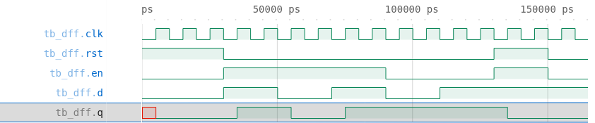
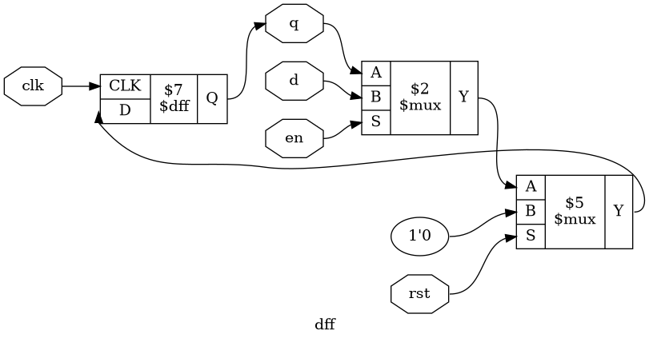

# Tutorial 1: D Flip-Flop

The D flip-flop is the basic storage element of synchronous logic, and every
FIFO and arbiter in later tutorials is built from it. This small design is also
a tour of the environment: you will simulate it, view its waveform, see the
logic it becomes, and prove that it works.

Set up the environment first, as described in the [main README](../../README.md).
Then run these commands in a VS Code terminal, from this directory:

```bash
cd tutorials/01-d-flip-flop
```

To run everything at once, use `make all`.

## The design

[`rtl/dff.v`](rtl/dff.v) stores one bit:

```verilog
always @(posedge clk) begin
    if (rst)
        q <= 1'b0;
    else if (en)
        q <= d;
end
```

On each rising edge of `clk`:

| `rst` | `en` | `q` becomes  | Why                                  |
| ----- | ---- | ------------ | ------------------------------------ |
| 1     | any  | 0            | Reset comes first in the `if`        |
| 0     | 1    | `d`          | Load a new value                     |
| 0     | 0    | `q`          | No assignment, so the value is held  |

Between clock edges `q` does not change, whatever `d` does. The reset is
*synchronous* because it only takes effect on a clock edge.

## Simulate

[`tb/tb_dff.v`](tb/tb_dff.v) is a self-checking testbench. It applies inputs
and compares `q` against the expected value.

```bash
make sim
```

The last lines should include `PASS`. Notice that the testbench changes inputs
on the *falling* edge of the clock. They are then stable at the rising edge, so
there is no doubt about which values the flip-flop samples.

## View the waveform

`make sim` also wrote `build/tb_dff.vcd`. To view it:

1. In the Explorer, click `build/tb_dff.vcd`. It opens in VaporView.
2. Open the VaporView icon in the Activity Bar on the left, and expand `tb_dff`.
3. Hover over each of `clk`, `rst`, `en`, `d` and `q`, and click its **+**
   button.



Check the table above against the trace:

- `q` is red at the start. This is `x`, the unknown value: no clock edge has
  loaded `q` yet. Real hardware would hold a 0 or a 1, but you cannot know which.
- `q` only changes just after a rising edge of `clk`, even though `d` changes on
  falling edges.
- While `en` is low, `q` ignores `d`.
- When `rst` and `en` are both high, `rst` wins.

## Lint

Verilator's `-Wall` reports suspicious code that a simulator accepts silently.

```bash
make lint
```

Any warning starts with `%Warning`. The lines that start with `- V e r i l a t i o n`
are a normal report.

## Simulate with Verilator

Verilator compiles the design to C++ instead of interpreting it, which makes it
much faster on large designs. The same testbench works unchanged.

```bash
make verilator
```

## Test in Python

Writing every case by hand stops scaling quickly.
[`tb/test_dff.py`](tb/test_dff.py) uses cocotb to apply 1000 random inputs and
compare `q` against a small Python model.

```bash
make cocotb
```

Look for `TESTS=1 PASS=1 FAIL=0`. The inputs are random, so each run exercises
different sequences.

## Prove it with formal verification

A simulation only checks the inputs you tried. The assertions in the
`` `ifdef FORMAL `` block of `rtl/dff.v` state the same rules as the table, and
the solver proves that they hold for *every* input sequence. Simulators and
synthesis skip this block because `FORMAL` is not defined for them.

```bash
make formal
```

Look for `successful proof by k-induction` and `DONE (PASS, rc=0)`.

## See the logic

```bash
make schematic
```

Click `build/dff.png` in the Explorer:



This is the table in hardware. The left multiplexer picks `d` when `en` is high
and otherwise feeds `q` back to itself, which is how a value is held. The right
multiplexer forces a 0 when `rst` is high. It sits closest to the flip-flop,
which is why reset wins.

## Map it to real FPGAs

```bash
make synth
```

| Family     | Cells                            |
| ---------- | -------------------------------- |
| Xilinx     | 1 `FDRE`                         |
| Gowin      | 1 `DFFRE`                        |
| Cyclone V  | 1 `MISTRAL_FF`, 1 `MISTRAL_ALUT2` |

Xilinx and Gowin flip-flops have built-in clock enable and synchronous reset
pins, so both multiplexers disappear into a single cell. On Cyclone V, Yosys
uses one lookup table for part of that logic. The same Verilog costs different
amounts on different devices. These are Yosys counts, so vendor tools can give
different results.

## Try it yourself

Tests are only useful if they fail when the design is wrong. Change one line of
`rtl/dff.v`, then run `make sim`, `make cocotb` and `make formal`:

1. Replace `else if (en)` with `else`, so the flip-flop no longer holds.
2. Replace `if (rst)` with `if (rst && !en)`, so `en` beats reset.
3. Reset `q` to `1'b1` instead of `1'b0`.

Each mistake is caught by all three. Undo each change before trying the next.
