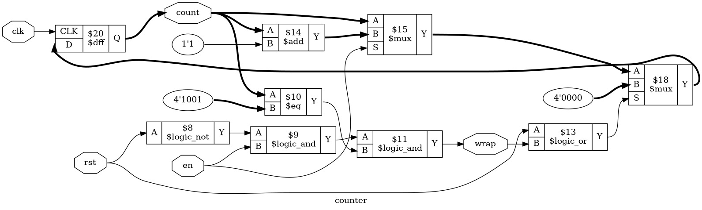

# Tutorial 2: Counter

A counter is the first design here that stores more than one bit. It is also
half of a FIFO: the read and write pointers are counters that wrap around at the
end of the memory. This tutorial builds one that counts from 0 to `MOD-1` and
then starts again, and you will use a parameter to make the same Verilog work
for any size.

Finish [Tutorial 1](../01-d-flip-flop/README.md) first, since this one uses the
same tools. Run these commands in a VS Code terminal, from this directory:

```bash
cd tutorials/02-counter
```

To run everything at once, use `make all`.

## The design

[`rtl/counter.v`](rtl/counter.v) has three new ideas in its first few lines:

```verilog
module counter #(
    parameter MOD = 10
) (
    ...
    output reg  [$clog2(MOD)-1:0] count,
    output wire                   wrap
);
```

- **`MOD` is a parameter.** It is a constant that you choose when you use the
  module, so one design can make counters of any size. `MOD` must be at least 2.
- **`count` is a vector.** `[3:0]` would be four bits, and `count` behaves like
  four of the flip-flops from Tutorial 1 that share a clock.
- **`$clog2` works out the width.** It is the base-2 logarithm, rounded up.
  `$clog2(10)` is 4, and four bits can hold the largest value, 9.

The counting itself is short:

```verilog
assign wrap = !rst && en && (count == LAST[$clog2(MOD)-1:0]);

always @(posedge clk) begin
    if (rst || wrap)
        count <= 0;
    else if (en)
        count <= count + 1'b1;
end
```

`LAST` is `MOD - 1`. It is 32 bits wide, like any integer, so the part-select
`[$clog2(MOD)-1:0]` keeps only the bits that `count` has. Without it the design
still simulates correctly, but `make lint` reports a `WIDTHEXPAND` warning.
Comparing different widths is a common source of bugs, so state the width on
purpose.

On each rising edge of `clk`:

| `rst` | `en` | `count`  | `count` becomes | `wrap` before the edge |
| ----- | ---- | -------- | --------------- | ---------------------- |
| 1     | any  | any      | 0               | 0                      |
| 0     | 0    | any      | `count`         | 0                      |
| 0     | 1    | `MOD-1`  | 0               | 1                      |
| 0     | 1    | other    | `count + 1`     | 0                      |

`wrap` is a `wire` set by `assign`, not a register. This is *combinational*
logic: it has no clock, and it follows its inputs straight away. It tells other
logic that the counter is about to return to 0.

## Simulate

[`tb/tb_counter.v`](tb/tb_counter.v) is self-checking, like the last testbench.
It counts through two full cycles, so it also checks what happens after a wrap,
and then tests hold and reset. The tricky cases are at the last value: `wrap`
must stay low while holding there, and during a reset.

```bash
make sim
```

The last lines should include `PASS`. The `step` task checks `wrap` before the
rising edge, because it is combinational, and checks `count` after it.

The testbench takes `MOD` as a parameter too, so the same checks work for any
size. The Makefile passes it in:

```bash
make sim MOD=16
make sim MOD=7
```

## View the waveform

Use a fresh simulation for this step. `make verilator` writes the same file, and
Verilator has no `x` value, so run `make sim` again if you have run anything
else since:

```bash
make sim
```

Then open `build/tb_counter.vcd` as in Tutorial 1, and add `clk`, `rst`, `en`,
`count` and `wrap` from `tb_counter`. Check the table against the trace:

- `count` is `x` until the first rising edge, at 5 ns, when reset clears it.
- `count` changes just after each rising edge, and steps from 9 to 0.
- `wrap` goes high when `count` reaches 9 and low one clock later. It changes
  on rising edges here only because that is when `count` changes.
- Near the end of the trace, at 340 ns, `count` is 9 and `en` falls. `wrap`
  drops at that moment, on a falling edge of `clk`. No register could do that.
  This is what combinational means.

## Lint

```bash
make lint
```

Any warning starts with `%Warning`. The lines that start with `- V e r i l a t i o n`
are a normal report. `MOD` changes the widths in the design, so check another
size as well:

```bash
make lint MOD=16
```

## Simulate with Verilator

```bash
make verilator
```

## Test in Python

[`tb/test_counter.py`](tb/test_counter.py) applies 5000 random inputs and
compares both outputs against a Python model.

```bash
make cocotb
make cocotb MOD=16
```

Look for `TESTS=1 PASS=1 FAIL=0`. A random test can pass simply because it never
reached the interesting case, so this one counts its wraps, logs the number, and
fails if there were none. Reset is kept rare for the same reason: with a reset
every few clocks, `count` would seldom get as far as `MOD-1`.

## Prove it with formal verification

```bash
make formal
```

[`counter.sby`](counter.sby) has two tasks, so this runs two proofs: `MOD=10` and
`MOD=16`. Look for `successful proof by k-induction` and `DONE (PASS, rc=0)` for
each of them.

The `` `ifdef FORMAL `` block in `rtl/counter.v` has something new, an
*assumption*:

```verilog
always @(posedge clk) begin
    if (!past_valid)
        assume (rst);
end
```

An `assert` is a claim for the solver to prove. An `assume` is a fact that it may
rely on. The solver begins from any state at all, including a `count` of 12 in a
counter that should stop at 9. Real designs have the same problem, since a
flip-flop powers up holding an unknown value, and that is what reset is for. This
line tells the solver that the design starts in reset.

Be careful with assumptions. An assertion that is wrong gets reported, but an
assumption that is wrong hides bugs without any message.

## See the logic

```bash
make schematic
```

Click `build/counter.png` in the Explorer:



The thick lines are vectors, carrying 4 bits instead of one. Follow `count` from
the flip-flop:

- `$add` makes `count + 1`, and the first `$mux` picks that when `en` is high.
- `$eq` compares `count` with `4'1001`, which is 9. With `en` and `!rst` this
  makes `wrap`. Notice that no clock reaches this path.
- The last `$mux` forces `4'0000` when `rst` or `wrap` is high. It sits closest
  to the flip-flop, which is why reset and wrap beat counting.

## Map it to real FPGAs

```bash
make synth
```

| Family     | Flip-flops      | Total cells |
| ---------- | --------------- | ----------- |
| Xilinx     | 4 `FDRE`        | 8           |
| Gowin      | 4 `DFFRE`       | 18          |
| Cyclone V  | 4 `MISTRAL_FF`  | 12          |

There are four flip-flops because `count` has four bits. Each family also uses
carry logic for the addition: `CARRY4`, `ALU` or `MISTRAL_ALUT_ARITH`.

Try `make synth MOD=16`. The totals stay the same, and the only change is that
Xilinx uses `LUT5` cells in place of `LUT6`. A 4-bit counter would overflow to 0
without help, but `wrap` is an output, so its comparison has to stay.

These are Yosys counts, so vendor tools can give different results.

## Try it yourself

Change `rtl/counter.v`, then run `make sim`, `make cocotb` and `make formal`.
Undo each change before trying the next.

1. Replace `LAST = MOD - 1` with `LAST = MOD - 2`, so the count stops one short.
2. Replace `!rst && en &&` with `!rst &&`, so `wrap` ignores `en`.
3. Replace `!rst && en &&` with `en &&`, so `wrap` can go high during reset.
4. Replace `else if (en)` with `else`, so the counter never holds.

Each mistake is caught by all three. The next two are more interesting.

**A bug that depends on the parameter.** Replace `if (rst || wrap)` with
`if (rst)`, so nothing returns `count` to 0. Run the checks:

```bash
make sim
make cocotb
make sim MOD=16
make cocotb MOD=16
make formal
```

`MOD=10` fails, but `MOD=16` passes everything, and `make formal` reports a pass
for `mod16` and a failure for `mod10`. At 16 the bug does no harm, because four
bits overflow from 15 to 0 by themselves. If you only ever tested powers of two,
you would never find it. Choose test values that can show the bug you are
looking for.

**An assumption that matters.** Replace `assume (rst);` with `assume (1);`, so
the solver no longer knows that the design starts in reset. `make sim` and
`make cocotb` still pass, since neither looks at the assumption, but the proof
for `mod10` fails. The solver has picked a starting `count` above 9, which the
design can never reach after a reset. `mod16` still passes because every 4-bit
value is legal there. The trace is in `build/formal_mod10/engine_0/trace.vcd` if
you want to open it.
