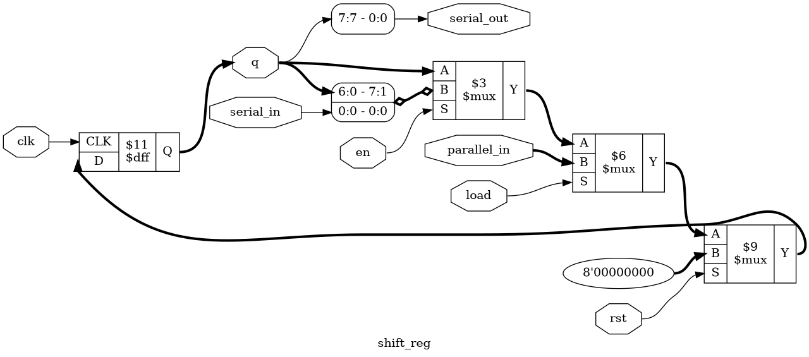
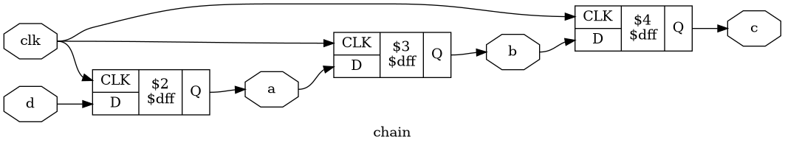
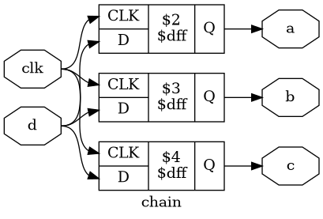

# Tutorial 3: Shift Register

A shift register moves bits along a row of flip-flops, one place per clock. It
turns a byte into a stream of single bits and back again, so it sits at both ends
of nearly every serial link. This tutorial builds one, sends a byte down a single
wire, and shows what goes wrong if you write clocked logic with `=` instead of
`<=`.

Finish [Tutorial 2](../02-counter/README.md) first, since this one uses its
vectors and parameters. Run these commands in a VS Code terminal, from this
directory:

```bash
cd tutorials/03-shift-register
```

To run everything at once, use `make all`.

## The design

[`rtl/shift_reg.v`](rtl/shift_reg.v) can reset, load all its bits at once, or
shift by one place:

```verilog
assign serial_out = q[WIDTH-1];

always @(posedge clk) begin
    if (rst)
        q <= 0;
    else if (load)
        q <= parallel_in;
    else if (en)
        q <= {q[WIDTH-2:0], serial_in};
end
```

The new part is the last line:

- **`q[WIDTH-2:0]` is a part-select.** It takes a range of bits. With `WIDTH=8`
  that is the lower seven bits, `q[6:0]`.
- **`{ , }` is a concatenation.** It joins its parts into one vector, with the
  first part at the top. `{q[6:0], serial_in}` is 7 + 1 = 8 bits, the same width
  as `q`.

So every bit moves up one place, `serial_in` fills the gap at `q[0]`, and the old
`q[7]` is gone, after being visible on `serial_out`. There is no addition here.
Shifting is only rewiring, and you will see that in the schematic.

The order of the `if` sets the priority, which is reset, then load, then shift.
On each rising edge of `clk`:

| `rst` | `load` | `en` | `q` becomes                  |
| ----- | ------ | ---- | ---------------------------- |
| 1     | any    | any  | 0                            |
| 0     | 1      | any  | `parallel_in`                |
| 0     | 0      | 1    | `{q[WIDTH-2:0], serial_in}`  |
| 0     | 0      | 0    | `q`                          |

`WIDTH` must be at least 2. At `WIDTH=1` the part-select would be `q[-1:0]`, and
the tools disagree about how bad that is. `make sim WIDTH=1` stops with
`error: part select q[-1:0] is out of order`, and `make lint WIDTH=1` reports
`SELRANGE`. Yosys only prints a warning and carries on, so don't rely on synthesis
to catch it.

## Serial and parallel

*Parallel* means one wire per bit: eight bits cross in one clock on eight wires.
*Serial* means one wire: eight bits cross in eight clocks. Serial is slower for
the same clock, but it needs far fewer wires, which is why links between chips
often use it.

A shift register does both. Load it in parallel and it sends serially from
`serial_out`. Feed `serial_in` and it collects the bits for you to read in
parallel from `q`. Put one at each end of a wire and you have a link, and this is
the basis of UART and SPI. Real links add more. SPI shares a clock between the two
ends and is usually sent MSB first, like this design. UART has no shared clock,
sends the LSB first, and marks each byte with start and stop bits.

## Simulate

[`tb/tb_shift_reg.v`](tb/tb_shift_reg.v) builds that link. A second `shift_reg`,
called `rx`, listens to `serial_out` of the first:

```verilog
shift_reg #(.WIDTH(WIDTH)) rx (
    ...
    .serial_in(serial_out), .serial_out(), .q(rx_q)
);
```

The testbench loads `01001001`, gives both registers eight clocks with `en` high,
and checks that `rx_q` ends up holding `01001001`. At the same time it shifts the
opposite bits into the sender. It then tests hold and each priority in the table.
The pattern is not symmetrical, so a design that reversed the bits could not pass
by luck.

```bash
make sim
```

The last lines should include `PASS`. Try other sizes, including the smallest and
an odd one:

```bash
make sim WIDTH=2
make sim WIDTH=5
```

## View the waveform

Use a fresh simulation for this step. `make verilator` writes the same file, and
Verilator has no `x` value, so run `make sim` again if you have run anything else
since:

```bash
make sim
```

Then open `build/tb_shift_reg.vcd` as in Tutorial 1, and add `clk`, `rst`,
`load`, `en`, `serial_out`, `q` and `rx_q` from `tb_shift_reg`. Set `q` and
`rx_q` to binary if they show in another format. Check the design against the
trace:

- `q` is `x` until the first rising edge, at 5 ns, when reset clears it.
- At 25 ns `q` becomes `01001001`, all at once. That is the parallel load.
- `en` is high for the eight rising edges from 35 ns to 105 ns. `serial_out` shows
  the top bit of `q` throughout, and `rx_q` fills from the right: `00000000`,
  `00000001`, `00000010`, `00000100`, `00001001`, `00010010`, `00100100`,
  `01001001`. It is complete at 105 ns.
- At 125 ns `load` and `en` are both high, and `q` takes `parallel_in` without
  shifting. `rx` has its `load` tied low, so it keeps shifting.
- At 145 ns `rst`, `load` and `en` are all high, and `q` goes to 0.

## Lint

```bash
make lint
```

No output except Verilator's report means no warnings. This also checks
`rtl/chain.v`, which appears below. Check the smallest size as well:

```bash
make lint WIDTH=2
```

## Simulate with Verilator

```bash
make verilator
```

This runs both testbenches and each should print `PASS`. Remember this command,
because it finds something that Icarus misses at the end of this tutorial.

## Test in Python

[`tb/test_shift_reg.py`](tb/test_shift_reg.py) applies 20000 random inputs and
compares `q` and `serial_out` against a Python model.

```bash
make cocotb
make cocotb WIDTH=16
```

Look for `TESTS=1 PASS=1 FAIL=0`. The test counts the cases that matter and fails
if any of them never happened. They are `rst_beat_load`, `load_beat_en`, and
`crossings`, which counts `WIDTH` shifts in a row with no load or reset, so a bit
really did go the whole way through. The log line has the numbers. Load is kept
rare for the same reason as reset in Tutorial 2. At `WIDTH=32` one run had only 8
crossings, so a much wider register would need gentler inputs.

## Prove it with formal verification

```bash
make formal
```

[`shift_reg.sby`](shift_reg.sby) proves `WIDTH=2` and `WIDTH=8`. Look for
`successful proof by k-induction` and `DONE (PASS, rc=0)` for each.

The assertions are the table again. Notice that this design has no
`assume (rst)`, unlike the counter. A counter with `MOD=10` has values it must
never reach, but every value of `q` is legal here, so the solver can start
anywhere and the rules still hold.

## See the logic

```bash
make schematic
```

Click `build/shift_reg.png` in the Explorer:



Start from the right, at the flip-flop's `D` input, and read backwards:

- The `$mux` closest to the flip-flop forces `8'00000000` when `rst` is high.
- The next `$mux` picks `parallel_in` when `load` is high.
- The last `$mux` picks between `q` and the shifted value, using `en`.

The rounded box in front of it is the concatenation. Its labels `6:0 - 7:1` and
`0:0 - 0:0` say that bits 6 to 0 of `q` go to bits 7 to 1, and `serial_in` goes to
bit 0. The box marked `7:7 - 0:0` picks out `serial_out`. Neither contains any
logic. They are only wires, which is why the shift itself costs nothing.

## Map it to real FPGAs

```bash
make synth
```

| Family     | Flip-flops      | Logic              | Total cells |
| ---------- | --------------- | ------------------ | ----------- |
| Xilinx     | 8 `FDRE`        | 8 `LUT5`           | 16          |
| Gowin      | 8 `DFFRE`       | 8 `LUT3`, 1 `LUT2` | 17          |
| Cyclone V  | 8 `MISTRAL_FF`  | 9 `MISTRAL_ALUT3`  | 17          |

There is one flip-flop per bit and no carry logic. The lookup tables choose
between loading and shifting. `make synth WIDTH=16` gives 32, 33 and 33 cells, so
the cost grows in step with the width.

These are Yosys counts, so vendor tools can give different results, and they say
nothing about timing.

## Blocking and nonblocking

Verilog has two assignments, and so far you have only used one in clocked logic:

- **`<=` is nonblocking.** All the right-hand sides are read first, and the
  left-hand sides change together at the end of the step.
- **`=` is blocking.** The left-hand side changes at once, so the next line sees
  the new value.

[`rtl/chain.v`](rtl/chain.v) shows why this matters. It is a shift register written
out as three separate registers:

```verilog
always @(posedge clk) begin
    a <= d;
    b <= a;
    c <= b;
end
```

Each line reads the old value of the stage before it, so a value takes one clock
per stage.

```bash
make chain
```

This prints the flip-flop count for Xilinx, then a single pulse on `d` walking
down the chain, and draws `build/chain.png`:

```text
        3 cells
        3   FDRE

clock 0: d=1 a=1 b=0 c=0
clock 1: d=0 a=0 b=1 c=0
clock 2: d=0 a=0 b=0 c=1
```



The rule is to use `<=` in anything clocked. The testbenches can use `=` because
they change inputs on the falling edge, when nothing is reading them.

## Try it yourself

Change `rtl/shift_reg.v`, then run `make sim`, `make cocotb` and `make formal`.
Undo each change before trying the next.

1. Replace `if (rst)` with `if (rst && !load)`, so load beats reset.
2. Replace `else if (load)` with `else if (load && !en)`, so shifting beats load.
3. Replace `{q[WIDTH-2:0], serial_in}` with `{serial_in, q[WIDTH-1:1]}`, so it
   shifts the wrong way.
4. Replace `else if (en)` with `else`, so the register never holds.
5. Replace `q[WIDTH-1]` in the `assign` with `q[0]`, so the wrong end comes out.

Each mistake is caught by all three. The rest are more interesting.

**A concatenation that is too wide.** Replace `{q[WIDTH-2:0], serial_in}` with
`{q[WIDTH-1:0], serial_in}`. That is 9 bits going into 8. `make sim`, `make cocotb`
and `make formal` all pass, because the extra bit falls off the top and the
behaviour is the same. Only Verilator objects: `make lint` reports `WIDTHTRUNC`,
and `make verilator` won't build. Nothing is broken today, but the code doesn't say
what its author meant.

**The chain collapses.** In `rtl/chain.v`, replace each `<=` with `=`. Run:

```bash
make chain
```

```text
        1 cells
        1   FDRE

clock 0: d=1 a=1 b=1 c=1
clock 1: d=0 a=0 b=0 c=0
```

`a` takes `d`, then `b` reads the new `a`, then `c` reads the new `b`. The pulse
reaches all three in one clock, the testbench ends with `FAIL: 3 errors`, and three
stages have become one flip-flop. `make verilator` gives the same result, so the
two simulators agree this time. `build/chain.png` shows why:



All three flip-flops now take their `D` from `d`, and synthesis merges them into
the one you saw counted. Now see which tools warned you:

```bash
verilator --lint-only rtl/chain.v
make lint
```

The first command prints no warning, and neither did `make verilator`. The second
reports `BLKSEQ` on each line: `Blocking assignment '=' in sequential logic
process`. This warning needs `-Wall`.

**The same mistake that works.** Keep the `=`, and reverse the three lines so that
`c = b;` comes first and `a = d;` last. `make chain` prints `PASS` and 3 `FDRE`
again, and the schematic looks like the correct one. Each line now reads its value
before anything overwrites it. Correct code would not depend on the order of its
lines, and `make lint` still reports `BLKSEQ`.

**Three tools, three answers.** Replace the whole `always` block in `rtl/chain.v`
with three, keeping `=`:

```verilog
always @(posedge clk) a = d;
always @(posedge clk) b = a;
always @(posedge clk) c = b;
```

All three blocks wake on the same edge, and Verilog does not define which runs
first. This is a *race*.

| Tool                    | What happens to the pulse                         |
| ----------------------- | ------------------------------------------------- |
| `make chain` (Icarus)   | `a=1 b=0 c=0`, then it vanishes and never reaches `c` |
| `make verilator`        | `a=1 b=1 c=1` in one clock, as if it had collapsed |
| Yosys                   | 3 `FDRE` and the correct schematic                |

The simulators fail in different ways, and Yosys built the correct chain. Those
are the results with the tools in this environment, and another version could
order the blocks differently. Neither simulation matches what was built, and
that is the real danger of `=` in clocked logic.

**One `=` that only one tool notices.** Undo the changes to `rtl/chain.v`. In
`rtl/shift_reg.v`, change only the shift line to
`q = {q[WIDTH-2:0], serial_in};`. There is just one register and one assignment,
so it looks harmless. Run everything:

```bash
make sim
make cocotb
make formal
make schematic
make verilator
make lint
```

`make sim`, `make cocotb` and `make formal` all pass, and the schematic has the same
structure as before. Then `make verilator` fails, with
`FAIL t=110000 rx_q=10010011 expected=01001001`. `rx_q` is one place ahead, because
in Verilator's run `serial_out` changed before `rx` sampled it, so `rx` got the next
bit a clock early. It is the same race, now between two instances. cocotb has no
`rx`, and formal works on the same logic as `<=`, so neither can see it. Only the
testbench with a neighbour exposes it, and only under one of the two simulators.
`make lint` is the one check that points at the line: `BLKSEQ` again.

Keep `-Wall` lint in your routine. Tests only caught this by luck.
