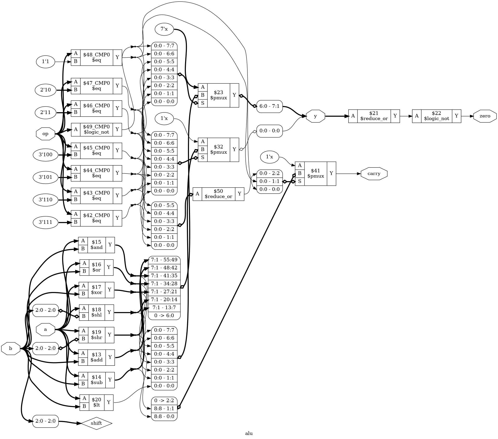
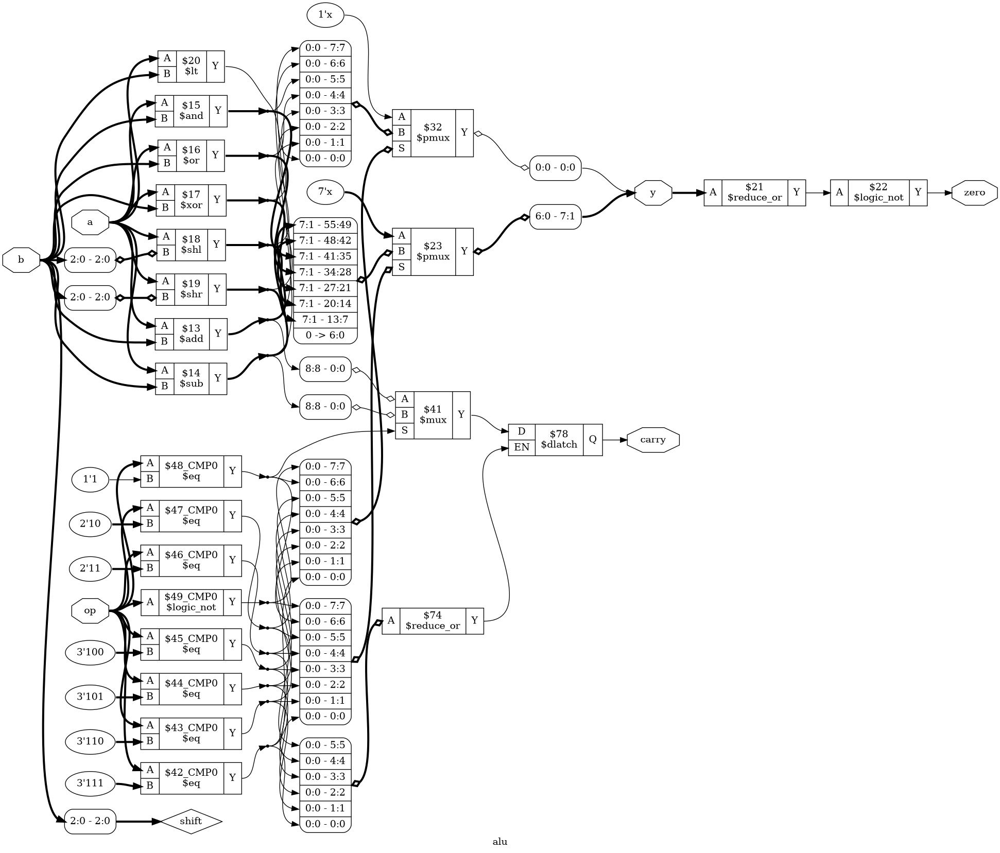

# Tutorial 4: ALU

An arithmetic logic unit is the part of a processor that does the sums. It takes
two numbers and an operation code, and produces a result. This one matters here
for a different reason: it is the first design in these tutorials with no clock.
Everything so far stored something. This design must store nothing, and you will
see how one missing line makes it store something anyway.

Finish [Tutorial 3](../03-shift-register/README.md) first. Run these commands in
a VS Code terminal, from this directory:

```bash
cd tutorials/04-alu
```

To run everything at once, use `make all`.

## The design

[`rtl/alu.v`](rtl/alu.v) has inputs `a`, `b` and `op`, and outputs `y`, `carry`
and `zero`:

| `op` | Name   | `y`                               | `carry`             |
| ---- | ------ | --------------------------------- | ------------------- |
| 0    | `ADD`  | `a + b`                           | Carry out           |
| 1    | `SUB`  | `a - b`                           | Borrow, high if `a < b` unsigned |
| 2    | `AND`  | `a & b`                           | 0                   |
| 3    | `OR`   | `a \| b`                          | 0                   |
| 4    | `XOR`  | `a ^ b`                           | 0                   |
| 5    | `SHL`  | `a` shifted left, zeros come in   | 0                   |
| 6    | `SHR`  | `a` shifted right, zeros come in  | 0                   |
| 7    | `SLT`  | 1 if `a < b` as signed numbers    | 0                   |

Shifts use only the low bits of `b`: 3 bits when `WIDTH` is 8, which is enough
to count from 0 to 7. `WIDTH` must be at least 2. `zero` is high when `y` is 0.

The heart of it is a new kind of `always` block:

```verilog
always @(*) begin
    y     = {WIDTH{1'b0}};
    carry = 1'b0;

    case (op)
        OP_ADD: {carry, y} = {1'b0, a} + {1'b0, b};
        OP_SUB: {carry, y} = {1'b0, a} - {1'b0, b};
        OP_AND: y = a & b;
        ...
        OP_SLT: y[0] = $signed(a) < $signed(b);
    endcase
end
```

- **`always @(*)` describes combinational logic.** There is no clock edge. The
  block runs again whenever anything it reads changes. It uses blocking `=`, not
  the `<=` of clocked blocks, so the lines take effect in order, top to bottom.
- **`case` picks one branch.** It compares `op` with each label in turn.
- **`{carry, y}` catches the carry.** Adding two 8-bit numbers can give a 9-bit
  answer, and an 8-bit `y` has nowhere to put the top bit. The concatenation
  makes a 9-bit target, and `{1'b0, a}` makes each operand 9 bits to match.
  `{carry, y} = a + b;` happens to work too, since Verilog widens `a + b` to
  suit the target, but the rule depends on context, so state the width on purpose.
- **Subtraction uses the same top bit.** It goes high when the answer wraps
  below 0, so here `carry` means *borrow*.
- **`$signed` changes how the bits are read.** As unsigned numbers, `4'b1111` is
  15. As signed numbers it is -1, which is less than 0.

`zero` is one line, outside the block:

```verilog
assign zero = ~|y;
```

`|y` is a *reduction operator*. With one operand, it ORs all the bits of `y`
together into a single bit, which is high if any bit is set. `~` inverts that.
`&y` and `^y` work the same way.

### Default assignments and latches

The two lines before the `case` are *default assignments*. They look redundant,
but they are the most important lines in the file.

In combinational logic every output must have a value on every path through the
block. Suppose `carry = 1'b0;` is missing. When `op` is `AND`, nothing assigns
`carry`, so Verilog says that it keeps its old value. Keeping a value means
storing it, and no combination of gates can do that alone. So the tools build a
*latch*: a storage element, with no clock, that follows its input while enabled
and holds while not. You asked for logic and got memory, and `carry` now depends
on the *previous* operation.

With the default in place, every path assigns `carry`, and the later assignment
wins when there is one. `y` needs the same for `SLT`, which sets only bit 0 and
relies on the default for the rest.

You will build this latch on purpose at the end of the tutorial.

## Simulate

The design has no clock, but [`tb/tb_alu.v`](tb/tb_alu.v) still has one:

```verilog
always #5 clk = ~clk;
```

It drives the same way as the earlier testbenches: a new input after each
falling edge, and a check 1 ns later. This clock is not connected to the ALU. It
only paces the test and gives the waveform a time scale.

```bash
make sim
```

Look for `PASS: 2048 input combinations`. With `WIDTH=4` there are 16 values of
`a`, 16 of `b` and 8 of `op`, and the testbench tries every combination. For
combinational logic that feels like complete proof. Keep that thought for the end
of the tutorial.

The testbench has its own parameter, `SIM_WIDTH`, because the count grows quickly:

```bash
make sim SIM_WIDTH=8
```

That is `PASS: 524288 input combinations`, in about 2 seconds here, with a 67 MB
VCD. Every extra bit multiplies the work by 4, and 32 bits is out of reach.

Notice that `a`, `b` and `op` have no starting value in the testbench. That is
deliberate. `always @(*)` only runs when something it reads *changes*. If they
start at 0 and the first test also uses 0, nothing changes, the block never runs,
and `y` stays `x`. Try `reg [WIDTH-1:0] a = 0;`, and the same for `b` and `op`,
and the first check fails with `y=x`.

## View the waveform

Use a fresh simulation for this step. `make verilator` writes the same file, and
Verilator has no `x` value, so run `make sim` again if you have run anything
else since:

```bash
make sim
```

Then open `build/tb_alu.vcd` as in Tutorial 1, and add `clk`, `a`, `b`, `op`, `y`,
`carry` and `zero` from `tb_alu`. Check the table against the trace:

- Everything except `clk` is `x` until 10 ns, when the first inputs arrive.
  `y` has no flip-flop to reset. It is unknown because its inputs are.
- `y` changes at the same instant as `a` and `b`, on falling edges of `clk`. At
  20 ns `b` goes to 1, and so does `y`.
- Nothing at all happens on rising edges. Compare this with `count` in
  [Tutorial 2](../02-counter/README.md), which moved just after each one.
- At 320 ns `a` is 1 and `b` is 15. `y` is 0, and both `carry` and `zero` are
  high: the sum is 16, which takes a fifth bit, so the low four bits are all 0.

## Lint

```bash
make lint
```

No `%Warning` lines means no warnings. `WIDTH` changes the widths in the design,
so check other sizes as well:

```bash
make lint WIDTH=4
make lint WIDTH=32
```

## Simulate with Verilator

```bash
make verilator
```

## Test in Python

[`tb/test_alu.py`](tb/test_alu.py) takes over where trying every input stops
being possible. It applies 5000 random inputs and compares all three outputs
against a Python model, at any width.

```bash
make cocotb
make cocotb WIDTH=32
```

Look for `TESTS=1 PASS=1 FAIL=0`. There is no clock here at all, not even one for
pacing: the test waits 1 ns for the logic to settle and then checks.

Random numbers rarely hit the interesting cases at 32 bits, since two random
values are almost never equal. So `pick()` often forces `b` to equal `a`, or uses
0, all ones or a lone top bit. The test also counts carries, borrows, zero
results, true `SLT` results and `SLT` with mixed signs. It logs the counts, like
`WIDTH=32 {'carry': 284, ...}`, and fails if any of them is 0.

## Prove it with formal verification

```bash
make formal
```

[`alu.sby`](alu.sby) has two tasks, `WIDTH=8` and `WIDTH=32`. Look for
`successful proof by k-induction` and `DONE (PASS, rc=0)` for each of them.

At 32 bits there are 2<sup>67</sup> input combinations, so no simulation could
try them all, yet the proof takes less than a second. The solver reasons about
the logic instead of trying values. A wide adder is no trouble for it: with
`WIDTH` changed to 256 in `alu.sby`, the proof took under 2 seconds here.

There is no `$past` and no `past_valid` this time. The assertions sit in an
`always @(*)` block, because each one is about the present values alone:

```verilog
3'd0: begin
    assert (y == a + b);
    assert (carry == (y < a));
end
```

The second line says that a carry happened exactly when the 8-bit sum came out
smaller than `a`. That is a different way of saying what the design does, and the
solver has to show that the two agree. The block also uses the numbers `3'd0` to
`3'd7` rather than the `OP_` names, and takes the shift amount directly from `b`.
A check that shares a name or a wire with the design shares its mistakes too.

The `.sby` file sets `depth 1`. With no state, one step is the same as any other,
so there is nothing to gain by looking further ahead.

## See the logic

```bash
make schematic
```

Click `build/alu.png` in the Explorer:



There are no flip-flops. At the bottom left, `a` and `b` feed eight blocks that
all run at the same time: `$add`, `$sub`, `$and`, `$or`, `$xor`, `$shl`, `$shr`
and `$lt`. Hardware does not choose which sum to do. It does all of them, and
then throws seven answers away.

- At the top left, `$eq` blocks compare `op` with each value (`$logic_not` is the
  test for 0), and the small boxes
  next to them gather those results.
- The `$pmux` blocks are multiplexers with many inputs. Those results pick which
  answer goes through. There are two for `y`, split at bit 0 because `SLT` treats
  that bit differently, and one for `carry`.
- The `7'x` and `1'x` inputs are what a `$pmux` gives when nothing is selected.
  All eight values of `op` have a branch, so that never happens.
- At the top right, `$reduce_or` and `$logic_not` are `~|y`, making `zero`.

## Map it to real FPGAs

```bash
make synth
```

| Family     | Flip-flops | Carry cells               | Total cells |
| ---------- | ---------- | ------------------------- | ----------- |
| Xilinx     | 0          | 7 `CARRY4`                | 97          |
| Gowin      | 0          | 17 `ALU`                  | 482         |
| Cyclone V  | 0          | 19 `MISTRAL_ALUT_ARITH`   | 92          |

There are no flip-flops, which is what a purely combinational design should give.
Most of the rest is lookup tables, and Gowin's total includes 196 multiplexer
cells, `MUX2_LUT5` to `MUX2_LUT8`.

These are Yosys counts at `WIDTH=8`, so vendor tools can give different results,
and they say nothing about timing.

## Try it yourself

Change `rtl/alu.v`, then run `make sim`, `make cocotb` and `make formal`. Undo
each change before trying the next.

1. Swap the operands of `OP_SUB`, so it computes `b - a`.
2. Replace `$signed(a) < $signed(b)` with `a < b`, so `SLT` is unsigned.
3. Replace `~|y` with `|y`, so `zero` is inverted.
4. Replace the `OP_ADD` line with `OP_ADD: y = a + b;`, so the carry is lost.

Each mistake is caught by all three.

**A bug that hides at a small width.** Replace the `shift` line with
`wire [1:0] shift = b[1:0];`. `make sim` tries every input and passes, because
two bits are correct at `WIDTH=4`. `make cocotb` and `make formal` run at 8 bits
and fail. `make sim` is only exhaustive at the width it runs.

**The latch.** Now the main event. Delete the line `carry = 1'b0;` and run:

```bash
make sim
```

`PASS: 2048 input combinations`. Every input was tried and every answer was
right, on a design that contains a storage element. Even `make sim SIM_WIDTH=8`
passes. Now run the other tools:

```bash
make lint
make schematic
make synth
make cocotb
make formal
```

`make lint` stops the build, and `make verilator` does too:

```text
%Warning-LATCH: rtl/alu.v:24:5: Latch inferred for signal 'carry' (not all control paths of combinational always assign a value)
```

`make schematic` prints Yosys's version of the same message:

```text
Warning: Latch inferred for signal `\alu.\carry' from process ...
```

Open `build/alu.png`, and there it is at the right, between the logic and `carry`:



The `$pmux` for `carry` has become a `$mux` choosing between the add and subtract
results, feeding `D` of a `$dlatch`. The `$reduce_or` drives `EN`. It is high for
the six operations that do not assign `carry`. The latch holds while `EN` is high,
although the picture does not show that: it uses an active-low enable, which you
can only see in the cell's `EN_POLARITY` parameter.

`make synth` shows that the families do not agree on what to do about it. Xilinx
builds one `LDCE` and Gowin one `DLN`, each with only a warning. Cyclone V stops
with `ERROR: Latch inferred`, so there is no table this time. The two counts that
finished are in `build/stat-xilinx.txt` and `build/stat-gowin.txt`.

`make cocotb` fails, as does `make formal`. The proof's trace, in
`build/formal_w8/engine_0/trace.vcd`, needs one step: `op` is 6, and the solver
has started the latch holding 1, so `carry` is high during a shift.

So why did the exhaustive test pass? It runs through the operations in order. The
last `SUB` it tries is 15 - 15, which sets `carry` to 0. The latch then holds that
0 through all six remaining operations, and 0 is the right answer for all of them.
The test only sees a stale 0.

The test tried every *input*, but a latch makes the output depend on the input
*and* what came before. The checks in `tb_alu.v` assumed that the design has no
state, and that is exactly what the bug broke. To see this, change the order of
the loops, so that `op` changes fastest:

```verilog
for (ia = 0; ia < RANGE; ia = ia + 1)
    for (ib = 0; ib < RANGE; ib = ib + 1)
        for (iop = 0; iop < 8; iop = iop + 1)
            step;
```

Those are the same 2048 inputs in a different order, and now there are 720 errors.
The first is an `AND` straight after a `SUB` that borrowed. The fixed design still
passes this order. Put the original loops back when you are done.

**A latch that lint misses.** Restore `carry = 1'b0;` and delete the
`y = {WIDTH{1'b0}};` line instead. `make lint` gives no warning and `make sim` still
passes. Every branch assigns something to `y`, which appears to be enough for
Verilator, even though `SLT` only assigns bit 0. `make schematic` is the tool that
notices, with `Latch inferred` for `` \alu.\y [7:1] ``, a latch on just the upper
seven bits. `make cocotb` and `make formal` both fail. Lint is a good check, but
passing it does not prove there is no latch.

**A `default:` that does nothing.** With `carry = 1'b0;` still deleted, you might
try adding `default: carry = 1'b0;` to the `case`. The latch stays, and so does
the warning. All eight values of `op` have their own branch, so `default:` never
runs. It does not reach the branches that forget to assign `carry`. A default
assignment before the `case` does.

**The classic case.** Restore `carry = 1'b0;`, then delete the `y` default and the
whole `OP_SLT` line. Now no
branch handles `op` 7. Verilator reports `CASEINCOMPLETE` as well as `LATCH`, and
this time `make sim` fails, with 136 errors.
