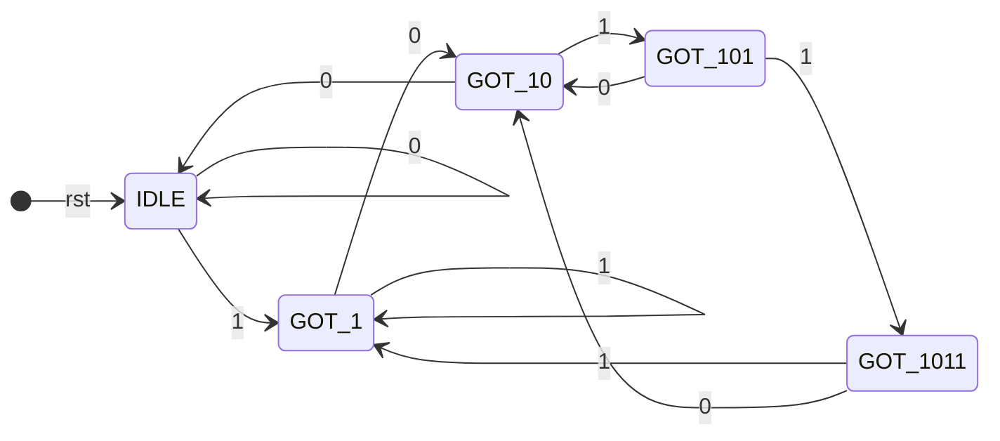
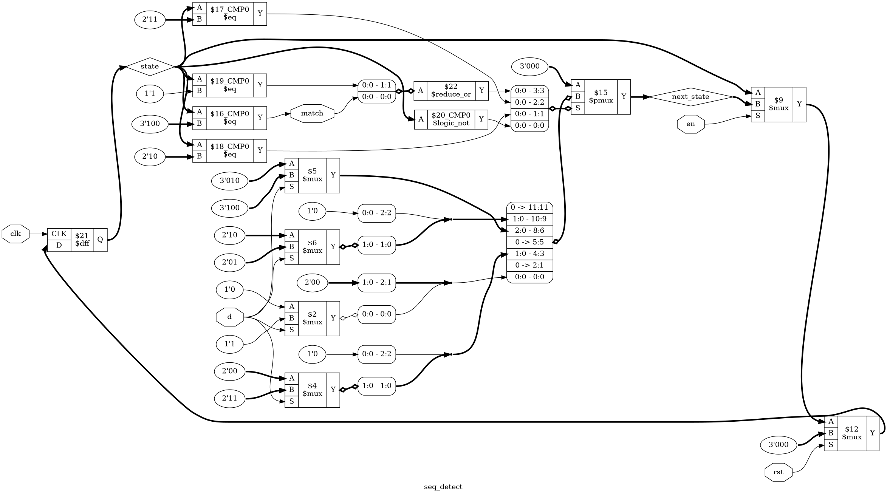

# Tutorial 5: Sequence Detector

Up to now, a design's next value has followed from a simple rule. A serial
protocol, a bus controller or an arbiter has to remember *where it is* in a
sequence of steps, and the usual way to build that is a finite state machine, or
FSM. This tutorial builds one that watches a serial input for the pattern `1011`.

It also teaches a new formal tool, `cover`, which checks that a proof is actually
about something.

Finish [Tutorial 2](../02-counter/README.md) first, and read
[Tutorial 4](../04-alu/README.md) for combinational `always @(*)` blocks. Run
these commands in a VS Code terminal, from this directory:

```bash
cd tutorials/05-sequence-detector
```

To run everything at once, use `make all`.

## The design

The states of [`rtl/seq_detect.v`](rtl/seq_detect.v) record how much of the
pattern has been seen:



Each arrow is labelled with the value of `d`. If your Markdown viewer does not
draw the diagram, this table holds the same information:

| State      | Seen so far  | Next if `d` = 0 | Next if `d` = 1 | `match` |
| ---------- | ------------ | --------------- | --------------- | ------- |
| `IDLE`     | nothing      | `IDLE`          | `GOT_1`         | 0       |
| `GOT_1`    | `1`          | `GOT_10`        | `GOT_1`         | 0       |
| `GOT_10`   | `10`         | `IDLE`          | `GOT_101`       | 0       |
| `GOT_101`  | `101`        | `GOT_10`        | `GOT_1011`      | 0       |
| `GOT_1011` | `1011`       | `GOT_10`        | `GOT_1`         | 1       |

The interesting rows are the ones that do not go back to `IDLE`. In `GOT_1`,
another 1 still counts as the first bit of a pattern. In `GOT_1011`, the last 1
of this match can be the first bit of the next one, so `1011011` gives two
matches. This is called *overlap*.

The states have names instead of bare numbers:

```verilog
localparam [2:0] IDLE     = 3'd0;
localparam [2:0] GOT_1    = 3'd1;
...
```

A `localparam` is a constant that cannot be overridden from outside the module.
With five states, `state` needs three bits.

The design then splits into two pieces. The *next-state logic* is combinational,
in the style of [Tutorial 4](../04-alu/README.md), and only answers the question
"where would we go?":

```verilog
always @(*) begin
    case (state)
        IDLE:     next_state = d ? GOT_1    : IDLE;
        ...
        GOT_1011: next_state = d ? GOT_1    : GOT_10;
        default:  next_state = IDLE;
    endcase
end
```

The *state register* is the flip-flop from
[Tutorial 1](../01-d-flip-flop/README.md), three bits wide:

```verilog
always @(posedge clk) begin
    if (rst)
        state <= IDLE;
    else if (en)
        state <= next_state;
end

assign match = (state == GOT_1011);
```

Keeping them apart means that the transitions can be read as a table, and that
the reset and enable rules are in one place.

Three bits have eight codes and only five are used. No input sequence can reach
codes 5 to 7, but `default` says what to do if something else puts the design
there, such as a bad power-up value. It also gives `next_state` a value on every
path, so there is no inferred latch.

## Moore and Mealy

`match` depends on `state` alone. This is a *Moore* output, and it changes only
after a clock edge, however much `d` moves in between.

The alternative is a *Mealy* output, which looks at the inputs as well:

```verilog
assign match = !rst && en && d && (state == GOT_101);
```

`GOT_1011` is no longer needed, so a Mealy version has four states, and `match`
goes high one clock earlier, before the last bit has been clocked in. The price
is that `d` now has a combinational path to `match`, which is the behaviour you
saw on `wrap` in [Tutorial 2](../02-counter/README.md). This lesson uses Moore.
Our tests are written for Moore too, so the Mealy version fails them.

## Simulate

[`tb/tb_seq_detect.v`](tb/tb_seq_detect.v) sends bit patterns, and gives the
expected `match` for each bit. In this line, each bit of the second number is the
value of `match` after the bit in the same position of the first:

```verilog
send(7, 16'b1011011, 16'b0001001);
```

```bash
make sim
```

The testbench prints a heading for each group of tests, and the last lines should
include `PASS`. The `step` task also checks that `match` has not moved in the 1 ns
after the inputs change, since a Moore output cannot react before the clock.

## View the waveform

Use a fresh simulation for this step. `make verilator` writes the same file, and
Verilator has no `x` value, so run `make sim` again if you have run anything
else since:

```bash
make sim
```

Open `build/tb_seq_detect.vcd` as in Tutorial 1. Add `clk`, `rst`, `en`, `d` and
`match` from `tb_seq_detect`, and `state` and `next_state` from `dut`. Watch the
first pattern, `1011`:

- `state` and `match` are `x` until the first rising edge, at 5 ns.
- `next_state` changes as soon as `d` does. At 40 ns, on a falling edge, `d` rises
  and `next_state` moves from 0 to 3 while `state` stays at 2.
- `state` changes only on rising edges. It takes that 3 at 45 ns.
- `match` goes high at 55 ns, the rising edge that takes the last 1. At 60 ns `d`
  falls, and `match` does not react. It falls on the rising edge at 65 ns. This
  is a Moore output.

## Lint

```bash
make lint
```

Any warning starts with `%Warning`. The lines that start with `- V e r i l a t i o n`
are a normal report.

## Simulate with Verilator

```bash
make verilator
```

## Test in Python

[`tb/test_seq_detect.py`](tb/test_seq_detect.py) has two tests.

The first applies 5000 random inputs. Its model has no states at all: it keeps a
list of the bits taken and compares the last four with `1011`. That is the point.
A model copied from the state table could share a mistake with it, while this one
gets the answer a different way.

```bash
make cocotb
```

Look for `TESTS=2 PASS=2 FAIL=0`. As in Tutorial 2, the test counts what it saw
and fails if it never happened. It logs a line like
`saw 219 matches, 22 of them overlapping`, and the numbers change on each run.

The second test checks `default`. No input can reach codes 5 to 7, so it writes
each one straight into `dut.state`, and checks that the next enabled clock goes to
`IDLE`.

## Prove it with formal verification

The `` `ifdef FORMAL `` block in `rtl/seq_detect.v` uses the same trick as the
Python model. It keeps a shift register of the bits taken, and asserts that the
FSM agrees with it:

```verilog
assert (match == (history[3:0] == 4'b1011));
assert (state == expected_state);
```

```bash
make formal
```

[`seq_detect.sby`](seq_detect.sby) has two tasks, `prove` and `cover`. Look for
`successful proof by k-induction`, and for `DONE (PASS, rc=0)` from each of them.

The first assertion is the one we care about. The second is a *helper*, and it is
there because of how induction works. The base case starts from reset, but the
induction step starts from any values at all that pass the assertions so far,
including ones that no reset can lead to. Without the helper, the proof ends in
`DONE (UNKNOWN, rc=4)`. The base case passes and the induction step fails. In
`build/formal_prove/engine_0/trace_induct.vcd` the solver sits in unused code
`101` with a `history` of `0001101`, takes a 1, and lands in `IDLE` with `history`
ending in `1011`. The design can never get there. The helper rules such states
out by tying `state` to `history`.

## Cover: is the proof about anything?

An `assert` says that something bad never happens. If nothing happens at all,
that is trivially true. An assumption that is too strong can leave the solver
with no interesting behaviour to check, and the proof passes while saying nothing.
This is a *vacuous* proof, and it looks exactly like a good one.

A `cover` asks the opposite question: can this ever happen? The solver has to
find a real trace that gets there, starting from reset and obeying every
assumption. In `mode cover`, `sby` fails if it cannot.

```verilog
cover (match);
cover (match && history == 7'b1011011);
```

The `cover` task gives the solver 20 steps. Its output includes
`Reached cover statement in step 5` and `in step 8`, and each one writes a trace.
The second is `build/formal_cover/engine_0/trace1.vcd`, and it is the shortest
way to two overlapping matches:

| Step | `rst` | `en` | `d` | `state` before the next edge | `match` |
| ---- | ----- | ---- | --- | ---------------------------- | ------- |
| 0    | 1     | 0    | 0   | `IDLE`                       | 0       |
| 1    | 0     | 1    | 1   | `IDLE`                       | 0       |
| 2    | 0     | 1    | 0   | `GOT_1`                      | 0       |
| 3    | 0     | 1    | 1   | `GOT_10`                     | 0       |
| 4    | 0     | 1    | 1   | `GOT_101`                    | 0       |
| 5    | 0     | 1    | 0   | `GOT_1011`                   | 1       |
| 6    | 0     | 1    | 1   | `GOT_10`                     | 0       |
| 7    | 0     | 1    | 1   | `GOT_101`                    | 0       |
| 8    | 0     | 0    | 0   | `GOT_1011`                   | 1       |

Nobody wrote this test. The solver worked out `1011011` for itself, and that is
worth seeing: `cover` is also a quick way to get a working example out of a design.

`assert` and `cover` do different jobs, and you want both. The exercises below
show what each one misses.

## See the logic

```bash
make schematic
```

Click `build/seq_detect.png` in the Explorer:



The two pieces of the design are easy to find. Start at the `$dff` on the left,
whose output is `state`:

- The column of `$eq` cells and the `$logic_not` decode `state`, one for each
  state. `$logic_not` is the test for `IDLE`, since that code is 0.
- `$15 $pmux` is the `case`. The decoded states select one of its inputs, and the
  `3'000` on its `A` input is `default`.
- The `$mux` cells to its left, with `d` on their `S` inputs, are the `d ? x : y`
  expressions.
- The output of the `$pmux` is `next_state`. It then goes through a `$mux` for
  `en` and a last `$mux` for `rst`, so reset sits closest to the flip-flop, as in
  Tutorial 1. Together those make up the state register.
- `$16` compares `state` with `3'100` to make `match`. Only `state` reaches it.

## Map it to real FPGAs

The schematic shows `state` as three bits, but that is not what gets built.
Yosys recognises FSMs and can change how the states are encoded:

```bash
make fsm
```

```text
Recoding FSM `$fsm$\state$27' from module `\seq_detect' using `auto' encoding:
  mapping auto encoding to `one-hot` for this FSM.
  000 -> ----1
  100 -> ---1-
  010 -> --1--
  001 -> -1---
  011 -> 1----
```

*One-hot* gives each state its own flip-flop, so exactly one is high at a time.
The table printed below this has five states and no `default`: the unused codes
are gone, because they are unreachable.

You can opt out with an attribute on the register, which leaves the three bits as
written. The first column below is the design as it stands, and the second is
`make synth` after adding this:

```verilog
(* fsm_encoding = "none" *) reg [2:0] state;
```

```bash
make synth
```

| Family     | One-hot, as written      | With `fsm_encoding = "none"` |
| ---------- | ------------------------ | ---------------------------- |
| Xilinx     | 5 `FDRE`, 11 cells       | 3 `FDRE`, 7 cells            |
| Gowin      | 5 `DFF`, 37 cells        | 3 `DFFRE`, 7 cells           |
| Cyclone V  | 5 `MISTRAL_FF`, 11 cells | 3 `MISTRAL_FF`, 8 cells      |

These are Yosys counts, so vendor tools can give different results, and they say
nothing about timing. They do show that the encoding is a real choice. Do not
assume that one-hot is smaller.

The recoding has another effect. We wrote the netlist from Yosys's `fsm` pass to a
file, and tried every 5-bit value in `state`, followed by the bits
`0000101100001011`. Most bad values recovered and found both matches, but `00000`
stayed at `00000` for all 16 bits and found none: no flip-flop is hot, so nothing
wakes the machine up. With `fsm_encoding = "none"`, all eight 3-bit codes found
both matches.

So the `default` that the cocotb test checks is a property of the Verilog. It was
not kept in the one-hot netlist, and a test of the RTL cannot tell you that. If
recovery from a bad state matters, check what the tools actually built.

## Try it yourself

Change `rtl/seq_detect.v`, then run `make sim`, `make cocotb` and `make formal`.
Undo each change before trying the next.

1. In the state register, replace `else if (en)` with `else`, so `en` is ignored.
   The formal block has the same line, so change the first one only.
2. Replace `state <= IDLE;` with `state <= GOT_1;`, so reset starts part-way
   through a pattern.
3. Replace `(state == GOT_1011)` with `(state == GOT_101)`, so `match` is early.

Each mistake is caught by all three. The next ones are more interesting.

**A bug that a simple test misses.** Change the `GOT_1011` line to
`GOT_1011: next_state = IDLE;`, so the FSM starts again after each match. Run
`make sim`:

```text
-- separated patterns
-- near misses
-- patterns that overlap or restart
FAIL t=410000 rst=0 en=1 d=1 match=0 expected=1
FAIL t=530000 rst=0 en=1 d=1 match=0 expected=1
-- hold and reset
```

Every separated `1011` still matches. A testbench that sent only clean patterns
with gaps between them would pass this design. `make cocotb` and the `prove` task
catch it without being told about overlap, because they compare against a history
of the bits. Notice that the `cover` task still passes. It finds another way to
get `1011011` into `history`, at step 11 instead of step 8. A reached cover shows
that something can happen, not that the design is right.

**A proof of nothing.** Keep that bug, and replace `if (!past_valid)` with
`if (1)`, so `assume (rst);` applies on every clock. The design now stays in reset
for ever, as far as the solver is concerned. Run `make formal`.

The `prove` task reports `successful proof by k-induction` and
`DONE (PASS, rc=0)` on a design you know is broken. Every assertion holds, because
`state` never leaves `IDLE`. Only the `cover` task complains:
`Unreached cover statement`, then `DONE (FAIL, rc=2)`. Without it, this would look
like a clean run.

**Something a proof cannot see.** Replace `default:  next_state = IDLE;` with
`default:  next_state = GOT_1011;`. `make sim` and `make formal` both pass, since
codes 5 to 7 are unreachable and no check of reachable behaviour goes there. Only
`make cocotb` fails, with `code 5 with d=0 did not go to IDLE`, because that test
writes the code directly. To see why formal is blind here, undo that change and
add `cover (state == 3'd7);` next to the other covers. The `cover` task fails with
`Unreached cover statement`: an assertion about those states could only ever be
vacuous. Formal proves what happens from reset. It says nothing about what happens
when the state is corrupted.
