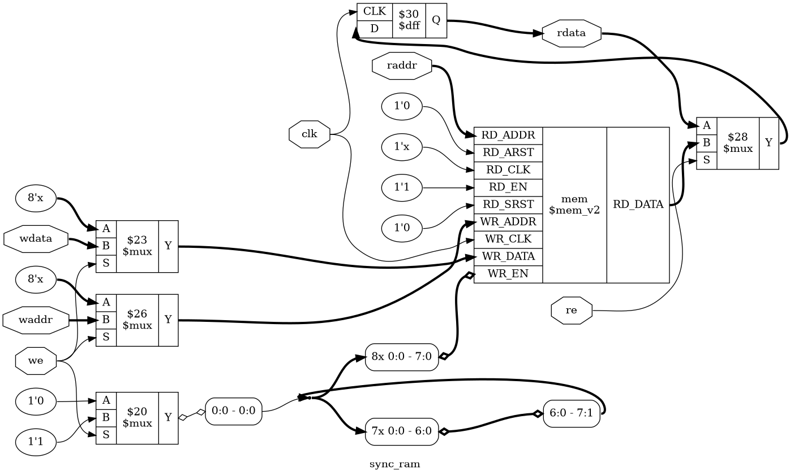

# Tutorial 6: Synchronous RAM

So far every stored bit has been its own flip-flop. That stops being practical
when you need hundreds of words, so FPGAs have dedicated memory blocks. The FIFO
in the next tutorial is built around one. This tutorial writes a RAM that the
tools can place in those blocks, and shows what a small change in the Verilog
costs when they cannot.

It also brings a new formal trick. A memory has far too many states to check one
by one, so you will prove the design for a single word, chosen by the solver.

Finish [Tutorial 5](../05-sequence-detector/README.md) first. This one leans most
on the parameters and formal proofs from [Tutorial 2](../02-counter/README.md).
Run these commands in a VS Code terminal, from this directory:

```bash
cd tutorials/06-sync-ram
```

To run everything at once, use `make all`.

## The design

[`rtl/sync_ram.v`](rtl/sync_ram.v) has one write port and one read port on one
clock. This is called a *simple dual-port* RAM. The storage is one new line:

```verilog
reg [WIDTH-1:0] mem [0:DEPTH-1];
```

The range before the name is the width of each word, as in any vector. The range
after the name makes it an *array* of `DEPTH` such words. You pick a word with
`mem[3]`, and the address can be a signal. With the defaults this is 256 words of
8 bits, and the addresses are `$clog2(DEPTH)` bits wide.

The rest is short:

```verilog
always @(posedge clk) begin
    if (we)
        mem[waddr] <= wdata;
    if (re)
        rdata <= mem[raddr];
end
```

On each rising edge of `clk`:

| `we` | `re` | `mem[waddr]` becomes | `rdata` becomes |
| ---- | ---- | -------------------- | --------------- |
| 0    | 0    | unchanged            | `rdata`         |
| 1    | 0    | `wdata`              | `rdata`         |
| 0    | 1    | unchanged            | `mem[raddr]`    |
| 1    | 1    | `wdata`              | `mem[raddr]`    |

`rdata` is a register, so a read takes one clock: put an address on `raddr` with
`re` high, and the word appears just after the next rising edge. This *read
latency* is what lets the design fit in a block RAM. Those blocks have a clocked
read path, as you will see when one variant cannot use them.

Addresses must stay below `DEPTH`. At a `DEPTH` of 10, a 4-bit address can also hold
values that have no word.

### Why there is no reset

A reset would have to clear every word in a single clock, but each port of a block
RAM reaches one address per clock. The reset would force the memory into flip-flops,
and the last exercise shows the bill. Designs track which words are valid instead,
as the FIFO in the next tutorial does with its pointers.

### Reading the word being written

What should `rdata` get when `we` and `re` are both high, and `waddr` equals
`raddr`? This is a *read-during-write*. Verilog gives this code a definite
answer: **the old data**. Both assignments use `<=`, so on the clock edge
`mem[raddr]` is read before any nonblocking update takes place. The new data is
visible from the next read onward.

That answer belongs to this code. It is not a law of memories, and keeping it costs
real logic on one family, as you will see.

## Simulate

[`tb/tb_sync_ram.v`](tb/tb_sync_ram.v) sweeps every address with two patterns, so
each bit is seen at 0 and at 1. It then tests hold, read-during-write and
writes with `we` low. Its `step` task checks that `rdata` does not move before the
rising edge, which is how it knows the read has a clock of latency.

```bash
make sim
```

The first line of interest is this one, and then the last lines should include
`PASS`:

```text
Read of an unwritten word: rdata=xx
```

Nothing has been written yet, and there is no reset, so Icarus shows `x`. A real
device holds some value, but your design cannot rely on it. The testbench treats
this as a check, so a memory that reads as anything else fails.

The sizes are parameters:

```bash
make sim DEPTH=16
make sim WIDTH=32 DEPTH=1024
```

## View the waveform

Use a fresh simulation for this step. `make verilator` writes the same file, and
Verilator has no `x` value, so run `make sim` again if you have run anything else
since:

```bash
make sim
```

Then open `build/tb_sync_ram.vcd` as in
[Tutorial 1](../01-d-flip-flop/README.md), and add `clk`, `we`, `waddr`, `wdata`,
`re`, `raddr` and `rdata` from `tb_sync_ram`. You will not find `mem` in the list,
because `$dumpvars` does not write arrays here. Only the ports show what the
memory did:

- `re` is high from 10 to 20 ns, the read of an unwritten word. `rdata` stays `x`
  all the way to 2585 ns, through the whole first write sweep.
- The read sweep starts at 2580 ns. `raddr` changes on falling edges, and `rdata`
  follows on the next rising edge: `ff` at 2585 ns, `fe` at 2595 ns. That half
  clock is only there because the testbench drives on the falling edge.
- Near the end, at 10300 ns, `we` and `re` are both high with `waddr` and `raddr`
  at 255, and `wdata` is `00`. At 10305 ns `rdata` becomes `ff`, the old data.
  At 10315 ns the next read returns `00`.

## Lint

```bash
make lint
make lint DEPTH=10
```

Verilator prints a short report, and no `%Warning` lines means no warnings. This
also checks [`rtl/async_read_ram.v`](rtl/async_read_ram.v), which you will meet
below.

## Simulate with Verilator

```bash
make verilator
```

This one prints `rdata=00` for the unwritten word, because Verilator has no `x`. A
design that wrongly depends on memory starting at zero would pass here, so the `x`
check only runs under Icarus.

## Test in Python

[`tb/test_sync_ram.py`](tb/test_sync_ram.py) applies 10000 cycles of random reads
and writes, and compares `rdata` against a Python dictionary of what each address
should hold. A missing address means the word was never written, and the test
then requires `rdata` to be `x`.

```bash
make cocotb
make cocotb DEPTH=16
```

Look for `TESTS=1 PASS=1 FAIL=0`. Two random 8-bit addresses seldom match, so 30%
of the reads aim at the write address. The test counts the reads that landed on a
write of new data, logs the number and fails if there were none.

## Prove it with formal verification

256 words of 8 bits are 2048 bits of state, which gives 2^2048 possible memory
contents, and no assertion written word by word will scale.

Instead, the `` `ifdef FORMAL `` block in `rtl/sync_ram.v` watches a single word:

```verilog
(* anyconst *) reg [$clog2(DEPTH)-1:0] watch_addr;
(* anyconst *) reg [WIDTH-1:0]         watch_data;

reg holds = 1'b0;
always @(posedge clk) begin
    if (we && waddr == watch_addr)
        holds <= (wdata == watch_data);
end
```

`(* anyconst *)` means the solver chooses the value, once, and it never changes
during the proof. `holds` is a tracked copy of the watched word in one bit: it
says that the word currently contains `watch_data`, and the last write to that
address decides.

The rule to prove is then simple. If `holds` was high and the watched address was
read, `rdata` must be `watch_data`:

```verilog
if ($past(re) && $past(raddr) == watch_addr && $past(holds))
    assert (rdata == watch_data);
```

`$past(holds)` is the state before the clock edge, so this also says that a read
during a write returns the old data.

**Why one word proves them all.** The solver is free to choose any address and
any value, and it is searching for a failure. If some address could fail, it would
choose that one. So a pass cannot depend on which word was watched. It is the same
step as starting a maths proof with "let x be any integer".

**Why the state space stays small.** The proof is only about one word and one
flag. The other words are never mentioned, so the solver has no need to work out
what they hold.

**Why it needs an invariant.** Recall from Tutorial 2 that k-induction can start
from any state at all. That includes a state where `holds` is high but the memory
contains something else, and then the read rule fails even though no real run can
get there. This assertion rules that state out:

```verilog
always @(*) begin
    if (holds)
        assert (mem[watch_addr] == watch_data);
end
```

This joins the tracked copy to the real memory, and the induction can rely on it.
While `holds` is low there is no promise at all, so a word that was never written
needs no special case.

```bash
make formal
```

[`sync_ram.sby`](sync_ram.sby) proves `DEPTH=256`, 16 and 10 here. Look for
`successful proof by k-induction` and `DONE (PASS, rc=0)` for each. They should
take about a second.

The file sets `depth 4`, not the default of 20, because induction closes well within
that and more depth only adds work: `DEPTH=256` took 8 seconds at 20. At `depth 3`, a
read bug gave `UNKNOWN` with no trace, since a write, a read and the check did not fit.

Now see how little the size matters:

```bash
make formal-huge
```

That is 1 048 576 words of 32 bits, over 33 million bits of state, and it took
about 8 seconds here. Keep this target for designs that pass `make formal`.

## See the logic

```bash
make schematic
```

Click `build/sync_ram.png` in the Explorer:



The memory is not drawn as flip-flops. `prep` keeps it as one `$mem_v2` box, so the
picture looks the same at any depth. Follow the two ports:

- On the left, `$mux` cells carry `wdata`, `waddr` and `we` to the write port. They
  send `x`, meaning "don't care", when `we` is low.
- Inside the box, `RD_CLK` is `1'x`, so the read port shown here has no clock.
- On the right, `RD_DATA` goes through a `$mux` that `re` controls, into a `$dff`, and
  out to `rdata`. The `$mux` holds `rdata` when `re` is low, as in Tutorial 1.

That `$dff` is the important part. Synthesis merges it into the memory block, and
without it there is nothing to merge.

## Map it to real FPGAs

```bash
make synth
make synth DEPTH=512
make synth DEPTH=16
make synth-async
make synth "FLAGS=-nobram -nolutram"
```

`make synth` uses the same flags as Tutorial 2, and no block RAM flag is needed.
`FLAGS` adds extra ones, and `make synth-async` maps `rtl/async_read_ram.v`, which
is the same memory with `assign rdata = mem[raddr];`.

| Version              | Xilinx                       | Gowin                       | Cyclone V                     |
| -------------------- | ---------------------------- | --------------------------- | ----------------------------- |
| `DEPTH=256`          | 12 `RAM64M`, 8 `FDRE`: 34    | 1 `DPX9B`, 26 FFs: 83       | 1 `MISTRAL_M10K`: 2           |
| `DEPTH=512`          | 1 `RAMB18E1`: 1              | 1 `DPX9B`, 27 FFs: 74       | 1 `MISTRAL_M10K`: 2           |
| `DEPTH=16`           | 2 `RAM32M`, 8 `FDRE`: 10     | 2 `RAM16SDP4`, 8 FFs: 10    | 8 `MISTRAL_MLAB`, 8 FFs: 16   |
| Async read, 256      | 12 `RAM64M`: 26              | 32 `RAM16SDP4`: 282         | 64 `MISTRAL_MLAB`: 112        |
| No RAM cells, 256    | 2056 `FDRE`: 3481            | 2056 `DFFE`: 5071           | 2056 `MISTRAL_FF`: 3445       |

The number after the colon is the total cell count. These are Yosys counts, so
vendor tools can give different results, and they say nothing about timing. One
block RAM also counts as one cell here, although it is a large and limited resource.

There are three kinds of memory in this table:

- **Block RAM** is `RAMB18E1`, `DPX9B` and `MISTRAL_M10K`. It is a fixed block with a
  clocked read.
- **LUT RAM** is `RAM64M`, `RAM32M`, `RAM16SDP4` and `MISTRAL_MLAB`. It uses the
  memory inside lookup tables, and its read is not clocked, so `rdata` still needs
  its 8 flip-flops.
- **Flip-flops** are what is left. The last row shows the price: 2048 bits of memory
  and 8 of `rdata` make 2056, plus thousands of cells to choose a word.

Some results are worth a closer look:

- Xilinx does not use block RAM at 256 words. Yosys estimates a cost and picks LUT
  RAM, and doubling the depth then drops it from 34 cells to 1. To force the block,
  use `make synth FLAGS=-nolutram`, which gives 1 `RAMB18E1`.
- An asynchronous read rules out block RAM, since those blocks have no unclocked
  read. Gowin goes from 83 cells to 282, and Cyclone V from 2 to 112. Xilinx shows
  little change because it was already using LUT RAM.
- Gowin's 26 flip-flops are the price of old data. The Yosys description of this
  block has no old-data mode, so Yosys builds that behaviour around it. The exercise
  below removes them.

## Try it yourself

Change `rtl/sync_ram.v`, then run `make sim`, `make cocotb` and `make formal`.
Undo each change before trying the next.

1. Replace `if (we)` with `if (1'b1)`, so every clock writes.
2. Replace `if (re)` with `if (1'b1)`, so `rdata` never holds.
3. Replace `if (re)` with `if (re && !we)`, so a write blocks a read.
4. Replace `mem[raddr]` with `mem[raddr + 1'b1]`, so reads are off by one.

Each mistake is caught by all three. The next ones are more interesting.

**Statement order.** Swap the two `if` statements, so the read comes first. Run the
checks: nothing changes, because nonblocking assignments do not depend on their
order. The old-data behaviour comes from `<=`, not from the order of the lines.

Undo that, and change the write to a blocking `mem[waddr] = wdata;`. Now the read
sees the new data, and all three checks fail. Keep the `=` and swap the two `if`
statements again. The read now runs before the write, so the design has old data
again, and **all three pass**. Only `make lint` objects, with `BLKSEQ`. The behaviour
is correct, but it now hangs on the order of two statements, and that is exactly the
kind of code that lint is there to reject.

**A bug at one address.** Replace `if (we)` with `if (we && waddr != 8'hA5)`, so one
word can never be written. `make sim` and `make cocotb` catch it, since both reach
every address. `make formal` fails for `d256`, and `watch_addr` is `a5` in
`build/formal_d256/engine_0/trace.vcd`. Nobody told the solver where to look.
`d16` and `d10` pass, because their addresses are too short to equal `A5`.

Now narrow it to `if (we && !(waddr == 8'hA5 && wdata == 8'h3C))`, so one value at
one address is lost. `make sim` passes: the sweep writes `5a` and `a5` there, never
`3c`. `make cocotb` passed 16 of 20 runs here, so it depends on luck. `make formal`
fails `d256`, with `watch_addr` at `a5` and `watch_data` at `3c`. A test finds the
bugs its inputs happen to reach. The proof covers them all.

**Why the address must be symbolic.** Keep the first `A5` bug, and replace the
`(* anyconst *)` line for `watch_addr` with
`wire [$clog2(DEPTH)-1:0] watch_addr = 0;`. `make formal` now passes every task, with
a dead word in the design, and `make sim` still fails. The proof was never wrong, but
now it only talks about address 0.

**The invariant.** Replace `assert (mem[watch_addr] == watch_data);` with
`assert (1'b1);`. Simulation does not care, but `make formal` ends in
`DONE (UNKNOWN, rc=4)` with `returned FAIL for induction`. The design has no bug: the
solver simply started from a state with `holds` high and the wrong word in memory.
More depth does not help, and `depth 20` failed in the same way, since the solver can
always start from a bad state far enough back.

**A change that no test can see.** Put `(* no_rw_check *)` in front of the `mem`
declaration. This tells Yosys that a read-during-write may return anything. `make sim`,
`make cocotb` and `make formal` all still pass, because they read the Verilog and
ignore the attribute. Then run `make synth`: Gowin falls from 83 cells to 3. Your tests
now describe a design that differs from the hardware. That is safe only if nothing
ever reads the address being written, and no check here would tell you.

**The cost of a reset.** Add `input wire rst,` to the ports and `integer i;` after
`mem`, then change the write to:

```verilog
if (rst) begin
    for (i = 0; i < DEPTH; i = i + 1)
        mem[i] <= 0;
end else if (we)
    mem[waddr] <= wdata;
```

`make synth` now gives Xilinx 2056 `FDRE` and 3490 cells, up from 34. On all three
families the RAM cells are gone.
