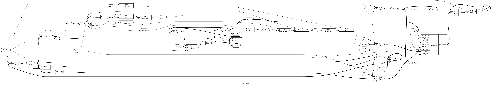

# Tutorial 7: Synchronous FIFO

A FIFO is a queue in hardware: values come out in the order they went in. It
exists because the two sides of a design rarely work at the same pace. A sender
produces a burst of data while the receiver is busy, or a receiver needs eight
values at once and the sender makes them one at a time. A FIFO lets each side
run at its own pace, as long as the average rates match and the bursts fit.

This one uses a single clock. It joins two earlier designs: the pointers are the
counters from [Tutorial 2](../02-counter/README.md), and the storage is the RAM
from [Tutorial 6](../06-sync-ram/README.md). Finish both first. The hard part is
not the hardware. It is proving that nothing is lost, duplicated or reordered.

Run these commands in a VS Code terminal, from this directory:

```bash
cd tutorials/07-sync-fifo
```

To run everything at once, use `make all`.

## The design

[`rtl/sync_fifo.v`](rtl/sync_fifo.v) has one port group for each side:

```verilog
input  wire             wr_en,
input  wire [WIDTH-1:0] wr_data,
output wire             full,
input  wire             rd_en,
output reg  [WIDTH-1:0] rd_data,
output wire             empty
```

`DEPTH` is the number of entries, and it must be a power of two, at least 2.

The memory is a ring. `wr_ptr` says where the next write goes and `rd_ptr` says
where the next read comes from. Each moves forward one entry when it is used,
and runs off the end back to 0. The entries from `rd_ptr` up to `wr_ptr` hold
the queue.

## Why equal pointers are ambiguous

Take a FIFO of 4 entries, and pointers of 2 bits, just enough to address it. If
you write 4 times and read none, `wr_ptr` goes 0, 1, 2, 3, 0 and is back where
`rd_ptr` is. The pointers are equal and the FIFO is full. But they are also
equal after a reset, when it is empty.

Two bits cannot tell these apart, because the number of entries used can be
0, 1, 2, 3 or 4. That is five cases, and the difference of two 2-bit numbers has
only four values.

So make each pointer one bit wider than the address:

```verilog
reg [ADDR:0] wr_ptr;
reg [ADDR:0] rd_ptr;

wire same_entry = wr_ptr[ADDR-1:0] == rd_ptr[ADDR-1:0];
wire same_lap   = wr_ptr[ADDR] == rd_ptr[ADDR];

assign empty = same_entry && same_lap;
assign full  = same_entry && !same_lap;
```

The low bits still address the memory. The extra top bit flips each time the
pointer goes round, so it counts laps. Both pointers on the same entry and the
same lap means the reader has caught up: empty. On the same entry but a lap
apart means the writer has gone all the way round: full. `wr_ptr - rd_ptr` is
now always the number of entries used.

This is why `DEPTH` must be a power of two: the low bits have to run off the end
of the memory by themselves. Nothing stops you passing another size, but
`make sim DEPTH=10` fails with `FAIL: 21 errors`.

## Accepting a write or a read

`full` and `empty` decide what gets through:

```verilog
wire do_write = !rst && wr_en && !full;
wire do_read  = !rst && rd_en && !empty;
```

On each rising edge of `clk`, with `rst` low:

| `wr_en` | `rd_en` | State     | What happens                        | Entries used |
| ------- | ------- | --------- | ----------------------------------- | ------------ |
| 1       | 0       | not full  | Write                               | up by 1      |
| 1       | 0       | full      | Nothing                             | same         |
| 0       | 1       | not empty | Read                                | down by 1    |
| 0       | 1       | empty     | Nothing                             | same         |
| 1       | 1       | middle    | Write and read                      | same         |
| 1       | 1       | full      | Read only. **The write is lost**    | down by 1    |
| 1       | 1       | empty     | Write only. **No data comes out**   | up by 1      |

The last two lines are choices. At full, a read frees an entry on the same edge,
so the write could have been let through. This design refuses it, so that `full`
alone tells the writer whether its write went in. If the write were let through,
the answer would also depend on `rd_en` in the same cycle, which the writer may not
see. A writer must not assert `wr_en` and forget about it: if `full` is high, the
value did not go in. In the same way, a write at empty cannot come out on that edge, because
it is not in the memory yet.

A nice result follows. `wr_ptr` and `rd_ptr` address the same entry only when
the FIFO is empty or full, and in those states one of the two operations is
blocked. So the read-during-write case from Tutorial 6 can never happen here,
and the formal proof below checks that too.

## When read data is valid

This FIFO has one cycle of read latency, like the RAM in Tutorial 6:

- Check `empty`, then assert `rd_en`.
- At the rising edge the read is accepted and `rd_ptr` moves.
- `rd_data` shows the value **after** that edge, and holds it until the next
  accepted read.

So `rd_data` is not the front of the queue. It is the last value read. It is
`x` until the first read, because neither reset nor anything else loads it. The
other common style, called first-word fall-through, shows the front of the queue
on `rd_data` before you ask for it. This design does not do that.

## Simulate

[`tb/tb_sync_fifo.v`](tb/tb_sync_fifo.v) walks through every line of the table.
It fills the FIFO, tries to overfill it, drains it, tries to over-read it, runs
both pointers for two laps with one entry in use, and tries both operations at
full and at empty. After each clock its `step` task checks `full`, `empty` and
`rd_data`, including that `rd_data` holds when no read was accepted.

```bash
make sim
```

The last lines should include `PASS`. The testbench takes the same parameters as
the design:

```bash
make sim DEPTH=4
make sim WIDTH=16 DEPTH=8
```

## View the waveform

Use a fresh simulation for this step. `make verilator` writes the same file, and
Verilator has no `x` value, so run `make sim` again if you have run anything
else since:

```bash
make sim
```

Then open `build/tb_sync_fifo.vcd` as in Tutorial 1. Add `clk`, `rst`, `wr_en`,
`wr_data`, `full`, `rd_en`, `rd_data` and `empty` from `tb_sync_fifo`, then expand
`dut` and add `wr_ptr` and `rd_ptr`. The values below are in hexadecimal, so with
`DEPTH=16` the extra bit is the `1` in `10`. Check the table against the trace:

- `full`, `empty` and both pointers are `x` until the first rising edge, at 5 ns.
  `rd_data` stays `x` for much longer, until 215 ns.
- At 185 ns the 16th write makes `wr_ptr` `10` while `rd_ptr` is `00`. The low
  four bits are equal and the top bit differs, and `full` goes high.
- At 195 ns `wr_en` is still high, with `wr_data` at `2d`. `wr_ptr` does not move.
- `rd_en` rises at 210 ns, and `rd_data` changes to `01` at the next rising edge,
  215 ns. That is the one-cycle latency.
- At 365 ns `rd_ptr` reaches `10` too. The pointers are equal, this time on the
  same lap, and `empty` goes high with `rd_data` holding `2e`.
- At 385 ns both enables are high at empty. `wr_ptr` moves, `rd_ptr` does not, and
  `rd_data` keeps `2e`.
- At 905 ns both enables are high at full, with `wr_ptr` at `02`, `rd_ptr` at `12`
  and `wr_data` at `2d`. `rd_ptr` moves to `13`, `wr_ptr` does not move, and `2d`
  is gone.

## Lint

```bash
make lint
make lint DEPTH=4
```

A warning would start with `%Warning`. The three report lines are normal.

## Simulate with Verilator

```bash
make verilator
```

## Test in Python

[`tb/test_sync_fifo.py`](tb/test_sync_fifo.py) sends 20000 cycles of random
traffic and compares the outputs against a scoreboard. In Python the model of a
FIFO is one line, a `deque`: `append` on a write and `popleft` on a read.

```bash
make cocotb
make cocotb DEPTH=4
```

Look for `TESTS=1 PASS=1 FAIL=0`, and the line with the event counts before it.
The numbers change with each run, and look like this:

```text
WIDTH=8 DEPTH=16 {'writes ignored': 3100, 'reads ignored': 3662, 'both at full': 690, ...
```

The interesting cases are all at the edges, and traffic with equal rates stays
in the middle. So the test changes rates every 100 cycles, favouring writes for a
while and then reads. As with the wraps in Tutorial 2, it counts each event and
fails if one never happened.

You can watch that check work. `make cocotb DEPTH=1024` fails with
`the random traffic never reached: became full`. The design is fine, but a phase
of 100 cycles cannot fill 1024 entries, so the test is telling you that it did
not test what it claims to.

## Prove it with formal verification

```bash
make formal
```

[`sync_fifo.sby`](sync_fifo.sby) has three tasks. Two are proofs, at `DEPTH=4` and
`DEPTH=16`, so look for `successful proof by k-induction` and `DONE (PASS, rc=0)`
for each. The third we will come to. This is the main work of the lesson.

**The easy half** is about the pointers. The formal block keeps its own count of
entries, `f_count`, from the ports alone, and checks the design against it:

```verilog
assert (f_count <= DEPTH);
assert (f_count == f_distance);          // wr_ptr - rd_ptr
assert (full == (f_count == DEPTH));
assert (empty == (f_count == 0));
```

`f_write` and `f_read` are low on overflow and underflow, so two more assertions
say that a pointer moves exactly when one of those is high. A third says that
`rd_data` holds otherwise.

None of that mentions the data. A FIFO could pass all of it and return garbage.

**The hard half** is ordering. The trick is that you do not need to follow every
value. Follow one, and let the solver choose which:

```verilog
(* anyconst *) reg [ADDR:0]    f_tag_ptr;
(* anyconst *) reg [WIDTH-1:0] f_tag_data;

wire f_tag_write = f_write && wr_ptr == f_tag_ptr && wr_data == f_tag_data;
wire f_tag_read  = f_read && f_tagged && f_ahead == 0;
```

This is the `(* anyconst *)` idea from Tutorial 6: the solver picks a value once,
and it never changes. The tagged write is the one with that
pointer value and that data. Since the solver may pick any of them, a proof for
the one is a proof for every write.

When the tagged write goes in, `f_ahead` records how many entries are in front
of it. Each read counts it down. When it reaches 0, the next read must be the
tagged one, so one clock later:

```verilog
if (f_returned)
    assert (rd_data == f_tag_data);
```

Notice what that says. If a write finds 3 entries ahead of it, the 4th read
returns its data. That holds for every write, so nothing is reordered, dropped
or duplicated. The read side only counts reads, and does not ask `rd_ptr` where
the data is.

**Why induction needs help.** The solver has no trouble with the first 20 clocks
after reset. But induction, from Tutorial 2, must also work from *any* state
that passes the assertions, and it will invent a state where the tag is in
flight and the memory holds something else. So the design has three more
assertions, which say what such a state must look like:

```verilog
if (f_tagged) begin
    assert (f_ahead < f_count);                       // the tag is in the queue
    assert (f_tag_position == f_tag_ptr);             // rd_ptr + f_ahead
    assert (mem[f_tag_ptr[ADDR-1:0]] == f_tag_data);  // and in the memory
end
```

These are not extra claims about the FIFO. They are the reason the claim is
true, written down. With them, the log shows induction closing after trying only
steps 20, 19 and 18, at `DEPTH=16` as well as at `DEPTH=4`. A small `DEPTH` was
not needed to make the proof finish. The 4-entry proof stays because filling the
FIFO takes 4 writes instead of 16, so its failure traces are shorter to read. The
last section shows why one size is not enough.

To see the helpers matter, delete all three and run `make formal`, then undo it.
This takes a minute or two. The base case still passes, but both proofs end in
`DONE (UNKNOWN, rc=4)`, and the failure reported in `induction` is the line with
`assert (rd_data == f_tag_data)`. Unknown is not a failure of the design. It means
no bug turned up in 20 clocks, and the solver cannot see why the claim stays true.

The proof has limits. It holds for the parameters listed in the `.sby` file, not
for every size. It also says nothing about timing.

**The third task** asks a different question. A proof only speaks about states
that can happen, so if the assumptions were too strict, it could pass while
checking nothing. `cover` from [Tutorial 5](../05-sequence-detector/README.md)
guards against this. The `cover` task must find a trace, at `DEPTH=4`, for both
enables at full, both enables at empty, and a tagged write coming back from the
second lap of the pointers. Look for three `reached cover statement` lines. The
traces are in `build/formal_cover/engine_0/`.

## See the logic

```bash
make schematic
```

Click `build/sync_fifo.png` in the Explorer. It is very wide, so zoom in:



Start at the big `mem` box on the right, and notice that the memory is a single
`$mem_v2` cell, not 16 sets of flip-flops. Then follow these:

- `wr_ptr` and `rd_ptr` each have a `$dff`, an `$add` and two `$mux` cells. That
  is the counter from Tutorial 2, once for each side.
- Each pointer also passes through a small box marked `3:0` and one marked `4:4`.
  These are the part-selects. The `3:0` wires go to `$eq` for `same_entry` and to
  the `RD_ADDR` and `WR_ADDR` pins, and the `4:4` wires go to `$eq` for `same_lap`.
- `do_write` drives the select of the `$mux` cells in front of the memory, and
  `do_read` the `$mux` in front of the `rd_data` flip-flop.

## Map it to real FPGAs

```bash
make synth
```

| Family    | Flip-flops                 | Memory         | Total cells |
| --------- | -------------------------- | -------------- | ----------- |
| Xilinx    | 18 `FDRE`                  | 2 `RAM32M`     | 33          |
| Gowin     | 8 `DFFE`, 10 `DFFRE`       | 2 `RAM16SDP4`  | 73          |
| Cyclone V | 18 `MISTRAL_FF`            | 8 `MISTRAL_MLAB` | 46        |

The 18 flip-flops are two 5-bit pointers and the 8 bits of `rd_data`. An array
this small goes into RAM built from lookup tables, not block RAM.

Try `make synth DEPTH=1024`. Xilinx now uses 1 `RAMB18E1`, Gowin 1 `DPX9B` and
Cyclone V 1 `MISTRAL_M10K`, and each has 22 flip-flops. That is the pointers
alone, 11 bits each, because `rd_data` has moved inside the block RAM.

These are Yosys counts, so vendor tools can give different results, and they say
nothing about timing.

## Try it yourself

Change `rtl/sync_fifo.v`, then run `make sim`, `make cocotb` and `make formal`.
Undo each change before trying the next.

1. Replace `assign full  = same_entry && !same_lap;` with
   `assign full  = same_entry;`, the design with no use for the extra bit.
2. Replace `assign empty = same_entry && same_lap;` with
   `assign empty = same_entry;`.
3. Remove `&& !full` from `do_write`, so a write is allowed when full.
4. Remove `&& !empty` from `do_read`, so a read is allowed when empty.
5. In the memory block, replace `if (do_write)` with `if (wr_en)`. The pointers
   are still right, but a blocked write overwrites the oldest entry.

Each mistake is caught by all three. In the first, `full` is high from reset, so
nothing can ever be written, and the `cover` task reports that the tagged write
never came back. The next ones are more interesting.

**A bug only the ordering proof sees.** Replace
`rd_data <= mem[rd_ptr[ADDR-1:0]];` with
`rd_data <= mem[rd_ptr[ADDR-1:0] + 1'b1];`, so each read returns the wrong entry.
`make sim` and `make cocotb` fail, and `make formal` reports `Assert failed` at
the line with `assert (rd_data == f_tag_data)`. The solver stops at its first
failure, so to see what the rest think, replace that line with `assert (1);` and
run `make formal` again. All three tasks pass. The pointers, `full`, `empty` and
the occupancy are all still right, and the FIFO returns the wrong data. Without
the ordering proof, formal would have called this design correct.

**A bug that a small proof misses.** Replace `ADDR-1` with `1` on both sides of
the `same_entry` line, as if you had written it for 4 entries. Run:

```bash
make sim DEPTH=4
make cocotb DEPTH=4
make formal
make sim
```

Everything passes at `DEPTH=4`, `make formal` reports a pass for `depth4` and a
failure for `depth16`, and the last `make sim`, at 16 entries, fails. This is why
the proof runs at two sizes. It is the same
lesson as `MOD=16` in Tutorial 2, from the other side: there a power of two hid
the bug, and here a small size does.

**A change that is not a bug.** Remove `!rst &&` from `do_write`. All three still
pass. A write during reset does reach the memory, but both pointers go to 0 and
that entry can only be read after it is written again. If you remove `!rst &&`
from `do_read` instead, all three fail, because `rd_data` changes during a reset.

**A different FIFO, not a broken one.** Some designs accept a write at full when
a read happens on the same edge. Replace `!full` with `(!full || rd_en)` in
`do_write`. All three fail, since all three were told that write is lost. Now
make the same change to `f_write`, and delete the assertion below the comment
about read-during-write, which is no longer true. `make formal` passes, ordering
proof included. `make sim` and `make cocotb` still fail, because they describe
the old behaviour. The table above was a choice, and your tests record that
choice along with the bugs.
