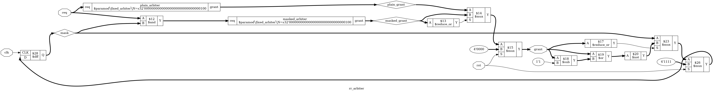

# Tutorial 8: Arbiter

Sooner or later, several parts of a design want one shared thing: a memory port,
a bus, a FIFO's write side. An *arbiter* takes their requests and picks one
winner each clock cycle. This tutorial starts with the simplest arbiter, shows
how it can shut a requester out forever, and then builds a round-robin arbiter
that proves it cannot.

Finish [Tutorial 2](../02-counter/README.md) first, since this one uses the same
tools and assumes you have met `assert` and `assume`.
[Tutorial 7](../07-sync-fifo/README.md) is a good place to have seen a design
with state and proofs together. Run these commands in a VS Code terminal, from
this directory:

```bash
cd tutorials/08-arbiter
```

To run everything at once, use `make all`.

## One-hot

Each requester has one bit of `req`, and gets one bit of `grant` back. Only one
can win, so `grant` is *one-hot*: exactly one bit is set. When nobody is asking
it is zero, so the full rule is "one-hot or zero".

There is a short test for this. `x - 1` clears the lowest set bit of `x` and sets
the bits below it, so `x & (x - 1)` is `x` with its lowest set bit removed. If
that is zero, `x` had at most one bit set. `grant & (grant - 1)` is how the Python
test checks the rule. SystemVerilog has it as a built-in, `$onehot0(grant)`, which
the proof uses.

## A fixed-priority arbiter

[`rtl/fixed_arbiter.v`](rtl/fixed_arbiter.v) is one line of logic. The lowest
requester number always wins:

```verilog
assign grant = req & -req;
```

This picks out the lowest set bit, using *two's complement*. `-req` means
`~req + 1`: invert every bit, then add one.

| Step          | Value  | What happened                                      |
| ------------- | ------ | -------------------------------------------------- |
| `req`         | `0110` | Requesters 1 and 2 are asking                      |
| `~req`        | `1001` | The zeros below the lowest set bit are now ones    |
| `~req + 1`    | `1010` | The carry runs through them, and stops at that bit |
| `req & -req`  | `0010` | Above that bit, each bit is the inverse of `req`   |

Only the lowest set bit survives. There is no loop and no priority chain to
write, and it works at any width.

It has one serious flaw. It has no memory, so if requester 0 asks every cycle it
wins every cycle. This is *starvation*: a requester waits forever even though the
hardware is working exactly as designed. The arbiter is fast and correct, and it
is not *fair*.

## The round-robin design

Round-robin means taking turns. After a requester wins, it goes to the back of
the queue. [`rtl/rr_arbiter.v`](rtl/rr_arbiter.v) does that with one register and
two copies of the fixed arbiter:

```verilog
reg [N-1:0] mask;

fixed_arbiter #(.N(N)) masked_arbiter (.req(req & mask), .grant(masked_grant));
fixed_arbiter #(.N(N)) plain_arbiter  (.req(req),        .grant(plain_grant));

assign grant = rst             ? {N{1'b0}}    :
               (|masked_grant) ? masked_grant :
                                 plain_grant;
```

A 1 in `mask` means "still has a turn in this round". The first arbiter looks only
at those requesters. If none of them is asking, the round is over, and the second
arbiter starts a new round from requester 0.

The mask moves past each winner:

```verilog
always @(posedge clk) begin
    if (rst)
        mask <= {N{1'b1}};
    else if (|grant)
        mask <= ~(grant | (grant - 1'b1));
end
```

| `grant` | `grant - 1` | `grant \| (grant - 1)` | `mask` becomes |
| ------- | ----------- | ---------------------- | -------------- |
| `0001`  | `0000`      | `0001`                 | `1110`         |
| `0100`  | `0011`      | `0111`                 | `1000`         |
| `1000`  | `0111`      | `1111`                 | `0000`         |

Only the requesters above the winner keep a turn. The mask holds when nothing is
granted, so an idle cycle does not lose anyone's place. Reset forces `grant` to
zero whatever `req` is, and restarts the round. `N` must be at least 2.

**`grant` is combinational.** A requester sees its grant in the same cycle as its
request, and the mask moves at the next rising edge. The price is a longer path,
from `req` through the arbiter to whatever uses `grant`. Registering `grant` would
shorten that path but add a clock of delay. Because of this choice, `req` must not
depend combinationally on `grant`, or the two would form a loop.

## Why N-1

Suppose requester `t` raises its request and holds it. Think of the mask as a
place in a circle of `N` requesters, with the next one to be considered just after
the last winner.

- Each grant goes to the first requester at or after that place that is asking.
- `t` is asking, so nobody past `t` can win. Each grant goes either to someone
  between the place and `t`, or to `t` itself.
- Each grant to someone else moves the place closer to `t`.
- There are only `N-1` others in the circle.

So `t` waits for at most `N-1` other grants, however the other requesters behave.
A waiting request also never sits through an empty cycle, because some request is
always high while it waits. Cycles waited and other grants are the same number.

The worst case is a requester that has just won and asks again at once: all `N-1`
others can go first. This is what fairness means here: not "everyone gets some",
but a number you can design a system around.

## Simulate

[`tb/tb_rr_arbiter.v`](tb/tb_rr_arbiter.v) checks `grant` before each rising edge,
because it is combinational. It tests reset, single requesters, all requests held,
idle cycles and a lone requester winning twice in a row. Then it holds every
request for 400 cycles and counts the grants of both arbiters.

```bash
make sim
```

The last lines should be:

```text
Grants in 400 cycles with every request held:
  requester 0: fixed 400, round-robin 100
  requester 1: fixed 0, round-robin 100
  requester 2: fixed 0, round-robin 100
  requester 3: fixed 0, round-robin 100
PASS
```

That is starvation in one table. Now try other sizes, including ones that are not
powers of two:

```bash
make sim N=3
make sim N=5
```

## View the waveform

Use a fresh simulation for this step. `make verilator` writes the same file, and
Verilator has no `x` value, so run `make sim` again if you have run anything else
since:

```bash
make sim
```

Then open `build/tb_rr_arbiter.vcd` as in
[Tutorial 1](../01-d-flip-flop/README.md). Add `clk`, `rst`, `req` and `grant` from
`tb_rr_arbiter`, then expand `dut` and add `mask`. Show the vectors in binary.

- `mask` is `x` until the first rising edge, at 5 ns, when reset sets it to `1111`.
  `grant` is 0 the whole time, because `rst` blocks it even while `mask` is unknown.
- At 10 ns `req` becomes `1111` while `rst` is still high, and `grant` stays 0.
- At 80 ns `rst` falls with `req` at `1111`, and `grant` is `0001`. From there
  every request is held, and on each rising edge `mask` and `grant` step together:

  | Time   | `mask` | `grant` |
  | ------ | ------ | ------- |
  | 80 ns  | `1111` | `0001`  |
  | 85 ns  | `1110` | `0010`  |
  | 95 ns  | `1100` | `0100`  |
  | 105 ns | `1000` | `1000`  |
  | 115 ns | `0000` | `0001`  |
  | 125 ns | `1110` | `0010`  |

- At 115 ns `mask` is `0000`, so `masked_grant` is 0 and the plain arbiter starts
  the next round. Add `masked_grant` and `plain_grant` from `dut` to see it.
- At 200 ns `rst` rises on a falling edge of `clk`, and `grant` drops at that moment.
  `mask` does not return to `1111` until the rising edge at 205 ns.

## Lint

```bash
make lint
```

Verilator prints a short report, and no `%Warning` lines means no warnings. `N`
sets every width in the design, so check other sizes too:

```bash
make lint N=3
make lint N=5
```

## Simulate with Verilator

```bash
make verilator
```

## Test in Python

[`tb/test_rr_arbiter.py`](tb/test_rr_arbiter.py) runs 6000 random cycles at a
light, a medium and a heavy load. Each requester holds its request until granted.

This test has no cycle-accurate model. It checks the rules instead: one-hot, no
grant without a request, a grant whenever anyone asks, and no wait above `N-1`.
Any arbiter that keeps those rules passes, so a failure tells you which rule broke.

```bash
make cocotb
make cocotb N=3
make cocotb N=5
```

Look for `TESTS=1 PASS=1 FAIL=0`, and for the maximum wait of each requester. One
run at `N=4` printed:

```text
N=4 max wait, round-robin:      [3, 3, 3, 3]
N=4 max wait, fixed (Python):   [0, 44, 1475, 2000]
```

The second line is not the Verilog fixed arbiter. It is `req & -req` in Python,
given equally heavy traffic of its own. Its numbers change from run to run. The
round-robin line was `N-1` for every requester on every run, at each size we tried.

The test also fails if the run was too easy. It needs every requester to have
been granted, some contended cycles, some wraps of the round, a wait of exactly
`N-1`, and a fixed-priority wait above `N-1`. Under the heavy load a requester
often asks again straight after its grant, and that matters, as you will see.

## Prove it with formal verification

```bash
make formal
```

[`rr_arbiter.sby`](rr_arbiter.sby) has three tasks, so this runs three proofs: `N=3`,
`N=4` and `N=5`. Look for `successful proof by k-induction` and `DONE (PASS, rc=0)`
for each of them.

The `` `ifdef FORMAL `` block in `rtl/rr_arbiter.v` starts with rules about a single
cycle, which hold for any `req` at all:

```verilog
assert ($onehot0(grant));
assert ((grant & ~req) == 0);
if (rst)
    assert (grant == 0);
else if (|req)
    assert (|grant);
```

Fairness is harder, because it is a rule about time. The proof picks one requester
and measures its wait:

```verilog
(* anyconst *) reg [$clog2(N)-1:0] watched;
```

`anyconst` lets the solver choose any value, then keeps it for the whole proof, so
this covers every requester at once. A counter, `wait_count`, then counts the cycles
that `watched` has been asking without a grant, and the claim is:

```verilog
assert (wait_count <= N - 1);
```

This needs a new kind of assumption:

```verilog
if (past_valid && !$past(rst) && $past(req[watched]) && !$past(grant[watched]))
    assume (req[watched]);
```

In words, once the watched requester asks, it keeps asking until it is granted.
Fairness makes no sense without this. A requester that gives up was never owed a
grant, so "wait" would mean nothing. The assumption is a promise about the world
outside the design, and whatever you connect to `req` must really keep it.
Notice that it says nothing about the other requesters. They can come and go as
they like, which makes the proof stronger than one that held them all.

The last assertion is there only to help the solver:

```verilog
if (wait_count != 0)
    assert (req[watched]);
```

Induction can begin from any state that passes the assertions, not just a state
that reset can reach. Without this line, one such state is a wait in progress with
no request behind it, so the assumption above never applies. This helper rules
it out, and the solver then finishes the proof on its own. The steps below show
what happens if you remove it.

## See the logic

```bash
make schematic
```

Click `build/rr_arbiter.png` in the Explorer. It is wide, so zoom in:



`prep` keeps the hierarchy, so the two arbiters appear as named boxes:

- `req` goes straight into `plain_arbiter`, and through a `$and` with `mask` into
  `masked_arbiter`.
- `$reduce_or` asks whether `masked_grant` has any bit set, and the first `$mux`
  uses the answer to pick between the two grants.
- The next `$mux` forces `4'0000` when `rst` is high, and its output is `grant`.
- `$sub`, `$or` and `$not` are the line `~(grant | (grant - 1'b1))`.
- Two more `$mux` cells hold `mask` when no grant is given and load `4'1111` on
  reset, on the way back to the `$dff`.

The only flip-flop is the mask. From `req` to `grant` there is no clock at all.

## Map it to real FPGAs

```bash
make synth
```

| Family     | Flip-flops      | Total cells at `N=4` |
| ---------- | --------------- | -------------------- |
| Xilinx     | 4 `FDSE`        | 36                   |
| Gowin      | 4 `DFFSE`       | 44                   |
| Cyclone V  | 4 `MISTRAL_FF`  | 33                   |

There are four flip-flops because `mask` has four bits. They are `FDSE` and `DFFSE`,
not the `FDRE` and `DFFRE` of Tutorial 2, because this register resets to ones: the
`S` is for set. The arithmetic in `req & -req` and `grant - 1` uses carry cells.

`make synth N=3` gives 27, 37 and 25 cells, and `make synth N=5` gives 50, 69 and 40.

Take care comparing these. The Gowin total includes two `$scopeinfo` markers, and
a `GND` and a `VCC`. The Xilinx total keeps the two arbiters separate, so Yosys has
not optimized across them. The Makefile flattens only after mapping, because
`synth_xilinx -flatten` crashes this development build of Yosys at `N=4`. All of
these are Yosys counts, so vendor tools can give different results, and they say
nothing about timing. The path through two arbiters is worth watching in a real
design.

## Try it yourself

Change `rtl/rr_arbiter.v` or `rtl/fixed_arbiter.v`, then run `make sim`,
`make cocotb` and `make formal`. Undo each change before trying the next.

1. In `rtl/fixed_arbiter.v`, replace `req & -req` with `req`, so `grant` is not
   one-hot.
2. Delete `rst ? {N{1'b0}} :` from the `assign grant` statement, so reset no longer
   blocks `grant`.
3. Replace the final `plain_grant;` with `masked_grant;`, so no new round starts.
4. Add `<< 1` to the end of the mask expression, so the next requester is skipped.

Each mistake is caught by all three. The next ones are more interesting.

**A bug that breaks no simple rule.** Replace the mask update with this, which
forgets to take out the winner:

```verilog
mask <= ~(grant - 1'b1);
```

The winner keeps its turn, so a requester that asks again wins again, and everyone
above it starves. `grant` is still one-hot, still a subset of `req`, and still high
whenever anyone asks.

`make sim` fails its order checks, and `make cocotb` fails with `waited more than
N-1 cycles`. `make formal` fails on all three tasks, and the only failed assertion
is `assert (wait_count <= N - 1)`. To see how invisible this bug is to the other
checks, keep it, delete that assertion and the `req[watched]` helper, and run
`make formal` again. All three proofs pass.

It also shows why the traffic matters. The bug does nothing unless a winner asks
again straight away. We tried changing the Python test so that each requester stays
quiet for one cycle after its grant, and with this bug in place it then passed every
run at `N=3`, `N=4` and `N=5`. A random test only finds what its traffic can reach.

**A bug that depends on `N`.** The mask has no index to wrap, so why prove `N=3` and
`N=5`? Because many arbiters use a rotating pointer instead, and that is easy to get
wrong. Try one. Replace `reg [N-1:0] mask;` with:

```verilog
reg  [$clog2(N)-1:0] ptr;
wire [N-1:0]         mask = {N{1'b1}} << ptr;
```

In the `always` block, replace `mask <= {N{1'b1}};` with `ptr <= 0;`, and the mask
update with `ptr <= ptr + 1'b1;`. Then run:

```bash
make cocotb
make cocotb N=3
make cocotb N=5
make formal
```

`N=4` passes, and `make formal` reports a pass for `n4` and failures for `n3` and
`n5`. The pointer relies on overflow to wrap, which works only when `N` is a power
of two. At `N=3` a 2-bit pointer also visits 3, a place with no requester, so a
round takes four turns and a request can wait 3 cycles instead of 2. This is
[Tutorial 2](../02-counter/README.md)'s lesson again: choose test values that can
show the bug. `make sim` does report 2 failures at `N=4`, but these are not fairness
failures. That testbench expects this arbiter's exact order, and a pointer that
moves one place at a time, instead of past the winner, gives a different fair order.

**A change that only one test notices.** Replace `else if (|grant)` with `else`, so
the mask also updates on idle cycles. With no grant, `grant - 1` is all ones, so an
idle cycle clears the mask and throws away the place in the round. `make sim` fails
once, in its idle test. `make cocotb` and `make formal` pass at `N=3`, `N=4` and
`N=5`. They are right to: a waiting request means no cycle is idle, so the fairness bound still
holds. Formal proved what was asked, and nobody asked about this. If the place
matters to you, it needs its own check.

**Removing the assumption.** Replace `assume (req[watched]);` with `assume (1);`.
`make sim` and `make cocotb` still pass, since neither looks at it, but all three
proofs fail, on `assert (req[watched])`. The solver found a requester that lets go
of its request. The trace is in `build/formal_n4/engine_0/trace.vcd`.

**Checking the bound is exact.** Replace `wait_count <= N - 1` with
`wait_count <= N - 2`. All three proofs fail with a real trace, so `N-1` is not just
an upper limit: it is reached.

**A proof with no answer.** Delete the two helper lines, `if (wait_count != 0)` and
the `assert (req[watched])` under it. Now `make formal` reports neither pass nor fail,
but `DONE (UNKNOWN, rc=4)`. The base case passes, so no real bug was found, and only
the induction step fails, from a state that reset could never reach. In
`build/formal_n4/engine_0/trace_induct.vcd`, `wait_count` is 3 while `req` is 0.
The design has not changed. An unknown result means the proof needs more help, and it is a
different thing from a bug.
