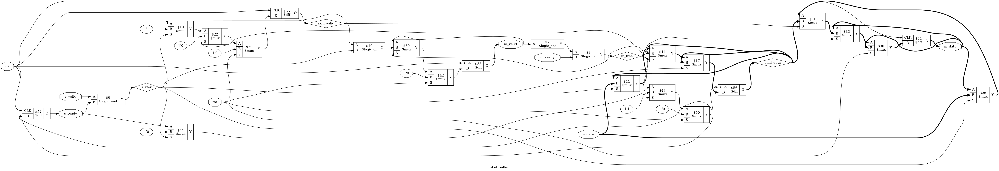

# Tutorial 9: Skid Buffer

Most blocks in a design pass words to each other, and sometimes the receiver
cannot keep up. It needs a way to say "wait", and that signal travels backwards
against the data. In a long pipeline it becomes one of the slowest paths in the
chip. A skid buffer cuts that path without giving up any speed, and it takes only
two registers. It is small, but it is easy to get subtly wrong.

Finish [Tutorial 7](../07-sync-fifo/README.md) first, since this design is a
close relative of the FIFO. Run these commands in a VS Code terminal, from this
directory:

```bash
cd tutorials/09-skid-buffer
```

To run everything at once, use `make all`.

## The handshake

Two wires control every transfer. The sender drives `valid` to say "this data is
a real word". The receiver drives `ready` to say "I can take a word". There are
three rules:

1. **A word moves on a rising edge where `valid` and `ready` are both high.** If
   either is low, nothing moves.
2. **`valid` must not depend on `ready`.** The sender offers a word without
   waiting. If each side waited for the other, neither would ever go first.
3. **Once `valid` is high, it stays high and the data stays stable until the word
   is accepted.** The sender cannot take an offer back or change it.

`ready` has no such rule, and it can rise and fall as it likes. When the receiver
holds `ready` low, the sender has to wait, and whatever feeds the sender soon has
to wait too. This is *backpressure*.

The buffer has two of these interfaces. `s_valid`, `s_ready` and `s_data` face
upstream, where the buffer receives. `m_valid`, `m_ready` and `m_data` face
downstream, where it sends. AXI-Stream is a real-world example of this handshake,
with signals called `TVALID` and `TREADY`. This module only borrows the idea and
has not been checked against that specification.

## Why one register is not enough

A pipeline register between the two interfaces is one `m_data` register and one
`m_valid` bit. It can take a new word when it is empty, or when its word is
leaving:

```verilog
assign s_ready = !m_valid || m_ready;
```

This runs at one word per clock, but `s_ready` is combinational. `m_ready` goes
straight through to `s_ready`, and if ten stages are chained, it passes through
all ten within a single clock. That long path sets the clock speed.

So make `s_ready` a register. It now shows what was true one clock ago, and this
is the problem. Suppose words are flowing and `m_ready` falls. The output register
is full and cannot load, yet `s_ready` is still high from the clock before. On
this edge upstream sees `valid` and `ready`, so as far as it knows the word has
been transferred. Rule 1 says it is gone from upstream, and it has nowhere to go.

There are two ways out:

- **Open `s_ready` only when the register is known to be empty.** Nothing is lost,
  but the register then alternates between empty and full, which halves the
  speed. You will see this in the exercises.
- **Add a second register to catch that one word.** This is the *skid register*,
  named after a car that skids a little way after the brakes go on. Only one word
  can skid, since `s_ready` has fallen by the next clock.

## The design

[`rtl/skid_buffer.v`](rtl/skid_buffer.v) takes the second way. `WIDTH` sets the
size of a word, and `m_valid`, `m_data` and `s_ready` are all registers:

```verilog
assign s_xfer = s_valid && s_ready;
assign m_free = !m_valid || m_ready;

always @(posedge clk) begin
    if (rst) begin
        m_valid    <= 1'b0;
        skid_valid <= 1'b0;
        s_ready    <= 1'b0;
    end else if (m_free) begin
        if (skid_valid)
            m_data <= skid_data;
        else if (s_xfer)
            m_data <= s_data;
        m_valid    <= skid_valid || s_xfer;
        skid_valid <= 1'b0;
        s_ready    <= 1'b1;
    end else if (s_xfer) begin
        skid_data  <= s_data;
        skid_valid <= 1'b1;
        s_ready    <= 1'b0;
    end
end
```

`m_ready` still decides what the flip-flops load, but the path stops at their D
inputs. That is the whole point: it no longer reaches `s_ready` in the same clock.

The buffer is always in one of three states:

| State     | `m_valid` | `skid_valid` | `s_ready` |
| --------- | --------- | ------------ | --------- |
| Empty     | 0         | 0            | 1         |
| One full  | 1         | 0            | 1         |
| Both full | 1         | 1            | 0         |

On each rising edge, with `s_ready` set by the state:

| State     | `s_valid` | `m_ready` | What happens                             | Next state |
| --------- | --------- | --------- | ---------------------------------------- | ---------- |
| Empty     | 0         | any       | Nothing                                  | Empty      |
| Empty     | 1         | any       | New word loads the output register       | One full   |
| One full  | 0         | 0         | The word waits                           | One full   |
| One full  | 0         | 1         | The word leaves                          | Empty      |
| One full  | 1         | 1         | One word leaves, the new one replaces it | One full   |
| One full  | 1         | 0         | New word loads the skid register         | Both full  |
| Both full | any       | 0         | Both words wait                          | Both full  |
| Both full | any       | 1         | The skid word moves to the output        | One full   |

The fifth row is full speed: one in and one out, every clock. The sixth row is
the skid.

This is a FIFO of depth 2, like the one in [Tutorial 7](../07-sync-fifo/README.md).
`s_ready` low means full, and `m_valid` low means empty. The difference is that
this one moves the words between registers instead of moving pointers over a
memory, which keeps the outputs directly on flip-flops.

Reset adds one short moment outside the table. `s_ready` is held low during reset,
so nobody thinks a word was accepted, and it rises one clock after reset ends.

## Simulate

[`tb/tb_skid_buffer.v`](tb/tb_skid_buffer.v) sends numbered words, so a lost or
repeated word shows up as a wrong number. It runs a burst with `m_ready` held
high, then a long stall, then another burst, then a reset with both registers
full.

```bash
make sim
```

The last lines should include `PASS`. Above that, the testbench prints what it
measured:

```text
m_ready held high:
  32 words in 32 clocks: 1.00 words per clock
stalled for 8 clocks:
  2 words accepted, 0 delivered, m_data held at 33
after the stall:
  32 words in 32 clocks: 1.00 words per clock
```

During the stall the buffer takes exactly two words and then closes. Afterwards
the output carries on with no gap. The testbench also takes `WIDTH`:

```bash
make sim WIDTH=32
```

## View the waveform

Use a fresh simulation for this step. `make verilator` writes the same file, and
Verilator has no `x` value, so run `make sim` again if you have run anything else
since:

```bash
make sim
```

Then open `build/tb_skid_buffer.vcd` as in
[Tutorial 1](../01-d-flip-flop/README.md). Add `clk`, `s_valid`, `s_ready`,
`s_data`, `m_valid`, `m_ready` and `m_data` from `tb_skid_buffer`, and
`skid_valid` and `skid_data` from `dut`. Check the state table against the trace:

- `m_data` is `x` until the first word loads it, at 35 ns, and `skid_data` is `x`
  until 385 ns. `m_valid` is low all that time, so nobody may look at `m_data`.
  This is why the data registers need no reset.
- From 35 ns, `m_data` follows `s_data` one clock behind and changes on every
  rising edge. This is the fifth row of the table, and `skid_valid` stays low.
- At 370 ns `m_ready` falls while the buffer is empty. Word 33, which
  VaporView shows in hexadecimal as `21`, loads the output register at 375 ns.
- At 385 ns word 34 (`22`) loads `skid_data`, `skid_valid` rises and `s_ready` falls.
  `s_data` moves on to 35 (`23`) at 390 ns and holds still: upstream is keeping rule 3.
- `m_data` stays at 33 until `m_ready` rises at 470 ns.
- At 475 ns `m_data` becomes 34, `skid_valid` falls and `s_ready` rises. Words
  keep leaving on every clock. The output never paused for the skid word.

## Lint

```bash
make lint
```

Any warning starts with `%Warning`. The lines that start with `- V e r i l a t i o n`
are a normal report. `WIDTH` changes the design, so check another size:

```bash
make lint WIDTH=32
```

## Simulate with Verilator

```bash
make verilator
```

## Test in Python

[`tb/test_skid_buffer.py`](tb/test_skid_buffer.py) drives random traffic for
10000 clocks, in five phases that change which side is faster. It plays a polite
upstream, holding each word until it is accepted, and a downstream that does
whatever it likes. Its scoreboard is a queue of words that went in and have not
come out yet:

- Every word that leaves must match the front of the queue, so it arrives once
  and in order.
- The queue length must match the state table, so `m_valid` and `s_ready` are
  checked on every clock. It can never exceed 2.
- `m_data` must not change during a stall.
- The queue must be empty after a final drain, so a word lost near the end is
  noticed too.

```bash
make cocotb
make cocotb WIDTH=32
```

Look for `TESTS=1 PASS=1 FAIL=0`, and a line of counts like this one:

```text
transfers=5289 stalls=2934 skid_uses=1249 stall_starts_on_transfer=1156 resets=21
```

The numbers change from run to run, and the test fails if any of them is 0.
`stall_starts_on_transfer` counts the clocks where `m_ready` has just fallen while
a word is entering. Remember that one for the exercises.

## Prove it with formal verification

Simulation only tries the traffic that a testbench generates. Now we want a proof
for all traffic, and that raises a question: all traffic, or all *legal* traffic?

### Assume at the inputs, assert at the outputs

A block usually cannot promise anything if its neighbours break the rules, so a
proof states what the block relies on and what it promises in return. This is
*assume-guarantee*. The rules from the handshake section appear twice in the
`` `ifdef FORMAL `` block of `rtl/skid_buffer.v`. Upstream drives `s_valid` and
`s_data`, so its rules are assumed:

```verilog
if (past_valid && !rst && !$past(rst) && $past(s_valid) && !$past(s_ready)) begin
    assume (s_valid);
    assume (s_data == $past(s_data));
end
```

The buffer drives `m_valid` and `m_data`, so the same rule is asserted there:

```verilog
if ($past(m_valid) && !$past(m_ready)) begin
    assert (m_valid);
    assert (m_data == $past(m_data));
end
```

Look at them side by side. If you connect two buffers, the `assert` of the first
is the `assume` of the second, which is why each block can be proved alone.
`m_ready` has no assumption at all, because `ready` has no rule to keep: the proof
covers a downstream that does anything.

The other assertions say that an accepted word is on offer on the next clock, so
`valid` never waits for `ready`, and that a clock with `m_ready` high leaves
`s_ready` high, which is what gives full throughput.

### Interface rules are not data integrity

Those assertions look only at the handshake. A buffer could obey every one of them
and still lose words, because a word that vanishes breaks no rule on either port.
So there are two separate proofs, which [`skid_buffer.sby`](skid_buffer.sby) runs
as separate tasks:

- **`rules`** proves the handshake assertions.
- **`data`** adds the block under `` `ifdef CHECK_DATA `` and proves that no word
  is lost, duplicated or reordered. **`data32`** repeats this at `WIDTH=32`.

The data proof needs two things. The first is a count of accepted minus delivered
words, taken from the ports. It must never exceed 2, and it must always equal the
number of full registers, so a word cannot vanish or appear from nowhere.

The second is a *symbolic tagged word*. You met `(* anyconst *)` in
[Tutorial 6](../06-sync-ram/README.md). `$anyseq` is its cousin, a value that the
solver may choose anew on every clock:

```verilog
wire pick = $anyseq;
```

The solver can raise `pick` on any accepted word. That word gets tagged: its data
is saved in `tag_data`, and `tag_ahead` records whether another word is in front
of it. The assertions then say that the tagged word is in exactly the register its
place in the queue says:

```verilog
if (tagged) begin
    if (tag_ahead)
        assert (skid_valid && skid_data == tag_data);
    else
        assert (m_valid && m_data == tag_data);
end
```

Since the solver can tag any word it likes, the proof covers all of them. One
tagged word needs only a few extra registers, and it covers corruption,
duplication and reordering at once.

### Checking the assumptions

An assumption that is too strong hides bugs without any message, as
[Tutorial 2](../02-counter/README.md) warned. The fourth task, `reach`, guards
against that. It uses `cover` from [Tutorial 5](../05-sequence-detector/README.md)
to ask the solver for a trace where the skid register loads, one where it
empties, and one with transfers on both sides on two clocks in a row. If an
assumption had ruled these out, `reach` would fail.

```bash
make formal
```

Look for `successful proof by k-induction` for `rules`, `data` and `data32`,
`Reached cover statement` three times for `reach`, and `DONE (PASS, rc=0)` for
all four.

## See the logic

```bash
make schematic
```

Click `build/skid_buffer.png` in the Explorer:



This one is wide, so zoom in. The five `$dff` boxes are `s_ready`, `m_valid`,
`m_data`, `skid_valid` and `skid_data`, and the thick lines carry the 8-bit words.
There is one thing to check:

- Find `m_ready` in the middle. It enters a `$logic_or` with the inverted
  `m_valid` to make `m_free`, which then feeds `$mux` select lines.
- Follow those paths to the right. Every one of them ends at the D input of a
  `$dff`.
- Find `s_ready` on the left. It comes straight from the Q output of a `$dff`, so
  no path from `m_ready` reaches it without crossing a clock edge.

## Map it to real FPGAs

```bash
make synth
```

| Family     | Flip-flops               | Total cells |
| ---------- | ------------------------ | ----------- |
| Xilinx     | 19 `FDRE`                | 34          |
| Gowin      | 16 `DFFE`, 3 `DFFRE`     | 44          |
| Cyclone V  | 19 `MISTRAL_FF`          | 33          |

There are 19 flip-flops: 8 for `m_data`, 8 for `skid_data`, and 3 for `m_valid`,
`skid_valid` and `s_ready`. Gowin shows the split clearly, since only the three
control bits use a flip-flop with reset. The data registers were never reset.

With `make synth WIDTH=32` the count is 67 flip-flops, two for each extra bit.
This is the price of the buffer: twice the data width in flip-flops, plus a
multiplexer in front of `m_data`.

These are Yosys counts, so vendor tools can give different results, and they say
nothing about timing. They cannot show you that the buffer shortens a path, only
what it costs.

## Try it yourself

Change `rtl/skid_buffer.v`, then run `make sim`, `make cocotb` and `make formal`.
Undo each change before trying the next.

1. Replace `assign m_free = !m_valid || m_ready;` with
   `assign m_free = m_ready;`, so `valid` waits for `ready`.
2. In the `else if (s_xfer)` branch, delete `s_ready <= 1'b0;`, so a third word
   overwrites the skid word.
3. In the `else if (m_free)` branch, delete `skid_valid <= 1'b0;`, so the skid
   word is delivered again and again.

Each mistake is caught by all three. The next ones are more interesting.

**A word that breaks no rule.** Replace `skid_data <= s_data;` with
`skid_data <= m_data;`. `make sim` and `make cocotb` fail, and in `make formal` the
`data` tasks fail while `rules` still passes. The handshake is perfect and the word
is wrong. This is the difference between the two proofs.

**A bug that needs bad timing.** Registering `m_ready` looks like a sensible
timing fix, after a whole lesson about registering `ready`. Add this above
`reg skid_valid`:

```verilog
reg m_ready_q;
always @(posedge clk)
    m_ready_q <= m_ready;
```

Then replace `else if (s_xfer) begin` with `else if (s_xfer && !m_ready_q) begin`.
The buffer now knows about a stall one clock late, so it drops the word that
arrives on the first clock of a stall. Run the checks:

```bash
make sim
make cocotb
make formal
```

`make sim` still says `PASS`, with the same throughput and the same long stall.
Look at why: the testbench lowers `m_ready` while the buffer is empty, so by the
time a word needs the skid register, the stall is already a clock old. A longer
stall would not help. Only the moment that the stall *starts* matters.

`make cocotb` fails with `s_ready=1 with 2 inside`, usually within a few hundred
nanoseconds, since random traffic hits this case all the time. It is the
`stall_starts_on_transfer` count from before. In `make formal`, `data` fails on
`count == m_valid + skid_valid`, and `rules` passes: a lost word breaks no rule on
either port.

Now close the gap in the testbench. Add this after the `// Still working.` burst:

```verilog
// A stall that starts while a word is moving.
burst(4);
step(1'b1, 1'b0);
step(1'b1, 1'b0);
drain;
```

`make sim` now reports `more than two words inside` and a wrong `m_data`. Undo the
bug and it passes again.

**One register at half speed.** Replace `s_ready <= 1'b1;` with
`s_ready <= !(skid_valid || s_xfer);`. This is the first way out from earlier:
`s_ready` only opens when the output register is about to be empty. `make sim`
reports that the burst had a gap:

```text
32 words in 63 clocks: 0.51 words per clock
```

`make sim` reports no wrong words, so this is a speed bug and not a data bug. In
`make formal`, the failing assertion is `assert (s_ready);`, the throughput rule,
and `data` fails too because it includes the `rules` assertions. `reach` fails
because the skid register is never needed.

**An assumption that hides a bug.** Add `assume (m_ready);` next to `assume (rst);`,
outside the `if`, and run `make formal`. `rules` and `data` pass, because a
downstream that never stalls is easy to serve. Now also replace `skid_valid <= 1'b1;` with
`skid_valid <= 1'b0;`, which throws the skid word away, and run it again:

```text
[build/formal_rules] DONE (PASS, rc=0)
[build/formal_data] DONE (PASS, rc=0)
[build/formal_data32] DONE (PASS, rc=0)
[build/formal_reach] DONE (FAIL, rc=2)
```

The design is badly broken and every proof passes, since the solver is not allowed
to stall. `make sim` and `make cocotb` fail, and `reach` fails with `Unreached cover
statement`. It is the only part of `make formal` that notices. A proof is only as
good as its assumptions, so always check that the interesting cases can still
happen.

**An assumption that was not needed.** Delete `assume (s_valid);` and
`assume (s_data == $past(s_data));` and run everything. Nothing changes, and all
the proofs still pass. You might expect a failure, but look at the design: it
reads `s_data` only on the clock of a transfer, so what upstream does while
`s_ready` is low cannot reach any register. This buffer keeps its promises even
beside a neighbour that breaks the rules. Not every block does: one that read
`s_data` while it waited, and counted on it not changing before the transfer, would
depend on these assumptions completely. Keep them here anyway, since they state the
contract that upstream has signed up to.
