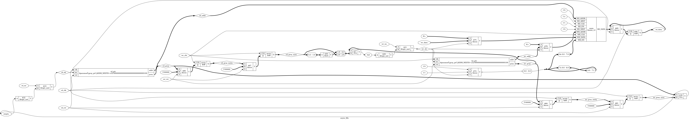

# Tutorial 10: Asynchronous FIFO

Real designs have more than one clock. A camera delivers pixels on its own
clock, and memory runs on another. A dual-clock FIFO is the standard way to pass
data between them. It is also where this course's tests stop being enough: this
is the first design where every check can pass and the hardware can still fail.
Read the warning below before you trust a green result here.

Finish [Tutorial 7](../07-sync-fifo/README.md) first, since this design keeps
its pointers and its extra pointer bit. Run these commands in a VS Code terminal,
from this directory:

```bash
cd tutorials/10-async-fifo
```

To run everything at once, use `make all`.

## Why a binary pointer cannot cross

In the [synchronous FIFO](../07-sync-fifo/README.md), `full` and `empty` compare
the two pointers. Here the write pointer belongs to `wr_clk` and the read pointer
to `rd_clk`, so each side must sample a pointer that moves on someone else's
clock. Two things go wrong:

- A flop needs its input stable around the clock edge. If the input changes
  inside that window the flop can go *metastable*: its output sits between 0 and
  1 for a while, then settles to either value.
- The bits of a pointer do not arrive together. Wires differ, so the bits reach
  the sampling flops at slightly different times.

Together these break a binary pointer. Going from 7 to 8 changes four bits:

```text
00111  old value, 7
01000  new value, 8
01111  one possible sample, with bit 3 new and the others old: 15
```

A sample taken during that change can be a value the pointer never held. A
sampled 15 could make the FIFO believe that words exist which were never written.

## Gray code

Gray code numbers things so that neighbours differ in exactly one bit. Here is
a 3-bit pointer, for a FIFO of 4 words:

| Count  | 0     | 1     | 2     | 3     | 4     | 5     | 6     | 7     |
| ------ | ----- | ----- | ----- | ----- | ----- | ----- | ----- | ----- |
| Binary | `000` | `001` | `010` | `011` | `100` | `101` | `110` | `111` |
| Gray   | `000` | `001` | `011` | `010` | `110` | `111` | `101` | `100` |

It also holds across the wrap from 7 to 0. With only one bit moving, a sample
taken during a change can only be the old value or the new one. Both are values
the pointer really held, so at worst the sampling side is one step out of date.

The conversion is one XOR, in [`rtl/gray_ptr.v`](rtl/gray_ptr.v):

```verilog
to_gray = value ^ (value >> 1);
```

`gray_ptr` keeps the binary count, for addressing memory and adding 1, and a Gray
copy for the other side. The Gray copy is a flop, not an `assign`. Combinational
logic can glitch while its inputs settle, and a sampling flop could catch the
glitch. Only flop outputs should go into a crossing.

## Two-flop synchronizers

The sampling flop may still go metastable, so nothing that matters may read it
directly. A second flop on the same clock samples the first. The first flop gets
almost a whole clock period to settle before the second one looks.

```verilog
rd_gray_meta <= rd_gray;        // clocked by wr_clk, can go metastable
rd_gray_sync <= rd_gray_meta;   // clocked by wr_clk, the only reader of _meta
```

[`rtl/async_fifo.v`](rtl/async_fifo.v) has one of these in each direction. They
are written out there, rather than hidden in a module, so that the formal proof
can see the first stage. This makes failure unlikely, not impossible. How unlikely
depends on the device and the clocks, and nothing in this tutorial measures it.

## Warning: simulation does not model metastability

**A passing test does not prove that a clock domain crossing is safe.**

Icarus, Verilator and cocotb treat a flop as ideal. All the bits of a pointer
change at the same instant, and a sample gets either all the old bits or all the
new ones. The two problems above cannot occur, so simulation cannot show them.
At the end of this tutorial you will replace Gray code with a raw binary pointer,
which is the bug this whole design exists to prevent, and watch simulation pass.

Formal verification here does not model it either. `make formal` lets the two
clocks move in any pattern, but a sampled bit is still exactly 0 or exactly 1,
and all the bits of a sample are taken at the same moment. A proof below says
"this design is correct if every flop is ideal".

A real design also needs timing constraints on the crossing. For example, the
delays of the Gray pointer bits must be bounded so that they differ by less than
one period of the launching clock. Otherwise one change can overtake the next at
the far end, and two bits appear to move at once. Those constraints are written
for, and checked by, the vendor tools (Vivado, Gowin EDA, Quartus), which are
deliberately not in this environment. Nothing in this tutorial has been through
such a tool, so it makes no claim about timing or about failure rates.

## The design

```verilog
module async_fifo #(
    parameter WIDTH      = 8,
    parameter ADDR_WIDTH = 4
) (
    input  wire             wr_clk, wr_rst, wr_en,
    input  wire [WIDTH-1:0] wr_data,
    output wire             full,
    input  wire             rd_clk, rd_rst, rd_en,
    output reg  [WIDTH-1:0] rd_data,
    output wire             empty
);
```

That is a condensed view of the ports. The FIFO holds `2**ADDR_WIDTH` words, and
`ADDR_WIDTH` must be at least 2. Each input and flag belongs to one clock only.
A write happens on a rising `wr_clk` edge when `wr_en` is high and `full` is low.
A read happens on a rising `rd_clk` edge when `rd_en` is high and `empty` is low,
and `rd_data` holds the word after that edge. Enables are ignored while the flag
is high, so a blocked write or read changes nothing.

The memory is the one thing both clocks touch without a synchronizer. That is
safe because of the flags: the reader only reaches a slot after the write
pointer has passed it, and the writer only reuses a slot after the read pointer
has passed it, so nobody reads a word while it is being written.

## Why full and empty are pessimistic

Each flag compares this side's own pointer, which is current, with an old copy
of the other side's. The copy is at least two clocks behind.

- The writer sees an old read pointer, so it thinks fewer words have left. It can
  report `full` when a slot has just been freed.
- The reader sees an old write pointer, so it thinks fewer words have arrived.
  It can report `empty` when a word is already waiting.

Both mistakes are safe. A late `full` delays a write and a late `empty` delays a
read, but neither loses data. The dangerous mistakes would be the opposite ones,
and they cannot happen, because a pointer only moves forward and a copy can only
trail it. The news does arrive: if the other side stops, the copy catches up and
the flag becomes exact. Pessimism costs a little throughput and nothing else.

One more detail: a copy is not a pointer that moves one step at a time. If the
other clock is faster, the copy skips values. That is fine, because each sample
is still a value the pointer really held at the moment it was taken.

## The full comparison

[Tutorial 7](../07-sync-fifo/README.md) gave each pointer one extra bit, so that
full and empty can be told apart. Both have equal address bits. For empty, the
extra bits are equal too. For full, the writer is exactly `DEPTH` ahead, so the
extra bit differs and the address bits are the same.

Empty carries straight over to Gray code: equal pointers have equal codes. Full
does not, because Gray code is not binary. Look at the table above, with `DEPTH`
= 4. Count 1 is `001` and count 5 is `111`, so the top *two* bits differ.

The conversion shows why. Adding `DEPTH` flips only the top bit of the binary
value. Gray bit `n` is binary bit `n` XOR binary bit `n+1`. So that one flip
changes the top Gray bit and the Gray bit below it, and no others:

```verilog
assign full  = wr_gray == {~rd_gray_sync[ADDR_WIDTH:ADDR_WIDTH-1],
                           rd_gray_sync[ADDR_WIDTH-2:0]};
assign empty = rd_gray == wr_gray_sync;
```

## Reset

**What this design assumes about its two resets:**

- Each reset is active high and synchronous to its own clock.
- The two are one reset of the whole FIFO, never one side alone. Each side's
  flags compare against the other side's pointer, so the pointers must go to 0
  together.
- Both must be high at once, for long enough that each clock has a rising edge
  while both are high. If a clock is not running, its side has not been reset.
- `wr_en` and `rd_en` stay low until both resets have been released.
- Words inside the FIFO are lost. The flags mean nothing until the first rising
  edge of each clock under reset, and they are `x` in simulation until then.

Real hardware needs one more thing. A single reset source is not synchronous to
both clocks, so each domain needs its own reset synchronizer, and that is another
crossing. It is not built here, and the same warning applies to it.

The testbenches hold both resets for several clocks, then release `wr_rst` first.
The proof assumes one reset, at the start, with both released together.

## Simulate

[`tb/tb_async_fifo.v`](tb/tb_async_fifo.v) runs two free-running clocks. Each
side drives its inputs on its own falling edge. Two edges can land at the same
instant, and if the two sides shared a variable, the result would depend on which
process the simulator ran first. So they share nothing. The reader works out each
expected word from its position in the stream, with no scoreboard to share. Each
side has its own random numbers too.

```bash
make sim
```

Look for these lines, then `PASS`:

```text
full stayed high for 2 write clocks after a read freed a slot
empty stayed high for 2 read clocks after a write
6400 words, 63364 blocked writes, 61759 blocked reads
```

The first two lines are pessimism, measured. The test also fills the FIFO, checks
that `full` rises after exactly 16 words, resets it with words inside, and then
runs traffic at five clock ratios, with the writer in a hurry and then the
reader. A *blocked* write or read is one that met `full` or `empty`. Each ratio
prints its own counts, and the test fails if the side in a hurry never meets
`full` or `empty` in that ratio.

## View the waveform

Use a fresh simulation for this step. `make verilator` writes the same file, and
Verilator has no `x` value, so run `make sim` again if you have run anything
else since:

```bash
make sim
```

Then open `build/tb_async_fifo.vcd` as in
[Tutorial 1](../01-d-flip-flop/README.md). Times are in ps. Add `wr_clk`,
`rd_clk`, `full` and `rd_en` from `tb_async_fifo`, then expand `dut` and add
`wr_gray`, `rd_gray`, `rd_gray_meta` and `rd_gray_sync`. Show the pointers in
binary, and check the story so far against the trace:

- `wr_gray` changes one bit at a time during the first fill, from 65039 ps. It
  is `00001`, `00011`, `00010`, `00110` and so on.
- At 215129 ps the sixteenth write sets `wr_gray` to `11000` and `full` rises.
  The read pointer is `00000`, so the top two bits are inverted and the rest match.
- The next read is at 316837 ps, when `rd_gray` becomes `00001`. A slot is free
  from here, but `full` stays high.
- `rd_gray_meta` follows at 325195 ps, on a `wr_clk` edge. At 335201 ps
  `rd_gray_sync` changes and `full` falls with it.
- Look just after, while the reader drains. At 355213 ps `rd_gray_sync` is `00011`,
  and one write clock later it is `00110`. The read clock is faster here, so the
  copy skipped a value, and it changed two bits at once. It is still a value that
  `rd_gray` really held.

## Lint

```bash
make lint
```

Any warning starts with `%Warning`. The lines that start with `- V e r i l a t i o n`
are a normal report. The widths depend on the parameters, so check others too. `rtl/` is clean for `ADDR_WIDTH` from 2 to 5:

```bash
make lint ADDR_WIDTH=2
```

## Simulate with Verilator

```bash
make verilator
```

The numbers should match `make sim` exactly, since both testbench processes wait
only on their own clock. The clock half periods are variables, so Verilator cannot
tell that they are not zero. That is the reason for `--no-sched-zero-delay` in the
Makefile.

## Test in Python

[`tb/test_async_fifo.py`](tb/test_async_fifo.py) has five tests, one per period
ratio, including write faster and read faster. A writer and a reader run side by
side with random enables, and a Python `deque` is the scoreboard. Sharing it is
safe because only one coroutine runs at a time.

```bash
make cocotb
make cocotb ADDR_WIDTH=2
```

Look for `TESTS=5 PASS=5 FAIL=0 SKIP=0`. Each test logs a line like this one,
from a run with `wr_clk` 7 times faster, and the numbers vary from run to run:

```text
periods 2018 and 14002 ps: 4000 writes, 4000 reads, 22455 full events, 20 empty events
```

A test fails if it never saw a full event or never saw an empty event. Reaching
both takes some care when one clock is 7 times faster, so the traffic rate
changes at random between slow, medium and eager.

## Prove it with formal verification

```bash
make formal
```

This takes about 20 seconds. [`async_fifo.sby`](async_fifo.sby) has seven tasks.
Look for `DONE (PASS, rc=0)` on each of them, and `successful proof by k-induction`
on the six that use `mode prove`.

The new line in the file is `multiclock on`. Formal normally treats one clock as
one step. With this option, a step is one instant of *solver time*, and `wr_clk`
and `rd_clk` are ordinary inputs that the solver may raise at any step, together
or apart. Assertions run on every step, using `$global_clock`:

```verilog
always @($global_clock) begin
    if (past_valid && reset_done && $past(reset_done)) begin
        if ($rose(wr_clk))
            assert ($onehot0(wr_gray ^ $past(wr_gray)));
```

So a proof covers every clock ratio at once, including ones that drift and
change, which no list of test ratios can do. The results, all in `prove` mode
for `ADDR_WIDTH` 2, 3 and 4, at `WIDTH` 8:

| Task       | Proved                                                                 |
| ---------- | ---------------------------------------------------------------------- |
| `gray_a*`  | Each Gray pointer moves at most one bit per clock of its own           |
| `fifo_a*`  | No overflow, no underflow, and the order the words were written in     |
| `fifo_a*`  | Each flag is exact when its copy of the pointer is up to date          |
| `cover_a2` | Traces exist for full, full with a free slot, empty with a word waiting |

The ordering proof tracks one word, at any pointer value and with any data. The
word stays in memory until it is
read, and it comes out when the read pointer has the same value. Induction needed
some help: the proof also states that each copy trails its pointer, as a chain of
inequalities in `rtl/async_fifo.v`. That chain is the pessimism argument, written
as assertions.

What was **not** proved:

- Metastability, or bits arriving at different times. See the warning above.
- A reset during operation, or releasing the two resets separately. Only the
  tests touch those, and only as described under Reset.
- Any `ADDR_WIDTH` above 4, or any `WIDTH` but 8.
- That data keeps flowing on real clocks. The solver may stop a clock forever.

## See the logic

```bash
make schematic
```

Click `build/async_fifo.png` in the Explorer. It is very wide, so zoom in:



`rd_ptr` and `wr_ptr` appear as boxes, since each is a `gray_ptr`. Find
`rd_gray`, and follow it right to `rd_gray_meta` and then `rd_gray_sync`, each a
`$dff` with `wr_clk` at its `CLK` pin. The `$mux` before each one is the reset.
That is the crossing. `rd_gray_sync` then
goes through `$not` on its top two bits and into the `$eq` that makes `full`. The
same chain runs along the bottom of the picture, from `wr_gray` to the `$eq` that
makes `empty`. The `mem` block has `WR_CLK` and `RD_CLK`, and it is the only cell
with both.

## Map it to real FPGAs

```bash
make synth
```

| Family     | Flip-flops                  | Memory cells     | Total cells |
| ---------- | --------------------------- | ---------------- | ----------- |
| Xilinx     | 46 `FDRE`                   | 2 `RAM32M`       | 72          |
| Gowin      | 38 `DFFR`, 8 `DFFE`         | 2 `RAM16SDP4`    | 125         |
| Cyclone V  | 48 `MISTRAL_FF`             | 8 `MISTRAL_MLAB` | 82          |

Totals for Xilinx and Gowin include 2 `$scopeinfo` cells, which are not hardware.
These are Yosys counts, so vendor
tools can give different results. They say nothing about timing, and Yosys does
not check the crossing.

## Try it yourself

Change the RTL, then run `make sim`, `make cocotb` and `make formal`. Undo each
change before trying the next.

| Change                                                  | Sim  | cocotb | Formal                 |
| ------------------------------------------------------- | ---- | ------ | ---------------------- |
| `wr_ok = wr_en`, so `full` is ignored                   | FAIL | FAIL   | `fifo_a*` fail         |
| `rd_ok = rd_en`, so `empty` is ignored                  | FAIL | FAIL   | `fifo_a*` fail         |
| In `gray_ptr`, `gray <= to_gray(bin)`, a clock late     | FAIL | FAIL   | All fail but `cover`   |

The next ones are more interesting.

**The Gray-bits bug.** Replace the `full` assignment with
`assign full = wr_gray == rd_gray_sync;`, inverting nothing. The pointers start
equal, so `full` is high straight out of reset, and nothing can ever be written.
`make sim` reports `full=1 expected=0` and then `FAIL: timed out`. Everything
catches this, except `gray_a*`, which is only about the pointers.

Now try the mistake that comes from thinking in binary, by inverting only the
top bit:

```verilog
assign full = wr_gray == {~rd_gray_sync[ADDR_WIDTH], rd_gray_sync[ADDR_WIDTH-1:0]};
```

This is correct for binary pointers. In Gray code `full` does not rise at 16
words, so the FIFO overwrites its oldest word. cocotb fails with
`more words accepted than the FIFO holds`, and `fifo_a*` fail.

**The headline: cross the raw binary pointer.** This removes the reason for this
whole design. It takes three edits, so that everything still adds up in binary:

1. In `rtl/gray_ptr.v`, replace `to_gray = value ^ (value >> 1);` with
   `to_gray = value;`, so the "Gray" pointer is really binary.
2. In `rtl/async_fifo.v`, use the top-bit `full` assignment from above, which is
   right for binary.
3. In `gray2bin` in the formal block, replace `gray2bin[i + 1] ^ g[i]` with `g[i]`.

Run the checks:

| Check                               | Result             |
| ----------------------------------- | ------------------ |
| `make sim`, 5 clock ratios          | **PASS**           |
| `make verilator`                    | **PASS**           |
| `make cocotb`, 5 clock ratios       | **PASS**, 5 of 5   |
| `make formal`, `fifo_a*`            | **PASS**, proved   |
| `make formal`, `gray_a*`            | FAIL               |

Stop and take that in. A design with the classic clock domain crossing bug passes
every simulation, at every ratio, with every word in order. It even *proves*
correct: no overflow, no underflow, correct order. Nothing is wrong in a world
where all the bits of a pointer change at the same instant, and that is the only
world these tools can see.

The one failure is the `$onehot0` assertion, and look at why. It did not detect a
crossing problem. It detected that a pointer changed more than one bit, because
we wrote down that rule ourselves, from knowing what the hardware needs. No tool
worked that out. If you had not known to write it, everything would be green.

**Remove the first synchronizer stage.** Replace `rd_gray_meta` with `rd_gray` in
the line `rd_gray_sync <= rd_gray_meta;`, and do the same on the other side with
`wr_gray_sync <= wr_gray;`. Now a possibly metastable flop drives `full` directly.
`make cocotb` passes and `make formal` proves everything. Only `make sim` fails,
and only because it measures latency:

```text
FAIL full took 1 write clocks to fall, expected 2
```

That check counts flops. It does not see any metastability.

**A bug that no check here can find.** In `gray_ptr.v`, change the `gray` port to
`output wire`, add `assign gray = to_gray(bin);`, and remove the two `gray <=`
lines from the `always` block.
The Gray value is now combinational logic in front of the crossing, which the
design section warned about. Every check passes, `make formal` included, because
it matches the original on every clock edge. The difference is only what happens
between edges: on real hardware, it can glitch.

**Reset one side.** In `reset_both` in the testbench, delete `wr_rst = 1'b1;`.
Now a mid-run reset clears the read side only, and the write pointer stays where
it was. `make sim` reports `empty=0 expected=1`, then wrong data, which is why
the reset rules above say never to do this.

The habit to take from this tutorial is one the rest of the course depends on: a
check only tells you about the world it models.
