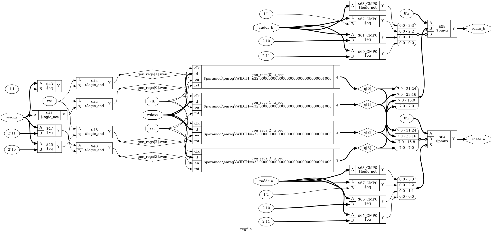

# Tutorial 11: Register File

A CPU keeps the values it is working on in a small set of fast registers. An
instruction such as `ADD R1, R2` reads two of them and writes one back, all in a
single clock. The hardware that does this is a *register file*, and the CPU in
Tutorial 17 will use this one with its four registers,
R0 to R3.

It is also a good reason to learn `generate`. Four registers could be typed out by
hand, but a parameter cannot change how many lines you typed. `generate` lets the
number of instances depend on `REGS`.

Finish [Tutorial 10](../10-async-fifo/README.md) first. This one leans most on the
enable flip-flop from [Tutorial 1](../01-d-flip-flop/README.md), the RAM and the
watched word from [Tutorial 6](../06-sync-ram/README.md), and `cover` from
[Tutorial 5](../05-sequence-detector/README.md). Run these commands in a VS Code
terminal, from this directory:

```bash
cd tutorials/11-register-file
```

To run everything at once, use `make all`.

## The design

[`rtl/enreg.v`](rtl/enreg.v) is the flip-flop from Tutorial 1 with `d` and `q` made
`WIDTH` bits wide. [`rtl/regfile.v`](rtl/regfile.v) uses one per register. It has a
write port, `we`, `waddr` and `wdata`, and two read ports, each an address and a
data output. The reads are combinational, like `wrap` in Tutorial 2. There is no read
enable and no clock: change `raddr_a` and `rdata_a` follows.

### Hierarchy and generate-for

A module placed inside another is an *instance*. Its parameters are set with `#( )`,
which is how `WIDTH` passes down from `regfile` to `enreg`. This makes one instance
per register:

```verilog
wire [WIDTH-1:0] q [0:REGS-1];

genvar i;
generate
    for (i = 0; i < REGS; i = i + 1) begin : gen_regs
        localparam integer INDEX = i;

        wire wen = we && (waddr == INDEX[ADDR_BITS-1:0]);

        enreg #(.WIDTH(WIDTH)) u_reg (
            .clk(clk),
            .rst(rst),
            .en(wen),
            .d(wdata),
            .q(q[i])
        );
    end
```

This looks like the `for` loops in testbenches, but it runs at a different time.
It never runs in the hardware. The tools expand it while building the design, and
`i` is a `genvar`, a constant that only exists during that expansion. With `REGS=4`
the result is the same as writing the block out four times.

`gen_regs` is the block's name. Each copy gets a *hierarchical name* built from it:
`gen_regs[2].wen`, and `gen_regs[2].u_reg.q` for the flip-flops inside. You will see
those names in the waveform, the schematic and the Python test. Always name these
blocks. An exercise below shows what happens if you don't.

`q` is an array of wires, like `mem` in Tutorial 6, with one entry per register. Each
instance drives its own entry, and the read logic picks one.

### The write decoder

`wen` is a *binary decoder*. It turns the 2-bit `waddr` into one enable per register,
and at most one is high. Every instance receives the same `wdata`, and the enable
decides which one takes it. `INDEX` exists because a `genvar` can't be part-selected,
and it needs cutting to the width of `waddr` for the same reason as `LAST` in
Tutorial 2.

### generate-if and addresses with no register

`REGS` need not be a power of two. At `REGS=5` a 3-bit address can also hold 5, 6
and 7, which have no register, and reading `q[5]` gives `x` in Icarus. So a decision
is needed:

- **A write to a missing register changes nothing.** No decoder output matches, so
  this needs no code.
- **A read of a missing register returns 0.** Now the output is always defined.

The check is pointless when every address exists, so `generate` builds it only when
it is needed:

```verilog
if (REGS == (1 << ADDR_BITS)) begin : gen_read_all
    assign rdata_a = q[raddr_a];
    assign rdata_b = q[raddr_b];
end else begin : gen_read_checked
    localparam integer LAST = REGS - 1;

    assign rdata_a = (raddr_a <= LAST[ADDR_BITS-1:0]) ? q[raddr_a] : {WIDTH{1'b0}};
    assign rdata_b = (raddr_b <= LAST[ADDR_BITS-1:0]) ? q[raddr_b] : {WIDTH{1'b0}};
end
```

This choice is made while building the design, so only one branch exists in the
hardware, and with `REGS=4` the CPU pays nothing for the check. `q[raddr_a]` itself
is the *read mux*: a selector that picks one of `REGS` words.

### Reading the register being written

What does `rdata_a` show when `raddr_a` equals `waddr` and `we` is high? **The old
value, until the rising edge.** The new value appears just after the edge. There is
no special logic for this: `rdata_a` looks at the flip-flops, and they have not
changed yet.

The CPU relies on this. `ADD R1, R2` sends `rdata_a` through the ALU and back to
`wdata` while `raddr_a` and `waddr` are both 1. If a read returned the new value, the
result would feed its own input, around a loop with no flip-flop to stop it.

Reset works the same way: reads show the old values until the edge.

## Simulate

[`tb/tb_regfile.v`](tb/tb_regfile.v) keeps a model of what each register should
hold. After every write it reads all addresses on both ports, so a write that also
lands somewhere else gets noticed. It uses two patterns, so that each bit is seen at
0 and at 1, then tests read during write, addresses with no register, and `rst`
beating `we`.

```bash
make sim
make sim REGS=5
make sim REGS=3 WIDTH=4
```

The last lines of each should include `PASS`. The `step` task checks the reads before
the rising edge, against the old values, and again after it.

## View the waveform

Use a fresh simulation for this step. `make verilator` writes the same file, and
Verilator has no `x` value, so run `make sim` again if you have run anything else
since:

```bash
make sim
```

Then open `build/tb_regfile.vcd` as in Tutorial 1. Add `clk`, `rst`, `we`, `waddr`,
`wdata`, `raddr_a`, `rdata_a`, `raddr_b` and `rdata_b` from `tb_regfile`.

Now expand `dut`: open `gen_regs[0]` to find `wen`, and open `u_reg` inside it to
find `q`. Add those two. `$dumpvars` does not write arrays here, which left `mem`
invisible in Tutorial 6, but this design has a real signal for each register. There
is also an empty `gen_read_all` entry. At `REGS=5` it becomes `gen_read_checked`,
which shows that only one branch was built.

- `rdata_a` and `rdata_b` are `x` until 5 ns, when reset clears every `q`.
- At 50 ns `we` rises with `waddr` at 0 and `wdata` at `01`. Only `gen_regs[0].wen`
  goes high. `gen_regs[0].u_reg.q` becomes `01` at 55 ns, and `wen` falls at 60 ns.
- At 60 ns `raddr_b` moves to 3 and `rdata_b` drops from `01` to `00` straight away,
  on a falling edge of `clk`. No register is involved in a read.
- At 460 ns `waddr`, `raddr_a` and `raddr_b` are all 1 and `wdata` is `01`, with
  `we` high. Both read ports show `fe`, the old value. At 465 ns both become `01`.
- At 490 ns `rst` rises and `rdata_a` shows `01`. It stays there until 495 ns, then
  drops to `00`.

## Lint

```bash
make lint
make lint REGS=5
make lint REGS=3
```

Any warning starts with `%Warning`. The lines that start with `- V e r i l a t i o n`
are a normal report. Each run checks `rtl/regfile.v` and `rtl/enreg.v`, and also
[`rtl/regfile_noreset.v`](rtl/regfile_noreset.v), which you will meet below.

## Simulate with Verilator

```bash
make verilator
make verilator REGS=5
```

Each one should print `PASS`. Keep in mind that Verilator has no `x`. That matters
in one of the exercises.

## Test in Python

[`tb/test_regfile.py`](tb/test_regfile.py) applies 10000 cycles of random writes and
reads, and compares both ports against a Python list.

```bash
make cocotb
make cocotb REGS=5
```

Look for `TESTS=1 PASS=1 FAIL=0`. The test logs how many reads landed on a write of
new data, how often the ports showed different values, how many resets cleared real
data, and how often an address with no register was used. It fails if any of them
never happened, and the last is only required when such addresses exist. Python can
reach through the hierarchy too: `dut.gen_regs[i].u_reg.q.value` reads one register
directly, so a stray write is caught at once.

## Prove it with formal verification

```bash
make formal
```

[`regfile.sby`](regfile.sby) runs three proofs, `r4`, `r5` and `r3`, for those values
of `REGS`, and two cover tasks, `c4` and `c5`. Look for
`successful proof by k-induction` for each proof, and `DONE (PASS, rc=0)` for all
five. It took about a second here.

The proof watches one register, as Tutorial 6 watched one word:

```verilog
(* anyconst *) reg [ADDR_BITS-1:0] watch_addr;

reg [WIDTH-1:0] shadow = {WIDTH{1'b0}};
reg             known  = 1'b0;
always @(posedge clk) begin
    if (rst) begin
        shadow <= {WIDTH{1'b0}};
        known  <= 1'b1;
    end else if (we && waddr == watch_addr) begin
        shadow <= wdata;
    end
end
```

This needs no `watch_data`. A register file has a reset, so its contents are always
known, and `shadow` can simply be a copy of the watched register. `known` goes high
at the first reset, and before that nothing is promised. That also means there is no
`assume (rst)` as in Tutorial 2. The only assumption in this file is that `watch_addr`
is a real register, so it adds no limits on the inputs when a CPU proof uses this
module.

The assertions compare the register and both read ports with `shadow`:

```verilog
if (known)
    assert (q[watch_addr] == shadow);
if (known && raddr_a == watch_addr)
    assert (rdata_a == shadow);
```

`shadow` changes on the clock edge, so the second assertion also says that a read
during a write returns the old value. The first is the invariant, as in Tutorial 6.
Two more assertions say that a read of a missing register returns 0.

`rtl/regfile.v` also has `cover` statements for writes, read during write, reset, and
two ports showing different values. Three more for missing addresses sit behind a
generate-if, since they are unreachable at `REGS=4` and would fail the task there.

The output includes `Reached cover statement` up to `in step 3`. That last trace is
`build/formal_c4/engine_0/trace4.vcd`, the shortest way to show two different values
at once. The solver resets, writes `11` to register 0, writes `01` to register 3, and
then reads both.

## See the logic

```bash
make schematic
```

Click `build/regfile.png` in the Explorer:



`prep` keeps the hierarchy, so `enreg` appears as four boxes, labelled from
`gen_regs[0].u_reg` to `gen_regs[3].u_reg`. Follow the data from left to right:

- On the left, the decoder compares `waddr` with each address, and `$logic_and` adds
  `we` to make each `gen_regs[n].wen`.
- `wdata`, `clk` and `rst` go to all four boxes. Only `en` differs.
- On the right, each `q[n]` goes to two `$pmux` cells, one per read port. No clock
  reaches `rdata_a` or `rdata_b`.

## Map it to real FPGAs

[`rtl/regfile_noreset.v`](rtl/regfile_noreset.v) is the same design written as in
Tutorial 6, with `reg [WIDTH-1:0] mem [0:REGS-1];`, and without a reset. It shows what
the reset and the read ports cost. `FLAGS` adds Yosys options, as in Tutorial 6, and
`-nolutram` forbids LUT RAM.

```bash
make synth
make synth REGS=16
make synth-noreset
make synth-noreset REGS=16
make synth-noreset FLAGS=-nolutram
make synth-noreset REGS=256 FLAGS=-nolutram
```

| Version                         | Xilinx             | Gowin                | Cyclone V              |
| ------------------------------- | ------------------ | -------------------- | ---------------------- |
| `regfile`, `REGS=4`             | 32 `FDRE`: 56      | 32 `DFFRE`: 152      | 32 `MISTRAL_FF`: 52    |
| `regfile`, `REGS=16`            | 128 `FDRE`: 278    | 128 `DFFRE`: 1719    | 128 `MISTRAL_FF`: 317  |
| No reset, `REGS=4`              | 4 `RAM32M`: 4      | 4 `RAM16SDP4`: 5     | 16 `MISTRAL_MLAB`: 16  |
| No reset, `REGS=16`             | 4 `RAM32M`: 4      | 4 `RAM16SDP4`: 4     | 16 `MISTRAL_MLAB`: 16  |
| No reset, no LUT RAM, `REGS=4`  | 32 `FDRE`: 52      | 32 `DFFE`: 148       | 32 `MISTRAL_FF`: 52    |
| No reset, no LUT RAM, `REGS=256`| 2048 `FDRE`: 4612  | 2048 `DFFE`: 8088    | 2048 `MISTRAL_FF`: 4578|

The number after the colon is the total cell count. For `regfile`, the Xilinx and
Gowin totals include one `$scopeinfo` per register. It is a marker left by flattening
that remembers the hierarchy, not hardware. These are Yosys counts, so vendor tools
can give different results, and they say nothing about timing.

`regfile` always costs `WIDTH` × `REGS` flip-flops, here 32 and 128, plus the read
muxes. Three differences from the RAM in Tutorial 6 keep it out of memory blocks:

- **Reset.** A memory can't clear every word in one clock, as Tutorial 6 explained.
  Removing the reset is what lets `regfile_noreset` use LUT RAM, and the flip-flops
  disappear from the table.
- **Combinational read.** A block RAM has a clocked read path, so it can't do this.
  With LUT RAM forbidden, the only thing left is flip-flops, and no block RAM appears
  even at `REGS=256`.
- **Two read ports.** The RAM in Tutorial 6 had one. The last exercise shows that
  each extra read port takes another block.

LUT RAM looks like a bargain in this table. But the CPU has only four registers, and
wants them cleared so that a program starts from a known state. That is worth 32
flip-flops. Later lessons copy `rtl/regfile.v` and `rtl/enreg.v` together.

## Try it yourself

Change `rtl/regfile.v`, then run `make sim`, `make cocotb` and `make formal`. Undo each
change before trying the next.

1. Replace `wire wen = we && (waddr` with `wire wen = (waddr`, so every clock writes.
2. Replace `(waddr == INDEX` with `(waddr != INDEX`, so the decoder is inverted.
3. Replace `.rst(rst),` with `.rst(rst && INDEX != 0),`, so reset misses register 0.
4. In the `gen_regs` loop, replace `i < REGS` with `i < REGS - 1`, so the last
   register is missing. `make lint` stays clean, and `make sim` reports `rdata_b=zz`.

Each mistake is caught by all three. The next ones are more interesting.

**New data on a read.** Replace `assign rdata_a = q[raddr_a];` with
`assign rdata_a = (we && waddr == raddr_a) ? wdata : q[raddr_a];`. This is called a
*bypass*. It is a fair design in other places, and the pipelined CPU will come back to
it, but here all three checks fail, because the old value is part of this module's
promise. The `c4` task fails too, with `Unreached cover statement`.

**A bug that depends on `REGS`.** Replace `INDEX[ADDR_BITS-1:0]` with `INDEX[1:0]`,
as you might if you wrote this for four registers first. `make sim`, `make lint` and
`make cocotb` all pass. `make formal` passes `r4` and `r3`, but fails `r5`:

```bash
make sim REGS=5
```

The first failure is `FAIL t=131000 raddr_b=4 rdata_b=01 expected=00`. Index 4 cut to
two bits is 0, so a write to address 0 also lands in register 4. `make lint REGS=5`
reports `WIDTHEXPAND` too, which is why lint needs running at more than one size.

**A bug that only appears at 6.** Replace `if (REGS == (1 << ADDR_BITS))` with
`if (REGS % 2 == 0)`, on the idea that even means fully used. Now run everything:
`make sim` and `make cocotb` pass at 4, 3 and 5, and `make formal` passes every task.
4 is a power of two, and 3 and 5 are odd, so all of them still pick the right branch.
Then try 6, which is neither:

```bash
make sim REGS=6
make cocotb REGS=6
make verilator REGS=6
make formal TASKS=r6
```

`make sim` reports `FAIL t=11000 raddr_b=7 rdata_b=xx expected=00`, because addresses
6 and 7 have no register and nothing checks them. `make cocotb` and the `r6` proof
fail as well. But **`make verilator` prints `PASS`.** Verilator has no `x`, and it
returned 0 for those reads, which happens to be the right answer. Generate bugs live
in particular values of a parameter, so test a power of two, an odd value and an even
value that is not a power of two.

**The invariant.** Replace `assert (q[watch_addr] == shadow);` with `assert (1'b1);`.
`make formal` ends `r4` in `DONE (UNKNOWN, rc=4)` with `returned FAIL for induction`,
on a design with no bug.

**A proof of nothing.** Replace `assume (watch_addr < REGS);` with
`assume (watch_addr < REGS && rst);`, and make the change from exercise 1 as well.
Reset is now held forever, so no write ever lands. `r4` reports
`successful proof by k-induction` on a broken design, and only `c4` complains, with
`Unreached cover statement`.

**Names are part of the design.** Replace `begin : gen_regs` with `begin`. `make sim`,
`make verilator`, `make lint` and `make formal` all pass, but `make cocotb` fails with
`regfile contains no child object named gen_regs`. The tool chose a name, and the VCD
now shows `genblk1[0]`. Anything that refers to the hierarchy depends on these names.

**What a block RAM needs.** Make the reads clocked in `rtl/regfile_noreset.v`: change
both outputs to `output reg `, delete the two `assign` lines, and add these at the top
of the `always` block:

```verilog
rdata_a <= mem[raddr_a];
rdata_b <= mem[raddr_b];
```

Then run `make synth-noreset REGS=256 FLAGS=-nolutram`. Instead of 2048 flip-flops you
get two blocks on every family: 2 `RAMB18E1`, 2 `DPX9B` and 2 `MISTRAL_M10K`. One write
port and one read port fit in a block, so a second read port needs a second block that
holds the same data. That design is cheap, but its reads take a clock, and it has no
reset.
