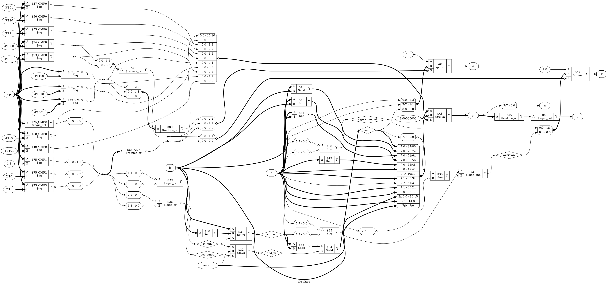

# Tutorial 12: ALU with status flags

A CPU has no `if` statement. It compares two numbers by subtracting them, keeps a
few bits that describe the result, and branches on those bits. They are the
*status flags*, and they make signed numbers, comparisons and numbers wider than
the ALU possible. The CPU in Tutorial 17 will copy this file, so its rules are
written down exactly.

Finish [Tutorial 4](../04-alu/README.md) first, since this one extends it. Run
these commands in a VS Code terminal, from this directory:

```bash
cd tutorials/12-flags-alu
```

To run everything at once, use `make all`.

## Two's complement

Eight bits have 256 patterns, and we decide what they mean. In *two's complement*
the top bit counts as -128 instead of +128, so they run from -128 to 127 rather
than 0 to 255. `01111111` is 127 either way. `10000000` is 128 or -128, `11001000`
is 200 or -56, and `11111111` is 255 or -1.

The two readings of a pattern differ by 256. An 8-bit adder drops anything past 8
bits, so it works modulo 256 and cannot tell them apart. That is why one adder does
both kinds of arithmetic: `11001000 + 01100100` gives `00101100`, which is right
as 200 + 100 (losing 256) and as -56 + 100 = 44.

To negate a number, invert it and add 1. So `a - b` is `a + ~b + 1`, and the same
adder subtracts too. The bits of the answer are the same either way. Only the
question "did it fit?" has two answers, so there are two flags.

## The design

[`rtl/alu_flags.v`](rtl/alu_flags.v) has inputs `a`, `b`, `carry_in` and `op`, and
outputs `y`, `z`, `c`, `n` and `v`. This table is the contract for the CPU:

| `op`   | Name     | `y`                            | `c`                | `v`                 |
| ------ | -------- | ------------------------------ | ------------------ | ------------------- |
| 0      | `ADD`    | `a + b`                        | Carry out          | Signed overflow     |
| 1      | `ADC`    | `a + b + carry_in`             | Carry out          | Signed overflow     |
| 2      | `SUB`    | `a - b`                        | NOT borrow         | Signed overflow     |
| 3      | `SBC`    | `a - b - !carry_in`            | NOT borrow         | Signed overflow     |
| 4      | `AND`    | `a & b`                        | 0                  | 0                   |
| 5      | `OR`     | `a \| b`                       | 0                  | 0                   |
| 6      | `XOR`    | `a ^ b`                        | 0                  | 0                   |
| 7      | `NOT`    | `~a`                           | 0                  | 0                   |
| 8      | `SHL`    | `a` left, 0 comes in           | Old top bit of `a` | Sign of `a` changed |
| 9      | `SHR`    | `a` right, 0 comes in          | Old bit 0 of `a`   | 0                   |
| 10     | `ASR`    | `a` right, sign bit kept       | Old bit 0 of `a`   | 0                   |
| 11     | `ROL`    | `a` left, `carry_in` comes in  | Old top bit of `a` | Sign of `a` changed |
| 12     | `ROR`    | `a` right, `carry_in` comes in | Old bit 0 of `a`   | 0                   |
| 13     | `PASS_B` | `b`                            | 0                  | 0                   |
| 14, 15 | Unused   | 0                              | 0                  | 0                   |

For every operation, `z` is high when `y` is 0, and `n` is the top bit of `y`.
`WIDTH` must be at least 2.

Shifts differ from Tutorial 4. They move `a` by exactly one place and ignore `b`,
so `c` has one clear meaning: the bit that fell off the end. The rotates go
*through* the carry. For a plain rotate, feed the bit leaving `a` into `carry_in`.
`SHL` and `ROL` double the number, so they give the same `y`, `c` and `v` as
`ADD a, a` and `ADC a, a`. `SHR` and `ASR` halve a number, unsigned or signed, so they
cannot overflow. `ROR` is different: a `carry_in` of 1 enters at the top, which can make
the unsigned value bigger and flip the sign. Its `v` of 0 is this ALU's choice, not a
fact of arithmetic.

The ALU stores nothing. Keeping the flags between instructions is the CPU's job,
in a register whose `c` feeds back to `carry_in`.

All four sums share one adder. `{c, y} = sum;` then takes the answer apart, as in
Tutorial 4, and the block has the same default assignments, now for `v` as well.

```verilog
wire             is_sub    = (op == OP_SUB) || (op == OP_SBC);
wire             use_carry = (op == OP_ADC) || (op == OP_SBC);
wire [WIDTH-1:0] addend    = is_sub ? ~b : b;
wire             add_in    = use_carry ? carry_in : is_sub;
wire [WIDTH:0]   sum       = {1'b0, a} + {1'b0, addend} + {{WIDTH{1'b0}}, add_in};
```

### c and v are different questions

`c` asks: did the *unsigned* answer fit? `v` asks: did the *signed* answer fit?
Neither tells you about the other:

```bash
make sim
```

The first lines are real results, with the signed reading in brackets:

```text
ADD a=100 (100) b=20 (20) carry_in=0: y=120 (120) z=0 c=0 n=0 v=0
ADD a=200 (-56) b=100 (100) carry_in=0: y=44 (44) z=0 c=1 n=0 v=0
ADD a=100 (100) b=100 (100) carry_in=0: y=200 (-56) z=0 c=0 n=1 v=1
ADD a=128 (-128) b=255 (-1) carry_in=0: y=127 (127) z=0 c=1 n=0 v=1
```

100 + 20 fits both ways. 200 + 100 is too big unsigned, but -56 + 100 = 44 is
right. 100 + 100 is right unsigned, but reads as -56 signed. -128 + -1 is wrong
both ways. The hardware does not know which kind of number you meant. It sets both
flags, and the program looks at the one that applies.

### The v formula

```verilog
wire overflow = (a[WIDTH-1] == addend[WIDTH-1]) && (sum[WIDTH-1] != a[WIDTH-1]);
```

In words: two numbers of the same sign gave a result of the other sign.

Adding numbers of opposite signs cannot overflow, because the answer lies between
them. Adding two of the same sign moves away from 0 by at most one full range, so
a wrong answer is exactly 256 from the true one. That puts it on the other side
of 0, which flips the sign bit.

Look at `addend`, not `b`. In a subtraction the number really added is `~b`, whose
sign is the opposite of the sign of `b`.

### The carry after a subtraction

Each CPU needs one rule here. x86, Z80 and AVR make `c` mean *borrow*, as Tutorial
4 did. ARM and the 6502 make it mean *NOT borrow*, and so does this design: **`c`
= 1 means nothing was borrowed, so `a >= b` as unsigned numbers.**

The reason is in the adder. The carry out of `a + ~b + 1` is 1 exactly when no
borrow happened, so using it as it comes needs no inverter on the way out or back
in. `SBC` is then just `ADC` with `~b`, and `SUB` is `SBC` with `carry_in` at 1.
The cost is that `carry_in` means "no borrow coming in".

## The Verilog `signed` pitfalls

`$signed(x)` changes how bits are read, not the bits. `>>>` shifts right and copies
the sign bit in, but only in a signed expression. Here is the trap: **an expression
is signed only if every operand is signed.** One unsigned operand makes all of it
unsigned, without any message. In [`tb/signed_pitfalls.v`](tb/signed_pitfalls.v),
`s` is a signed -3, `u` an unsigned 2, and `raw` is unsigned with the same bits as `s`:

```bash
make pitfalls
```

It runs under Icarus and then Verilator, and each prints these lines. The run fails if
either gives anything else:

```text
                         s < u = 0  (the right answer is 1)
        s < $signed({1'b0, u}) = 1  (the right answer is 1)
                         s + u = 255  (the right answer is -1)
        s + $signed({1'b0, u}) = -1  (the right answer is -1)
                      s + 1'b1 = 254  (the right answer is -2)
                         s + 1 = -2  (the right answer is -2)
                        s[7:0] = 253  (the right answer is -3)
                     raw >>> 1 = 126  (the right answer is 254)
            $signed(raw) >>> 1 = 254  (the right answer is 254)
sel ? $signed(raw) >>> 1 : raw = 126  (the right answer is 254)
```

- `s + u` goes into a 16-bit target. Being unsigned, `s` is extended with zeros and
  not its sign. The `{1'b0, u}` in the fix keeps the value of `u`: `$signed(u)` alone
  would read a `u` of 200 as -56.
- `1'b1` is unsigned, and a plain `1` is a signed integer.
- A part-select is unsigned, even when it selects every bit.
- `?:` is the worst. The `$signed` and the `>>>` are both correct, but `raw` is in
  the same expression, so the shift is done unsigned.

That last trap is why `ASR` has a `case` branch with nothing else in the expression:

```verilog
y = $signed(a) >>> 1'b1;
```

Lint is little help. `verilator --lint-only -Wall` on this file warned about widths
on some lines, but said nothing about `s < u`, `raw >>> 1` or the `?:` line. Those width
warnings are on purpose here, so `make pitfalls` builds with `-Wno-WIDTHEXPAND`.

## What flags are for

### Comparisons

To compare, `SUB` and look at the flags, then throw `y` away.

| Test     | Unsigned  | Signed          |
| -------- | --------- | --------------- |
| `a == b` | `z`       | `z`             |
| `a < b`  | `!c`      | `n ^ v`         |
| `a >= b` | `c`       | `!(n ^ v)`      |
| `a <= b` | `!c \| z` | `(n ^ v) \| z`  |
| `a > b`  | `c & !z`  | `!(n ^ v) & !z` |

`n` is the sign of the 8-bit answer, and when `v` is high that answer is on the
wrong side of 0. So `n ^ v` is the sign of the true answer. Compare 100 with -100:

```text
SUB a=100 (100) b=156 (-100) carry_in=0: y=200 (-56) z=0 c=0 n=1 v=1
```

Unsigned, `c=0` says 100 is less than 156. Signed, `n ^ v` is 0, which says 100 is
not less than -100. Both are right, and `n` alone would get the signed one wrong.
The testbench checks `==`, `<` and `<=` both ways against plain integer comparisons.

### Numbers wider than the ALU

An 8-bit CPU adds 16-bit numbers as you do by hand: low column first, then carry
into the next one. Here is 456 + 356, which are `1, 200` and `1, 100` in two bytes:

```text
ADD a=200 (-56) b=100 (100) carry_in=0: y=44 (44) z=0 c=1 n=0 v=0
ADC a=1 (1) b=1 (1) carry_in=1: y=3 (3) z=0 c=0 n=0 v=0
```

The result is `3, 44`, which is 3 × 256 + 44 = 812. The task `wide_add` in
[`tb/tb_alu_flags.v`](tb/tb_alu_flags.v) does this for 4000 pairs, some of them
corner cases, against a real 16-bit sum. The final `c`, `n` and `v` all describe the
16-bit answer. `wide_sub` does the same with `SUB` then `SBC`, and `c` goes straight
across with nothing inverted. `wide_shift` uses `SHL` then `ROL`, which is why the
rotates go through the carry.

`z` does not carry over. Here is 1 + 0 in two bytes:

```text
ADD a=1 (1) b=0 (0) carry_in=0: y=1 (1) z=0 c=0 n=0 v=0
ADC a=0 (0) b=0 (0) carry_in=0: y=0 (0) z=1 c=0 n=0 v=0
```

The answer is 1, but the last `z` is high, because it describes the high byte only.
A 16-bit zero test needs `z` from both steps, and `wide_add` ANDs them.

## Simulate

`make sim` tries every combination of `a`, `b`, `carry_in` and `op`, at 8 bits and
including the unused ops, in about 10 seconds here. Look for:

```text
PASS: 2097152 input combinations, 12000 wide operations
```

The answers come from plain integers and range checks, not from copying the design.
`op` changes fastest, because Tutorial 4 showed that the order can hide a latch.
`make sim WIDTH=4` runs other sizes, but every extra bit multiplies the work by 4.

## View the waveform

Only the printed steps are recorded, since `$dumpoff` stops the VCD before the
long loops. Run `make sim`, open `build/tb_alu_flags.vcd` as in Tutorial 1, and add
`clk`, `a`, `b`, `carry_in`, `op`, `y`, `z`, `c`, `n` and `v` from `tb_alu_flags`.

- Everything except `clk` is `x` until 10 ns, as in Tutorial 4.
- Everything changes on falling edges of `clk`, and the flags change at the same
  instant as `a` and `b`. There are no flip-flops here.
- At 30 ns `a` and `b` are 100. `y` is 200, `v` and `n` are high, and `c` is low.
- At 40 ns `a` is 128 and `b` is 255, and `c` and `v` are both high.
- At 80 ns `c` is high with the low byte of the wide sum. At 90 ns `carry_in`
  rises and `op` becomes 1: the carry moving to the next step.
- At 110 ns `z` is high.
- At 120 ns the trace ends and the signals show `x`. That is what `$dumpoff`
  writes. It is not the design.

## Lint and Verilator

```bash
make lint
make lint WIDTH=2
make lint WIDTH=32
make verilator
```

Any warning starts with `%Warning`. The lines that start with `- V e r i l a t i o n`
are a normal report. `make verilator` writes no waveform, unlike earlier tutorials:
Verilator ignored `$dumpoff` and wrote a 224 MB file, so the Makefile leaves out
`--trace`.

## Test in Python

[`tb/test_alu_flags.py`](tb/test_alu_flags.py) applies 20000 random inputs at any
width. Its model copies nothing from the RTL and never uses a sign bit to set a
flag. Python integers do not overflow, so it finds the true answer and asks
whether that fits:

```python
total = a + b + extra
return total % size, int(total >= size), int(not fits(sa + sb + extra))
```

```bash
make cocotb
make cocotb WIDTH=32
```

Look for `TESTS=1 PASS=1 FAIL=0`. The test logs what it reached, and fails if any
count is 0. The counts include all four combinations of `c` and `v`, overflow on a
shift, and subtractions where the signed and unsigned orders disagree.

## Prove it with formal verification

```bash
make formal
```

[`alu_flags.sby`](alu_flags.sby) has two tasks, `WIDTH=8` and `WIDTH=32`. Look for
`successful proof by k-induction` and `DONE (PASS, rc=0)` for each of them.

Tutorial 4 warned that a check that shares a wire with the design shares its
mistakes too. So each number in the `` `ifdef FORMAL `` block is signed and two bits
wider than the design, too wide to overflow, and each flag comes from its definition:

```verilog
4'd2: begin
    assert (f_uy - f_b_weight == f_ua - f_ub);
    f_exact = f_sa - f_sb;
end
...
assert (v == (f_exact < f_smin || f_exact > f_smax));
```

The first line says `y` falls short of the true difference by 2<sup>WIDTH</sup>
exactly when `c` is 0, which is what NOT borrow means. The last says `v` is high
exactly when the true signed answer is out of range. Neither mentions `sum`,
`addend` or `overflow`, and the block uses numbers rather than the `OP_` names.

## See the logic

```bash
make schematic
```

Click `build/alu_flags.png` in the Explorer, and zoom in:



- At the left, `$eq` blocks decode `op`, as in Tutorial 4.
- At the bottom middle, `$not` and a `$mux` make `addend`, and two `$add` blocks
  make `sum`. Beside them, `$eq`, `$ne` and `$logic_and` make `overflow`.
- The three `$pmux` blocks at the right choose `y`, `c` and `v`.
- There is no shifter. A one-place shift is only wires, arriving at the tall box
  beside the `$pmux` for `y`. In the `ASR` rows, bit 7 of `a` is used twice:
  `7:7` and `7:1`.

## Map it to real FPGAs

```bash
make synth
```

| Family     | Flip-flops | Carry cells             | Total cells |
| ---------- | ---------- | ----------------------- | ----------- |
| Xilinx     | 0          | 3 `CARRY4`              | 63          |
| Gowin      | 0          | 9 `ALU`                 | 138         |
| Cyclone V  | 0          | 10 `MISTRAL_ALUT_ARITH` | 70          |

This is smaller than Tutorial 4's ALU, which had two separate sums and a barrel
shifter. These are Yosys counts at `WIDTH=8`, so vendor tools can give different
results, and they say nothing about timing.

## Try it yourself

Change `rtl/alu_flags.v`, then run `make sim`, `make cocotb` and `make formal`.
Undo each change before trying the next.

1. In `overflow`, replace `addend[WIDTH-1]` with `b[WIDTH-1]`. 3 - 5 now overflows.
2. In `add_in`, replace `carry_in` with `(carry_in ^ is_sub)`, so `SBC` takes a borrow.
3. Replace the `ASR` line with `y = (op == OP_ASR) ? $signed(a) >>> 1'b1 : a;`. It
   looks correct, and it is the `?:` trap.
4. Replace `~|y` with `~|y[WIDTH-2:0]`, so `z` misses the top bit.
5. Delete `v = 1'b0;`. Tutorial 4's latch is back, and this time `make sim` finds it:
   the first failure is a `SHR` straight after a `SHL` that overflowed.

Each mistake is caught by all three.

**A bug that small numbers cannot see.** Compute `v` one bit too low:

```verilog
wire overflow = (a[WIDTH-2] == addend[WIDTH-2]) && (sum[WIDTH-2] != a[WIDTH-2]);
```

Test with only small numbers, `a` and `b` from -32 to 31:

```bash
make sim SMALL=32
```

```text
PASS: 131072 input combinations, 0 wide operations
```

That is every operation on 4096 pairs, positive and negative. Those answers all fit
in 7 bits, so bit 6 is a copy of the sign, and the true `v` is always 0. Now try
`make sim SMALL=33`, `make sim`, `make cocotb` and `make formal`. All of them fail. A
test of friendly numbers passes a broken overflow flag, because it never overflows.

**A change that should pass.** The other textbook formula for `v` is the carry into
the top bit XORed with the carry out of it, and the carry in is `a ^ addend ^ sum`
at that bit:

```verilog
wire overflow = sum[WIDTH] ^ a[WIDTH-1] ^ addend[WIDTH-1] ^ sum[WIDTH-1];
```

Everything passes, including both proofs. The solver has shown that two formulas
which look nothing alike are the same.

**A bug that depends on the parameter.** Write the 8-bit version with fixed numbers:

```verilog
wire overflow = (a[7] == addend[7]) && (sum[7] != a[7]);
```

`make sim` and `make cocotb` pass, and `make formal` passes `w8` but fails `w32`. So
does `make cocotb WIDTH=32`. This is why the proof runs at a second width.

**A proof that shares a wire.** Put the bit-too-low `overflow` back. In the formal
block, replace the `v` assertion with `if (op < 4'd4) assert (v == overflow);`, and
delete `assert ((n != v) == (f_sa < f_sb));`. `make sim` and `make cocotb` still
fail, but `make formal` now passes both widths on a broken design, because it is
comparing the wire with itself. Put the comparison line back and the proof fails
again, since that assertion is stated independently.
