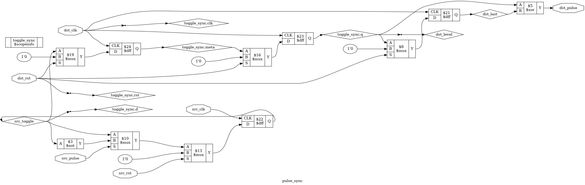

# Tutorial 13: Clock Crossings and Reset Synchronizers

[Tutorial 10](../10-async-fifo/README.md) moved whole words between clocks. Most
crossings are smaller: one *busy* flag, one *done* pulse, one reset. Each looks
too simple to go wrong, and each can fail in a way that passes tests. The CPU you
are building will need this as soon as it meets the outside world: its reset and
its serial port do not arrive on its clock.

Finish [Tutorial 10](../10-async-fifo/README.md) first, since this builds on its
two-flop synchronizer and its warning. Run these commands in a VS Code terminal,
from this directory:

```bash
cd tutorials/13-cdc-reset
```

To run everything at once, use `make all`.

## Warning: simulation does not model metastability

**A passing test does not prove that a clock domain crossing is safe.**

Icarus, Verilator and cocotb treat a flop as ideal. A sampled bit is exactly 0 or
exactly 1, straight away. A real flop whose input changes at the wrong moment can
sit between the two for a while, and that never happens here. So no test below
can see the failure a synchronizer exists to prevent.

Formal verification here does not model it either. `make formal` lets the clocks
move in any pattern, but every flop is still ideal, so a proof says "this design
is correct if every flop is ideal".

A real design needs clock domain crossing analysis and timing constraints, from
the vendor tools (Vivado, Gowin EDA, Quartus). Those tools are deliberately not in
this environment, and nothing in this tutorial has been through one. It makes no
claim about timing, about failure rates, or about how any device behaves. What
the checks do show is the logic: whether pulses get lost, and whether resets
leave on the right edge. Near the end you will remove a synchronizer flop and see
exactly which checks notice, and why they do.

## Three modules, and which top each target uses

| Target                 | Top                                                    |
| ---------------------- | ------------------------------------------------------ |
| `sim`, `verilator`     | `tb_cdc`, which holds all three through `tb/cdc_top.v` |
| `cocotb`               | `cdc_top`, so one run covers all three                 |
| `lint`, `synth`        | Each of the three modules in turn                      |
| `formal`               | Each of the three modules, one task per proof          |
| `schematic`            | `pulse_sync`, flattened                                |

[`tb/cdc_top.v`](tb/cdc_top.v) is a small system with two clock domains. `clk_a`
sends to `clk_b`, and one `arst` fans out to both. There are no parameters here.

## A single level: why two flops are enough

[`rtl/sync_2ff.v`](rtl/sync_2ff.v) is the synchronizer from Tutorial 10, for one
bit:

```verilog
meta <= d;      // can go metastable
q    <= meta;   // the only reader of meta
```

The first flop may misbehave, and the second gives it almost a whole clock to
settle before anyone looks. This makes failure unlikely, not impossible.

One bit is the easy case because there is nothing to tear. A sample taken as `d`
changes can land on the old value or the new one, and both are true. At worst `q`
is one clock later. Tutorial 10 needed Gray code to get several bits into that
position. A single bit is there already.

`d` must come straight from a flop in the sending domain, since combinational
logic can glitch and the sampling flop could catch the glitch.

## A pulse can vanish

A level waits to be seen. A pulse does not. Suppose `clk_a` is 7 times faster than
`clk_b`, and a pulse lasts one `clk_a` clock. It can start and end between two
rising edges of `clk_b`. Nothing samples it, and nothing records that it existed.

`cdc_top` has that crossing built in, as `b_naive`: `a_pulse` through `sync_2ff`,
then a rising-edge detector. It is the obvious design, so run it:

```bash
make sim
```

Look for `PASS`, and these lines, where `naive` is how many got through:

```text
half periods 1009 and 7001 ps, gap 14: sent 200, pulse_sync 200, naive 32
half periods 3137 and 5003 ps, gap 4: sent 200, pulse_sync 200, naive 111
half periods 5003 and 5021 ps, gap 3: sent 200, pulse_sync 200, naive 198
half periods 5003 and 3137 ps, gap 2: sent 200, pulse_sync 200, naive 200
half periods 7001 and 1009 ps, gap 2: sent 200, pulse_sync 200, naive 200
1000 level changes, the naive crossing lost 259 pulses
```

The naive crossing lost 168 of 200 going from fast to slow. It lost none from slow
to fast, so a test at only that ratio would call it good. Clocks 0.4 percent apart
lost 2, which is why a design that "runs at about the same speed" is not safe.

## The toggle pulse synchronizer

The fix in [`rtl/pulse_sync.v`](rtl/pulse_sync.v) is to stop sending a pulse. Each
pulse flips a level instead, and a level waits:

```verilog
else if (src_pulse)
    src_toggle <= ~src_toggle;          // on src_clk

sync_2ff toggle_sync (... .d(src_toggle), .q(dst_level));   // into dst_clk

dst_last <= dst_level;                  // on dst_clk
assign dst_pulse = dst_level ^ dst_last;
```

The XOR is what makes it work: a change in *either* direction is one pulse. The
crossing itself is plain `sync_2ff`, carrying one bit that comes from a flop.

## The limit on spacing

The toggle only waits until the next pulse. Two pulses flip it there and back, and
if no `dst_clk` edge falls between them, the destination sees no change at all. So
both pulses are gone.

**The rule for this design: pulses must be at least two `dst_clk` periods apart.**

For ideal flops one period is enough, and the testbench measures that. Here `clk_a`
is 2018 ps and `clk_b` is 14002 ps, so one `clk_b` period is 6.9 clocks of `clk_a`:

```text
gap  1 clk_a clocks: sent 100, lost 86
gap  2 clk_a clocks: sent 100, lost 84
gap  5 clk_a clocks: sent 100, lost 54
gap  6 clk_a clocks: sent 100, lost 26
gap  7 clk_a clocks: sent 100, lost 0
gap 14 clk_a clocks: sent 100, lost 0
```

That is from the 16 gaps `make sim` prints. So why ask for two periods? A real flop
sampling near a change may take either value, so the sample nearest each end of the
gap cannot be relied on. With two periods, one sample always falls well inside the
gap. That is an argument about margin, and not a measurement, because these tools
have no such effect to measure. If pulses can arrive closer than the rule allows,
this is the wrong module: use a FIFO, or a handshake that makes the sender wait.

The test also fails if any pulse is lost at a gap of one `clk_b` period or more.

## View the waveform

Use a fresh simulation for this step. `make verilator` writes the same file, and
Verilator has no `x` value, so run `make sim` again if you have run anything
else since:

```bash
make sim
```

Then open `build/tb_cdc.vcd` as in [Tutorial 1](../01-d-flip-flop/README.md). Times
are in ps. From `tb_cdc` add `clk_b`, `a_pulse` and `b_pulse`. Expand `dut`, then
add `src_toggle` and `dst_level` from `pulse`, `meta` from `pulse.toggle_sync`, and
`meta` from `naive_sync`. Go to 7527000 ps, the first pulse at the 7 to 1 ratio:

- `a_pulse` is high from 7536266 to 7538284. `clk_b` rises at 7527369 and 7541371,
  so the whole pulse fits between two edges. `meta` in `naive_sync` stays 0. That
  pulse is gone, and this is the moment it was lost.
- `src_toggle` rises at 7537275 and stays high, so `meta` in `toggle_sync` catches
  it on the next edge, at 7541371.
- `dst_level` and `b_pulse` rise together one `clk_b` later, at 7555373.
  `b_pulse` falls at 7569375, one `clk_b` clock long.
- The next pulse takes `src_toggle` to 0 at 7565527. `dst_level` falls at 7583377,
  and `b_pulse` rises again. A falling level is a pulse too.

## Why reset release is dangerous

An asynchronous reset is attractive: it works with no clock. Asserting it is
harmless, since everything goes into reset, and the order does not matter. The
danger is in letting go.

If reset is released just before a clock edge, the release reaches some flops
before that edge and others after it, because the net is long. Those flops then
leave reset one clock apart, so the design wakes up in a state it can never reach
by itself. A real flop also has a recovery time, like a setup time for its reset
pin, so a release close to an edge is the metastability problem again.

The testbench shows the first half of that, with the skew written in by hand. A
two-flop one-hot ring must always hold exactly one 1, and the reset reaches one
flop 200 ps after the other. It is released 100 ps before a rising edge:

```text
raw release: ring=11
```

Bit 1 left reset before the edge and took a 1 from bit 0, and bit 0 was still held
at 1. Those two 1s now circulate forever.

## The reset synchronizer

[`rtl/reset_sync.v`](rtl/reset_sync.v) keeps the good half of an asynchronous reset
and fixes the bad half. It is called *asynchronous assert, synchronous deassert*:

```verilog
always @(posedge clk or posedge arst) begin
    if (arst) begin
        meta <= 1'b1;
        rst  <= 1'b1;
    end else begin
        meta <= 1'b0;
        rst  <= meta;
    end
end
```

- **Assert.** `arst` sets both flops at once, with no clock needed.
- **Release.** A 0 walks through two flops, so `rst` can only fall just after a
  rising edge of `clk`, on the second edge after `arst` falls. The first flop is
  the one whose release can land close to an edge. It is a synchronizer, carrying
  a constant 0.
- **Short resets.** Even a 100 ps glitch on `arst` gives a reset that lasts until
  that second edge.

`rst` now changes just after an edge, so skew up to nearly a whole clock no longer
straddles one. With the same ring, the same skew and the same moment:

```text
synchronized release: ring=10, one bit set for 8 clocks
```

The modules in this tutorial use `rst` as a synchronous reset, as this course
always has. That works because `rst` is held across clock edges, but it needs a
running clock. A domain whose clock is stopped has not been reset.

## Reset fan-out

Each clock domain needs its own `reset_sync`, clocked by that domain's clock. A
release timed for one clock means nothing to another. `cdc_top` does this:

```verilog
reset_sync a_reset (.clk(clk_a), .arst(arst), .rst(rst_a));
reset_sync b_reset (.clk(clk_b), .arst(arst), .rst(rst_b));
```

So the domains leave reset at different moments, which is the catch. `make sim`
checks that each leaves on its own second edge. In the trace, `arst` falls at
50030 ps, `rst_b` at 59603 ps and `rst_a` at 65039 ps.

Worse, `reset_sync` stretches a reset only inside its own domain. Take a short
`arst`, a slow `clk_a`, and `src_toggle` left high by an odd number of pulses.
Domain b leaves reset before `clk_a` has had an edge to clear the toggle, sees a
toggle of 1, then sees it fall:

```text
short reset, toggle high: 2 phantom pulses
long reset, toggle high: 0 phantom pulses
```

**The rule: hold `arst` until every clock has had a rising edge.** This is the same
rule Tutorial 10 gave its two resets, and `reset_sync` does not remove it. A source
of short resets needs stretching on the slowest clock. If one domain must wait for
another, as a sender must wait for its receiver, that takes design too: nothing
here makes the two releases line up.

## From reset to the serial port

A reset button and a serial line have the same problem: neither has a clock. The
receiver in the [next tutorial](../14-uart/README.md) reads its `rx` pin through a
two-flop synchronizer, for the reasons above. Reset meets it there too. `sync_2ff`
resets to 0, but a serial line idles high and a low level means a start bit. A 0
left by reset would look like one, so the receiver's synchronizer resets to 1. When
you pick a reset value for a crossing, ask what the far side will think it means.

## Lint

```bash
make lint
```

This lints each module in turn. Any warning starts with `%Warning`. The lines that
start with `- V e r i l a t i o n` are a normal report.

## Simulate with Verilator

```bash
make verilator
```

The numbers should match `make sim`. The clock half periods are variables, so this
needs `--no-sched-zero-delay`, as in Tutorial 10. The testbench drives with `<=`, so
that a rising edge of the other clock landing at the same instant always gets the
old value, whichever process the simulator runs first. The exception is `arst`,
which is asserted between edges on purpose.

## Test in Python

[`tb/test_cdc.py`](tb/test_cdc.py) runs five clock ratios, in both directions. At
each it sends 1000 pulses with random gaps, about 60 percent of them exactly on the
two-period limit, and changes `a_level` at random while comparing `b_level` with
the value two edges ago. Two more tests cover pulses below the limit, which must be
seen to vanish, and 50 random resets.

```bash
make cocotb
```

Look for `TESTS=7 PASS=7 FAIL=0 SKIP=0`. The numbers vary from run to run:

```text
periods 2018 and 14002 ps, gap 14: sent 1000, pulse_sync 1000, naive 141, ...
below the limit: sent 1000, received 228
50 resets, 35 with the toggle high, 99 pulses
```

A test fails if a pulse is lost above the limit, if none was sent on the limit, if
nothing was lost below it, if the naive crossing lost nothing at the 7 to 1 ratio,
or if no reset ever arrived with the toggle high.

## Prove it with formal verification

```bash
make formal
```

[`cdc_reset.sby`](cdc_reset.sby) has six tasks, and takes a few seconds. Look for
`DONE (PASS, rc=0)` on each, and `successful proof by k-induction` on the three
called `*_prove`. As in Tutorial 10, `multiclock on` lets the solver raise any clock
at any step, so each proof covers every clock ratio at once.

| Task          | Proved, for ideal flops                                                  |
| ------------- | ------------------------------------------------------------------------ |
| `sync_prove`  | `q` is `d` from exactly two rising edges ago, and moves only on `clk`    |
| `pulse_prove` | Every pulse is taken once or still in the chain, and arrives in 3 edges  |
| `reset_prove` | `rst` is high whenever `arst` is, and falls on exactly the second edge   |
| `*_cover`     | Traces exist: `q` high, a pulse out, three pulses in flight, a new reset |

The assumptions, which are the important part:

- `sync_prove`: `rst` is high until `clk` has risen. `d` is free to change at any step.
- `pulse_prove`: one reset, at the start, of both sides together, until each clock
  has risen. And **one rising edge of `dst_clk` strictly between two pulses**:

  ```verilog
  if (src_sent)
      assume (edges != 2'd0);
  ```

  That is weaker than the two-period rule, so pulses that keep the rule meet it.
- `reset_prove`: `arst` is high at the first step. After that it may do anything.

Each module has its own define, such as `CHECK_PULSE_SYNC`, so that `pulse_prove`
does not pick up the assumptions of `sync_2ff`. The extra `f_meta` port on `sync_2ff`
exists only under that define, and lets the proof see the first flop.

What was **not** proved:

- Metastability, or a release inside a flop's recovery time. See the warning above.
- A reset during operation of `pulse_sync`, or a release of one side alone. Only the
  tests touch those.
- The fan-out rule, or anything about `cdc_top`. Each proof covers one module.
- That the two-period rule is enough on a real device.
- That data keeps flowing on real clocks. The solver may stop a clock forever.

## See the logic

```bash
make schematic
```

Click `build/pulse_sync.png` in the Explorer:



Start at `src_pulse`, bottom left. It feeds `$mux` cells into the only flop on
`src_clk`, and that flop's output `src_toggle` loops back through `$not`. Follow
`src_toggle` up to `toggle_sync.meta` and `toggle_sync.q`, both clocked by `dst_clk`.
That line is the crossing, and it is the only wire joining the two clocks. The `$xor`
at the top right is the edge detector, comparing `dst_level` with `dst_last`.

## Map it to real FPGAs

```bash
make synth
```

| Module       | Xilinx        | Gowin                 | Cyclone V                |
| ------------ | ------------- | --------------------- | ------------------------ |
| `sync_2ff`   | 2 `FDRE`      | 2 `DFFR`              | 2 `MISTRAL_FF`           |
| `pulse_sync` | 4 `FDRE`      | 3 `DFFR`, 1 `DFFRE`   | 4 `MISTRAL_FF`           |
| `reset_sync` | 2 `FDPE`      | 2 `DFFP`              | 2 `MISTRAL_FF`           |

The table shows flops only. Total cells are 2, 7 and 2 for Xilinx, 2, 7 and 3 for
Gowin, and 2, 7 and 4 for Cyclone V, and the 7s for Xilinx and Gowin include 1
`$scopeinfo`, which is not hardware. `reset_sync` maps to a different flop on Xilinx
and Gowin, because it needs an asynchronous set. These are Yosys counts, so vendor
tools can give different results. They say nothing about timing, and Yosys does not
check the crossing.

## Try it yourself

Change the RTL, then run `make sim`, `make cocotb` and `make formal`. Undo each
change before trying the next.

| Change                                                         | Sim  | cocotb    | Formal             |
| -------------------------------------------------------------- | ---- | --------- | ------------------ |
| `dst_pulse = dst_level & ~dst_last`, rising edges only         | FAIL | 6 of 7 fail | `pulse_prove` fails |
| `dst_pulse = dst_level`, no edge detector                      | FAIL | 6 of 7 fail | `pulse_prove` fails |
| In `reset_sync`, `rst <= 1'b0;`, one stage                     | FAIL | 1 of 7 fails | `reset_prove` fails |
| In `reset_sync`, drive `rst` straight from `arst`              | FAIL | 1 of 7 fails | `reset_prove` fails |

The next ones are more interesting.

**Pulse sync without the toggle.** Remove the `else if` and write
`else src_toggle <= src_pulse;`. Every clock ratio now fails: from slow to fast the
XOR sees both edges of the pulse, so 200 pulses arrive as 400. Now also use the
rising-edges change from the table. That rebuilds the naive crossing, and from slow
to fast it reports 200 of 200. Only ratios with `clk_a` faster fail, with 23 of 200
at 7 to 1. Three of the seven cocotb tests fail, and `pulse_prove` fails.

**Synchronous assert.** Remove `or posedge arst` from `reset_sync`. Six cocotb tests
pass, and every pulse still arrives. Only the checks that ask for a reset with no
clock edge fail: `make sim` reports `assertion waited for a clock`, the
`reset_fan_out` test fails, and so does `reset_prove`. Think of what this means for
a design with a stopped clock.

**One reset synchronizer shared.** In `tb/cdc_top.v`, clock `b_reset` from `clk_a`.
`make sim` and the `reset_fan_out` test fail, because `rst_b` no longer falls on
`clk_b`. `make formal` passes every task, because no proof looks at `cdc_top`.

**A limit that only formal enforces.** In `rtl/pulse_sync.v`, replace
`assume (edges != 2'd0);` with `assume (1);`. The design has not changed, so `make sim`
and `make cocotb` pass, and `pulse_prove` fails. The spacing rule is a duty on
whoever uses this module, and nothing in the hardware enforces it.

**Check the test.** Make `documented_gap` return 2 in `tb/tb_cdc.v` and
`tb/test_cdc.py`, with the RTL untouched. At 7 to 1 only 30 of 200 arrive, and the
`a_much_faster` test fails. So the loss check can fail, which is worth knowing
before you trust a pass.

**The headline: a one-flop synchronizer.** In `rtl/sync_2ff.v`, replace `q <= meta;`
with `q <= d;`. A flop that can go metastable now drives logic directly, the exact
bug this tutorial is about. Run the checks:

| Check                                  | Result                                 |
| -------------------------------------- | -------------------------------------- |
| `make sim`, level check                | FAIL, `b_level=1 expected=0`           |
| `make sim`, pulse counts               | Still 200 of 200 at every ratio        |
| `make cocotb`, 5 ratio tests           | FAIL, on the level check               |
| `make cocotb`, reset and limit tests   | PASS                                   |
| `make formal`, `sync_prove`            | FAIL                                   |
| `make formal`, `pulse_prove`           | Inconclusive, with `pulse_cover` FAIL  |

It looks caught, but look at why. Each failing check says the same thing: the signal
arrived one clock early. They count flops, because we wrote down "two edges". The
pulse proof depends on `meta` as a stage of its chain, which is bookkeeping too. No
check saw metastability.

Prove that to yourself. Keep the bug, and change the expected latency to one edge:
`level_2` to `level_1` in the `b_level` check in `tb/tb_cdc.v`, `model[1]` to
`model[0]` in the check in `tb/test_cdc.py`, and `d_before` to `d_last` in the
assertion in `rtl/sync_2ff.v`.

`make sim` prints `PASS`, `make cocotb` reports `TESTS=7 PASS=7 FAIL=0`, and
`sync_prove` is a successful proof. `pulse_prove` stays inconclusive, for the
bookkeeping reason above, not because it sees a hazard. A synchronizer with one
flop is green. The only thing that stopped it before was a number we typed, from
knowing what the hardware needs. A one-stage `reset_sync`, from the table above, is
the same story: pulses still flow, and only the edge counts object.

Next, the [UART](../14-uart/README.md) sends bytes over a wire that has no clock at
all, and starts with the two-flop synchronizer from here.
