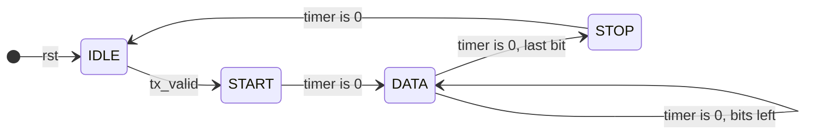
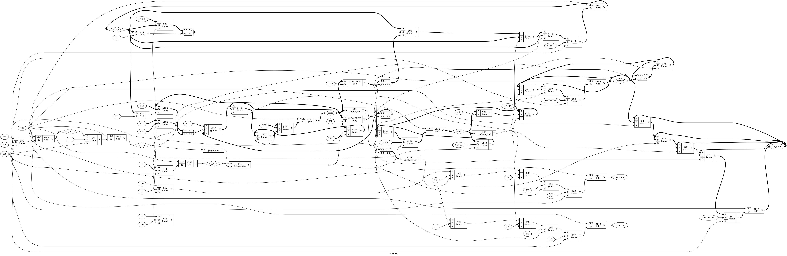

# Tutorial 14: UART

A UART sends bytes between two chips over a single wire, with no clock wire beside
it. It is one of the oldest serial links and it is still the first thing brought up
on a new board, because it needs almost nothing at the other end. The computer in
Tutorial 19 will print through this one, so this is how our CPU will talk to the
outside world.

It is also the first design here where three familiar pieces work as a team. A
counter measures time, a shift register moves the bits, and an FSM decides what
each moment means.

Finish [Tutorial 13](../13-cdc-reset/README.md) first, since the receiver's input
crosses clock domains. The design also uses the shift register from
[Tutorial 3](../03-shift-register/README.md), the FSM style from
[Tutorial 5](../05-sequence-detector/README.md) and the handshake from
[Tutorial 9](../09-skid-buffer/README.md). Run these commands in a VS Code
terminal, from this directory:

```bash
cd tutorials/14-uart
```

To run everything at once, use `make all`.

## What the line looks like

The wire sits high when nothing is happening. A byte is sent as a *frame* of ten
bits, each lasting the same time:

```text
 idle  start  d0  d1  d2  d3  d4  d5  d6  d7  stop  idle
 ----+      +---+   +---+       +---+   +---+----------
     |      |   |   |   |       |   |   |   |
     +------+   +---+   +-------+   +---+
```

That picture is the byte `0xA5`, which is `10100101` in binary. The least significant
bit goes first, so the wire shows 1, 0, 1, 0, 0, 1, 0, 1.

- **Start bit:** always 0. The fall from idle says that a frame has begun.
- **Eight data bits:** least significant first.
- **Stop bit:** always 1. It puts the line back high, so that the next start bit
  has a falling edge, even if the next frame follows straight away.

This format is called *8N1*: eight data bits, no parity, one stop bit.

## Why no shared clock is needed

Both ends agree on the *baud rate* in advance, which here means bits per second. The
receiver then needs only one more fact, which is when the frame began, and the
falling edge of the start bit gives it that. From that edge it times the rest
with its own clock.

Each frame starts this timing again, so the two clocks only have to agree for ten
bits at a time. They may never be equal, and they do not need to be. How much they
may differ is measured below.

## The parameter

`CLKS_PER_BIT` says how many clocks one bit lasts. Divide the clock by the baud rate
and round to the nearest whole number:

| Clock   | Baud   | Exact value | `CLKS_PER_BIT` | Actual baud | Error  |
| ------- | ------ | ----------- | -------------- | ----------- | ------ |
| 100 MHz | 115200 | 868.06      | 868            | 115207      | +0.01% |
| 50 MHz  | 115200 | 434.03      | 434            | 115207      | +0.01% |
| 27 MHz  | 115200 | 234.38      | 234            | 115385      | +0.16% |
| 12 MHz  | 115200 | 104.17      | 104            | 115385      | +0.16% |
| 1 MHz   | 115200 | 8.68        | 9              | 111111      | -3.55% |

The default of 16 is not a real rate. It only keeps simulations short. It must be
at least 4, because the receiver needs a few clocks to reach the middle of a bit.

## The transmitter

[`rtl/uart_tx.v`](rtl/uart_tx.v) has four states, one for each part of the frame,
and two counters:



`timer` counts down the clocks of the current bit. `bits_left` counts data bits,
from 8 down to 0, and needs four bits to hold the 8. `shifter` holds what remains of
the byte, with the next bit in `shifter[0]`. It shifts right here, because the
least significant bit goes first. The shift register in Tutorial 3 shifted left.

Outside `IDLE`, `timer` counts down and the FSM acts only when it reaches 0.

`tx` is a register, not an `assign` from the state. A combinational output could
glitch between clock edges, and on this wire the far end would take a glitch for a
start bit.

The parallel side is the handshake from Tutorial 9. A byte moves when `tx_valid` and
`tx_ready` are both high, and `tx_ready` is simply "in `IDLE` and not in reset". The
byte is copied into `shifter` at that moment, so `tx_data` may change afterwards.
`tx_ready` is high for one clock between frames, so a full-speed stream takes
`10 * CLKS_PER_BIT + 1` clocks per byte. The spare clock is a slightly long stop bit,
which any receiver accepts.

## The receiver

[`rtl/uart_rx.v`](rtl/uart_rx.v) has the same four states, but its job is harder. It
does not control when anything happens.

**The input is asynchronous.** The sender's clock has nothing to do with `clk`, so
`rx` can change at any moment, and that includes the setup window of the first
flop. This is the crossing from Tutorial 13, and it gets the same two-flop
synchronizer:

```verilog
rx_meta <= rx;
rx_sync <= rx_meta;
rx_prev <= rx_sync;
```

`rx_meta` is the `meta` flop of `sync_2ff` in Tutorial 13, and `rx_sync` is its only
reader. The logic reads `rx_sync` and `rx_prev`. `rx_prev` is one clock older, so
`rx_prev && !rx_sync` marks a falling edge. Tutorial 13's rule that the input must
come straight from a flop in the sending domain is why `tx` is a register.

`sync_2ff` resets to 0, but these flops reset to 1, because 1 is the idle level. A
reset to 0 would look like a line that has just gone low.

### Warning: simulation does not model metastability

**A passing test does not prove that a clock domain crossing is safe.**

To Icarus, Verilator and cocotb a flop always holds a clean 0 or 1. The real first
flop can go metastable, and no simulation here will ever show it. `make formal` does
not model it either, so a proof only says that the design is correct if every flop is
ideal. The synchronizer is there because of how the hardware behaves, not because a
test asked for it. This design has not been through vendor clock domain crossing
analysis, and nothing here makes a claim about timing or failure rates.

**Sample in the middle.** A bit is safest in its middle, since that is the point
furthest from both edges. So the receiver waits half a bit after the start edge,
and then a whole bit between samples:

```text
 start         d0            d1
 ------+              +-------------+
       |              |             |
       +--------------+             +---
              ^             ^             ^
              half a bit    one bit       one bit
```

```verilog
localparam integer HALF = (CLKS_PER_BIT + 1) / 2 - 2;
```

The `- 2` is there because seeing the edge and loading `timer` use up two clocks of
that half bit. The `+ 1` rounds up for an odd `CLKS_PER_BIT`. Without it, the check at
`CLKS_PER_BIT=5` comes too early, and the random test's noise pulses get through.

Half way through the start bit is also a chance to look again. If the line has gone
back high, it was a noise pulse and not a start bit, so the FSM returns to `IDLE`.

**Framing errors.** The sample at the stop bit should be 1. If it is 0, the frame
did not end where it should, either because the two ends disagree on the baud rate
or because the line was held low. The byte cannot be trusted, so the receiver raises
`rx_error` for one clock and does not touch `rx_data`. Using `rx_prev` helps here:
a line held low has no falling edge, so it gives one error and not one every ten
bits.

**No `rx_ready`.** `rx_valid` is a one-clock pulse with no `ready` to answer it. This
is not an oversight. The wire has no way to tell the sender to wait, so the byte has
arrived whether the logic likes it or not. `rx_data` holds the byte until the next
good one, which gives a slow reader about one frame to collect it. If that is not
enough, put a FIFO from [Tutorial 7](../07-sync-fifo/README.md) after it.

[`rtl/uart.v`](rtl/uart.v) only connects the two halves. They share a clock and
nothing else.

## Simulate

[`tb/tb_uart.v`](tb/tb_uart.v) is a *loopback*: it wires `tx` to `rx`, then sends
every byte value. A loopback alone is weak, since a transmitter and receiver with the
same bug can agree with each other. So `send_tx` also checks the line on every clock
of the frame. After that it drives the receiver directly, to try a bad stop bit, a
short pulse and a line held low.

```bash
make sim
make sim CLKS_PER_BIT=7
```

Each run should end with `PASS`. Try `4`, `5` and `100` too.

## View the waveform

Run `make sim` once more with no `CLKS_PER_BIT`, then open `build/tb_uart.vcd` as in
Tutorial 1. Add `tx_valid`, `tx` and `rx_valid` from `tb_uart`, `state` and `timer`
from `dut.u_tx`, and `rx_sync`, `state`, `timer` and `rx_data` from `dut.u_rx`.
Change the radix of `rx_data` to hexadecimal if you can. The clock period is 10 ns,
so one bit is 160 ns.

- `tx` falls at 25 ns, then shows the frame for `0xA5`: high at 185 ns, low at 345,
  high at 505, low at 665 for two bits, high at 985, low at 1145, and high from 1305.
- `rx_sync` follows `tx` 20 ns later, at 45 ns. Those are the two synchronizer flops.
- `u_rx.state` moves from 0 to 1 at 55 ns, and `u_rx.timer` counts 6 down to 0. The
  first sample is at 125 ns, which is 80 ns or half a bit after `rx_sync` fell.
- `rx_valid` pulses at 1565 ns, with `rx_data` at `a5`. This is before the transmitter
  has finished, because the receiver is done in the middle of the stop bit.
- `u_tx.state` returns to 0 at 1625 ns and the next frame starts at 1635 ns.

## Lint and Verilator

```bash
make lint
make lint CLKS_PER_BIT=7
make verilator
```

Any warning starts with `%Warning`. The lines that start with `- V e r i l a t i o n`
are a normal report. The same testbench should print `PASS` under Verilator.

## Test in Python

[`tb/test_uart.py`](tb/test_uart.py) models a sender with its own clock. `send_frame`
drives `rx` in picoseconds, with no reference to `clk`, so edges land anywhere in the
clock period. This is the one place in the course that does not drive on the falling
edge, because being unrelated to the clock is the point.

```bash
make cocotb
```

This takes about a minute. Look for `TESTS=3 PASS=3 FAIL=0`. There are three tests:

- `random_frames` sends 2000 frames with random bytes and gaps. Each frame gets a
  bit period up to 2% off, and each edge in it moves up to another 2% of a bit. One
  frame in twenty has a bad stop bit, and some gaps hold a short noise pulse. The test
  counts framing errors, back-to-back frames and noise pulses, and fails if any is zero
  or if any result differs from the model.
- `random_transmit` sends random bytes through the transmitter and decodes `tx` in
  Python.
- `clock_tolerance` is the experiment in the next section.

## How far can two clocks differ?

Each sample lands a little further from the middle of its bit, and the error adds up
over the frame. The stop bit is the last sample, so it has furthest to go.
`clock_tolerance` measures this. It sweeps the sender's bit period from -8% to +8%
in steps of 0.1%, and sends a back-to-back stream at each step. The last line reports
where the first failures were:

```text
CLKS_PER_BIT=16: first failure at -5.1% (sender fast) and +4.9% (sender slow)
```

The arithmetic agrees. With a period of `P` clocks, the receiver samples the stop bit
151 clocks after it sees the edge, and the sender's stop bit starts at `9P`. If
`9P > 151`, the sample lands on `d7`, and that happens when `P` is above 16.78, or
+4.9%. On the fast side the next start bit arrives at `10P`, and that overtakes the
sample at about -5%.

So the budget is about 5%. It belongs to the *difference* between the clocks, since
only their ratio matters. A sender 2.5% fast and a receiver 2.5% slow have used all of
it. Look back at the 1 MHz row of the parameter table: its -3.55% has spent most of
the budget before the other end's clock is counted.

The limit also depends on how finely the receiver can place its sample:

| `CLKS_PER_BIT` | Sender fast | Sender slow |
| -------------- | ----------- | ----------- |
| 4              | -5.1%       | +2.8%       |
| 5              | -4.1%       | +4.7%       |
| 7              | -4.3%       | +4.9%       |
| 16             | -5.1%       | +4.9%       |
| 100            | -5.1%       | +5.6%       |

Each is the first failing step for this test's fixed seed and data, in a stream of
128 bytes per step, or 32 at `CLKS_PER_BIT=100`. Treat them as measurements of this
design in simulation with clean edges. A real line has slow edges and noise, which
take a share of the same budget.

## Prove it with formal verification

```bash
make formal
```

[`uart.sby`](uart.sby) has ten tasks, and the whole run takes seconds. Look for
`DONE (PASS, rc=0)` on each.

Be clear about what each one shows:

| Tasks                  | Mode  | What it shows                                       |
| ---------------------- | ----- | --------------------------------------------------- |
| `tx4`, `tx10`, `tx16`  | prove | For all time, at each of these three sizes          |
| `rx4`, `rx10`, `rx16`  | prove | For all time, for any waveform on `rx`              |
| `tx_cover`, `rx_cover` | cover | A whole frame, `0xA5` and a framing error can happen |
| `loop4`, `loop16`      | bmc   | One byte round trip, to a fixed depth               |

**Transmitter.** `tx` is high in `IDLE` and `STOP`, low in `START`, and equal to the
right bit of the accepted byte in `DATA`. `timer` and `bits_left` stay in range in
every state. A formal-only counter shows that every bit lasts exactly `CLKS_PER_BIT`
clocks, and `tx` cannot change inside a bit. Together these come close to saying the
frame is right on its own.

**Receiver.** `timer` and `bits_left` stay in range, `rx` reaches the logic only
through both synchronizer flops, a frame starts only on a falling edge and continues
only if the start bit is still low, `rx_valid` and `rx_error` appear only after
sampling a stop bit and never together, and `rx_data` changes only with `rx_valid`.

All four codes of the 2-bit `state` are legal, so "the FSM stays in a legal state" would
mean nothing here. The invariants say instead what must be true *in* each state.

**The round trip is not proved.** `prove` would need invariants linking the
transmitter's state to the receiver's, and these tasks do not attempt that. The `loop`
tasks use [`tb/uart_loop_formal.v`](tb/uart_loop_formal.v), where the solver picks any
byte through `(* anyconst *)` and `tx` is wired to `rx`. They show that this byte
arrives correctly with no error, in a search of 50 clocks at `CLKS_PER_BIT=4` and 190
clocks at 16. That covers one byte from reset with both ends on the same clock. It says
nothing about a second byte, about other sizes, or about clock differences.

Formal also says nothing about *where* in the bit the receiver samples, because no
property mentions it. The exercises show why that matters.

## See the logic

```bash
make schematic
```

The top level would only show two boxes, so this draws the receiver. Click
`build/uart_rx.png` in the Explorer:



It is large, so look for a few landmarks:

- At the far left, `rx` enters and passes through two `$dff` cells to `rx_sync`, and
  `rx_prev` follows. No other path reaches `rx`. Here you can check the synchronizer
  by eye.
- `$logic_not` and `$logic_and` next to `rx_prev` make the falling edge detector.
- `4'0110` is `HALF`, 6, and `4'1111` is `LAST`, 15. Those are the two values that
  `timer` can load, and that is mid-bit sampling in hardware.
- `4'1000` is the 8 loaded into `bits_left`.

## Map it to real FPGAs

```bash
make synth
```

| Family     | Flip-flops                | Total cells |
| ---------- | ------------------------- | ----------- |
| Xilinx     | 54 (`FDRE`, `FDSE`)       | 123         |
| Gowin      | 54 (`DFF` and variants)   | 141         |
| Cyclone V  | 54 `MISTRAL_FF`           | 125         |

The code declares 50 flop bits, 19 in the transmitter and 31 in the receiver. The other
four appear because Yosys spotted the two FSMs and recoded each `state` from two bits to
four, one-hot. The totals include two `$scopeinfo` entries on Xilinx and Gowin, which are
bookkeeping and not real cells.

These are Yosys counts, so vendor tools can give different results, and they say
nothing about timing.

## Try it yourself

Change the RTL, then run `make sim`, `make cocotb` and `make formal`. Undo each
change before trying the next. `Formal` names the tasks that fail. `tx`, `rx` and
`loop` mean all sizes of that task.

| Change                                                         | Sim  | cocotb | Formal                |
| -------------------------------------------------------------- | ---- | ------ | --------------------- |
| Transmitter sends the most significant bit first               | FAIL | FAIL   | `tx`, `loop`          |
| Both ends use most significant bit first                       | FAIL | FAIL   | `tx`, `loop`          |
| In `uart_tx`, `LAST = CLKS_PER_BIT - 2`                        | FAIL | FAIL   | `tx`, `loop`          |
| `assign tx_ready = !rst;`                                      | FAIL | FAIL   | `tx`, `loop`          |
| `tx <= 1'b0;` on entering `STOP`                               | FAIL | FAIL   | `tx`, `loop`          |
| `tx <= tx_data[0];` in place of `shifter[0]`                   | FAIL | FAIL   | `tx`                  |
| In `uart_rx`, `if (1'b1)` in place of the stop bit's `if (rx_sync)` | FAIL | FAIL | `rx`, `rx_cover`   |
| `if (1'b0)` in place of the start bit's `if (rx_sync)`         | FAIL | FAIL   | `rx`                  |
| `if (!rx_sync)` in place of `if (rx_prev && !rx_sync)`         | FAIL | FAIL   | `rx`                  |
| Delete the line `rx_valid <= 1'b0;`                            | FAIL | FAIL   | `rx`, `loop`          |
| Add `rx_data <= shifter;` beside `rx_error <= 1'b1;`           | FAIL | pass   | `rx`                  |

The second row is why `send_tx` checks the line. The two bugs cancel, so with that
check turned off the testbench passes. The next ones are more interesting.

**The surprise: sampling at the edge of a bit.** Set `HALF = 0`, so the receiver samples
just after the start edge and just after each edge from then on. Run the checks:

```bash
make sim
make cocotb
make formal
```

`make sim` passes every byte, because a perfect clock never moves the sample off its
bit. `make formal` passes too, because no property says where to sample. Only cocotb
fails, on the 2% timing error of `random_frames`, and `clock_tolerance` reports a first
failure at `+0.8%` with a slow sender. A healthy design manages `+4.9%`. Setting
`HALF = CLKS_PER_BIT - 3` does the same in the other direction: `-0.7%` with a fast
sender. Either bug would work on your desk with a good pair of clocks, and fail on
somebody else's board. Testing with perfect timing does not test timing.

**A synchronizer with one flop.** Replace `rx_sync <= rx_meta;` with `rx_sync <= rx;`.
This is the bug Tutorial 13 warns about, and `make sim` and `make cocotb` both pass, with
tolerance unchanged. Only formal fails, in `rx` and `loop`, and only because a property
counts the flops. It still sees no metastability.

**A proof that needs a second opinion.** Set `LAST = CLKS_PER_BIT - 2` in `uart_rx`, so
each sample comes a clock early. `make sim` and `make cocotb` fail, but the `rx` proofs
pass, because `timer` is still in range. Only `loop4` and `loop16` fail. Now change
`bits_left <= 4'd8` to `4'd7` in `uart_rx`. The `rx` proofs pass again, for the same
reason, and `rx_cover` fails because `0xA5` is no longer reached in its depth. `cover` found a
bug that the assertions could not.

**Write the missing property.** Add a formal-only counter to `uart_rx.v` that starts at
the falling edge, like `f_clocks` in `uart_tx.v`, and assert that in `START` the counter
plus `timer` equals `(CLKS_PER_BIT + 1) / 2 - 2`. The good design still proves. With
`HALF = 0`, `rx10` and `rx16` fail, and `rx4` passes because `HALF` is 0 there anyway.
