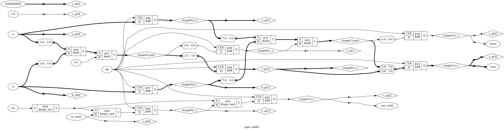

# Tutorial 15: Pipelining

Every design so far has met its clock because nobody asked how fast the clock
was. In a real chip that is the first question. The slowest path of logic between
two flip-flops sets the clock speed for the whole design, and a 32-bit carry chain
is a classic slow path. This tutorial cuts that path with registers, so that an
add takes several clocks but a new add can still start on every clock.

The same idea runs through every fast CPU. Lessons 17 to 19 build a CPU that works
on one instruction at a time, and [lesson 20](../20-pipelined-cpu/README.md) cuts
it into a pipeline like this one, except that its stages depend on each other.

Finish [Tutorial 9](../09-skid-buffer/README.md) first, since this one comes back
to its `ready` signal, and [Tutorial 11](../11-register-file/README.md) for
`generate`. Run these commands in a VS Code terminal, from this
directory:

```bash
cd tutorials/15-pipelining
```

To run everything at once, use `make all`.

## What limits the clock

A flip-flop only works if its input is steady around the clock edge:

- **Setup time** is how long the input must be steady *before* the edge.
- **Hold time** is how long it must stay steady *after* the edge.

Break either rule and the flip-flop may store the wrong value. This is the same
failure as the metastability in [Tutorial 10](../10-async-fifo/README.md).

Between two flip-flops, a new value leaves the first one shortly after an edge
(the *clock-to-Q* delay), passes through the logic (the *combinational delay*),
and must arrive before the setup time of the next edge:

```text
clock period >= clock-to-Q + combinational delay + setup
```

The path with the largest total is the *critical path*, and it alone sets the
clock speed. Speeding up any other path gains nothing. Hold is a different kind
of problem: it does not depend on the clock period, so a slower clock cannot fix
it. Tools fix it by adding delay to paths that are too short.

An adder has a long path because of the carry. Bit 31 of the sum depends on bit 0
of the inputs, so in the worst case a carry must ripple through every bit, as in
`FFFFFFFF + 1`. A longer adder means a longer path.

Nothing in simulation shows any of this. Icarus and Verilator give every gate zero
delay, and the 10 ns clock in the testbench is only a number. A design with an
impossibly long path passes `make sim` at any period, so everything in this
tutorial about speed comes from other tools.

## How a register splits a path

Put flip-flops in the middle of the path, and each half becomes a path of its own.
With `STAGES = 2`, a 32-bit add becomes two 16-bit adds, one per clock:

```text
          stage 0                       stage 1
a[15:0] ─┐
b[15:0] ─┴─ add ─┬─ sum[15:0] ─[reg]─────────────┐
                 └─ carry ─────[reg]─┐           ├─[reg]─ sum[31:0]
                                     ├─ add ─────┴─[reg]─ carry
a[31:16] ──────────────────────[reg]─┤
b[31:16] ──────────────────────[reg]─┘
in_valid ──────────────────────[reg]───────────────[reg]─ out_valid
```

Three kinds of register appear:

- **The carry register** is the cut itself. It stores the carry so that the next
  stage can use it one clock later.
- **Alignment registers** hold everything that is not being worked on. The upper
  operand bits wait for the carry, and the finished lower sum bits wait for the
  upper ones. Without them, stage 1 would add the upper bits of the *next* add to
  the carry of *this* one.
- **The valid bit** travels with the data. It says that this slot of the pipeline
  holds a real add. An empty slot is called a *bubble*.

## The design

[`rtl/pipe_adder.v`](rtl/pipe_adder.v) has two parameters. `WIDTH` is the size of
the operands, and `STAGES` is how many parts to cut the carry chain into. Each
stage adds `WIDTH / STAGES` bits, and the last stage takes any left over.

The module uses `generate` to build one stage per loop. Each stage is short:

```verilog
wire [BITS:0] part = {1'b0, a_p[i][LO +: BITS]} + {1'b0, b_p[i][LO +: BITS]}
                   + {{BITS{1'b0}}, c_p[i]};

always @(posedge clk) begin
    a_r <= a_p[i];
    b_r <= b_p[i];
    s_r <= s_p[i];
    s_r[LO +: BITS] <= part[BITS-1:0];
    c_r <= part[BITS];
    v_r <= !rst && v_p[i];
end
```

`a_p[i]` is the first operand as it enters stage `i`, and likewise for the others.
Index 0 is the input ports, and index `STAGES` is the outputs. The second
assignment to `s_r` overrides part of the first, because the last assignment to a
bit wins, so the stage copies the sum so far and writes its own bits over the top.

**Only the valid bits are reset.** Data without a valid bit means nothing, so there
is no need to clear it. **Many register bits are never used,** such as all of `a_r`
in the last stage. Synthesis removes them, which keeps the Verilog simple.

## Simulate

[`tb/tb_pipe_adder.v`](tb/tb_pipe_adder.v) keeps its own delay line of expected
results, `STAGES` long, and checks `out_valid`, `sum` and `carry` on every clock.
A result that is correct but a clock late fails. Operands change on every clock,
even in the gaps, because a bubble must not disturb the adds around it.

```bash
make sim
```

The last lines should include:

```text
latency: 2 clocks
full: 200 results in 200 clocks
gapped: 134 results in 200 clocks
PASS
```

These are measured, not assumed. **Latency** is how long one add takes: the
testbench sends a single add and counts clocks until its result appears.
**Throughput** is how many adds finish per clock: it sends 200 adds back to back,
and counts the clocks from the first result to the last. The `gapped` line is the
same with every third slot a bubble, and the gaps come out unchanged.

Now try `make sim STAGES=1` and `make sim STAGES=4`. The latency line says 1 and 4
clocks, and the full rate is still 200 results in 200 clocks.

Latency grows with the stages, and throughput per clock does not change at all.
This is the bargain. Each add takes more clocks, and adds finish just as often. If
the clock can run faster, the design does more work per second.

## View the waveform

Run `make sim` again if you have run `make verilator`, which writes the same file
and has no `x` value. Open `build/tb_pipe_adder.vcd` as in Tutorial 1. From
`tb_pipe_adder` add `clk`, `in_valid`, `a`, `b`, `out_valid`, `carry` and `sum`.
From `dut.stage[0]` add `a_r`, `b_r`, `c_r` and `v_r`. In hexadecimal, check:

- `out_valid` is `x` until the first rising edge, at 5 ns, when reset clears it.
- `sum` and `carry` stay `x` until 15 ns, one clock longer. Reset does not touch
  them, and known values take two clocks to get through the stages. This is
  harmless, because `out_valid` is low.
- At 20 ns `in_valid` rises with `a = FFFFFFFF` and `b = 1`.
- At 25 ns `stage[0].v_r` and `stage[0].c_r` go high. The lower half is done and
  has carried out. `stage[0].a_r` and `b_r` hold the operands for the next stage.
- At 30 ns the inputs change to the next add, while the first one is still inside.
  That is a pipeline: two adds in flight at the same time.
- At 35 ns `out_valid` rises with `sum = 0` and `carry = 1`. The two rising edges
  at 25 and 35 ns are the latency of 2.

## Lint

```bash
make lint
make lint STAGES=4
```

Any warning starts with `%Warning`. The lines that start with `- V e r i l a t i o n`
are a normal report. Lint runs twice, because `make pnr` below uses a second module.

## Simulate with Verilator

```bash
make verilator
```

## Test in Python

[`tb/test_pipe_adder.py`](tb/test_pipe_adder.py) uses a *scoreboard*: a queue of
expected results. Each add joins the back of the queue with the clock it went in
on. Each result must match the front of the queue, exactly `STAGES` clocks later.
A reset empties the queue, since it drops the adds in flight.

```bash
make cocotb
make cocotb STAGES=4
```

Look for `TESTS=1 PASS=1 FAIL=0`. The rate of adds changes every 200 clocks, so
there are full bursts and sparse spells. The log line counts adds with no gap
before them, adds after a gap, carries across the first stage boundary, and adds
dropped by a reset. The test fails if any of these never happened. With `STAGES=1`
there is no boundary and no adds in flight to drop, so those two are not required.

## Prove it with formal verification

```bash
make formal
```

[`pipe_adder.sby`](pipe_adder.sby) has four tasks, so this proves `WIDTH=32` at 1,
2, 3 and 4 stages. Look for `successful proof by k-induction` and
`DONE (PASS, rc=0)` for each of them.

The `` `ifdef FORMAL `` block has a *shadow model*, which does the whole add at once
and then delays the answer by `STAGES` clocks in a shift register. The assertions
say that `out_valid` matches the oldest item, and that when it is high, `{carry, sum}`
matches too. Together they prove the sum and the latency for every pair of 32-bit
operands, on any pattern of `in_valid` and `rst`.

The proof needs no help about the internal registers. A pipeline has no feedback,
so everything stored in it has come from the inputs of the last few clocks, and
induction soon stops caring where it started.

## See the logic

```bash
make schematic
```

Click `build/pipe_adder.png` in the Explorer. It is drawn at `WIDTH=8` and
`STAGES=2`, because 32 bits would not be readable:



Find the two `$add` pairs. Follow `stage[0].part` to the right: its top bit goes
through `$59` to become `stage[0].c_r`, which feeds the second adder as the carry.
`stage[0].a_r` and `stage[0].b_r` are the alignment registers. The `$logic_and`
gates at the bottom are `!rst && valid`, once per stage. This is drawn before
synthesis, so the `a_r` registers are still 8 bits wide.

## The cost in flip-flops

```bash
make synth
make synth STAGES=1
make synth STAGES=4
```

| `STAGES` | Xilinx FFs             | Xilinx cells | Gowin FFs | Gowin cells | Cyclone V FFs | Cyclone V cells |
| -------- | ---------------------- | ------------ | --------- | ----------- | ------------- | --------------- |
| 1        | 34                     | 76           | 34        | 70          | 34            | 68              |
| 2        | 84                     | 128          | 84        | 122         | 84            | 121             |
| 4        | 80, plus 32 `SRL16E`   | 160          | 184       | 226         | 184           | 227             |

One stage needs 34 flip-flops: `sum`, `carry` and a valid bit. Two stages need 84,
and four need 184. The cost grows faster than the number of stages, because the
early stages have to carry nearly all the operands along with them. At `STAGES=4`,
only the 34 in the last stage hold the answer, and the others exist to wait.

The Xilinx row for `STAGES=4` is a surprise. Yosys noticed that some alignment
registers are plain delay chains, and put them in `SRL16E` cells, which are
shift registers built from LUTs. A delay line that does nothing but wait is cheap
on that family.

These are Yosys counts, so vendor tools can give different results. They say
nothing about timing.

## Measure the path

Yosys can report the longest chain of cells that has no flip-flop in it. This
command breaks the design into simple gates with `abc -g AND` and runs `ltp -noff`:

```bash
make depth
```

```text
STAGES=1: length=103 logic levels
STAGES=2: length=57 logic levels
STAGES=4: length=35 logic levels
```

These are **logic levels, not a clock speed**. They count gates, all alike, with
no wires. They do show the idea working: two stages nearly halve the path.

The suite also has `nextpnr-himbaechel`, an open-source place and route tool for
Gowin, which can estimate a clock speed:

```bash
make pnr
```

[`rtl/pipe_adder_top.v`](rtl/pipe_adder_top.v) wraps the adder so that its inputs
and outputs come from flip-flops and only three pins are needed, which
[`pipe_adder.cst`](pipe_adder.cst) assigns. This runs five placements for each
stage count, using different random seeds, on a GW1N-9C:

| `STAGES` | Lowest     | Middle     | Highest    |
| -------- | ---------- | ---------- | ---------- |
| 1        | 162.52 MHz | 172.77 MHz | 198.57 MHz |
| 2        | 189.21 MHz | 207.51 MHz | 232.23 MHz |
| 4        | 190.80 MHz | 212.54 MHz | 224.82 MHz |

**This is an open-source estimate, not a vendor result.** Gowin's own tools may
give different numbers, the design has not been run on a chip, and we have no such
figures for Xilinx or Cyclone V here.

Compare this with the logic levels. Those fell by two thirds from 1 to 4 stages,
yet the estimate gained far less, and 2 and 4 stages overlap. The seeds matter more
than that last step. The reason is in the critical path report, which you can read
in `build/pnr-4-1.log`. Here are the steps of the worst path for four stages:

| Step                      | Delay   |
| ------------------------- | ------- |
| Clock-to-Q of the carry   | 0.46 ns |
| Wire to the next stage    | 0.89 ns |
| Getting into the carry chain | 0.96 ns |
| Each bit of the chain     | 0.06 ns |
| Leaving the carry chain   | 0.56 ns |
| Wire and a LUT to the flip-flop | 0.95 ns |
| Setup                     | 0.40 ns |

FPGAs have dedicated carry wiring, so each bit costs almost nothing. Eight bits
take less than half a nanosecond, out of more than four. The rest is the price of
any path at all, and adding a register does not shrink it. Worse, each new register
adds its own clock-to-Q and setup. So pipelining gives diminishing returns, and on
a fast carry chain they arrive early. Going from 2 to 4 stages here more than
doubled the flip-flops, and the middle estimate barely moved. Measure before you
add stages.

## Why a stall is hard

This adder has no `ready`, which is why it is so simple. If the consumer could say
"wait", every stage would have to hold on the same clock. That means an enable on
all 184 flip-flops at `STAGES=4`, driven by one signal that must reach them within
a single clock: a new long path, running backwards past every register you added.

[Tutorial 9](../09-skid-buffer/README.md) is the fix. A skid buffer at the end of
the pipeline registers `ready`, and catches the word that skids, so the backward
path is cut in the same way as the forward one.

A CPU has it worse. An instruction that needs a result still in the pipeline must
wait while the ones behind it hold, even though nothing downstream is busy. That
stall, and the forwarding that avoids many of them, are the subject of
[lesson 20](../20-pipelined-cpu/README.md).

## Try it yourself

Change `rtl/pipe_adder.v`, then run `make sim`, `make cocotb` and `make formal`.
Undo each change before trying the next.

1. Replace `{{BITS{1'b0}}, c_p[i]}` with `{(BITS+1){1'b0}}`, so the carry is lost
   at each cut.
2. Replace `s_r <= s_p[i];` with `s_r <= {WIDTH{1'b0}};`, so finished sum bits are
   not kept.
3. Replace `assign v_p[0] = in_valid;` with `assign v_p[0] = 1'b1;`, so every slot
   claims to be real.
4. Replace `assign v_p[i + 1] = v_r;` with
   `assign v_p[i + 1] = (i == 0) ? v_p[i] : v_r;`, so the valid bit skips a stage
   and runs ahead of its data.

Each mistake is caught by all three. In the first two, `formal_s1` passes while
the other tasks fail: one stage has no cut to get wrong.

**A reset that misses a stage.** Replace `v_r <= !rst && v_p[i];` with
`v_r <= (i != 0 || !rst) && v_p[i];`, so stage 0 ignores reset. Run `make sim`,
and see just one `FAIL` line: an add offered during the reset gets into stage 0
and comes out afterwards. Only a reset with `in_valid` high can show this, which
is why both tests make one.

**A bug that a simple test cannot see.** Remove the alignment on `b` by replacing
`assign b_p[i + 1] = b_r;` with `assign b_p[i + 1] = b_p[i];`. Now the upper bits of
`b` reach stage 1 a clock too early. Run:

```bash
make sim SIMPLE=1
make sim
```

`SIMPLE=1` runs the test many people would write first: `a` counts up from 0 and
`b` stays at 1. It prints `PASS`, because the upper bits of `b` never change, so it
makes no difference which clock they came from. Doing the same to `a` also passes,
because 200 counts never change its upper bits either. The ordinary `make sim`
fails on hundreds of lines, `make cocotb` fails, and `make formal` fails at 2, 3
and 4 stages. A pipeline bug is a mix-up between neighbouring adds, so a test must
make neighbouring adds different in every bit.

**An assumption that matters less.** Replace `assume (rst);` with `assume (1);`.
`make sim` passes, and `formal_s1` still passes, but the other tasks fail. The
solver now powers up a valid bit high inside the pipeline, and it reaches
`out_valid` as a result that nobody asked for. One stage has no inside: its only
valid bit is overwritten on the first edge. So a single clock of reset is what
makes a pipeline safe, and it is needed even though the data is never reset.
