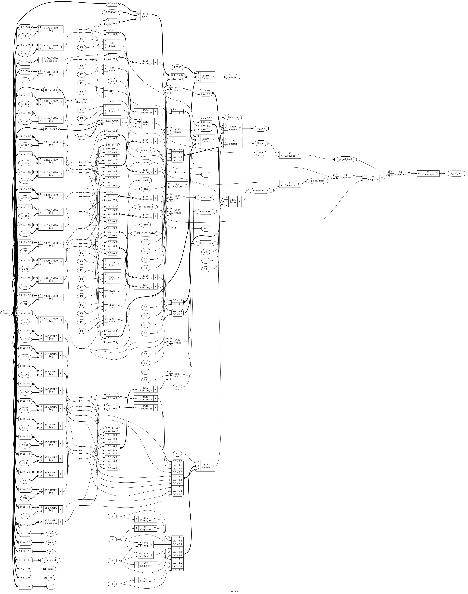

# Tutorial 16: Instruction set and assembler

So far every design has been told what to do by wires. A CPU is told by numbers
in a memory. The list of those numbers and what each one means is the *instruction
set*, and it is the contract between hardware and software. This tutorial fixes
that contract for the course's 8-bit CPU, builds the decoder that reads it, and
writes the assembler that produces it. Tutorial 17 builds the CPU around this
decoder, and later tutorials copy `rtl/decode.v` and `tools/asm.py` unchanged.

Finish [Tutorial 12](../12-flags-alu/README.md) first, since this one uses its flags.
Run these commands in a VS Code terminal, from this directory:

```bash
cd tutorials/16-instruction-set
```

To run everything at once, use `make all`.

## What an instruction set is

An instruction set answers four questions. What can a program see? What can it do?
What does each action look like as bits? What happens when the bits mean nothing?

Software sits on one side of those answers and hardware on the other, and either can
change freely while the contract holds. That is why this tutorial has no CPU in it:
the contract comes first, and each side is tested against it separately.

## The choices behind this one

Every choice here gives up something. These are the ones that shape the design.

- **Fixed length.** Every instruction is one 16-bit word. One memory read fetches one
  instruction, and the next is always at PC + 1, so there is no logic to find where
  an instruction ends. The cost is that `NOP` takes as much room as `LDI`.
- **Separate instruction memory.** Instructions are 16 bits and data is 8, so they
  would fit badly in one memory. Two memories can also be read in the same clock,
  which the pipelined CPU in Tutorial 20 needs. The cost is that a program cannot read
  or change its own code, so a table of constants has to be loaded with `LDI`.
- **Four registers.** Two bits name a register, so an instruction with two registers
  and an 8-bit number fits in 16 bits. A real program runs short of them, and that is
  what the stack is for.
- **The stack uses R3.** A separate stack pointer needs its own register, plus
  instructions to set and read it. Using R3 costs none of that: `LDI R3, 0xF0` sets
  it, and `LD R0, [R3+1]` reads the stack without popping. The cost is one register
  of the four, once a program uses the stack.
- **Absolute branches.** The target is the address itself, and imm is 8 bits, as wide
  as the PC. So any instruction can reach any other, with no adder for the target.
  The cost is that moving a program means assembling it again.
- **Only calculations set flags.** `ADD` sets them, and so do `ADDI`, `CMPI`, `ANDI`
  and every other ALU instruction. `LDI`, `LD`, `ST`, `POP` and all jumps leave them
  alone. A program must be able to load something between a compare and its branch,
  or between the two halves of a 16-bit add from Tutorial 12:

  ```text
  CMPI R0, 10        ; sets the flags
  LDI  R2, 0x80      ; a constant needed either way, and the flags survive
  BEQ  done
  ```

  `MOV` is the trap. It goes through the ALU as `PASS_B`, so it does set the flags,
  and it clears `c` and `v`. Use `LDI` or `LD` between a compare and a branch.

## The format

```text
15    12 11  10 9   8 7          0
+-------+------+-----+------------+
| op    | rd   | rs  | imm        |
+-------+------+-----+------------+
```

The fields are in the same place in **every** instruction. Reading `rd` takes no logic
at all, only wires from bits 11 and 10, so the register file can be read before anyone
knows what the instruction is. If `LD` kept its register in different bits from `ADD`,
each field would need a multiplexer controlled by `op`. imm is always the low byte, so
the same wires reach both the ALU and the PC. The one exception is a branch, which has
no registers to name and reuses bits 11 to 8 as a single `cond` field.

Assembler output has 0 in fields that an instruction does not use. The hardware
ignores them, except where a table below says a value is illegal. So `0401` is a
`HALT` too.

## Instruction set reference

R0 to R3, the PC, memory addresses and data are all 8 bits, and all of them wrap. On
reset the PC, the registers and the flags are all 0. `rs + imm` wraps at 8 bits.

| op  | Assembly          | Effect                               | Flags |
| --- | ----------------- | ------------------------------------ | ----- |
| 0   | `NOP`             | Nothing. imm is 0                    | none  |
| 0   | `HALT`            | Stop until reset. imm is 1           | none  |
| 1   | `ADD rd, rs` etc. | ALU operation, see the next table    | all   |
| 2   | `LDI rd, imm`     | rd = imm                             | none  |
| 3   | `ADDI rd, imm`    | rd = rd + imm                        | all   |
| 4   | `CMPI rd, imm`    | rd - imm, result discarded           | all   |
| 5   | `ANDI rd, imm`    | rd = rd & imm                        | all   |
| 6   | `LD rd, [rs+imm]` | rd = mem[rs + imm]                   | none  |
| 7   | `ST rd, [rs+imm]` | mem[rs + imm] = rd                   | none  |
| 8   | `JMP imm`         | PC = imm                             | none  |
| 9   | `Bcc imm`         | PC = imm if cond is true, else PC + 1 | none |
| A   | `CALL imm`        | Push PC + 1, then PC = imm           | none  |
| B   | `RET`             | Pop into PC                          | none  |
| C   | `PUSH rs`         | Push rs                              | none  |
| D   | `POP rd`          | Pop into rd                          | none  |
| E   | `JR rs`           | PC = rs                              | none  |
| F   | Illegal           |                                      |       |

The ALU instructions have op 1, and `funct` in imm[3:0] selects the operation in
`alu_flags` from Tutorial 12. Its `a` is rd, its `b` is rs, and `carry_in` is `c`.
All of them update all four flags with exactly the meanings in that tutorial. After
a subtraction, **`c` is NOT borrow**: `c` = 1 means `rd >= rs` as unsigned numbers.

| funct | Assembly     | rd becomes                  | funct | Assembly     | rd becomes              |
| ----- | ------------ | --------------------------- | ----- | ------------ | ----------------------- |
| 0     | `ADD rd, rs` | rd + rs                     | 8     | `SHL rd`     | Left, 0 comes in        |
| 1     | `ADC rd, rs` | rd + rs + `c`               | 9     | `SHR rd`     | Right, 0 comes in       |
| 2     | `SUB rd, rs` | rd - rs                     | 10    | `ASR rd`     | Right, sign bit kept    |
| 3     | `SBC rd, rs` | rd - rs - !`c`              | 11    | `ROL rd`     | Left, `c` comes in      |
| 4     | `AND rd, rs` | rd & rs                     | 12    | `ROR rd`     | Right, `c` comes in     |
| 5     | `OR rd, rs`  | rd \| rs                    | 13    | `MOV rd, rs` | rs                      |
| 6     | `XOR rd, rs` | rd ^ rs                     | 14    | `CMP rd, rs` | Unchanged: a `SUB` for flags only |
| 7     | `NOT rd`     | ~rd                         | 15    | Illegal      |                         |

Branches have op 9, and `cond` in bits 11 to 8. Targets are absolute.

| cond | Mnemonic | Taken when      | cond | Mnemonic | Taken when                 |
| ---- | -------- | --------------- | ---- | -------- | -------------------------- |
| 0    | `BEQ`    | `z`             | 6    | `BVS`    | `v`                        |
| 1    | `BNE`    | `!z`            | 7    | `BVC`    | `!v`                       |
| 2    | `BCS`    | `c`             | 8    | `BLT`    | `n != v` (signed)          |
| 3    | `BCC`    | `!c`            | 9    | `BGE`    | `n == v` (signed)          |
| 4    | `BMI`    | `n`             | 10   | `BLO`    | `!c` (unsigned, as `BCC`)  |
| 5    | `BPL`    | `!n`            | 11   | `BHS`    | `c` (unsigned, as `BCS`)   |

**Illegal words** are op 0 with imm above 1, op 1 with funct 15, op 9 with cond 12 to
15, and all of op F. An illegal word stops the CPU with `halted` and `illegal` high.
Like `HALT`, it changes no register, flag or memory, and the PC stays on it.

**The stack** grows down. A push decrements R3, then stores at the new R3. A pop loads
from R3, then increments R3. A program must set R3 itself: after `LDI R3, 0xF0` the
first push lands at 0xEF. Addresses 0xF0 to 0xFF are I/O, covered in Tutorial 19.
R3 moves while it is being used in `PUSH R3` and `POP R3`, so the result is defined
here. `PUSH R3` stores the value R3 held before the decrement. `POP R3` leaves R3
holding the loaded value: the load wins over the increment.

## Reading a hex word by hand

The fields fall neatly on hex digits. The first digit is op, the last two are imm, and
the second splits into two pairs of bits, so it is 4 × rd + rs.

Take `7600`. op is 7, which is `ST`. The second digit is 6, `0110` in binary, so rd is
1 and rs is 2. imm is 0. That is `ST R1, [R2]`.

Take `9104`. op is 9, a branch, so the second digit is `cond`: 1 is `BNE`. That is
`BNE 0x04`. For `180D`, op 1 sends you to funct, the last digit: 13 is `MOV`. The
second digit is 8, so rd is 2 and rs is 0, giving `MOV R2, R0`.

## The decoder

[`rtl/decode.v`](rtl/decode.v) is combinational, as the ALU in
[Tutorial 4](../04-alu/README.md) was: an `always @(*)` block with a default for every
output, then a `case`. Each branch lists only what its instruction turns on, which
keeps the file short and leaves no path that could make a latch.

Its inputs are `instr` and the flags `z`, `c`, `n` and `v`. Its outputs are:

| Output                       | Meaning                                                   |
| ---------------------------- | --------------------------------------------------------- |
| `rd`, `rs`, `imm`            | The fields, as plain wires                                |
| `alu_op`                     | The `op` input of `alu_flags`                             |
| `alu_src_imm`                | ALU input `b`: 1 for imm, 0 for rs                        |
| `reg_we`, `reg_waddr`        | Write a result to this register, which is always rd       |
| `flags_we`                   | Keep the flags from the ALU                               |
| `mem_read`, `mem_write`      | High for `LD`, `POP`, `RET` and for `ST`, `PUSH`, `CALL`  |
| `branch_taken`               | A branch whose condition is true now                      |
| `jump`, `call`, `ret`, `push`, `pop`, `jr`, `halt`, `illegal` | One each, for that instruction |
| `pc_sel_next`, `_imm`, `_rs`, `_stack`, `_hold` | Where the PC goes. Exactly one is high |

Three details are easy to misread:

- **`alu_op` is not always `funct`.** `CMP` is funct 14, which `alu_flags` leaves unused,
  so decode sends it the `SUB` code, 2, and leaves `reg_we` low. `LDI` uses `PASS_B`
  with `flags_we` low, which is the whole difference between `LDI` and `MOV`.
- **`reg_we` means a result going to rd.** R3 also moves during `CALL`, `RET`, `PUSH` and
  `POP`, and Tutorial 17 handles that when it sees those outputs. So `PUSH` has
  `mem_write` high and `reg_we` low, although R3 does change.
- **Branch evaluation is here too.** The flags from
  [Tutorial 12](../12-flags-alu/README.md) are inputs, and the cond table is a `case`:

  ```verilog
  4'd8:    branch_taken = n != v;   // BLT
  4'd9:    branch_taken = n == v;   // BGE
  4'd10:   branch_taken = !c;       // BLO
  ```

  Odd conds look like the opposite of the even one before them, but do not build
  that shortcut. 10 is `!c` and 11 is `c`, the other way round from 2 and 3.

## Simulate

A decoder with 16 bits of `instr` and 4 of flags has 2<sup>20</sup> possible inputs,
few enough to try all of them. [`tb/tb_decode.v`](tb/tb_decode.v) does, in about 4
seconds here.

```bash
make sim
```

The first lines decode ten words, and these are real results:

```text
9104 zcnv=0000 rd=0 rs=1 imm=04 alu_op=0 alu_src_imm=0 reg_we=0 flags_we=0 mem_read=0 mem_write=0 taken=1 halt=0 illegal=0 pc_sel=01000
9104 zcnv=1000 rd=0 rs=1 imm=04 alu_op=0 alu_src_imm=0 reg_we=0 flags_we=0 mem_read=0 mem_write=0 taken=0 halt=0 illegal=0 pc_sel=10000
```

The same word gives a different `taken` when `z` changes. The last line should be:

```text
PASS: 1048576 input combinations, 151040 illegal, 24576 branches taken
```

A check that copies the design also copies its mistakes, so this one shares nothing
with it. It has one row of constants per op, and pulls fields out of the word with
`/` and `%`. Each condition is a 16-bit truth table: `BEQ` is `16'hFF00`, so a
bit is set for each of the 16 flag values where `z` is high. As in Tutorial 12, `op`
changes fastest, since Tutorial 4 showed that order can hide a latch.

The two totals are a separate check, worked out from the spec and written in the
testbench. Illegal words: 254 × 16 for op 0, 16 × 16 for op 1, 4 × 256 for op 9 and
4096 for op F make 9440, and 9440 × 16 is 151040. Taken branches: 12 conds × 256
targets × the 8 flag values that make each one true is 24576.

## View the waveform

Only the ten printed words are recorded, since `$dumpoff` stops the VCD before the
long loops. Run `make sim`, open `build/tb_decode.vcd` as in Tutorial 1, and add
`clk`, `instr`, `z`, `reg_we`, `flags_we`, `mem_write`, `branch_taken`, `pc_sel_next`,
`pc_sel_imm` and `illegal` from `tb_decode`.

- Everything except `clk` is `x` until 10 ns. Then every output changes on falling
  edges of `clk`, at the same instant as `instr`.
- At 20 ns `instr` is `1600`, an `ADD`: `reg_we` and `flags_we` are high.
- At 30 ns it is `160E`, a `CMP`: `reg_we` falls and `flags_we` stays high.
- At 40 ns it is `7600`, an `ST`: `mem_write` is high and `reg_we` is low.
- At 70 ns it is `9104` with `z` low: `branch_taken` and `pc_sel_imm` are high. At 80
  ns only `z` changes, and both fall as `pc_sel_next` rises. The flags are part of
  the decode.
- At 100 ns `illegal` is high. At 110 ns the trace ends and the signals show `x`, which
  is what `$dumpoff` writes. It is not the design.

## Lint and Verilator

```bash
make lint
make verilator
```

Any warning starts with `%Warning`. The lines that start with `- V e r i l a t i o n`
are a normal report. `make verilator` prints the same `PASS` line.

## The assembler

Nobody wants to write `9104`. An *assembler* turns text into words.
[`tools/asm.py`](tools/asm.py) is written to be read, so open it alongside this section.
The instruction table at the top is the whole instruction set in one place.

Syntax has one instruction per line, with optional labels and comments:

```text
.equ  LIMIT, 10          ; a named constant
.org  0x10               ; the next instruction goes at this address
start: LDI  R0, LIMIT    ; a label is the address of what follows it
       ADDI R0, -1       ; -128 to 255 here. -1 becomes 0xFF
       LD   R1, [R2+4]   ; also [R2], [R2-1] and [R2+LIMIT]
       BNE  start        ; addresses are 0 to 255
```

Numbers are decimal, `0x` hex or `0b` binary. Mnemonics and registers may be in either
case, and labels are case sensitive. The output has 256 lines for `$readmemh`, and any
address that no instruction uses holds `0000`, a `NOP`.

### Why two passes

`CALL add_double` can come before the line that defines `add_double`, so on the first
sight of it the address is unknown. The fix is to read the source twice.

- **Pass 1** gives each line an address and writes down each label and `.equ` in the
  *symbol table*. It needs no encoding, because every instruction is one word. There
  is the fixed length paying off again.
- **Pass 2** goes through the instructions and encodes each one, looking symbols up.

`.org` and `.equ` act in pass 1, so they can only use numbers and earlier symbols.

```bash
make asm
```

This first runs [`tools/test_asm.py`](tools/test_asm.py) and should print `OK`. It holds
a word worked out by hand for each of the 41 mnemonics, and every error the assembler
can report, with the line it must name. Then it assembles the example to
`build/demo.hex` and prints a listing, of which this is the start:

```text
00  2CF0  LDI  R3, STACK_TOP ; set the stack pointer before any CALL or PUSH
01  2005  LDI  R0, COUNT     ; R0 counts down to 0
02  2400  LDI  R1, 0         ; R1 is the running total
03  2880  LDI  R2, RESULT    ; R2 points at where the answer goes
04  A009  CALL add_double    ; R1 = R1 + 2 * R0
```

`add_double` is at 09, known only after pass 1 has passed it. Errors stop the
assembler, name the line and write no output. Change `BNE loop` to `BNE lop` in
`programs/demo.asm`, and `make asm` ends with:

```text
programs/demo.asm:16: error: undefined symbol 'lop'
```

## Writing programs by hand

[`programs/demo.asm`](programs/demo.asm) works out 2 × (5 + 4 + 3 + 2 + 1) with a loop, a
subroutine and the stack, and stores the answer at data address 0x80.

```text
start:
        LDI  R3, STACK_TOP ; set the stack pointer before any CALL or PUSH
        LDI  R0, COUNT     ; R0 counts down to 0
        LDI  R1, 0         ; R1 is the running total
        LDI  R2, RESULT    ; R2 points at where the answer goes
loop:
        CALL add_double    ; R1 = R1 + 2 * R0
        ADDI R0, -1        ; sets z when R0 reaches 0
        BNE  loop
        ST   R1, [R2]
        HALT

add_double:
        PUSH R2
        MOV  R2, R0
        SHL  R2
        ADD  R1, R2
        POP  R2
        RET
```

Trace it on paper, since there is no CPU to run it yet. Tutorial 17 runs it for real.

- **The loop.** There is no subtract-immediate, so `ADDI R0, -1` counts down, and it
  sets the flags for the `BNE` straight after.
- **The call.** `CALL` at 04 pushes the return address 05: R3 goes from 0xF0 to 0xEF
  and memory at 0xEF holds 05. `RET` pops it back.
- **The stack.** `add_double` needs a working register, and the only free one is R2,
  which the caller is using as a pointer. So it pushes R2, at 0xEE, and pops it at
  the end. R1 goes 10, 18, 24, 28, 30, and the `ST` lands at 0x80 only because R2
  came back unchanged.

## Test in Python

[`tb/test_decode.py`](tb/test_decode.py) has two tests.

```bash
make cocotb
```

Look for `TESTS=2 PASS=2 FAIL=0`.

`random_words` applies 20000 random words and flags and compares every output with a
Python table: one row per mnemonic, listing only what is high. Random words rarely
form a valid `HALT`, so op 0 is steered towards imm 0 and 1. It counts every mnemonic,
taken and untaken branches, each of the four kinds of illegal word, and legal words
with junk in unused fields. It fails if any count is 0.

`assembled_program` tests the join between two pieces of work. It writes a program
with every mnemonic, assembles it by running `tools/asm.py`, reads the `.hex` back,
and applies each word to `decode` with all 16 flag values. The important detail is
where the expected answer comes from: the **source text**. The test sees `BEQ` in the
line, looks up what `BEQ` must do, and compares that with what `decode` does with the
word. If the assembler encodes `BEQ` wrongly, this test sees a branch that behaves
like a `BNE`, even though the decoder is correct.

## Prove it with formal verification

```bash
make formal
```

Look for `successful proof by k-induction` and `DONE (PASS, rc=0)`. As in Tutorial 4,
there is no state, so [`decode.sby`](decode.sby) sets `depth 1`.

`make sim` tried every input, but in one order, and Tutorial 4 showed that this is only
complete if the design really has no state. The solver has no such gap. The
`` `ifdef FORMAL `` block in `rtl/decode.v` is written out of the spec in bit positions
and masks. It proves that:

- `illegal` is high exactly for the four kinds of illegal word.
- `reg_we` and `mem_write` are never both high, nor are `mem_read` and `mem_write`.
- `reg_waddr` is rd whenever `reg_we` is high, and `reg_we` is high for the right ops.
- An illegal instruction never sets the flags, and `flags_we` is high for the right ops.
- `HALT` and illegal instructions write nothing at all.
- Exactly one `pc_sel_` output is high, and it is the right one. They are added up
  into a count, so that two high at once cannot pass.
- `branch_taken` matches the truth table for each condition.

`f_truth` is written with `?:` instead of `case`, for a reason you may meet again. As a
`case`, Yosys turned it into a ROM, whose contents are only known in the first step.
The base case passed, but the induction step let the solver choose them, and the proof
ended in `DONE (UNKNOWN, rc=4)`.

## See the logic

```bash
make schematic
```

Click `build/decode.png` in the Explorer, and zoom in. It is large, so look for the
shape of it rather than each wire:



- At the far left, `instr` fans out to a long column of `$eq` blocks. The upper ones
  compare `15:12` with each op, and the lower ones compare `11:8` with each cond.
- At the bottom left of that fan-out, slices go straight to `rd`, `rs`, `imm` and
  `reg_waddr` with no block in between. Those are the fields that line up.
- At the bottom, `z`, `c`, `n` and `v` go through `$logic_not`, `$eq` and `$ne` into a
  `$pmux`, on the way to `branch_taken`. That is the cond table.
- At the right, `$logic_or` blocks build the `pc_sel_` outputs. There are no `$dff`
  blocks anywhere.

## Map it to real FPGAs

```bash
make synth
```

| Family     | Flip-flops | Total cells |
| ---------- | ---------- | ----------- |
| Xilinx     | 0          | 38          |
| Gowin      | 0          | 115         |
| Cyclone V  | 0          | 36          |

Xilinx and Cyclone V use only lookup tables. Gowin's total includes 39 `MUX2_LUT`
cells. These are Yosys counts, so vendor tools can give different results, and they
say nothing about timing.

## Try it yourself

Change `rtl/decode.v`, then run `make sim`, `make cocotb` and `make formal`. Undo each
change before trying the next.

1. Swap `z` and `!z` in the `BEQ` and `BNE` lines.
2. In `BLT`, replace `n != v` with `n`. It is only wrong when `v` is high.
3. Add `reg_we = 1'b1;` to the `FUNCT_CMP` branch, so `CMP` overwrites rd.
4. Add `flags_we = 1'b1;` to `OP_LDI`.
5. Replace `assign reg_waddr = rd;` with `assign reg_waddr = rs;`.

Each mistake is caught by all three.

**A proof of safety is not a proof of correctness.** In `OP_CMPI`, replace `ALU_SUB`
with `ALU_ADD`. `make sim` and `make cocotb` fail, but `make formal` passes. The proof
says that this decoder cannot do anything illegal, and nothing in it mentions `alu_op`.
Every property you did not write is a bug it cannot see, so the test against the
full table stays necessary.

**A latch that lint misses.** Delete `mem_read = 1'b0;` from the defaults. This is
Tutorial 4's bug, but this time `make lint` reports no `%Warning`, with the assignment
buried in a nested `case`. `make sim` reports 851977 errors, because `op` changes
fastest. `make cocotb` and `make formal` fail too. `make schematic` prints
`Latch inferred for signal`, and `make synth` stops with an error at Cyclone V.

**Two mnemonics, one meaning.** In the `BLO` and `BHS` lines, swap `!c` and `c`. All
three fail, as they should. Undo that, then swap the numbers `4'd3` and `4'd10` in the
`BCC` and `BLO` lines. Everything passes, because the two do the same thing.

**A bug in the assembler, not the design.** In `tools/asm.py`, replace `"BEQ": 0, "BNE":
1,` with `"BEQ": 1, "BNE": 0,`. `make sim` and `make formal` pass, since neither uses the
assembler, and `random_words` passes too. Only `make asm` and `assembled_program` fail:

```text
BEQ word=9142 zcnv=(0, 0, 0, 0) branch_taken should be 0
```

The decoder is right, and the program is wrong anyway. Each piece passing alone did not
show that they work together.

**Two bugs that hide each other.** Keep that change, and also swap `z` and `!z` in
`decode.v`. Now `assembled_program` **passes**, since `BEQ` still behaves like `BEQ`.
A program would run perfectly. But `make asm`, `make sim`, `random_words` and `make
formal` all fail, because each compares against the spec's numbers. An end-to-end test
checks that two sides agree, not that they agree with the contract. Later tutorials
copy these files, and a hand-written `.hex` would then break.

**Which test sees what.** Undo everything, then replace `"BCC": 3,` with `"BCC": 10,`
and `"BLO": 10,` with `"BLO": 3,`. `assembled_program` passes, since the two behave
alike, and only the hand-worked words in `make asm` notice. Now replace
`if not -128 <= value <= 255:` with `if False:`. Only `make asm` fails again, because
the end-to-end program is valid and so never tries a value that is out of range.
