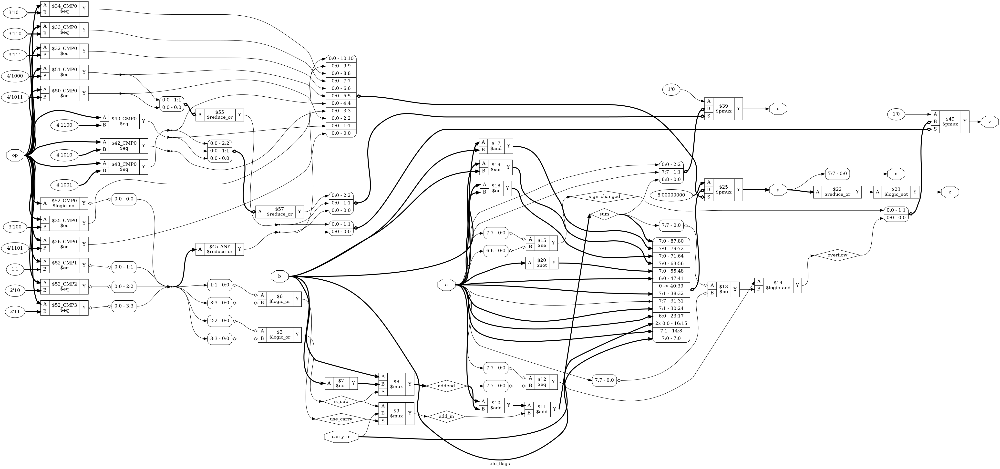

# Tutorial 18: Checking the CPU

Tutorial 17's CPU runs real programs and has a proof, yet that proof says nothing about
whether `ADD` adds. Every data bug in its last section passed `make formal`. This tutorial
closes that gap in two ways. First it runs the CPU beside a second, much simpler
description of the same instruction set, and compares them after every instruction. Then
it proves, one class of instruction at a time, that each does what the spec says. No RTL
changes here: `rtl/` is Tutorial 17's. The computer in Tutorial 19 and the pipeline in
Tutorial 20 both rest on what this one establishes.

Finish [Tutorial 17](../17-cpu/README.md) first. Run these commands in a VS Code terminal,
from this directory:

```bash
cd tutorials/18-cpu-verification
```

To run everything at once, use `make all`.

## What a reference model is

A **reference model** is a second description of what a design should do, written to be
obviously right, with no regard for how hardware works. Here it is an **instruction-set
simulator**, or ISS: [`tools/iss.py`](tools/iss.py). It has no clock and no states. One call
to `step()` runs one whole instruction:

```python
model = Iss(words)      # 256 instruction words
done = model.step()     # says what that instruction did
```

The two only line up at the end of an instruction, which is what `retire` is for.

## Why it must be written independently

A model copied from the design has the design's bugs, and the two will agree forever.
[Tutorial 4](../04-alu/README.md) said a check that shares a wire with the design shares
its mistakes.

So `iss.py` is written from the spec alone, and imports nothing from `asm.py`. Its ALU also
takes a different route from the hardware. `alu_flags.v` has one adder and adds `~b`. The
ISS does the true sum on Python integers, which cannot overflow, and reads the flags off
the answer:

```python
if name in ("SUB", "SBC", "CMP"):
    borrow = 1 - carry if name == "SBC" else 0
    total = a - b - borrow
    return total % BYTE, int(total >= 0), int(not fits(signed(a) - signed(b) - borrow))
```

Independence has a limit. The ISS and the CPU come from the same document, so a sentence
misread the same way twice gives two wrong sides that agree. For the shifts and rotates
the shared source is narrower still. The spec takes their `c` and `v` rules from the table
in Tutorial 12's `alu_flags.v`, the same file the CPU uses, so `iss.py` copies those rules
rather than deriving them. If a rule in that table were a mistake, such as the `v` of 0
for `ROR`, lockstep could not catch it.

## Lockstep

[`tb/lockstep.py`](tb/lockstep.py) runs the CPU and the ISS side by side. On each `retire` it
steps the ISS once, compares the PC, the instruction, all four registers and all four
flags, and stops at the first difference. Memory writes happen before `retire`, so it
records every `dmem_we`, and matches them in order against what the ISS wrote. A write that
only one side made is a failure too. A random program is cut off at 300 instructions, so the
checker runs one more retire after that, without counting it, to see the last one's write
through. It never looks at `state`, so a change of timing cannot upset it. You will see that
at the end.

Registers are not on any port, so the checker reaches them by path, which simulators
allow. `dut.u_cpu.u_regfile.q[2]` is R2. All these paths live in one small class, `CpuProbe`,
and everything else calls its `registers()`, `flags()`, `retire_pc()` and `retire_instr()`.

## Simulate

[`tb/tb_trace.v`](tb/tb_trace.v) does the same job in plain Verilog. `make sim` first runs
each program through the ISS, which writes a file with one line per instruction. The
testbench runs that program on the CPU, and compares the state with the next line at every
retire. This runs unchanged under Verilator as well.

```bash
make sim
```

Each program prints one line, and the last line is the total:

```text
build/demo.hex: 51 instructions compared
build/corners.hex: 47 instructions compared
PASS: 446 instructions matched the model
```

Use a fresh simulation for the next step, because `make verilator` writes the same file
and has no `x`. Open `build/tb_trace.vcd` as in Tutorial 1, and add `clk`, `rst`, `instr`,
`pc`, `retire` and `line` from `tb_trace`, then `got` and `expected`:

- At 45 ns `instr` becomes `2CF0`, the first word of `demo.asm`, `LDI R3, 0xF0`.
- `retire` is high from 75 ns to 85 ns, and `got` is compared just before 85 ns.
- At 85 ns `pc` becomes 1 and `line` goes from 0 to 1. The next word appears at 105 ns.

## Lint and Verilator

```bash
make lint
make verilator
```

Any warning starts with `%Warning`. The lines that start with `- V e r i l a t i o n`
are a normal report. `make verilator` prints the same lines as `make sim`.

## Test in Python

[`tb/test_lockstep.py`](tb/test_lockstep.py) has three tests.

```bash
make cocotb
```

Look for `TESTS=3 PASS=3 FAIL=0`, and these lines:

```text
directed: 455 instructions, 59 classes, 9 flag combinations, rarest class NOP with 1
random, 300 programs: 67974 instructions, 59 classes, 9 flag combinations, rarest class BVC_not_taken with 11
```

`directed_programs` runs everything in `programs/`, and each kind of illegal word. In
Tutorial 17 a random program had to reach `HALT` to be checked at all. Lockstep checks as it
goes, so in `random_programs` a program need not finish, or even make sense. Each of the
256 words is a random instruction. Programs jump anywhere, use R3 for anything and run off
the end of memory, and each is cut off after 300 instructions. Half of all data comes from
values where sums change behaviour, such as `0x7F` and `0x80`.

## Lockstep against a final check

Why not just compare at the end, as Tutorial 17 did? Because a later instruction can
destroy the evidence. [`programs/overwrite.asm`](programs/overwrite.asm) is built to show
this, and `final_state_only` runs it in the old way. In `rtl/cpu.v`, remove `&& flags_we`
from `flags_load`, so that every instruction with an `EXECUTE` state changes the flags, and
run `make cocotb`:

```text
** test_lockstep.directed_programs   FAIL
** test_lockstep.random_programs     FAIL
** test_lockstep.final_state_only    PASS
```

`overwrite.asm` ends with an `ADDI`, which sets all four flags correctly. Every wrong flag
before it is gone by `HALT`, so the final registers, flags, PC and memory are all right.
Lockstep stops two instructions into the first program it runs, and says why:

```text
LOCKSTEP FAILED in add_multi.asm, instruction 2: flags differ
  model ran  01: 20FF  LDI R0, 0xFF
  cpu ran    01: 20FF  LDI R0, 0xFF
             model       cpu
  pc         01          01
  instr      20FF        20FF
  R0         FF          FF
  R1         00          00
  R2         10          10
  R3         00          00
  flags      zcnv=0000   zcnv=0010   <-- differs
```

Lockstep names the instruction. Put `&& flags_we` back before going on.

## Coverage

A passing test only speaks for what ran, so the tests count. There are 59 classes: every
mnemonic, both directions of all 12 branches, `PUSH R3`, `POP R3`, and the four kinds of
illegal word. A test fails if one of its classes never ran.

You cannot ask for all 16 combinations of `zcnv`. Trying every input of every ALU operation
shows that only 9 can happen: 0 is not negative, for example, so `z` and `n` are never both
set. `iss.py` works this list out, so coverage never demands the impossible, and
[`programs/corners.asm`](programs/corners.asm) reaches all 9 on purpose. The random run
prints how uneven they are: `0000` came up 19715 times, and `1101` only 120.

An early version of the random test depended on luck. With seed 19 it failed on a perfect
CPU, with `never ran: ['ILLEGAL_OP_F']`. An illegal word ends its program, so each kind is
rare. The random test now leaves those four classes to `directed_programs`, which runs them
whatever the seed. With that change seeds 1 to 20 all pass on the correct CPU, and the rarest
other class ran at least 7 times. The seed stays fixed, at 18, so that a failure can
be repeated. To try another, use `make cocotb SEED=7`.

## Prove one instruction at a time

Simulation only speaks for the values it tried, and `ADC` alone has 131072 combinations of
inputs. A proof covers all of them.

[`tb/insn_check.v`](tb/insn_check.v) follows riscv-formal, a project that does this for real
RISC-V CPUs, but is far simpler. `cpu` runs with free inputs, so the solver picks every
instruction word and every byte read from memory. Whenever an instruction of the chosen
class retires, the checker works out from the spec what must have happened, and asserts:

- `retire_pc` is the PC before the instruction, and the new PC is right.
- All four registers and all four flags are right, including those that must not change.
- There was exactly the right number of memory reads and writes, with the right address
  and data.

```bash
make formal
```

[`insn.sby`](insn.sby) has 23 tasks. Twenty are classes of instruction, such as `arith`,
`shift`, `ld`, `bcc` and `pop`. Look for `successful proof by k-induction` and
`DONE (PASS, rc=0)` for each, and then the last line, `23 tasks passed`. All 22 proofs are
in `prove` mode. It takes under a minute.

**The checker shares nothing with the design.** No wire comes from `cpu.v` or `decode.v`.
Sums are true numbers, 11 bits wide so they cannot wrap, and `sum_v` is simply
`(s_exact < -128) || (s_exact > 127)`. Conditions use `?:`, not `case`, for the reason in
Tutorial 16, and `insn.sby` runs `proc -norom` as well.

**Reaching inside.** Yosys cannot read a path such as `u_cpu.pc` from Verilog. So
`insn_check.v` declares `f_pc`, `f_r0` and so on with no driver, and after flattening, when
a path is just a wire's name, `insn.sby` joins them: `connect -set f_pc u_cpu.pc`.

**Where a proof starts.** `pre_pc`, `pre_r0` and the rest copy the visible state on the first
clock of each instruction, the clock after a retire or a reset. A proof assumes only that
the FSM starts on such a clock, in `FETCH`. The PC, registers, flags, `ir` and `result` are
all free, and a reset is one case of that. So the solver needs no instructions to set up a
rare value: it simply starts there.

**No helper invariants.** In Tutorial 17, induction's window had to reach a `FETCH`, and that
is all that is needed here too. A window longer than one instruction always contains an
instruction's start, so `pre_` is right by the time a retire is checked. Depth 10 leaves
`pop` `UNKNOWN` and 11 proves it. `structure` needs 12, and `insn.sby` uses 13.

Three more tasks join the classes up:

| Task        | Proves                                                                    |
| ----------- | ------------------------------------------------------------------------- |
| `structure` | Every one of the 65536 words is in exactly one class. Reset gives the spec's state. Every instruction takes at most 9 clocks. `halted` holds until reset, and nothing moves |
| `fetch`     | `retire_instr` really is the word at `retire_pc`, read one clock after the address. The solver picks one address and its word, as in Tutorial 6 |
| `cover`     | From reset, each class can really retire, so no proof above is empty      |

## What proofs add, and what they cannot

Both methods catch most bugs. Here is the difference. In `rtl/alu_flags.v`, add this to the
end of `wire overflow`, just before the `;`:

```verilog
&& !(use_carry && add_in && a == 8'h3F && addend == 8'h40)
```

`0x3F + 0x40 + 1` is 128, which overflows, and now `v` misses it. That is one pair of
inputs in the whole of `ADC`, and one in `SBC`. Run the three checks:

| Check         | Result                                                                  |
| ------------- | ----------------------------------------------------------------------- |
| `make sim`    | `PASS: 446 instructions matched the model`                              |
| `make cocotb` | `TESTS=3 PASS=3 FAIL=0`, and no difference on any of seeds 1 to 20      |
| `make formal` | `arith` ends `DONE (FAIL, rc=2)` in 5 seconds. Every other task passes  |

`build/formal_arith/logfile.txt` names the failed line, `assert (f_v == want_v)`. Open
`build/formal_arith/engine_0/trace.vcd`, and it holds the whole story: `retire_instr` is
`1981`, which is `ADC R2, R1` with junk in the ignored bits, `val_rd` is `3F`, `val_rs` is
`40` and `pre_c` is 1. It has `want_v` 1 and `f_v` 0.

A solver does not try inputs one by one, so a rare input costs it no more than a common
one. Random testing has no such luck: those 20 runs were tens of thousands of instructions
each, with data drawn towards the edges on purpose. Remove the edit.

Simulation still earns its place. It runs whole programs from reset, in order, and the
exercises show lockstep and the proofs checking each other.

## What this still does not prove

Do not say "the CPU is correct". This is what has been shown, and what it stands on:

- **A human step.** The tasks show that reset is right, and that from any state each class
  of instruction is right, on a word really fetched from the PC. That every program
  therefore runs correctly is an argument by induction made here, not checked by a tool.
- **The spec is right, and was read correctly.** `iss.py` and `insn_check.v` have the same
  author and the same source.
- **Memory is assumed.** The proofs treat `dmem_rdata` as any value at all. They show the
  CPU uses the right address and takes the byte on the right clock, not that a RAM returns
  what was written. The instruction memory is assumed to answer one clock later.
- **The checker and the tools are trusted.** `insn_check.v` can have bugs. Its first version
  kept counting clocks through a reset out of `HALTED`, and `structure` ended `UNKNOWN` on a
  correct CPU. OSS CAD Suite here is a nightly build.
- **The proofs are about RTL.** They say nothing of the netlist, timing or a real board.
  A design that fails timing can do anything. Power-up is not covered either: reset is
  assumed to happen first.
- **Lockstep compares writes, not reads.** A wrong extra read is invisible to it. The
  proofs count reads, but only for this CPU. That matters in Tutorial 19, where a read of
  the UART changes its state.
- **`iss.py` is not proved.** It has only been tested where lockstep ran it.

For Tutorial 20, `iss.py` and `lockstep.py` are ready to reuse, but nothing has tried them
on a pipeline yet. A pipelined CPU needs its own probe class, whose values on the falling
edge while `retire` is high are the state just after that instruction and no younger
one. Memory writes may then arrive early or late against retires, which is what the
`write_lag` setting of `run_lockstep` is for. It is 0 here, and other values are untested.

## See the logic

```bash
make schematic
```

There is no new hardware, so this shows the part with this tutorial's hardest bug. Click
`build/alu_flags.png` in the Explorer. The CPU's schematic is in Tutorial 17.



- The `overflow` diamond is at the lower right, and it feeds the `$49` `$pmux` that drives `v`.
- Just before it, `$14` `$logic_and` joins `$12` `$eq`, which compares the top bits of `a` and
  `addend`, with `$13` `$ne`, which compares the top bits of `sum` and `a`.
- `$8` `$mux` picks `b` or `~b` as `addend`. `$10` and `$11` are the one adder.

The rare bug above would be one more condition on `$14`, and would not look wrong here.

## Map it to real FPGAs

```bash
make synth
```

| Family     | Flip-flops           | Total cells |
| ---------- | -------------------- | ----------- |
| Xilinx     | 79 `FDRE`            | 315         |
| Gowin      | 68 `DFFRE`, 11 `DFF` | 974         |
| Cyclone V  | 79 `MISTRAL_FF`      | 316         |

These match Tutorial 17, since verification adds no hardware. These are Yosys counts, so
vendor tools can give different results, and they say nothing about timing.

## Try it yourself

Make each change, then run `make sim`, `make cocotb` and `make formal`. Undo each change
before trying the next. These are real results. "Random only" means that `directed_programs`
passed and `random_programs` failed.

**The bugs Tutorial 17's proof could not see.**

| Change                                                                  | `sim` | `cocotb`    | `formal` fails          |
| ----------------------------------------------------------------------- | ----- | ----------- | ----------------------- |
| Remove `&& flags_we` from `flags_load`                                  | fails | fails       | `ldi`, `ld`, `st` and more |
| In `exec_value`, replace `pc_plus_1` with `pc`                          | fails | fails       | `call`                  |
| In `assign dmem_addr`, replace `rdata_b + imm` with `rdata_a + imm`     | fails | fails       | `ld`, `st`              |
| Replace `S_MEM_WAIT` with `S_MEMORY` in `result_load` and `u_result`    | fails | fails       | `ld`, `pop`, `ret`      |
| Replace `.carry_in(flag_c)` with `.carry_in(1'b0)`                      | fails | fails       | `arith`, `shift`        |
| Replace `assign dmem_wdata = result;` with `... = push ? rdata_b : result;` | fails | fails   | `push`                  |

The `carry_in` line fails `shift` as well as `arith`, because `ROL` and `ROR` use carry too.

**Bugs only wild programs reach.** Each of these passes `make sim` and the directed tests.

| Change                                                                 | `cocotb`    | `formal` fails                    |
| ---------------------------------------------------------------------- | ----------- | --------------------------------- |
| Add `\|\| ir[15:8] == 8'h01` to `stops`, so a `NOP` with junk halts    | random only | `nop`                             |
| Make `pc_plus_1` stick at `FF`, not wrap to 0                          | random only | Most classes, including `nop` and `call` |
| In `wire overflow`, use a sum that leaves out the carry flag in `ADC` and `SBC` | random only, on 19 of seeds 1 to 20 | `arith` |

**A proof that passes because nothing happens.** In `rtl/cpu.v`, replace
`S_SP_INC:    next_state = reg_we ? S_WRITEBACK : S_RETIRE;` with
`... reg_we ? S_WRITEBACK : S_SP_INC;`, so `RET` never finishes. The `ret` task still
passes, because no `RET` ever retires for it to check. Only `structure`, with its limit of 9
clocks, and `cover` fail. Assertions about a retire say nothing about whether one comes.

**Blame the model.** In `tools/iss.py`, replace `borrow = 1 - carry` with `borrow = carry`.
The CPU is now right and the model wrong, and lockstep cannot tell which: `make cocotb`
stops at `LOCKSTEP FAILED in corners.asm, instruction 24: registers differ`, and `make sim`
fails as well. But `make formal` passes, since it never uses the ISS. A disagreement
only tells you to go and read the spec. Now undo that, and instead in `tb/insn_check.v`
swap the two values of `extra` for `SBC`: replace `(pre_c ? 11'sd0 : -11'sd1)` with
`(pre_c ? -11'sd1 : 11'sd0)`. Only `arith` fails, while simulation and lockstep pass. Three
descriptions have to agree, so any one of them being wrong shows up.

**A bug in the model nobody meets.** In `tools/iss.py`, add
`^ int(a == 0x3F and b == 0x40 and extra == 1)` to the end of the `return` line under
`total = a + b + extra`. Everything passes, and `make formal` does not use the ISS, so no
check here covers this. The proof still vouches for the CPU, but this is why `iss.py` is
called tested and not correct.

**A faster CPU that passes.** Tutorial 17's last change made `RETIRE` skip `FETCH`. Replace
`S_RETIRE:    next_state = stops ? S_HALTED : S_FETCH;` with `... : S_WAIT;`, and
`assign imem_addr = pc;` with `assign imem_addr = pc_load ? pc_next : pc;`. Tutorial 17's
`make sim` and `make formal` objected, because they counted clocks. Here all three pass,
since nothing cares how long an instruction takes. These checks describe correct behaviour
and not one design, which is why Tutorial 20 can reuse them.
