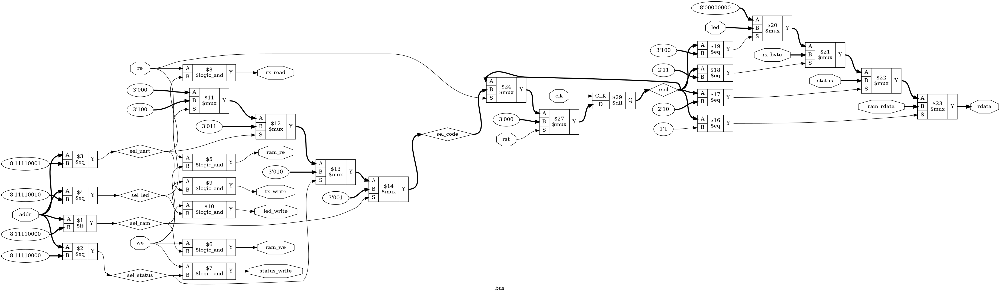

# Tutorial 19: The Computer

A CPU on its own can only change its own memory, so nobody can tell what it did. This
tutorial joins the CPU from Tutorial 17 to RAM, the UART from Tutorial 14 and a row of
LEDs, and it becomes a computer: a program prints a word, reads what you type and answers.

The CPU does not change at all. Not one line of `cpu.v` is new, and no instruction is
added. Everything here happens in the logic around it.

Finish [Tutorial 17](../17-cpu/README.md) and [Tutorial 14](../14-uart/README.md) first.
Run these commands in a VS Code terminal, from this directory:

```bash
cd tutorials/19-computer
```

To run everything at once, use `make all`.

## The design

[`rtl/computer.v`](rtl/computer.v) is the top level. Its only ports are `clk`, `rst`, the
two UART pins, `led`, `halted` and `illegal`. [`rtl/bus.v`](rtl/bus.v) is the one new
piece of logic that matters, and everything else in `rtl/` is copied unchanged.

```text
                     +--------------------- bus ---------------------+
 imem --> +-----+    |  addr --> decoder --> one strobe per device   |--> RAM (240 bytes)
          | cpu |--->|                                               |--> UART --> uart_tx
          |     |<---|  rdata <-- mux <-- rsel (which device?)       |<-- UART <-- uart_rx
          +-----+    +-----------------------------------------------+--> led register
```

## Memory-mapped I/O

Here is the whole of the outside world, as a program sees it:

| Address      | Read                                                         | Write                  |
| ------------ | ------------------------------------------------------------ | ---------------------- |
| 0x00 to 0xEF | RAM                                                          | RAM                    |
| 0xF0         | UART status: bit 0 tx ready, bit 1 byte waiting, bit 2 framing error seen | Any write clears bit 2 |
| 0xF1         | The next received byte. Clears bit 1                         | Byte to transmit       |
| 0xF2         | LED register                                                 | LED register           |
| 0xF3 to 0xFF | 0                                                            | Ignored                |

This is **memory-mapped I/O**: devices answer to addresses, so a program talks to them with
the instructions it already has. To light the LEDs it runs `ST R0, [R2+LED]`.

The CPU cannot tell that this was not RAM. It puts out an address, some data and `dmem_we`
exactly as usual. That is why no new instruction is needed, and also why any instruction
that touches memory reaches the devices. [`programs/io_rules.asm`](programs/io_rules.asm)
even sends a byte with `PUSH`, by pointing R3 at 0xF2 so that the push lands on 0xF1.

The price is 16 bytes of RAM. The stack still starts at 0xF0, so its first push lands on
0xEF, the last byte of RAM.

## Address decoding

The decoder turns each address into one select. There are only four comparisons:

```verilog
wire sel_ram    = (addr < 8'hF0);
wire sel_status = (addr == 8'hF0);
wire sel_uart   = (addr == 8'hF1);
wire sel_led    = (addr == 8'hF2);
```

A select only says who the address belongs to. Nothing may happen until `re` or `we`
agrees, so each strobe is one of those selects with one of those two signals:

```verilog
assign ram_we  = we && sel_ram;
assign rx_read = re && sel_uart;
```

That second input matters more than it looks. In `cpu.v`, `dmem_addr` is worked out on every
clock of every instruction, so it carries junk nearly all the time. While the CPU runs
`LDI R1, 0xF1` with R0 at 0, the address wires say 0xF1, and that is not a read.
`io_rules.asm` does exactly this with a byte waiting, and checks that it survives.

## The read data mux

A write is easy, because everything goes in at one clock edge. A read has two steps. The
address goes in at one edge and the data comes back on the next clock, as with the RAM in
[Tutorial 6](../06-sync-ram/README.md). The CPU's `MEM_WAIT` state is built around that.

So every device must answer one clock late, and the mux on `dmem_rdata` has a problem: by
the time the data is due, the address may have moved on. The bus keeps a note of which
device the read was for. This is the **registered select**:

```verilog
always @(posedge clk) begin
    if (rst)
        rsel <= R_NONE;
    else if (re)
        rsel <= sel_code;
end

assign rdata = (rsel == R_RAM)    ? ram_rdata :
               (rsel == R_STATUS) ? status    :
               (rsel == R_RX)     ? rx_byte   :
               (rsel == R_LED)    ? led       :
                                    8'd0;
```

The rule is general. When data comes back later than the request, the steering for that
data must travel with it.

## Reads with side effects

Reading RAM changes nothing, so it can be repeated freely. Reading 0xF1 is different: it
says "I have taken this byte", and clears bit 1 of status. A read that changes something
is called a **side effect**, and it is why a device is not just memory.

- **A side effect needs `re`,** not just the address, as above.
- **A program should read 0xF1 once per byte.** `io_rules.asm` reads it twice. The second
  read gives the old byte again, `C3`, with nothing to say that it is old.
- **The hardware must read once as well.** The CPU holds `dmem_re` for one clock, and
  Tutorial 17 proved that it is high only in `MEMORY`. "Try it yourself" below shows what
  happens if it stays high for two.

## The holding register, and a race

`uart_rx` pulses `rx_valid` for one clock, and cannot tell the sender to wait. So `computer.v`
copies each byte into `rx_hold` and sets `rx_waiting`, and the byte waits there until a
program reads it. There is room for one. If another arrives first it replaces the old one.
The spec does not say, so that is this design's choice.

A byte can also arrive on the same clock as a read. Neither may be lost:

```verilog
if (rx_read)
    rx_rdata <= rx_hold;       // the read gets the old byte

if (rx_valid) begin
    rx_hold    <= rx_data;     // the new byte waits
    rx_waiting <= 1'b1;
end else if (rx_read) begin
    rx_waiting <= 1'b0;
end
```

So arrival beats clearing, and `rx_rdata` is 8 extra flip-flops that hold what the read saw
at its own edge. Writing 0xF1 needs no such care: `uart_tx` ignores `tx_valid` unless it is
ready, which is the spec's rule that a byte written while it is busy is lost.

### Warning: simulation does not model metastability

`uart_rx` arrives from another clock domain, and passes through the two-flop synchronizer
in `uart_rx.v` from [Tutorial 14](../14-uart/README.md). **A passing test does not prove
that a clock domain crossing is safe.** Nothing in this tutorial, including the proof,
models metastability, and no claim is made about timing or failure rates.

## Polling

The CPU has no interrupts, so the only way to learn that something has happened is to keep
asking. This is **polling**, and in [`programs/hello.asm`](programs/hello.asm) it is three
instructions:

```text
putc:
        PUSH R1
putc_wait:
        LD   R1, [R2+UART_STATUS]
        ANDI R1, TX_READY
        BEQ  putc_wait
        ST   R0, [R2+UART_DATA]
        POP  R1
        RET
```

By the table in Tutorial 17 that loop takes 8 + 6 + 4 = 18 clocks a turn. At
`CLKS_PER_BIT=16` a frame lasts 160 clocks, so the CPU is mostly asking the same question.

The loop is a **subroutine**: `CALL putc` is short, and there is one place to get it right.
It saves R1 so that callers need not care which registers it uses. `getc` in
[`programs/echo.asm`](programs/echo.asm) is its mirror, with `RX_WAITING` for `TX_READY`,
and it returns the byte in R0. The stack from Tutorial 17 makes both of them possible.

## The programs

`make sim` assembles everything in `programs/` first, using [`tools/asm.py`](tools/asm.py)
from Tutorial 16. It has no character literals, so letters are `.equ` names.

| Program        | What it does                                                       |
| -------------- | ------------------------------------------------------------------ |
| `hello.asm`    | Prints `hello`, polling before each letter, then halts             |
| `echo.asm`     | Sends back each byte it reads, with a to z changed to upper case   |
| `leds.asm`     | Counts on the LEDs. The count lives in the LED register itself     |
| `io_rules.asm` | Tests each rule in the I/O map with real instructions              |
| `race.asm`     | Reads 0xF1 flat out, to make bytes land on the edge of a read      |
| `exercise.asm` | Yours. See the end of this tutorial                                |

## Simulate

[`tb/tb_computer.v`](tb/tb_computer.v) judges programs by their pins. Its own UART decoder
checks every clock of every bit on `uart_tx` and turns the frames back into bytes, and
`send_frame` drives `uart_rx` one bit at a time on falling edges.

```bash
make sim
make sim CLKS_PER_BIT=7
```

These are the bytes decoded from `uart_tx`, printed by the test at the default setting:

```text
hello: "hello"
hello: 33 status reads
echo: "HELLO, FPGA 19!~"
leds: 256 changes, ending at 00
io_rules: "AC"
reset: "hhello"
exercise: ""
PASS
```

- `hello` needed 33 status reads to send 5 letters. `HALT` stops the CPU and not the UART,
  so the last frame finishes after `halted` rises.
- `io_rules` wrote `A` then `B` with no poll between, so `B` was lost, and `C` came from the
  `PUSH`. The test also checks the 13 results it stores in RAM.
- `reset` resets in the middle of a frame. The first `h` got out, the `e` was cut off, and
  the program started again.

`CLKS_PER_BIT` values 4, 7, 8 and 16 all pass.

## View the waveform

Use a fresh `make sim`, because `make verilator` writes the same file and has no `x`. Open
`build/tb_computer.vcd` as in Tutorial 1. Add `dmem_addr`, `dmem_re`, `dmem_rdata`,
`rx_waiting` and `rx_rdata` from `dut`, `state` and `result` from `dut.u_cpu`, and `rsel`
from `dut.u_bus`.

This is `echo` reading its first byte, the `H`. The word is `62F1`, or
`LD R0, [R2+UART_DATA]`. Each row is the value just before the rising edge at that time:

| Edge (ns) | `state`       | `dmem_addr` | `dmem_re` | `rsel` | `dmem_rdata` | `rx_waiting` | `rx_rdata` | `result` |
| --------- | ------------- | ----------- | --------- | ------ | ------------ | ------------ | ---------- | -------- |
| 15065     | 5 `MEMORY`    | `F1`        | 1         | 2      | `03`         | 1            | `00`       | `00`     |
| 15075     | 6 `MEM_WAIT`  | `F1`        | 0         | 3      | `48`         | 0            | `48`       | `00`     |
| 15085     | 8 `WRITEBACK` | `F1`        | 0         | 3      | `48`         | 0            | `48`       | `48`     |

- In the first row `rsel` is still 2 from the last `LD`, so `dmem_rdata` shows status.
- The edge at 15065 ns does three things: `rsel` becomes 3, `rx_rdata` copies the byte, and
  `rx_waiting` clears.
- One clock after `dmem_re` the byte is on `dmem_rdata`, and `result` loads it at 15075 ns.
- Look at `dmem_addr` in the second row. It is still `F1`. Keep that in mind for later.

## Lint and Verilator

```bash
make lint
make lint CLKS_PER_BIT=7
make verilator
```

Any warning starts with `%Warning`. The lines that start with `- V e r i l a t i o n` are
a normal report. `make verilator` should print the same lines as `make sim`.

## Test in Python

[`tb/test_computer.py`](tb/test_computer.py) has a Python UART on both pins, with `uart_rx`
timed in picoseconds as in Tutorial 14. Behind that is a scoreboard, a model of the I/O map
that checks status, the LEDs and all read data on every clock.

```bash
make cocotb
make cocotb CLKS_PER_BIT=7
```

Look for `TESTS=6 PASS=6 FAIL=0`. The numbers below change with the random seed:

```text
line trace: 'hello', 33 status reads, 28 found it busy
1053 bytes in, 1053 bytes out, 118 letters, 55 bad frames, 6807 status reads
600 frames, 6027 reads, 38 landed on the edge of a read
```

- `hello` and `leds` run those programs.
- `random_bus` runs 25 random programs of loads and stores to every address, while bytes
  arrive at random. Exactly the accepted bytes must reach the line.
- `random_echo` sends 60 random strings, up to 2% off the right speed, some frames back to
  back and some with bad stop bits. It counts bytes both ways, letters, and polls that
  found no byte or a busy transmitter, and fails if any is zero or a byte goes missing.
- `read_races` runs `race.asm`, and fails if no byte lands on the edge of a read.
- `full_speed` is an experiment, and it is next.

## What polling costs

`random_echo` never lets the sender get more than one byte ahead. `full_speed` takes that
limit away and sends 256 bytes back to back, at the same bit rate the echo goes out at. It
uses a fixed seed, so these numbers repeat:

```text
CLKS_PER_BIT=16: 256 bytes back to back, 218 echoed, 38 overwritten, first at byte 9
CLKS_PER_BIT=7: 256 bytes back to back, 124 echoed, 132 overwritten, first at byte 3
```

The hardware is fine, and every byte that comes back is correct and in order. The line out
is the same speed as the line in, with the program's own time on top, so the backlog grows
until a byte is replaced in `rx_hold`. A FIFO from [Tutorial 7](../07-sync-fifo/README.md)
would buy time.

## Prove it with formal verification

```bash
make formal
```

[`bus.sby`](bus.sby) has two tasks, and takes seconds. Look for `successful proof by
k-induction` from `prove`, and `DONE (PASS, rc=0)` from both.

**This proves `bus` alone, not the computer.** The whole computer, with a CPU, two memories
and a UART, is too big to prove, and this tutorial does not try. So the proof takes the one
module that every access passes through, and makes everything around it a free input.
`addr`, `re`, `we` and all the read data can be anything at all, so these facts hold for
any CPU:

- Exactly one of RAM, status, UART, LED and "nothing" is selected for every address, and
  it is the one in the map, written a second way in the proof.
- RAM is never read or written at an I/O address, and each strobe fires only for its own.
- With `re` low there are no read side effects. With `we` low nothing is written.
- `rsel` matches the address of the read one clock later, wherever `addr` has gone since,
  and holds until the next read. `rdata` comes from the device `rsel` names.

The `cover` task shows a read of each kind finishing with the address already elsewhere.

**What is not proved** is everything in `computer.v`: the holding register, the status
bits and the LED register. Nothing proves that the parts work together. Only simulation
tests that, and the table below shows the difference.

## See the logic

```bash
make schematic
```

The whole computer would be unreadable, so this draws `bus`. Click `build/bus.png` in the
Explorer:



- At the left, `addr` feeds one `$lt` and three `$eq` cells. That is the whole decoder.
- Beside them, each `$logic_and` joins a select to `re` or `we`, and makes one strobe.
- In the middle, a chain of `$mux` cells makes `sel_code`, and the one `$dff` is `rsel`.
- At the right, four `$eq` cells read `rsel` and steer the `$mux` chain to `rdata`. `addr`
  has no path to `rdata` except through that flip-flop.

## Map it to real FPGAs

```bash
make synth
```

| Family     | Flip-flops           | Memories       | Total cells |
| ---------- | -------------------- | -------------- | ----------- |
| Xilinx     | 183 (`FDRE`, `FDSE`) | 8 `RAM256X1S`  | 552         |
| Gowin      | 163 (`DFF` variants) | 2 `SPX9`       | 1264        |
| Cyclone V  | 163 `MISTRAL_FF`     | 2 `MISTRAL_M10K` | 526       |

Xilinx and Gowin totals include 16 `$scopeinfo` entries, which are bookkeeping and not
real cells. These synthesize `hello.hex` as the program. Gowin and Cyclone V put both
memories in block RAM, and Xilinx does not. These are Yosys counts, so vendor tools can
give different results, and they say nothing about timing.

`make pnr` works as in [Tutorial 15](../15-pipelining/README.md). The pins in
[`computer.cst`](computer.cst) exist only so that the tool can run, and do not describe a
board. Hardware is not a goal of this course. It places the design five times:

```bash
make pnr
```

| Lowest    | Middle    | Highest   |
| --------- | --------- | --------- |
| 53.99 MHz | 56.98 MHz | 59.95 MHz |

**This is an open-source estimate for a GW1N-9C, not a vendor result.** In these five runs
the worst path ends at the CPU's `result` register or `z` flag, as in Tutorial 17, or at
the state register of `uart_tx`.

A warning from building this. An early `computer.v` zeroed `imem` in a loop, and then called
`$readmemh`. Every simulation passed, but in Yosys the zeros won, so the synthesized program
was empty, and the Xilinx flow cut the whole computer to 12 flip-flops. That number was the
only clue. Simulation and synthesis read the same Verilog, but they can disagree about it.

## Try it yourself

Change the RTL, then run `make sim`, `make cocotb` and `make formal`. Undo each change
before trying the next.

| Change                                                       | Sim  | cocotb | Formal |
| ------------------------------------------------------------ | ---- | ------ | ------ |
| `assign rx_read = sel_uart;`                                 | FAIL | FAIL   | FAIL   |
| `assign tx_write = sel_uart;`                                | FAIL | FAIL   | FAIL   |
| `sel_ram = (addr <= 8'hF0)`                                  | FAIL | FAIL   | FAIL   |
| `sel_led = (addr == 8'hF3)`                                  | FAIL | FAIL   | FAIL   |
| In `rdata`, `ram_rdata` in place of the last `8'd0`          | FAIL | FAIL   | FAIL   |
| In `computer.v`, status as `{5'd0, rx_err_seen, tx_ready, rx_waiting}` | FAIL | FAIL | pass |
| In `computer.v`, `rx_waiting <= 1'b1;` in place of `1'b0` after `rx_read` | FAIL | FAIL | pass |
| In `computer.v`, `else if (dmem_re)` in place of `else if (rx_read)` | FAIL | FAIL | pass |
| In `computer.v`, `else if (dmem_we)` in place of `else if (status_write)` | FAIL | FAIL | pass |

The first row is worth a second look: `hello` and `echo` still work, and only `io_rules`
fails, with `FAIL ram[14]=01 expected=03`. The last four rows pass formal because the proof
covers `bus`, and those bugs are in `computer.v`.

**The surprise: remove the registered select.** In `assign rdata`, replace `rsel` with
`sel_code` on all four lines, so the current address picks the data. This is the bug the
whole design was built to avoid. Run everything:

| Check            | Result                                                     |
| ---------------- | ---------------------------------------------------------- |
| `make sim`       | `PASS`, with every line of output the same                 |
| `make verilator` | `PASS`                                                     |
| `make cocotb`    | `TESTS=6 PASS=6 FAIL=0`                                    |
| `make lint`      | `%Warning-UNUSEDSIGNAL`, because `rsel` is now not used    |
| `make formal`    | `prove` ends `DONE (FAIL, rc=2)`, and `cover` passes       |

Every program works. Look back at the waveform table: `dmem_addr` is still `F1` in
`MEM_WAIT`, so the current address happens to be the old one and the bug cannot show. The
proof makes no assumption about `addr`, so it finds the bug anyway.

Now show that it is real. Undo that change, and in `cpu.v` move the address on after the
read. The spec allows this, since data is only due one clock after `dmem_re`:

```verilog
assign dmem_addr  = (state != S_MEMORY) ? 8'h00 : uses_stack ? rdata_a : rdata_b + imm;
```

With the good bus, nothing notices: `make sim`, `make cocotb` and `make formal` all pass.
That is the registered select doing its job. Now put the `sel_code` change back as well:

```text
FAIL after 54 clocks, halted=1 illegal=1 pc=Xx
hello: ""
```

`make cocotb` gives `TESTS=6 PASS=0 FAIL=6`. The first status read now follows address 00
to RAM, whose output nothing has loaded, so `result` becomes `x`, and that spreads to the
PC. The tests showed that the design suits this CPU. The proof covers any CPU.

**Bugs only formal sees.** Set `assign ram_we = we;`. Simulation and cocotb pass, because
`ram` has no cells above 239, so the stray write lands nowhere. A RAM with 256 real bytes
would be corrupted. Then try `else` in place of `else if (re)` above `rsel <=`.

**Bugs only Python sees.** In `computer.v`, connect `.rx_byte(rx_hold)` in place of
`rx_rdata`. Or change the priority, so that a read clears `rx_waiting` even if a byte
arrives on that edge. `make sim` and `make formal` pass both, because no byte lands on a
read there. In `make cocotb`, `read_races` and `full_speed` fail.

**A CPU that reads twice.** In `cpu.v`, add `|| state == S_MEM_WAIT` beside
`state == S_MEMORY` in `dmem_re`. `make sim` and `make formal` pass, and the programs still
work. Only the counts in `make cocotb` give it away: `leds` reports `512 reads of the LEDs`,
and `random_echo` reports twice as many reads as bytes. A second read of 0xF1 is not
harmless, though. Usually it changes nothing the first did not, but when a byte lands on the
edge of the first read, that byte is left waiting, and the second read clears `rx_waiting`
and loses it. In one run, a monitor added for the purpose counted 46 bytes lost this way.
`read_races` still passes, because its scoreboard follows the reads on the bus, and two reads
clear the byte there too. With a FIFO behind that address, every second read would remove a
byte.

**Your own program.** Follow the notes in [`programs/exercise.asm`](programs/exercise.asm):
wait for one byte, send it back as two hex digits, and halt. `make sim` sends it `0x5A`, and
the last line should change from `exercise: ""` to `exercise: "5A"`.

## How far you have come

In Tutorial 1 you clocked a single flip-flop. Since then you have built counters, shift
registers, an ALU, FSMs, RAM, FIFOs, a UART, a register file and an instruction set with
its own assembler, and learned to doubt each one with simulation, random tests, proofs and
mutations. This tutorial added only a few comparisons and one 3-bit register. They were
enough, because everything under them already worked.

So look again at `hello`. Those five letters came from a program assembled by a tool you
read, fetched by a CPU you built, one bit at a time down a wire. Every step between that
string and a flip-flop is yours.

[Tutorial 20](../20-pipelined-cpu/README.md) goes back inside the CPU and overlaps its
instructions, so that it finishes more of them per clock. A CPU like that has no reason to
hold an address still, which is when the registered select starts to earn its place.
