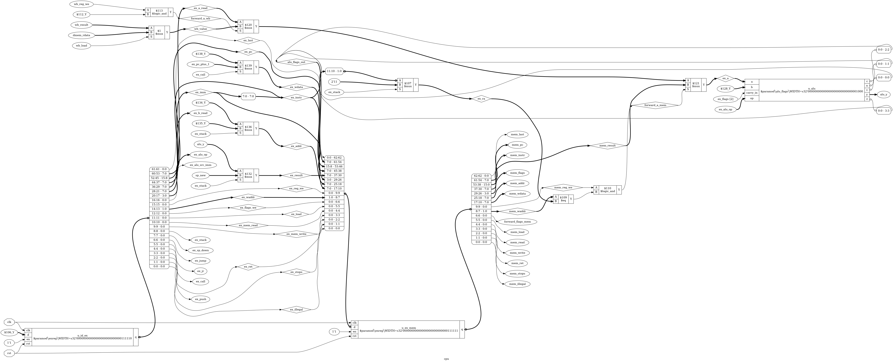

# Tutorial 20: The Pipelined CPU

Tutorial 17's CPU spends most of its clocks waiting: about six for each instruction,
while its ALU works for one of them. This tutorial cuts the same CPU into five stages, so
that a new instruction can start on every clock, as [Tutorial 15](../15-pipelining/README.md)
did for an adder. The instruction set, the ports and the programs do not change. Only the
clock count does.

The difficulty is that an adder's stages do not depend on each other, and instructions do.
This is the last tutorial of the course, and it finishes with an honest look at what the
whole course has and has not shown.

Finish [Tutorial 15](../15-pipelining/README.md) and
[Tutorial 18](../18-cpu-verification/README.md) first. Run these commands in a VS Code
terminal, from this directory:

```bash
cd tutorials/20-pipelined-cpu
```

To run everything at once, use `make all`.

## Five stages

[`rtl/cpu.v`](rtl/cpu.v) has the same `decode`, `regfile` and `alu_flags` as Tutorial 17,
unchanged. The FSM has gone. Instead, each instruction moves one stage on every clock:

| Stage | What happens                                                  |
| ----- | ------------------------------------------------------------- |
| `IF`  | `pc` is the address of the word now on `imem_data`            |
| `ID`  | `decode` reads the word, and the registers are read           |
| `EX`  | The ALU works, and jumps and branches are decided             |
| `MEM` | `dmem_re` or `dmem_we` is high for one clock                  |
| `WB`  | `dmem_rdata` is valid, and the registers and flags are written |

```text
 pc_next --> [pc] --imem_data--> [IF/ID] --> decode, --> [ID/EX] --> ALU --> [EX/MEM] --> dmem --> [MEM/WB] --> regfile
     ^                                       regfile                  |          |                     |        flags
     |                                          ^                     |          |                     |
     +---- target, and flush ------------------ | ---------------------+          |                     |
                                                |              ^                 |                     |
                                                |              +---- forward ----+---------------------+
                                                +---- forward from WB -----------------------------------+
```

Each boundary is one pipeline register, a single wide `enreg`, and each signal is named
for the stage it is in, so `ex_a` and `mem_result` say where they live:

```verilog
enreg #(.WIDTH(EX_MEM_BITS)) u_ex_mem (
    .clk(clk), .rst(rst), .en(1'b1),
    .d({ex_last, ex_pc, ex_instr, ex_result, alu_flags_out, ...}),
    .q({mem_last, mem_pc, mem_instr, mem_result, mem_flags, ...})
);
```

These are Tutorial 15's ideas. The control bits are its valid bit, and `ex_pc` and
`ex_instr` are alignment registers. A **bubble** is a word of zeros: `0000` is a `NOP`, and
every control bit is low, so a bubble cannot change anything. Killing an instruction is
writing zeros over it.

**The memories fit the stages.** Tutorial 17 needed wait states, because a synchronous
memory answers a clock late. Here that latency is the stage boundary. `imem_addr` is
`pc_next`, so memory and `pc` take the same value on the same edge, and `imem_data` always
belongs to `pc`. A load has its address out in `MEM`, and its data arrives in `WB`.

**Retire comes one clock after `WB`.** In that clock the registers and flags show this
instruction's result, and the next instruction's writes have not landed. So Tutorial 17's
rule still holds: when `retire` is high, its effects are complete. One thing does differ.
`pc` is now the fetch address and runs ahead, so only `retire_pc` says where the program is.

## Build it in steps

Instructions now overlap, and that breaks three things. The parameter `STEP` adds the fixes
one at a time, and nothing else changes:

| `STEP` | What is in the design                                    |
| ------ | -------------------------------------------------------- |
| 0      | Nothing: just the stages                                 |
| 1      | Flush                                                    |
| 2      | Plus: stall until every result is written                |
| 3      | Forwarding replaces most stalls, for registers           |
| 4      | Forwarding for flags as well. This is the finished CPU   |

```bash
make cpi
```

[`tb/tb_cpi.v`](tb/tb_cpi.v) runs all 14 programs at each `STEP`, and compares every retire
with the model. These are the real results, in clocks:

| Program         | Instructions | Tutorial 17 | `STEP=2` | `STEP=3` | `STEP=4` |
| --------------- | ------------ | ----------- | -------- | -------- | -------- |
| `demo`          | 51           | 329         | 164      | 114      | 99       |
| `add_multi`     | 29           | 184         | 76       | 38       | 37       |
| `fibonacci`     | 94           | 512         | 167      | 164      | 125      |
| `recursive_sum` | 58           | 370         | 197      | 150      | 129      |
| `memcpy`        | 88           | 512         | 200      | 177      | 129      |
| `branches`      | 61           | 285         | 140      | 119      | 104      |
| `stack_r3`      | 9            | 59          | 33       | 16       | 16       |
| `overwrite`     | 9            | 53          | 23       | 14       | 14       |
| `corners`       | 47           | 285         | 149      | 73       | 61       |
| `hazard_alu`    | 18           | 100         | 40       | 23       | 23       |
| `hazard_load`   | 16           | 98          | 37       | 23       | 23       |
| `hazard_flags`  | 19           | 104         | 50       | 34       | 24       |
| `hazard_branch` | 28           | 132         | 45       | 45       | 45       |
| `hazard_stack`  | 26           | 175         | 83       | 43       | 43       |
| **All 14**      | **553**      | **3198**    | **1404** | **1033** | **872**  |
| **CPI**         |              | **5.78**    | **2.53** | **1.86** | **1.57** |

**CPI** is clocks per instruction. `STEP=0` gets none of the 14 right, and `STEP=1` gets one.
`make cpi` runs each `STEP` under Icarus and then Verilator, and fails unless those counts
are right, and, for `STEP=2` to 4, unless all 14 programs together take no more clocks than
the totals above.

### Control hazards, and `STEP=1`

Fetching does not know what a word is, so the two words after a jump are fetched before
`EX` can object. [`programs/hazard_branch.asm`](programs/hazard_branch.asm) puts a store and
a `HALT` there, with `NOP`s that keep every other hazard away. `STEP=0` runs the store:

```text
STEP=0 build/hazard_branch.hex: WRONG at instruction 11
  model pc=0d instr=8010 R0-R3=11 40 00 f0 zcnv=1100 write=0 00 00
  cpu   pc=0b instr=7100 R0-R3=11 40 00 f0 zcnv=1100 write=1 40 11
```

The model has gone to the `JMP` at 0D, and the CPU has run the `ST` at 0B, the wrong path.
The fix is **predict not taken**: keep fetching `pc + 1`, and when `EX` finds a jump, `flush`
zeros what is in `IF` and `ID`. They have not reached `MEM` or `WB`, so nothing has changed
and nothing needs undoing. With `make cpi` it shows `STEP=1 build/hazard_branch.hex: right`.

`HALT` and illegal words flush in the same way. They only act in `EX`, where nothing older
can still jump past them, so a `HALT` on the wrong path never happens. Memory is only used
in `MEM`, behind every point that can flush, so a wrong-path store or load cannot reach it.
Tutorial 19's UART changes state when read, so this matters for reads too.

### Data hazards, and `STEP=2`

An instruction reads registers in `ID`, but the one before it does not write until `WB`,
three clocks later. [`programs/hazard_alu.asm`](programs/hazard_alu.asm) shows it on its third
instruction, where `R0` is 1 and `ADDI R0, 2` should make 3:

```text
STEP=1 build/hazard_alu.hex: WRONG at instruction 2
  model pc=02 instr=3002 R0-R3=03 00 40 00 zcnv=0000 write=0 00 00
  cpu   pc=02 instr=3002 R0-R3=02 00 40 00 zcnv=0000 write=0 00 00
```

It read the old `R0`. The simplest cure is to wait: hold the instruction in `ID` until
nothing ahead of it will write what it reads, and send bubbles down the pipeline.

That is a **stall**. `stall` holds `pc` and IF/ID, and zeros the input of ID/EX. The word
already fetched has nowhere to go, but it does not need to: `imem_addr` is `pc_next`, which
is `pc` during a stall, so memory simply reads the same word again.

`STEP=2` gets all 14 programs right. It is a working CPU, at a CPI of 2.53, and already far
ahead of Tutorial 17. But it waits for values that already exist.

### Forwarding, and `STEP=3`

The ALU's answer exists at the end of `EX`, not `WB`. So take it from where it is:

```verilog
wire forward_a_mem = HAS_REG_FORWARD && mem_reg_we && (mem_waddr == ex_ra);
wire forward_a_wb  = HAS_REG_FORWARD && wb_reg_we  && (wb_waddr  == ex_ra);

wire [7:0] ex_a = forward_a_mem ? mem_result :
                  forward_a_wb  ? wb_value   :
                                  ex_a_read;
```

The nearest stage is tested first, because it holds the newest value. There are three
distances, and `hazard_alu.asm` has one of each:

| Writer is      | The reader in `EX` or `ID` takes it from         |
| -------------- | ------------------------------------------------ |
| 1 place ahead  | `mem_result`, into `EX`                          |
| 2 places ahead | `wb_value`, into `EX`                            |
| 3 places ahead | `wb_value`, into `ID`                            |

The third is the one that is easy to forget. As [Tutorial 11](../11-register-file/README.md)
warned, `regfile` returns the old value until the edge. An instruction in `ID` while its
writer is in `WB` reads the old value, and by the time it reaches `EX` that writer has gone.
So `ID` has a **bypass** of its own, `bypass_a` and `bypass_b`.

The R3 inside `CALL`, `RET`, `PUSH` and `POP` is not named in the instruction, but `ex_ra`
is `SP` for them, so it forwards like any other register.
[`programs/hazard_stack.asm`](programs/hazard_stack.asm) relies on this. Forwarding costs
muxes and comparators, and a stall costs clocks: `demo` falls from 164 to 114.

### Flags, and `STEP=4`

Flags are written in `WB` here, like a register, so that a retire shows the right ones.
`Bcc`, `ADC`, `SBC`, `ROL` and `ROR` read them in `EX`, and `decode` needs them there to answer
for a branch, so `EX` has a second copy of `decode` used only for that.
[`programs/hazard_flags.asm`](programs/hazard_flags.asm) shows why they must be forwarded,
in the same way as registers: `mem_flags`, then `wb_flags`, then `flags_reg`. Flags read in
`EX` do not need a third path, since a writer that has left `WB` is already in `flags_reg`.

The result: `fibonacci`, a loop with a branch right after its compare, drops from 164 to 125.

### The one stall left

A load's data does not exist until `WB`, so nothing can forward it to the instruction right
behind. That instruction has to wait one clock in `ID`, and then `wb_value` reaches it:

```verilog
wire load_use = ex_load && ((id_reads_a && ex_waddr == id_ra) ||
                            (id_reads_b && ex_waddr == id_rs));
```

`id_reads_a` and `id_reads_b` matter. Without them, `LDI R0` after a load into `R0` would
wait for a value it throws away. [`programs/hazard_load.asm`](programs/hazard_load.asm) has
a load-use, the same load with one instruction between, and a load whose value is the
address of the next load.

## What each instruction costs

The `clock_model` test in cocotb checks every gap between two retires against this table,
so these are measured, not hoped for:

| Case                               | Extra clocks | Why                                   |
| ---------------------------------- | ------------ | ------------------------------------- |
| `Bcc` not taken                    | 0            | The guess was right                   |
| `Bcc` taken, `JMP`, `JR`, `CALL`   | 2            | Two flushed instructions              |
| `RET`                              | 4            | Its target exists in `WB`             |
| `POP`                              | 1            | It goes down the pipeline twice       |
| Load, with the next instruction using it | 1      | One stall                             |

So `demo` is 51 instructions, plus 5 clocks to fill the pipeline and raise `halted`, plus 10
for 5 `CALL`s, 8 for 4 taken branches, 20 for 5 `RET`s and 5 for 5 `POP`s: 99 clocks. Nearly
half of its time goes on control flow. Predict not taken pays nothing on a branch that falls
through, and 2 clocks on a loop's backward branch, which is nearly always taken. This is why
real CPUs predict. `JMP` and `CALL` could be decided in `ID` to save a clock, but one place
for every decision keeps this design simpler.

## The stack instructions

Each flows through as one instruction, because `regfile` has one write port and `WB` makes
one write. `PUSH` and `CALL` use `R3 - 1` as both the address and the new R3. `RET` reads at
R3 and writes `R3 + 1`. `PUSH R3` stores `ex_b`, the old R3, with no special case.

`RET` is the costly one. `EX` flushes like a jump and raises `front_stop`, which stops
fetching. Its target arrives on `dmem_rdata` in `WB`, and goes straight into `pc_next`.

`POP` has two registers to write, so it needs a short micro-sequence. `ID` holds it for a
clock, and sends it down twice. The first trip is `R3 = R3 + 1`. The second loads from
`R3 - 1` into rd, and uses ordinary forwarding to see the new R3. Since rd is written last,
`POP R3` keeps the loaded value, as the spec requires. Only the second trip has `last` high,
so one `POP` is one retire.

## Why Tutorial 15's warning mattered, and the skid buffer

[Tutorial 15](../15-pipelining/README.md) warned that a stall needs an enable on every
flip-flop, driven by one signal running backwards past every register you added. This CPU
escapes most of that, because of where its stall comes from. Nothing ahead of `ID` ever has
to wait, so `EX`, `MEM` and `WB` never stop. A bubble goes in, and the older instructions
carry on. `stall` reaches only `pc`, IF/ID and the input of ID/EX.

[Tutorial 9](../09-skid-buffer/README.md)'s comparison is fair only for the front end. There
too, a word is in flight when the stop arrives: memory has already taken the next address.
A skid register would catch it, and here memory reads the word again, which needs no storage
but leaves `stall` as a combinational path to `imem_addr`. The skid buffer's other trick,
registering `ready`, cannot work here. An instruction that must not leave `ID` has to stop on
this clock, because a clock later it has already run with a wrong value. If memory could
make the CPU wait, the back half would have to stop as well, and then the warning applies
in full. This design's memories answer in one clock, always.

## One instruction, clock by clock

Use a fresh simulation for this step, because `make verilator` writes the same file and has
no `x`. Run `make sim`, then open `build/tb_cpu.vcd` as in Tutorial 1. From `tb_cpu.dut.u_cpu`
add `clk`, `pc`, `imem_addr`, `id_instr`, `ex_instr`, `mem_instr`, `wb_instr`, `flush`,
`dmem_we`, `dmem_addr`, `retire` and `retire_pc`.

This is the start of `demo.asm`, up to its first `CALL`, the word `A009` at address 04. Each
row is the clock just after the rising edge at that time:

| Edge (ns) | `pc` | ID     | EX     | MEM    | WB     | What happens in this clock                       |
| --------- | ---- | ------ | ------ | ------ | ------ | ------------------------------------------------ |
| 65        | 04   | `2880` | `2400` | `2005` | `2CF0` | Five instructions overlap, counting `A009` in IF |
| 75        | 05   | `A009` | `2880` | `2400` | `2005` | `retire` is high, for `LDI R3` at address 00     |
| 85        | 06   | `30FF` | `A009` | `2880` | `2400` | `CALL` in EX. `flush` is high, `imem_addr` is 09 |
| 95        | 09   | `0000` | `0000` | `A009` | `2880` | `dmem_we` is high, with `dmem_addr` at EF        |
| 105       | 0A   | `C200` | `0000` | `0000` | `A009` | `PUSH R2`, the first word of the subroutine      |
| 115       | 0B   | `180D` | `C200` | `0000` | `0000` | `retire` is high, for the `CALL`: `retire_pc` 04 |

- The two rows of `0000` are the flushed `ADDI` and `BNE`, and they are the 2-clock cost.
- Two instructions retire on neighbouring clocks at 75 and 85 ns, and on from there.
- At 145 ns `POP R2` (`D800`) is in `ID`. At 155 ns it is in `ID` and `EX` at once, which is
  its second trip starting, with `pop_second` high.
- At 175 ns `RET` (`B000`) is in `EX` with `flush` high. At 185 ns `dmem_re` is high in `MEM`.
  At 195 ns it is in `WB`, and `imem_addr` is 05, read from memory. `ADDI` reaches `ID` at 215 ns.

## Simulate

[`tb/tb_cpu.v`](tb/tb_cpu.v) runs all 14 programs. At each retire it compares the registers,
flags and any memory write with the model's trace. At the end it checks results worked out
by hand, and a limit on clocks that equals what the design measures, so one extra stall fails.
It also checks that memory is only used by instructions that go on to retire, and with the
right number of reads. Then it writes one of each of the four kinds of illegal word over the
four wrong-path `HALT`s, and tests each kind as the first word of a program, and a reset at
each of the first 100 clocks of a run.

```bash
make sim
```

The last lines should be:

```text
build/demo.trace: 51 instructions, 99 clocks
PASS: 632 instructions retired in 1016 clocks
```

## Lint and Verilator

```bash
make lint
make verilator
```

Any warning starts with `%Warning`. The lines that start with `- V e r i l a t i o n` are a
normal report. Lint runs at all five values of `STEP`, and on `cpu_top`. `make verilator`
prints the same lines as `make sim`.

## Lockstep on a pipeline

[`tb/lockstep.py`](tb/lockstep.py) and [`tools/iss.py`](tools/iss.py) come from Tutorial 18,
which warned that neither had run on a pipeline.

```bash
make cocotb
```

Look for `TESTS=3 PASS=3 FAIL=0`, and these lines:

```text
directed: 562 instructions, 59 classes, 9 flag combinations, rarest class ANDI with 1
random, 300 programs: 67974 instructions, 59 classes, 9 flag combinations, rarest class BVC_not_taken with 11
hazards: 31 kinds, rarest are flush by illegal with 32, wrong path illegal with 43, flush by HALT with 74
clock model: 14476 gaps between retires were as predicted
```

With the same seed, the 300 wild programs are the same as in Tutorial 18, and the total of
67974 instructions matches. Here they took about 116000 clocks, and `lockstep.py` looks at
none of that: it only compares what retires.

**The probe needs no shadow registers.** The checker wants the state just after the retiring
instruction, and no younger one. Retiring a clock after `WB` gives exactly that, so
`PipeProbe` in [`tb/test_lockstep.py`](tb/test_lockstep.py) reads the real registers. All it
adds is `flags_reg`, and a count of hazards as they happen.

**`write_lag` is 2.** A store is on the bus before its own retire, and two older instructions
can retire first. The first try was 3, from counting by hand. At 2 the good CPU still passes,
and at 1 it fails, so 2 is the real figure.

**`lockstep.py` needed one change.** With `write_lag` above 0, a program could end with a
write nobody had matched, and the checker never looked. Now it checks at `HALT`. Without this,
a store left alive behind a `HALT` passes all three tests, with Tutorial 18's file unchanged.
With it, that bug stops at `LOCKSTEP FAILED in corners.asm, instruction 47: the cpu wrote 0F
to EF and the model did not`.

A random program cut off at its limit of 300 had the same gap: if the CPU missed a store in
the last two retires, nothing looked. So both this file and Tutorial 18's now go on for `write_lag + 1`
more retires, compared like any other but not counted. A CPU that drops every store after
its 298th retire passed all three tests before that, and now fails `random_programs` with
`LOCKSTEP FAILED in random program 25, instruction 303: the model wrote 00 to C4 and the cpu
did not`.

**Coverage counts hazards.** Tutorial 18's classes say what ran, not what overlapped. So
`random_programs` also fails unless all 31 kinds of hazard happened: each forward from each
stage, for rd, rs, R3, flags and carry, each kind of stall and flush, and a wrong-path
store, load, push, `POP`, branch, `HALT` and illegal word flushed before it could act. A
forward counts only if the instruction uses that value. Seeds 1 to 20 all pass, and on those
seeds the rarest kind of all ran at least 12 times. To try another, use `make cocotb SEED=7`.

## Prove it with formal verification

```bash
make formal
```

Look for `successful proof by k-induction` and `DONE (PASS, rc=0)`, and the last line,
`25 tasks passed`. It takes a few minutes, mostly in `arith`.

[`cpu.sby`](cpu.sby) proves the rules of the pipeline, in `prove` mode, from the `FORMAL`
block of `rtl/cpu.v`. `imem_data` and `dmem_rdata` are free, so these hold for any program:

- **A flushed instruction changes nothing.** `f_flushed` counts clocks since a flush. When a
  killed instruction would have reached `MEM`, `WB` or retire, `dmem_we`, `dmem_re`, the register
  and flag write enables and `retire` must be low. These look at outputs, not at how it is done.
- **Retire order is fetch order.** Each instruction gets a ghost number on entering `ID`, which
  travels with it. A retire must have a higher number than the last. It follows that no
  instruction retires twice, even a `POP`, and two retires at one PC were two fetches.
- **`halted` stays.** Only reset leaves it. `pc` and the flags hold, and nothing is written.
- **Nothing follows a `RET` or a stop** down the pipeline, and **nothing takes more than 10 clocks**
  from one retire to the next.

The `cover` task shows that these events really happen, including a flush killing a store.

[`insn.sby`](insn.sby) has the per-instruction proofs of Tutorial 18, for all 20 classes, also
in `prove` mode. [`tb/insn_check.v`](tb/insn_check.v) needed two changes. `pre_` is now the
state at the last retire, and a delay line brings each memory access to the clock of its
own retire. No wire of the checker comes from `cpu.v` or `decode.v`.

Expect these proofs to be hard, as a CPU's usually are, and they are not, for the reason in
Tutorial 15: a pipeline has no feedback. The induction step starts from any state at all,
with nonsense in every stage, but all of that drains out in a few clocks, and what is left
was made by real instructions. So a long enough window needs no helper invariants. At depth
14 `pop` ends `UNKNOWN`, because a chain of `POP`s fills the window, and depth 16 proves it.
Two facts about `halted` and `illegal` come from `cpu.sby`, so `insn.sby` leans on it there.

## What this still does not prove

- **The step from instructions to programs is a human argument.** The proofs show reset is
  right, that each class is right given the state at the last retire, and that fetches follow
  the PC. That every program runs correctly is argued here, not checked by a tool.
- **The spec, `iss.py` and `insn_check.v`** have one author and one source. A sentence misread
  twice gives two wrong sides that agree. `iss.py` is tested, not proved.
- **Memory is assumed.** Proofs treat `dmem_rdata` as any byte, and do not show that a RAM
  returns what was written, or that `imem_data` is steady but for the `fetch` task's one word.
- **Proofs are about RTL,** and this one has not run with Tutorial 19's bus and UART here.
- **`STEP` below 4 is lint and `make cpi` only.** None of the proofs or lockstep tests run there.

## See the logic

```bash
make schematic
```

The whole CPU is 26881 pixels wide and cannot be read, so this draws only what feeds `ex_a`,
the ALU's first input. Click `build/forward.png` in the Explorer:



- `u_alu` is at the upper right, and `ex_a` enters it at `a`. `u_id_ex` and `u_ex_mem` are the
  long boxes along the bottom, each with its fields fanned out beside it.
- Just before `ex_a` is `$121` `$mux`. Its select is `forward_a_mem`, and its `B` input is
  `mem_result`, which comes straight out of EX/MEM. That loop back from a later stage to an
  earlier one is forwarding.
- `forward_a_mem` comes from `$109` `$eq`, which compares `mem_waddr` with `ex_ra`, and `$110`
  `$logic_and`, which adds `mem_reg_we`. `ex_ra` is `$107` `$mux`, picking `2'11` for the stack.
- `$120` `$mux` at the top does the same for WB, and `$1` `$mux` at the top left is `wb_value`,
  where `dmem_rdata` enters. Follow it right: that wire is the start of the critical path below.

## Map it to real FPGAs

```bash
make synth
make pnr
```

| Family    | Tutorial 17 flip-flops | Tutorial 17 cells | This CPU's flip-flops              | This CPU's cells |
| --------- | ---------------------- | ----------------- | ---------------------------------- | ---------------- |
| Xilinx    | 79                     | 315               | 270 `FDRE`                         | 667              |
| Gowin     | 79                     | 974               | 176 `DFFR`, 86 `DFFRE`, 8 `DFF`    | 1019             |
| Cyclone V | 79                     | 316               | 270 `MISTRAL_FF`                   | 597              |

These are Yosys counts, so vendor tools can give different results, and they say nothing
about timing. Flip-flops more than triple. 72 of the 270 only carry `pc` and `instr` from
`MEM` onwards for the `retire_` ports, which only testbenches use.

`make pnr` uses the same device, seeds and program as Tutorial 17, on `cpu_top` with two
block RAMs. **This is an open-source estimate for a GW1N-9C, not a vendor result**, and the
design has not been run on a chip:

| Design                           | Lowest    | Middle    | Highest   | CPI, all 14 |
| -------------------------------- | --------- | --------- | --------- | ----------- |
| Tutorial 17                      | 52.31 MHz | 55.01 MHz | 57.91 MHz | 5.78        |
| This CPU                         | 49.66 MHz | 51.42 MHz | 53.73 MHz | 1.57        |
| This CPU, load not forwarded     | 53.19 MHz | 54.33 MHz | 55.04 MHz | 1.62        |

**The clock did not rise. It fell by about 6%.** Tutorial 15 cut an adder and gained speed.
Here the longest piece of logic is the ALU, which stays whole inside `EX`, and forwarding
puts muxes in front of it. In all five placements the worst path starts at `dmem`, whose
output alone takes 3.46 ns, and runs through forwarding and the ALU towards `mem_flags`:
everything a load-use forward can touch, in one clock. The gain is all in CPI, and it is large:
on the middle estimates this CPU does about 3.4 times the work per second (51.42 / 1.57
against 55.01 / 5.78), for about 2.1 times the Xilinx cells. That number is arithmetic on
two estimates and this mix of programs, not a measurement of a chip.

The last row removes `dmem_rdata` from forwarding into `EX`, so a load-use waits 2 clocks.
The memory's 3.46 ns leaves the worst path, the estimate recovers most of what was lost, and
CPI barely moves. That worst path then starts at `forward_flags_wb` and still runs through
the ALU. This version was only tried in `make cpi` and `make pnr`, not in lockstep or the
proofs, so it is an experiment, and not part of `rtl/`.

## Try it yourself

Change `rtl/cpu.v`, then run `make sim`, `make cocotb` and `make formal`. Undo each change
before trying the next. These are real results.

**Each of these is caught by all three.** "ALU classes" means `arith`, `logic`, `shift`,
`cmp`, `addi`, `cmpi` and `andi`.

| Change                                                         | `formal` fails                    |
| -------------------------------------------------------------- | --------------------------------- |
| Set `forward_a_mem`, `forward_a_wb` or `bypass_a` to `1'b0`    | ALU classes, `st`, `call`, `ret`, `push`, `pop` |
| Set `forward_b_mem`, `forward_b_wb` or `bypass_b` to `1'b0`    | `arith`, `logic`, `cmp`, `ld`, `st`, `push`, `jr` |
| Set `forward_flags_mem` or `forward_flags_wb` to `1'b0`        | `arith`, `shift`, `bcc`           |
| Replace `(STEP == 4) ? load_use :` with `(STEP == 4) ? 1'b0 :` | ALU classes, `ld`, `st`, `call`, `ret`, `push`, `pop`, `jr` |
| Swap the first two tests in `ex_a`, so the older value wins    | ALU classes, `st`, `call`, `ret`, `push`, `pop` |
| Replace `.carry_in(ex_flags[2])` with `.carry_in(forward_flags_wb ? wb_flags[2] : flags_reg[2])`, so only `ADC` right after a flag-setter is wrong | `arith`, `shift` |
| In `u_id_ex`, replace `(stall \|\| flush)` with `(stall \|\| (flush && !id_mem_write))`, so a store on the wrong path lives | `cpu.sby`, `halt`, `illegal`, `st`, `jmp`, `bcc`, `call`, `ret`, `push`, `jr` |
| Replace `{id_valid && !id_pop_first, id_pc,` with `{id_valid, id_pc,`, so `POP` retires twice | `cpu.sby`, `pop` |

**Bugs only wild programs reach.** Each of these passes `make sim`, `make verilator` and
`directed_programs`, including all five hazard programs. `random_programs` and the proof
named catch them.

| Change                                                            | `random_programs` stops at | `formal` fails |
| ----------------------------------------------------------------- | -------------------------- | -------------- |
| Remove `\|\| id_jr` from `id_reads_b`: `LD` then `JR`, no stall   | program 119, instruction 9 | `jr`           |
| Replace `id_stack` and `id_mem_write` in `id_reads_a` with `(id_stack && !id_call)` and `(id_mem_write && !id_call)`: `LD R3` then `CALL`, no stall | program 72, instruction 63 | `call` |
| Use `.carry_in((ex_alu_op == ALU_ROR) ? flags_reg[2] : ex_flags[2])`: only `ROR` gets stale carry | program 2, instruction 40 | `shift` |
| Add `&& !id_jr` to `bypass_b`                                     | program 2, instruction 101 | `jr`           |

A hazard is a pair of instructions at a distance. Directed programs have the pairs someone
thought of, and random programs have the rest.

**A check that looked finished.** In `u_id_ex`, use `(stall || (flush && !(ex_stops &&
id_mem_write)))`, so only a store right behind a `HALT` lives. `make sim`, `directed_programs`
and `random_programs` all fail, and `make formal` fails `cpu.sby`, `halt` and `illegal`. Now copy
Tutorial 18's `lockstep.py` over `tb/lockstep.py`. `make cocotb` gives `TESTS=3 PASS=3 FAIL=0`.
`write_lag` was never tested above 0, and this is the bug that was hiding there.

**A change that is not a bug.** Replace `.d(id_pop_first && !flush)` with `.d(id_pop_first)`.
Simulation, all three cocotb tests and all of `insn.sby` pass. Only `cpu.sby` fails, on `if
(pop_second) assert (id_valid && id_pop);`. A flushed `POP` leaves `pop_second` high for one clock,
over a bubble, and nothing can see it. So the proof of behaviour is right, and the structural
rule is stricter than it needs to be. The `!flush` stays because the rule is easier to think about.

**A slower CPU that is still right.** Replace the whole of `load_use` with `wire load_use =
ex_load;`, so every load stalls. Lockstep passes and all of `make formal` passes, since each
instruction still does the right thing. Only the clock limits in `make sim` and `make cpi`,
and the `clock_model` test, object. Speed is not something a proof of behaviour can see.

**A proof that passes because nothing happens.** Replace `ex_load && ((id_reads_a` with `ex_load
|| ((id_reads_a`, so a stall can wait for itself for ever. `make sim` and `make cocotb` fail with
`nothing retired for 32 clocks`. In `insn.sby`, 22 of 23 tasks still pass, as no instruction
reaches the checks, and `pop` ends `UNKNOWN`. It is `cpu.sby` that fails, on `f_gap`, the limit
on clocks between retires. Assertions about a retire say nothing about whether one comes.

**Spend clocks on speed.** To reproduce the last row of the `make pnr` table, add to
`load_use` the same test for `mem_load` and `mem_waddr`, and replace `wb_value` with `wb_result`
in `ex_a` and `ex_b`. `make cpi` shows all 14 still right, at a CPI of 1.62, and `make pnr`
shows the gain. `make cpi` then fails on its clock limits at `STEP=3` and `STEP=4`, and `make
sim` on its own, and that is the point of having them.

## The end of the course

You started with one D flip-flop. From it came a counter, then FIFOs, arbiters and a skid
buffer, then a register file, an ALU with flags, clock crossings and a UART. You designed an
instruction set and an assembler, built a CPU that ran recursion, checked it against a model
and by proof, connected it to the world, and have now made it overlap its own instructions.
Every layer is Verilog you can read, and each came with a way of finding out that it was wrong.

Keep the limits in view, because they are the habit worth keeping:

- **What was run** is simulation, under Icarus and Verilator, and it only speaks for what ran.
  Coverage says how much that was.
- **What was proved** is what each lesson's proofs say, under the assumptions they list,
  about RTL. For this CPU that is the structure above and the 20 classes, in `prove` mode.
- **No hardware was tested.** Nothing in this course has run on a chip, or on our two MiSTers.
- **Timing figures are estimates.** Every MHz here is from open-source tools, every cell count
  from Yosys, and no vendor tool has seen these designs.
- **Simulation does not model metastability,** so a passing test never showed that the clock
  crossings of Tutorials 10 and 13 are safe. That rests on the reasoning in those tutorials.

A passing test proves little until a broken design fails it. Whatever you build next, break
it on purpose first.
