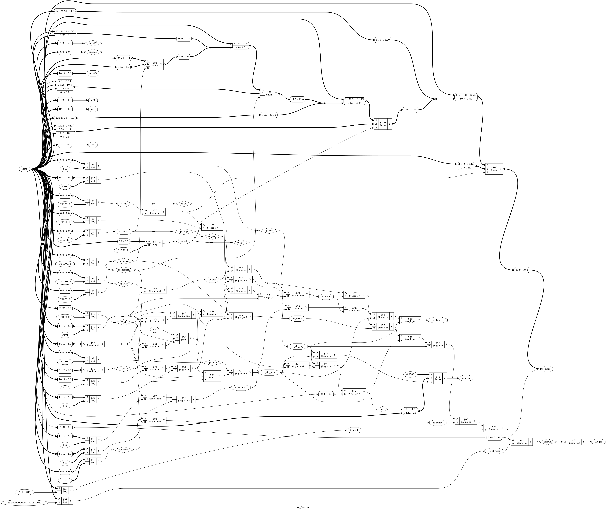

# Tutorial 21: A RISC-V Core

Tutorials 16 to 20 built a CPU for an instruction set the course made up. That was the
right place to start, since every part was small enough to read. This tutorial builds a
CPU for a real instruction set, RV32I, the base of RISC-V. It is multi-cycle, like
Tutorial 17's CPU, and has one simple memory interface for both instructions and data.
Tutorials 22 to 30 put it on a bus, give it peripherals and interrupts, and boot it from
flash. So the interface is the most important thing here, and it gets a section of its own.

The checks are the ones from [Tutorial 18](../18-cpu-verification/README.md): a Python
reference model, lockstep against it with random programs, a Verilog testbench that replays
its trace, and a proof for each class of instruction. One check is new. The memory now
makes the core wait, a random number of clocks, and every check has to survive that.

Finish [Tutorial 18](../18-cpu-verification/README.md) first. The register file comes from
[Tutorial 11](../11-register-file/README.md), the assembler from
[Tutorial 16](../16-instruction-set/README.md), and the FSM style from
[Tutorial 17](../17-cpu/README.md). Run these commands in a VS Code terminal, from this
directory:

```bash
cd tutorials/21-riscv-core
```

To run everything at once, use `make all`. It took 6 minutes 25 seconds here, nearly all
of it the proofs. One more check, `make archtest`, runs the official RISC-V architecture
tests. It downloads them, so it is not part of `make all`. See
[Run the official architecture tests](#run-the-official-architecture-tests).

## Why a standard instruction set

Tutorial 16 said an instruction set is a contract between hardware and software. A made-up
one has only one party on the software side: us. With a standard one, the contract was
written and checked by other people, and the software side already exists.

- **Software.** GCC and LLVM compile C for RISC-V, and books, simulators and test suites
  exist for it. This course has no RISC-V compiler in its Docker image yet, so programs
  here are still assembly, but they are standard assembly that `riscv64-unknown-elf-as`
  would accept.
- **A spec to read.** The RISC-V unprivileged spec says what every instruction does, in
  words, with the reasons for many choices. When the core and the model disagree, there is
  an outside answer to go and read, which Tutorial 18 did not have.
- **Room to grow.** RV32I is a base. Multiply (M), atomics (A), 16-bit instructions (C)
  and the privileged spec, with interrupts and CSRs, are separate pieces added to it.
  Tutorial 27 adds the machine-mode CSRs. Nothing in RV32I has to change for that.
- **The cost.** We do not get to choose. RV32I has 32 registers of 32 bits, so the register
  file alone is bigger than the whole of Tutorial 17's CPU. Some choices only make sense
  for fast pipelines, and a multi-cycle core pays for them anyway.

## RV32I in one page

The state a program can see is `pc` and 32 registers, `x0` to `x31`, each 32 bits. `x0` is
always 0, and a write to it is thrown away. Memory is bytes, little-endian, with 32-bit
addresses. There are no flags: a compare writes 0 or 1 to a register, and a branch
compares two registers itself.

| Group               | Instructions                                              |
| ------------------- | --------------------------------------------------------- |
| Register and register | `add sub sll slt sltu xor srl sra or and`               |
| Register and immediate | `addi slti sltiu xori ori andi slli srli srai`         |
| Upper immediate     | `lui auipc`                                               |
| Jumps               | `jal jalr`                                                |
| Branches            | `beq bne blt bge bltu bgeu`                               |
| Loads and stores    | `lb lh lw lbu lhu sb sh sw`                               |
| System              | `fence ecall ebreak`                                      |

That is 40 instructions. Every one is 32 bits, and must sit at an address that is a
multiple of 4.

What this core does with the corners the spec leaves open:

- **`fence`** orders memory accesses. This core makes one access at a time, in program
  order, so `fence` has nothing to do and is a NOP. As the spec asks, its other fields are
  ignored.
- **`ecall` and `ebreak`** ask for the operating system and the debugger. There are neither,
  so both stop the core with a trap. Every program here ends with `ebreak` when its own
  checks pass, and with `ecall` when one fails.
- **Misaligned accesses.** The spec lets a core either handle a load or store whose address
  is not a multiple of its size, or trap. This core traps, and the access never reaches
  the memory. The same goes for a jump or taken branch to an address that is not a multiple
  of 4: the spec says the jump itself traps.
- **Anything else** traps as an illegal instruction. That includes the M, A, F and C
  extensions, the CSR instructions, `mret` and `wfi`, `fence.i`, and every encoding the spec
  reserves, such as `slli` with a shift of 32.

## The six formats, and why the immediates are scrambled

Every instruction is one of six formats. `opcode` is always bits 6 to 0:

```text
     31        25 24    20 19  15 14  12 11         7 6      0
R   | funct7     | rs2    | rs1  |funct3| rd          | opcode |   add x1, x2, x3
I   | imm[11:0]           | rs1  |funct3| rd          | opcode |   addi, loads, jalr
S   | imm[11:5]  | rs2    | rs1  |funct3| imm[4:0]    | opcode |   stores
B   |[12]|[10:5] | rs2    | rs1  |funct3|[4:1] |[11]  | opcode |   branches
U   | imm[31:12]                        | rd          | opcode |   lui, auipc
J   |[20]|  [10:1]   |[11]| [19:12]     | rd          | opcode |   jal
```

Three rules hold across all six, and they are the point:

1. **`rs1`, `rs2` and `rd` never move.** The register file can be read from bits 19 to 15
   and 24 to 20 before anyone knows what the instruction is, which is what Tutorial 16 did
   with its fixed fields.
2. **The sign is always bit 31.** Every immediate is signed, so sign extension can start
   before decoding is finished.
3. **Each immediate bit has as few homes as possible.** B is S with two bits moved, and J
   is U with bits moved. So bits 10 to 5 of the immediate come from bits 30 to 25 in I, S,
   B and J alike, and bits 4 to 1 come from bits 24 to 21 or 11 to 8.

The spec gives these reasons itself: fewer places for each bit means smaller multiplexers
in front of the immediate, on the path that sets the clock speed of a fast core. The cost
falls on people reading hex by hand, and on the assembler, which has to put the bits back.
In B and J, bit 0 is not stored at all, since a jump is always to an even address.

[`rtl/rv_decode.v`](rtl/rv_decode.v) builds all five immediates in one `always` block. Its
schematic, at the end of this lesson, shows the result: four multiplexers in a chain pick
which bits land where.

Here is one branch by hand, `beq a0, a1, back`, at address 0x10 with `back` at 0x00, so
the offset is -16:

```text
-16 in 13 bits:  1 1111 1111 0000      imm[12]=1  imm[11]=1  imm[10:5]=111111  imm[4:1]=1000

  imm[12] imm[10:5]  rs2=a1  rs1=a0  beq  imm[4:1] imm[11] BRANCH
  1       111111     01011   01010   000  1000     1       1100011   = FEB508E3
```

[`tools/test_asm.py`](tools/test_asm.py) has this word, and a word worked out the same way
for every other instruction and pseudo-instruction. One of those was wrong at first,
`7EB50E63` for a branch of +4092: bit 11 of the offset goes to bit 7, and adding it had been
missed. The assembler had it right, `7EB50EE3`, and the test said so.

## The memory interface

The core has one port for everything it reads and writes. It follows PicoRV32's "native
memory interface", signal for signal, so the same memories and bridges work for both.

| Signal      | Direction | Meaning                                                      |
| ----------- | --------- | ------------------------------------------------------------ |
| `mem_valid` | out       | The core wants a transfer                                    |
| `mem_instr` | out       | This transfer is an instruction fetch                        |
| `mem_ready` | in        | The memory has done it                                       |
| `mem_addr`  | out, 32   | A byte address, always a multiple of 4                       |
| `mem_wstrb` | out, 4    | Which bytes to write. `0000` is a read                       |
| `mem_wdata` | out, 32   | The data to write, already in its byte lanes                 |
| `mem_rdata` | in, 32    | The word read. Only valid while `mem_ready` is high          |

The rules:

- A transfer happens on the rising edge where `mem_valid` and `mem_ready` are both high.
  `mem_ready` on its own means nothing.
- Once `mem_valid` is high, it stays high, and `mem_instr`, `mem_addr`, `mem_wstrb` and
  `mem_wdata` stay still, until that edge.
- `mem_ready` may be high on the very first clock, or any number of clocks later. The
  memory decides.
- The next transfer may start on the clock straight after, with `mem_valid` still high.
- All the outputs come straight from flip-flops. Reset clears `mem_valid`.

A memory needs only the word address, bits 31 to 2. A read returns the whole word, and the
core picks the bytes it wants. A write changes only the bytes whose `mem_wstrb` bit is set.
Tutorial 26 builds a bridge from this to Wishbone, whose `sel` is the same as `mem_wstrb`.

This is the start of `programs/sum.asm` in the waveform, with a memory that answers at
once. Each row is the value just before the rising edge at that time:

| Edge (ns) | `state`     | `mem_valid` | `mem_addr` | `mem_ready` | `mem_rdata` | `ir`       | `retire` |
| --------- | ----------- | ----------- | ---------- | ----------- | ----------- | ---------- | -------- |
| 35        | 0 `FETCH`   | 0           | 0          | 0           | `00000000`  | `00000000` | 0        |
| 45        | 0 `FETCH`   | 1           | 0          | 1           | `00000513`  | `00000000` | 0        |
| 55        | 1 `EXECUTE` | 0           | 0          | 0           | `00000513`  | `00000513` | 1        |
| 65        | 0 `FETCH`   | 1           | 4          | 1           | `00A00593`  | `00000513` | 0        |
| 75        | 1 `EXECUTE` | 0           | 4          | 0           | `00A00593`  | `00A00593` | 1        |

- Reset ends at 30 ns. The edge at 35 ns starts the first fetch, the only clock that a
  reset costs.
- The memory raises `mem_ready` with `00000513`, `li a0, 0`, on the falling edge at 40 ns,
  in the first clock of `mem_valid`. `ir` takes it at 45 ns.
- `retire` is high in the `EXECUTE` clock. At 55 ns `pc` and `mem_addr` both become 4, and
  `mem_valid` is high again: the next fetch starts on the same edge.
- So each of these instructions takes 2 clocks. `retire` goes high at 125 ns for
  `bnez a1, loop` (`FE059CE3`), and at 135 ns `mem_addr` goes back to 8, the loop's start.

To see it yourself, run `make sim`, open `build/tb_trace.vcd` as in Tutorial 1, and add
`clk`, `rst`, `mem_valid`, `mem_ready`, `mem_addr`, `mem_rdata` and `retire` from `tb_trace`,
then `state`, `pc` and `ir` from `dut`. The file holds all three runs of every program,
which is why it was 6.6 MB here. Use a fresh `make sim` for this, because `make verilator`
writes the same file.

## The core

[`rtl/rv32i.v`](rtl/rv32i.v) is the core. It uses three smaller modules:

| File                                  | What it is                                              |
| ------------------------------------- | ------------------------------------------------------- |
| [`rtl/rv_decode.v`](rtl/rv_decode.v)  | Combinational. Says what kind an instruction is, its registers and immediate, and whether it is illegal |
| [`rtl/rv_alu.v`](rtl/rv_alu.v)        | Combinational. The ten ALU operations, chosen by `{instr[30], funct3}` |
| [`rtl/rv_regs.v`](rtl/rv_regs.v)      | Tutorial 11's register file with 32 registers of 32 bits, and one change |

The change to the register file: `x0` is not a register. `q[0]` is the constant 0 and the
`generate` loop starts at 1, so there is no flip-flop that a bug could make non-zero, and a
write to `x0` has nowhere to go. [`rtl/enreg.v`](rtl/enreg.v) is Tutorial 11's, unchanged.

### The state machine

| Code | State     | What happens                                                    |
| ---- | --------- | --------------------------------------------------------------- |
| 0    | `FETCH`   | `mem_valid` and `mem_instr` are high with the PC. On the transfer, `ir` loads `mem_rdata` |
| 1    | `EXECUTE` | Decode, the register reads, the ALU and the branch compare all work in this one clock |
| 2    | `MEMORY`  | `mem_valid` is high for the load or store. On the transfer, a load writes rd |
| 3    | `TRAP`    | The instruction did not finish, and changed nothing. `trap` is high until reset |

From `EXECUTE` there are three ways out:

- **Most instructions retire here.** `retire` is high, and on the edge rd and `pc` load,
  and the next fetch starts with `mem_addr` set to the new PC.
- **A load or store** sets up its transfer and goes to `MEMORY`. It retires there, on the
  clock of the transfer, and the next fetch starts on the same edge.
- **An instruction that must trap** goes to `TRAP`.

Tutorial 17 had 11 states, partly for clarity. This core has 4, so it is worth seeing what
took the place of the others. There is no wait state after a fetch: `mem_ready` is the wait.
There is no `DECODE`: decoding is combinational, and the register reads are combinational
too, so `EXECUTE` does it all. There is no `WRITEBACK` or `RETIRE` clock: rd and `pc` load on
the same edge that ends the instruction.

That last point is a rule the checks depend on. **The registers and `pc` change only on the
edge at the end of a clock where `retire` is high.** Until then they hold the values from
before the instruction, so the operands are read while `retire` is high, and the results
are checked one clock later. That is a change from Tutorial 18, where `RETIRE` came after
`WRITEBACK`.

### Clocks per instruction

With a memory that answers at once, every instruction takes 2 clocks, and a load or store
3. Each clock the memory makes the core wait adds one. `make sim` measures every
instruction, and fails if one takes any other number of clocks. These are its results, for
the nine programs run three times, with three kinds of memory:

| Class           | Count | No wait | One wait, like a block RAM | 0 to 3 waits |
| --------------- | ----- | ------- | -------------------------- | ------------ |
| ALU, registers  | 81    | 2.00    | 3.00                       | 3.65         |
| ALU, immediate  | 298   | 2.00    | 3.00                       | 3.55         |
| `lui`, `auipc`  | 57    | 2.00    | 3.00                       | 3.46         |
| `jal`, `jalr`   | 33    | 2.00    | 3.00                       | 3.52         |
| Branches        | 177   | 2.00    | 3.00                       | 3.38         |
| Loads           | 66    | 3.00    | 5.00                       | 5.79         |
| Stores          | 68    | 3.00    | 5.00                       | 6.01         |
| `fence`         | 1     | 2.00    | 3.00                       | 3.00         |
| All             | 781   | 2.17    | 3.34                       | 3.92         |

The last column depends on the random waits each class happened to get. Shifts take as
long as an `add`, because the shifter is a barrel shifter that does any shift at once.
Taken and untaken branches cost the same, because the next fetch starts from `EXECUTE`
either way.

A memory that answers in the same clock is easy in a testbench, but hard in an FPGA: a
block RAM gives its data a clock after the address, like the one-wait column. That is why
caches matter, and Tutorial 30 builds one.

## Bytes and halfwords: how `mem_wstrb` is used

Memory is read and written a whole word at a time, at a word address. Bytes and halfwords
are made from that.

A **store** puts its data in every byte lane it could use, and sets `mem_wstrb` for the
lane it does use. The offset is the low two bits of the address, which never reach
`mem_addr`:

| Instruction | Address | `mem_addr` | `mem_wstrb` | `mem_wdata`, with rs2 = `8899AABB` |
| ----------- | ------- | ---------- | ----------- | ---------------------------------- |
| `sb`        | 0x201   | 0x200      | `0010`      | `BBBBBBBB`                         |
| `sb`        | 0x203   | 0x200      | `1000`      | `BBBBBBBB`                         |
| `sh`        | 0x202   | 0x200      | `1100`      | `AABBAABB`                         |
| `sw`        | 0x200   | 0x200      | `1111`      | `8899AABB`                         |

Copying the byte to all four lanes means `mem_wdata` needs no shifter, only wiring. The
memory takes byte 1 of the word from bits 15 to 8 whatever the instruction was.

A **load** reads the whole word with `mem_wstrb` at `0000`, then picks out its lanes and
extends them. In `programs/subword.asm` the word at `data` is `F4332211`:

| Instruction      | Lanes used     | Result     |
| ---------------- | -------------- | ---------- |
| `lb  a0, 3(s0)`  | bits 31 to 24  | `FFFFFFF4`, since `F4` is negative |
| `lbu a0, 3(s0)`  | bits 31 to 24  | `000000F4` |
| `lh  a0, 2(s0)`  | bits 31 to 16  | `FFFFF433` |
| `lhu a0, 0(s0)`  | bits 15 to 0   | `00002211` |

A halfword at offset 1 or 3, or a word at any offset but 0, would cross into the next
word, or need a lane that does not line up. Those are the misaligned accesses, and this
core traps on them instead of making two transfers.

## Traps, and where the CSRs will go

`trap_cause` holds the reason, in the codes of the RISC-V `mcause` register:

| Code | Reason                                                        |
| ---- | ------------------------------------------------------------- |
| 0    | A jump or taken branch to an address that is not a multiple of 4 |
| 2    | An illegal instruction                                        |
| 3    | `ebreak`                                                      |
| 4    | A misaligned load                                             |
| 6    | A misaligned store                                            |
| 11   | `ecall`                                                       |

A trapping instruction does not retire. Nothing it would have written is written: not rd,
not `pc`, and not memory, since a misaligned access never starts its transfer. So the
state in `TRAP` is exactly the state before the instruction, with `pc` pointing at it.

That is what machine mode needs. In Tutorial 27, the move to `TRAP` becomes: copy `pc` to
`mepc`, copy `trap_cause` to `mcause`, and jump to `mtvec`. The CSR instructions come out
of the illegal list in `rv_decode.v`, and `mret` with them. Interrupts arrive as one more
way out of `EXECUTE`. None of the states above has to change.

## The assembler

[`tools/asm.py`](tools/asm.py) is Tutorial 16's two-pass assembler, grown to RV32I. Pass 1
gives each line its address. Pass 2 makes the words. The output has one 32-bit word per
line, for `$readmemh`. It takes the usual RISC-V syntax:

```text
        .equ   COUNT, 10
start:  li     a0, COUNT          # a pseudo-instruction
        lw     t0, 4(sp)          # loads and stores: offset(base)
        bnez   a0, start          # branches name a label; the offset is worked out
table:  .word  1, 2, start
```

Registers have their ABI names as well as `x0` to `x31`: `zero`, `ra`, `sp`, `gp`, `tp`,
`t0` to `t6`, `s0` to `s11` and `a0` to `a7`. `%hi(x)` and `%lo(x)` split a value for
`lui` and `addi`.

The pseudo-instructions are the common ones: `nop`, `li`, `la`, `mv`, `not`, `neg`, `seqz`,
`snez`, `j`, `jr`, `ret`, `call`, `beqz`, `bnez`, `blez`, `bgez`, `bltz`, `bgtz`, `bgt`, `ble`,
`bgtu` and `bleu`. The docstring at the top of `asm.py` lists what each becomes. Two are
worth a closer look:

- **`li`** is one `addi` if the value fits in 12 signed bits, and otherwise `lui` and then
  `addi`. `addi` sign-extends, so when bit 11 of the value is set, the `lui` part must be one
  larger to make up for it. `li a0, 0x12345FFF` is `lui a0, 0x12346` and `addi a0, a0, -1`.
- **`call`** is a single `jal ra`. GNU `as` makes it `auipc` and `jalr`, which reach any
  address. This memory is 64 KiB, and `jal` reaches 1 MiB either way.

`make asm` runs [`tools/test_asm.py`](tools/test_asm.py) first:

```text
Ran 17 tests in 0.448s

OK
```

They check all 40 instructions and every pseudo-instruction against words worked out by
hand, branch and jump distances in both directions to their limits, and 34 kinds of error.
One test also hands each word to `iss.py`, which decodes on its own, and checks that it
names the same instruction.

## The reference model

[`tools/iss.py`](tools/iss.py) is Tutorial 18's idea for RV32I: one call to `step()` runs one
instruction, with no clock. It is written from the spec, and imports nothing from `asm.py`
or the RTL. It also takes a different route wherever it can:

- Its numbers are Python integers. A value is made signed only where the spec says signed.
- It builds each immediate bit by bit, from a table copied out of the spec's figures.
- Its memory is bytes. `lh` reads two bytes. Only `bus_write()`, which writes the trace,
  knows about byte lanes.

Each program in [`programs/`](programs) also checks its own answers, worked out by hand, and
ends with `ecall` if one is wrong. `make asm` runs every program through the model, and stops
if one does not end with `ebreak`. So the model is tested by the programs, not only by the
core. It works the other way too. While this lesson was written, `alu.asm` ended in `ecall`
on the model, and the model was right: the expected value said `auipc` was three words after
its label, and it was four.

| Program        | What it checks                                               |
| -------------- | ------------------------------------------------------------ |
| `sum.asm`      | A loop, `la`, a store and a load                             |
| `fibonacci.asm` | 30 numbers in a table, fib(29) = 514229                     |
| `alu.asm`      | Sums that wrap, signed and unsigned compares, sign-extended immediates, `lui`, `auipc`, `%hi` |
| `shifts.asm`   | Shifts by 0, 1 and 31, and by registers whose upper bits must be ignored |
| `branches.asm` | All six branches both ways, and every pseudo-branch          |
| `subword.asm`  | Every byte and halfword place, signed and unsigned           |
| `memcpy.asm`   | A string copied a byte at a time, then counted               |
| `calls.asm`    | Recursion with a stack, a call through a register, `jalr` with rd equal to rs1 |
| `x0.asm`       | Writes to `x0` are lost, but a load into it still happens   |

## Simulate

[`tb/tb_trace.v`](tb/tb_trace.v) works like Tutorial 18's. The model writes a trace with one
line per instruction. The testbench runs the same program, and at every retire compares the
instruction, any store, and on the next clock `pc` and all 31 registers. Its memory is a
model in the same file. It answers on the falling edge, like every input here, after a
number of wait clocks:

- mode 0: none, so `mem_ready` is high in the first clock of `mem_valid`
- mode 1: one, like a block RAM
- mode 2: 0 to 3, from a pseudo-random sequence, so Icarus and Verilator give the same run

While it waits, `mem_rdata` holds junk, so a core that reads too early fails. It also fails
if the core changes a request while it waits.

```bash
make sim
```

Each program prints one line per mode, then the table of clocks above, and then:

```text
build/x0.hex, wait mode 2: 23 instructions compared
PASS: 2343 instructions matched the model
```

## Lint and Verilator

```bash
make lint
make verilator
```

Any warning starts with `%Warning`. The lines that start with `- V e r i l a t i o n` are a
normal report. `make verilator` runs the same testbench, and prints the same lines.

## Test in Python

[`tb/test_lockstep.py`](tb/test_lockstep.py) has two tests, and
[`tb/lockstep.py`](tb/lockstep.py) does the work. It is Tutorial 18's lockstep checker with
three changes. It is also the memory, with 0 to 3 random waits and junk while waiting, and
it checks the interface rules as it goes. It compares the registers on the clock after a
retire, since that is when they change. And a trap is not a retire: when `trap` rises, the
model must have trapped on the same instruction with the same cause, and nothing may have
changed.

```bash
make cocotb
```

Look for `TESTS=2 PASS=2 FAIL=0`, and these lines:

```text
directed: 829 instructions, 71 classes, rarest class XORI with 1
random, 300 programs, 184 ended in a trap: 47069 instructions, 71 classes, rarest class LB@2 with 84
```

`directed_programs` runs everything in `programs/`, then 31 small programs that each stop in
a different way: 17 kinds of illegal word, `ecall`, `ebreak`, four misaligned loads, two
misaligned stores, three misaligned jumps, and three that must not trap, such as a `jalr` whose target
has bit 0 set, which the spec says to clear.

`random_programs` writes programs of 200 random instructions after a short start that gives
every register a value. Branches and jumps go anywhere in the program, loops may never end,
and stores may overwrite code. Half of all values come from a list where things change, such
as `0x7FFFFFFF` and `0x80000000`. Only three registers are kept as addresses, so that most
loads and stores land in data. Each program is cut off after 300 instructions, and
184 of the 300 stopped early at a trap, which is fine: the trap was checked too.

There are 71 classes: every instruction, each branch taken and not taken, each kind of trap,
every place a byte or halfword can sit in a word, and a write to `x0`. Each test fails if a
class it should reach never ran. The random test leaves the traps to the directed one, for
the reason Tutorial 18 gave: a trap ends a program, so how many happen depends on the seed.

## Prove one instruction at a time

[`tb/insn_check.v`](tb/insn_check.v) follows Tutorial 18's checker. The core runs with free
inputs, so the solver picks every word the memory returns, for fetches and for loads, and
when `mem_ready` comes. When an instruction of the chosen class retires, the checker works
out from the spec what must have happened, and asserts it:

- The instruction was fetched once, from `pc`, with `mem_wstrb` at `0000`, and `retire_instr`
  is the word that came back.
- It should not have trapped.
- It made exactly the right data transfers: none, or one at the right word address with the
  right `mem_wstrb`, and for a store the right bytes in the selected lanes.
- On the next clock, `pc` is right, and register `w` is right.

`w` is new. Copying all 31 registers would make the proof slow, so the solver picks one, as
Tutorial 11 did with its watched register. It may pick any, so the proof covers all of
them: `w` must keep its value through the instruction, and afterwards hold the new value if
it was rd, and the old one if not.

```bash
make formal
```

[`insn.sby`](insn.sby) has 13 tasks:

| Task        | Proves                                                                |
| ----------- | --------------------------------------------------------------------- |
| `upper`     | `lui`, `auipc`                                                        |
| `jal`, `jalr`, `branch` | Jumps and branches, and their link register              |
| `load`, `store` | All five loads and three stores, at every offset                  |
| `alu_imm`, `alu_reg`, `shift` | The ALU instructions                                  |
| `fence`     | `fence` changes nothing but `pc`                                      |
| `trap`      | Every instruction that should trap does, with the right cause, and changes nothing. None that should not, does |
| `structure` | The interface rules, a word address on every request, reset, an instruction finishes within 7 clocks, `pc` is always a multiple of 4, and nothing moves in `TRAP` |
| `cover`     | From reset, each class can retire and each trap can happen, so no proof above is empty |

Look for `DONE (PASS, rc=0)` in each, then the last line, `13 tasks passed`. They run in
parallel, and the slowest, `store`, took 294 seconds here.

**The checker shares nothing with the design.** It decodes for itself. Its compares use the
sign of a 33-bit difference, not `$signed`. Its arithmetic shift is a logical shift with
the top bits filled in. It sign-extends a byte by flipping bit 7 and subtracting `0x80`.

**What it assumes about memory.** That it answers within 2 clocks. Without some limit an
instruction could wait forever, and induction could start in the middle of one, after the
checker copied its starting state. Simulation tries up to 3.

**Where a proof starts.** In `FETCH` with no request yet, as a reset leaves it, but with `pc`
and all the registers free.

Three things went wrong while these were written, and all are worth knowing:

- The first version read `f_x1` to `f_x31` through a 1024-bit wire built from them. The
  `alu_reg` proof failed in seconds, with the watched register holding one value and the
  checker reading another. The cause was `connect -set` in `insn.sby`, which cuts every
  other driver of the net it sets, and so cut the assign that built the wide wire. The
  checker now reads the `f_` wires directly.
- Induction found a weakness in the core. The first version finished `MEMORY` on
  `mem_ready` alone, without looking at `mem_valid`. From reset `mem_valid` is always high
  in `MEMORY`, so no simulation could see a difference. But induction started in `MEMORY`
  with `mem_valid` low, and the core retired a load that never had a transfer. The
  interface rules say a transfer needs both, so the core now uses `mem_valid && mem_ready`.
- And one in the checker: its counters of transfers stopped at 3 by testing the old count,
  so a fetch on the first clock of an instruction could go uncounted. `load` and `store`
  ended `UNKNOWN` until that was fixed.

## What the proofs add, and what they cannot

Here is a bug only a proof finds. In `rtl/rv_alu.v`, replace `ALU_ADD:  y = a + b;` with:

```verilog
ALU_ADD:  y = (a == 32'h0000FFFF && b == 32'h00000001) ? 32'd0 : a + b;
```

That is one pair of inputs out of 2 to the power 64. Run the three checks:

| Check         | Result                                                                   |
| ------------- | ------------------------------------------------------------------------ |
| `make sim`    | `PASS: 2343 instructions matched the model`                              |
| `make cocotb` | `TESTS=2 PASS=2 FAIL=0`                                                  |
| `make formal` | `alu_imm` fails after 52 seconds and `alu_reg` after 111. The other 11 tasks pass |
| `make archtest` | `38 tests ran, 38 passed, 0 failed, 17 skipped`                        |

`addi` uses the same adder, which is why `alu_imm` fails too. Its log names the line
`assert (xreg(w) == w_after)`. In `build/formal_alu_imm/engine_0/trace.vcd`, `retire_instr`
is `00168D13`, which is `addi x26, x13, 1`, and `a` is `0000FFFF`. The solver went straight
to the one input that matters, while random testing would need luck. Random data here is
drawn towards edges such as `0x7FFFFFFF`, but `0x0000FFFF` is not one of them.

Remove the edit.

## Run the official architecture tests

Every check so far was written by the person who wrote the core, from the same reading of
the spec. RISC-V International keeps a suite of tests that were not:
[riscv-arch-test](https://github.com/riscv-non-isa/riscv-arch-test). A core that claims to
be RV32I is expected to pass them.

The tests do not check themselves. Each one runs its instructions on chosen values, and
stores every result in a region of memory called the signature, between the labels
`begin_signature` and `end_signature`. The suite comes with a reference signature for each
test, made by running the same test on a reference simulator, Sail or Spike, its README
says. A core passes a test when its signature matches the reference word for word. So the
reference is independent of this course: neither `iss.py` nor anything else written here
made it.

```bash
make archtest
```

**The version.** The Makefile clones tag `2.7.4`, commit
`96e3589a867955e94c95ba098822da54d3ae39c0`, into `build/riscv-arch-test`, and stops if the
tag points at any other commit. It is not the newest release. In every release from 3.0.0
to 4.1.0 that was checked, there are no reference files in the repository: the suite
expects its RISCOF framework to make them with a reference simulator, which this image does
not have. 2.7.4 is the last release with references for `rv32i_m/I`. The
clone is treated as data. Its Makefiles and scripts are never run. Only its `.S` files, its
`arch_test.h`, and its references are used, with this course's compiler command. `make
clean` removes it.

**The target files.** A suite like this needs a small header from each core that runs it,
and here it is [`tb/arch/model_test.h`](tb/arch/model_test.h), with the memory map in
[`tb/arch/link.ld`](tb/arch/link.ld):

- **Start.** The core starts at address 0, and the linker puts the test's first instruction
  there. Nothing needs setting up, since there are no CSRs yet. The Makefile checks with
  `nm` that `rvtest_entry_point` is at 0.
- **Stop.** `RVMODEL_HALT` is `ebreak`. This core has no trap handler, so `ebreak` stops it
  in `TRAP` with cause 3, which is the end of the test. Any other trap is a failure.
- **The signature.** `RVMODEL_DATA_BEGIN` and `RVMODEL_DATA_END` place the two labels,
  aligned to 16 bytes as the suite's own Sail target does, so the region is as long as the
  reference. The Makefile reads both addresses with `nm` and writes them, one line per test,
  into `build/archtest/list.txt`.

The tests are compiled with `-march=rv32i`, without `zicsr`, so the assembler would refuse
any CSR instruction. One test needed help. `jalr-01` writes `la x0, label`, and the
assembler in GCC 15 refuses it. The header defines a `la` macro that turns `la x0` into two
instructions that write `x0`, and so do nothing, and is plain `lla` for every other
register. With and without the macro, `add-01`, `beq-01`, `lw-align-01` and `jal-01`
compiled to identical binaries.

[`tb/tb_arch.v`](tb/tb_arch.v) runs every test in the list. Its memory is `tb_trace.v`'s in
wait mode 2: 0 to 3 waits from a pseudo-random sequence, with junk on `mem_rdata` while it
waits, and inputs driven on the falling edge. It is 2 MiB, because `jal-01` jumps across
1.7 MB of code. After `ebreak` it compares the signature with the reference, and prints
`PASS` or `FAIL` for each test, with the first three words that differ. `make archtest`
runs it under Icarus and then, unchanged, under Verilator. Both printed the same lines:

```text
PASS add-01: 588 signature words, 2620 instructions
...
PASS xori-01: 568 signature words, 1586 instructions
SKIP ebreak: needs mtvec and a trap handler, so CSRs (Tutorial 27)
...
SKIP Fencei: fence.i is Zifencei, not RV32I, and illegal on this core
38 tests ran, 38 passed, 0 failed, 17 skipped
PASS
```

It took 2 minutes 46 seconds here, from `make clean`, with the download.

**What ran, and what did not.** All 38 tests in `rv32i_m/I` ran and passed: every RV32I
instruction except `ecall` and `ebreak`, with loads and stores at aligned addresses only. No
test in that directory needs anything this core lacks. The 17 skipped tests are the rest of
`rv32i_m` that an RV32I machine could run:

| Tests | Why they are skipped |
| ----- | -------------------- |
| `ebreak`, `ecall` | They expect the trap to reach a handler through `mtvec`, which records `mcause` and `mepc`. That needs CSRs, which arrive in Tutorial 27 |
| 14 `misalign-*` tests: branches, `jal`, two `jalr`, `lh`, `lhu`, `lw`, `sh`, `sw` | The same: each expects a misaligned trap to reach a handler |
| `Fencei` | `fence.i` is the Zifencei extension, not RV32I. This core treats it as illegal |

The skipped tests are what the trap tests in `make cocotb` and `make formal` cover here, by
this course's own reading of the spec. The other directories, such as `M` and `C`, are for
extensions this core does not have.

## What this does not prove

As in Tutorial 18, do not say "the core is correct". This is what has been shown:

- **Each class, from any state, on any instruction word.** That every program therefore runs
  correctly is an argument made here, not checked by a tool.
- **The memory is assumed.** The proofs let it return anything, and show that the core asks
  for the right address and uses the answer on the right clock. They assume it answers
  within 2 clocks.
- **The spec was read correctly.** `iss.py` and `insn_check.v` have the same author and the
  same source. The hand-worked values in `test_asm.py` and in each program are a third
  reading, by the same person.
- **The official tests are one release, and only the base instructions.** `make archtest`
  runs the 38 RV32I tests of riscv-arch-test 2.7.4, and they pass. They check results, not
  traps, and [Try it yourself](#try-it-yourself) shows bugs they miss.
- **The checker and the tools are trusted,** and OSS CAD Suite here is a nightly build.
- **RTL only.** Nothing here speaks for a netlist, timing or a board.

## Compared with PicoRV32

[PicoRV32](https://github.com/YosysHQ/picorv32), by Claire Wolf, is a small RISC-V core
written in Verilog and widely used in FPGA systems, including the PicoSoC example in its
repository. This core copies its memory interface and its size class, and no code. What
differs, from PicoRV32's README as it stood on 2026-11-01. That README also says the project is
no longer under active development.

| | This core | PicoRV32 |
| --- | --- | --- |
| Instruction sets | RV32I | RV32E, RV32I, and options for M and C |
| Memory interface | The native interface | The same, plus a look-ahead interface, AXI4-Lite and Wishbone wrappers |
| Register file | 31 flip-flop registers, as in Tutorial 11 | Two read ports by default, or one to save space (`ENABLE_REGS_DUALPORT`) |
| Shifts | A barrel shifter, one clock | Four bits, then one bit, per clock by default (`TWO_STAGE_SHIFT`), a barrel shifter as an option (`BARREL_SHIFTER`) |
| Clocks per instruction | 2 to 3 with no wait, 3 to 5 with one | About 4 on average, its README says |
| Misaligned accesses, illegal words | Always trap | Trap by default, and `CATCH_MISALIGN` and `CATCH_ILLINSN` can turn that off |
| Interrupts | None yet. Tutorial 27 adds the standard CSRs | Its own interrupt scheme, with custom instructions rather than CSRs |
| Verification | This lesson's checks | Its README points to riscv-formal for formal checks, which `insn_check.v` imitates |

PicoRV32 spends more clocks per instruction, to keep each clock short and reach a high
frequency. This core does decode, register read and the ALU in one clock, so its clocks are
fewer and longer. Neither speed was measured here.

The register file is the biggest difference in size, as the next section shows.

## See the logic

```bash
make schematic
```

The whole core is far too wide to read, so this shows the decoder. Click
`build/rv_decode.png` in the Explorer:



- `instr` is the octagon on the left. The rounded boxes beside it slice it into fields.
- Along the top, `$79`, `$91`, `$100` and `$106` are the immediate. Each `$mux` picks the bits
  for one more format, and the last one feeds `imm` at the right.
- The column of `$eq` blocks compares bits 6 to 0 with each opcode. They become `is_lui`,
  `is_jal` and the rest.
- At the bottom right, an `$logic_or` chain joins every legal kind into `known`, and `$63`
  inverts it to make `illegal`.

## Map it to real FPGAs

```bash
make synth
```

| Family     | Flip-flops      | Total cells |
| ---------- | --------------- | ----------- |
| Xilinx     | 1134 `FDRE`     | 3375        |
| Gowin      | 1130 `DFFRE`, 4 `DFF` | 16036 |
| Cyclone V  | 1134 `MISTRAL_FF` | 3410      |

992 of the 1134 flip-flops are the register file. On Xilinx it is also 1249 of the cells,
the two 32-way read multiplexers and the write decoder, so the register file is about two
thirds of the core. Gowin's total is far larger, and most of it is 6239 cells from
`MUX2_LUT5` to `MUX2_LUT8` and 3730 `LUT1`. A register file kept in LUT RAM could replace most of the multiplexers, but that was not tried here. It needs two read ports, which most LUT
RAM gets by keeping two copies. These are Yosys counts, so vendor tools can give different
results, and they say nothing about timing.

## Try it yourself

Make each change, then run `make sim`, `make cocotb` and `make formal`, and `make archtest`
if you have run it once. Undo each change before trying the next. These are real results. A
`formal` column lists the tasks that failed. All the others passed. An `archtest` column
lists the architecture tests that failed, with how many signature words differed. All the
others passed.

**Bugs every check catches.**

| Change | `sim` | `cocotb` | `formal` fails | `archtest` fails |
| ------ | ----- | -------- | -------------- | ---------------- |
| In `rtl/rv_alu.v`, replace `$signed(a) >>> shamt` with `a >> shamt` | `FAIL a register differs` in `shifts.asm` | `x5 is 40000000, and the model has c0000000` | `shift` | `sra-01` 35 of 92, `srai-01` 32 of 88 |
| In `sign_bit`, remove `!funct3[2] && `, so `lbu` and `lhu` sign-extend | `FAIL a register differs` in `subword.asm` | `x10 is fffffff4, and the model has 000000f4` | `load` | `lbu-align-01` 31 of 32, `lhu-align-01` 31 of 32 |
| In `store_strb`, replace `(4'b0001 << offset)` with `4'b0001` | `FAIL the store differs` | `memory writes differ: core [00000065 wstrb 0001 to 00000300], model [00006500 wstrb 0010 to 00000300]` | `store` | `sb-align-01` 13 of 72 |
| In `S_EXECUTE`, replace `mem_addr  <= {sum[31:2], 2'b00};` with `mem_addr  <= sum;` | `FAIL the store differs` | `mem_addr 00000201 is not a multiple of 4` | `load`, `store`, `structure` | None: all 38 pass |

The last one is a broken interface, not a wrong answer. The testbench memory ignores bits 1
and 0 of `mem_addr`, so every load still got the right word: `sim` failed only because it
compares the store's address. `cocotb` and `structure` check the rule itself. `tb_arch.v`
only looks at the signature, which the wrong addresses do not change, so `archtest` misses
it.

**Bugs the architecture tests catch.** These were tried with `make archtest` only. Its
output names the words that differ, such as `sltu-01 word 0 (address 00003cb0) is
00000000, reference 00000001`.

| Change | `archtest` fails |
| ------ | ---------------- |
| In `rtl/rv_alu.v`, replace `{31'b0, a < b}` with `{31'b0, $signed(a) < $signed(b)}`, so `sltu` and `sltiu` compare signed | `sltu-01` 183 of 724, `sltiu-01` 177 of 700 |
| In `compare`, replace `!funct3[1] ? less : less_u` with `!funct3[1] ? less : less`, so `bltu` and `bgeu` compare signed | `bltu-01` 181 of 728, `bgeu-01` 180 of 728 |
| In `taken`, replace `(compare != funct3[0])` with `compare`, so `bne`, `bge` and `bgeu` act as `beq`, `blt` and `bltu` | `bne-01` 584 of 584, `bge-01` 590 of 592, `bgeu-01` 726 of 728 |

Each test checks one instruction, so the failing tests name the broken ones. The other 36
or 35 passed each time.

**A wait the fast memory hides.** In `S_FETCH`, replace `end else if (transfer) begin` with
`end else begin`, so `ir` loads whether or not `mem_ready` came. `make sim` passes all nine
programs in wait mode 0, then fails the first instruction of `sum.asm` in mode 1:

```text
FAIL a different trap, line 0
  model pc=00000000 instr=00000513 next=00000004 rd=x10 value=00000000 trap=0 cause=0
  core  pc=00000000 instr=d630e20d trap=1 cause=2
```

`d630e20d` is junk the memory drove while it waited, which the core took for an
instruction. `make cocotb` stops at instruction 1 with `the core trapped, and the model did
not`. `make formal` fails 12 of the 13 tasks, nearly all on the first assertion, that the
fetched word is the one that retired. `make archtest` fails all 38 tests: 36 trap within their
first nine instructions, nearly all as illegal instructions, such as `FAIL add-01: trap with cause 2
at pc 00000000, instruction f2adbbaf`, and two with an access outside the memory. A testbench
with an instant memory would never have seen this.

**Bugs only the trap tests see.** Assembled programs never contain these, so `make sim`
passes each time.

| Change | `cocotb` | `formal` fails |
| ------ | -------- | -------------- |
| In `rtl/rv_decode.v`, replace `funct3 == 3'b001 ? f7_zero :` with `funct3 == 3'b001 ? 1'b1 :`, so `slli` with a shift of 32 is legal | Directed only: `stop: illegal: SLLI shamt 32, instruction 1: the model trapped with cause 2, and the core retired`. The random test passed, since it never makes that word | `trap` |
| Replace `target[1:0] != 2'b00` with `target[0]` in `trap_fetch` | Both: `stop: misaligned jal, instruction 1: the model trapped with cause 0, and the core retired` | `jal`, `jalr`, `branch`, `trap`, `structure`, `cover` |
| Replace `is_jalr ? {sum[31:1], 1'b0} : sum` with `sum`, so `jalr` keeps bit 0 | Both: `stop: jalr clears bit 0, instruction 3: the core trapped, and the model did not` | `trap` |

In the second, `structure` fails because the PC is no longer a multiple of 4, and `cover`
fails because trap cause 0 can no longer happen at all. In the third, `jalr` itself passes:
the `jalr` that should have retired trapped instead, and only `trap` checks traps.

`make archtest` passes all 38 tests with each of these three changes, so none of its RV32I
tests runs an illegal word, a misaligned jump, or a `jalr` to an odd address. The
misaligned jumps, `jalr` with bit 0 set among them, are in the `misalign-*` tests it skips.

**A proof that passes because nothing happens.** Make loads never finish. In `assign retire`
replace `(in_memory && transfer)` with `(in_memory && transfer && !is_load)`, and in `S_MEMORY`
replace `if (transfer) begin` with `if (transfer && !is_load) begin`. `make sim` and `make
cocotb` both stop with `nothing retired`. In `make formal`, the `load` task passes, because
no load ever retires for it to check. Only `structure` fails, on its limit of 7 clocks, and
`cover`, with four unreached `cover` statements, all of them loads.

**Blame the model.** In `tools/iss.py`, replace `"SLTU": int(a < other)` with
`"SLTU": int(signed(a) < signed(other))`. Now the core is right and the model wrong. `make
sim` stops before the testbench starts, because `alu.asm` checks its own answer:

```text
build/alu.hex: stopped at 0000015c, ecall, with cause 11, not EBREAK
```

`make cocotb` fails with `LOCKSTEP FAILED in alu.asm, instruction 20: x5 is 00000000, and the
model has 00000001`, which cannot say who is wrong. `make formal` passes all 13 tasks, since
it never uses the model. Hand-worked answers in the programs, the model and the proof are
three readings of the spec, so one wrong reading shows up.
