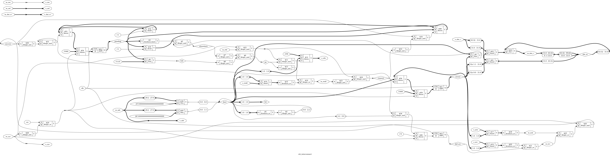

# Tutorial 22: Wishbone bus

The bus in [Tutorial 19](../19-computer/README.md) works, but it is our own. Every
device has to be built around its timing, a read always takes exactly one clock, and
nothing can say "wait". A standard bus fixes the rules once, so that any master can
talk to any slave that keeps them. This tutorial builds a Wishbone bus: a slave, a
master, and an interconnect between them. Then it writes the rules down as a formal
checker and proves that the slave and the interconnect keep them.

Finish [Tutorial 9](../09-skid-buffer/README.md) and
[Tutorial 19](../19-computer/README.md) first. Run these commands in a VS Code
terminal, from this directory:

```bash
cd tutorials/22-wishbone
```

To run everything at once, use `make all`.

## Wishbone

Wishbone is an open bus standard, defined in the *Wishbone B4* specification
published by OpenCores. B4 describes two ways to run the bus, *classic* and
*pipelined*. This tutorial uses pipelined mode, with 32-bit data and byte enables.
It has been written from the spec's description of the signals, and has not been
checked by any other Wishbone tool.

| Here    | Spec (master side) | Driven by | Meaning                                              |
| ------- | ------------------ | --------- | ---------------------------------------------------- |
| `cyc`   | `CYC_O`            | master    | A bus cycle is in progress                           |
| `stb`   | `STB_O`            | master    | A request is on the bus                              |
| `we`    | `WE_O`             | master    | The request is a write                               |
| `adr`   | `ADR_O`            | master    | Word address: bits [31:2] of the byte address        |
| `sel`   | `SEL_O`            | master    | Byte enables: bit k is bits 8k+7 to 8k of the data   |
| `dat_w` | `DAT_O`            | master    | Write data                                           |
| `stall` | `STALL_I`          | slave     | The request on the bus is not taken at this edge     |
| `ack`   | `ACK_I`            | slave     | The oldest request is done, for one clock            |
| `err`   | `ERR_I`            | slave     | The oldest request failed, for one clock             |
| `dat_r` | `DAT_I`            | slave     | Read data, valid while `ack` is high                 |

The spec names each signal from the side that sees it, so the master's `DAT_O` is
the slave's `DAT_I`. This tutorial calls them `dat_w` and `dat_r` instead, which
read the same from both sides. It leaves out `RTY` (retry) and the optional tags.

**Addresses.** Byte addresses are 32 bits, and the data is 32 bits wide, so the low
two bits of a byte address only pick a byte within a word. This bus drops them:
`adr` is 30 bits, the word address. `sel` says which bytes of that word a write
changes. A store of one byte to byte address `0x1000_0006` is `adr = 0x0400_0001`
with `sel = 4'b0100`, and the byte in bits 23 to 16 of `dat_w`. Turning a CPU's
byte address and size into `adr`, `sel` and shifted data is the CPU's job, not the
bus's.

### `cyc` and `stb`

`stb` marks one request. `cyc` marks a whole *cycle*, a group of requests that
belong together, and it stays high until the last answer is in. Between requests,
`stb` can be low while `cyc` is still high, because answers are still owed. A slave
must not answer once `cyc` has fallen: a master that drops `cyc` early is
abandoning the cycle. In a system with several masters, `cyc` is also what an
arbiter like the one in [Tutorial 8](../08-arbiter/README.md) would grant the bus
for. This tutorial has one master.

### The handshake

A request moves at a rising edge where `cyc` and `stb` are high and `stall` is low.
If you finished Tutorial 9, this is its handshake: `stb` is `valid` and `stall` is
`!ready`. The same rule holds too. A stalled request stays on the bus, unchanged,
until it is taken.

The answer goes the other way, and it is different. Each accepted request gets
exactly one `ack` or `err`, in the order that the requests went out, and the master
cannot stall an answer. It must always be ready to take one. So nothing in an answer
says which request it belongs to. The master knows from the order alone.

### Why pipelined mode exists

In classic mode, the master holds `stb` high until the `ack`. A request and its
answer are one event, so the next request cannot start until the last answer has
come back. If a slave takes three clocks to answer, the bus sits idle for most of
them.

Pipelined mode splits the two. A request is done with as soon as it is accepted,
and the master can put the next one on the bus on the very next clock while the
answers catch up. `stall` exists because the master no longer waits: a slave that
cannot take another request needs a way to say so.

[`rtl/wb_master.v`](rtl/wb_master.v) has an input `one_at_a_time` that makes it
wait for each answer before sending the next request. That is how classic mode
behaves, so the testbench can measure both against the same slaves:

| Slave answers after | Pipelined                     | One at a time                  |
| ------------------- | ----------------------------- | ------------------------------ |
| 1 clock             | 32 reads in 32 clocks: 1.00   | 32 reads in 63 clocks: 0.51    |
| 3 clocks            | 32 reads in 34 clocks: 0.94   | 32 reads in 127 clocks: 0.25   |

With one request at a time, each read costs the request clock plus the wait for the
answer. Pipelined, the waits overlap, and a slave three clocks deep costs only two
clocks more than one that answers at once, for all 32 reads.

## The design

```text
                              +--------------- wb_interconnect ----------------+
 commands  +-----------+      |  adr --> decoder --> stb to one slave          |--> wb_regfile u_slave0
 ------->  | wb_master |----->|            \--> nobody: default responder, err |    0x1000_0000, latency 1
 <-------  |           |<-----|  ack/err/dat_r <-- owner of the oldest request  |<-- wb_regfile u_slave1
 responses +-----------+      |  stall <-- slave's stall, or "answers owed"    |    0x2000_0000, latency 3
                              +------------------------------------------------+
```

[`rtl/wb_system.v`](rtl/wb_system.v) connects them. The address map is:

| Byte address                 | Device                                       |
| ---------------------------- | -------------------------------------------- |
| 0x1000_0000 to 0x1000_000F   | Slave 0: 4 registers, `ack` 1 clock after the request |
| 0x2000_0000 to 0x2000_000F   | Slave 1: 4 registers, `ack` 3 clocks after the request |
| Anything else                | `err`, from the interconnect                 |

### The slave

[`rtl/wb_regfile.v`](rtl/wb_regfile.v) is a register file with a Wishbone port.
`LATENCY` sets how many clocks pass between a request and its `ack`. Inside is a
short pipeline, one stage per clock, so it takes a new request on every clock and
can have up to `LATENCY` in flight:

```verilog
for (k = LATENCY - 1; k > 0; k = k - 1) begin
    busy[k] <= busy[k-1];
    data[k] <= data[k-1];
end
busy[0] <= accept;
data[0] <= regs[adr];
```

`ack` is the last stage of `busy`, and `dat_r` the last stage of `data`, so both
come straight from flip-flops. A write changes only the bytes that `sel` picks:

```verilog
for (k = 0; k < 4; k = k + 1)
    if (sel[k])
        regs[adr][8*k +: 8] <= dat_w[8*k +: 8];
```

A read always returns the whole word. The input `hold` makes the device slow: while
it is high, `stall` is high and the requests in flight stay where they are. Each
clock of `hold` adds a wait state to every one of them. A real device would raise
it when it was busy. Here the testbenches drive it, which is how the cocotb test
gets random wait states.

### The interconnect

[`rtl/wb_interconnect.v`](rtl/wb_interconnect.v) joins one master to `N` slaves. It
does three jobs.

**Address decoding.** Each slave has a `BASE` and a `MASK`, packed into two
parameters, and owns every address where `(address & MASK) == BASE`. Only `stb` is
decoded. `cyc`, `we`, `adr`, `sel` and `dat_w` go to every slave.

**Keeping answers in order.** Suppose the master reads slave 1, which answers after
3 clocks, and then slave 0, which answers after 1. Slave 0's answer would come back
first, and the master would take it as the answer to the first read. So the
interconnect remembers which slave it sent the outstanding requests to, the
*owner*, and how many answers are still owed. A request for anywhere else stalls
until that count reaches zero:

```verilog
wire elsewhere = (pending != 0) && (dest != owner);
```

This is the same lesson as Tutorial 19's registered select: when an answer comes
back later than its request, the steering for it must be remembered. Answers are
taken only from the owner, and so is `dat_r`.

**The default responder.** An address that nobody owns still gets an answer. The
interconnect raises `err` one clock later, itself:

```verilog
def_err <= request && dest[N];
```

Two other choices look tempting, and both are wrong:

- **No answer at all.** The master waits for an answer that never comes, with
  `cyc` high, forever. One bad pointer in a program hangs the whole bus. "Try it
  yourself" shows this happening.
- **An `ack` instead of `err`.** Now the bus never hangs, but a write to a bad
  address vanishes without a trace, and a read returns 0 as if it were real data.
  The program cannot tell that anything went wrong. Every rule of the protocol is
  kept, so a protocol checker cannot tell either. "Try it yourself" shows that too.

`err` tells the master the truth. What it does about it is up to the master: this
one passes it on with the response, and a CPU might take an exception.

### The master

[`rtl/wb_master.v`](rtl/wb_master.v) turns commands into requests. Commands come in
on a valid/ready handshake from Tutorial 9, and responses come out one per command,
in order, with `rsp_err` for an `err`. It counts the requests in flight, and keeps
`cyc` high while any are on the bus or owed.

## Simulate

[`tb/tb_wishbone.v`](tb/tb_wishbone.v) drives the commands. Its scoreboard is a
queue: when a command is accepted, it works out the answer from a model of the eight
registers and puts it at the back. Answers come back in order, so each one must
match the front. The model applies `sel` the same way the slave should.

```bash
make sim
```

The last line should be `PASS`. Above it, the testbench prints what it measured:

```text
write and read back:
  8 writes and 8 reads, all answered
partial-word writes:
  slave 0 register 1 is 04032201
unmapped addresses:
  3 of 4 requests answered with err
pipelined, slave 0 (latency 1):
  32 reads in 32 clocks: 1.00 per clock
one at a time, slave 0 (latency 1):
  32 reads in 63 clocks: 0.51 per clock
pipelined, slave 1 (latency 3):
  32 reads in 34 clocks: 0.94 per clock
one at a time, slave 1 (latency 3):
  32 reads in 127 clocks: 0.25 per clock
pipelined, slave 1 (latency 3) with hold1 high every other clock:
  32 reads in 67 clocks: 0.48 per clock
pipelined, taking turns between slaves 0 and 1:
  32 reads in 95 clocks: 0.34 per clock
mixed traffic:
  366 answers checked in all, 73 of them err
PASS
```

- Register 1 started as `22222222`. Writes with `sel` of `0001`, `0100`, `1100` and
  `0000` changed it to `04032201`. The last write had no bytes enabled, and changed
  nothing.
- Of the four requests in the unmapped test, three went to addresses nobody owns.
  The fourth reads slave 0 to check that the bad write did not land there.
- With `hold1` high on every other clock, the slave takes a request only on the
  other clocks, so the rate halves.
- Taking turns is slow. Every switch between slaves waits for the last slave's
  answers, and slave 1 takes 3 clocks. This is the price of keeping answers in
  order. Tutorial 23 looks at how AXI4-Lite handles the same problem.
- The mixed run uses a 16-bit LFSR for every choice, so it is the same on every run:
  both slaves busy at random, unmapped addresses, partial writes, and both modes.

The testbench drives everything on the falling edge, as in Tutorial 1. There is one
wrinkle: `hold` reaches `stall` and `cmd_ready` through logic, without a flip-flop
in between. So `step` waits 1 ns after driving the inputs before it reads anything.
An early version did not, and the mixed run failed with wrong answers. The design
was fine, and the testbench was reading `cmd_ready` from before `hold` changed.

## View the waveform

Use a fresh simulation, since `make verilator` writes the same file:

```bash
make sim
```

Open `build/tb_wishbone.vcd` as in [Tutorial 1](../01-d-flip-flop/README.md). From
`dut`, add `clk`, `m_cyc`, `m_stb`, `m_adr`, `m_stall`, `m_ack` and `m_err`. From
`dut.u_interconnect`, add `pending`, `owner` and `elsewhere`. `owner` is one-hot:
`1` is slave 0, `2` is slave 1 and `4` is the default responder.

The clock rises at 5, 15, 25 ns and so on. A request is accepted at the rising
edge that *sees* `m_stb` high and `m_stall` low, which is one clock after `m_stb`
first shows on the trace. The same goes for answers: the master takes `m_ack` or
`m_err` at the edge after it rises. Keep that in mind when reading the times.

**Pipelining**, from 1600 ns. The pipelined reads of slave 1 begin:

- At 1615 ns `m_stb` rises with the first read. The edge at 1625 ns accepts it, and
  `pending` becomes 1. New reads are accepted at 1635, 1645 and 1655 ns, with `m_adr`
  moving on after each one.
- `pending` climbs to 3. At 1645 ns the first `m_ack` rises, and the master takes it
  at 1655 ns, three clocks after its read was accepted and on the same edge that
  accepts the fourth read.
- From then on, one read goes in and one answer comes out on every clock, with
  `pending` steady at 3.

**An unmapped address**, from 470 ns:

- At 475 ns `m_stb` rises with a write to `m_adr` `0400_0004`, byte address
  0x1000_0010. The edge at 485 ns accepts it, and `owner` becomes `4`, the default
  responder.
- `m_err` rises at 485 ns, and the master takes it at 495 ns. Two more unmapped
  requests follow, and their errors are taken at 505 and 515 ns.
- At 505 ns `m_adr` moves to slave 0, and `m_stall` rises with `elsewhere`: the
  default responder still owes an answer. The stall ends at 515 ns, the edge at
  525 ns accepts the read, and its `m_ack` rises at 525 ns, to be taken at 535 ns.

**Keeping order**, from 4040 ns, where the reads take turns between the slaves:

- At 4045 ns `m_stb` rises with a read of slave 0, which is accepted at 4055 ns. At
  4055 ns `m_adr` moves to slave 1, and `m_stall` rises with `elsewhere`, while
  slave 0's `m_ack` rises. Once that answer is taken, the stall ends, and the read of
  slave 1 is accepted at 4075 ns.
- The next read, of slave 0, then waits with `m_stall` high from 4075 to 4105 ns,
  three clocks, until slave 1's answer has been taken at 4105 ns. It is accepted at
  4115 ns. That is where the 0.34 per clock went.

## Lint

```bash
make lint
```

This checks the whole system, then the interconnect, the slave and the master each
on their own with their default parameters. Any warning starts with `%Warning`.
[`rtl/wb_system.v`](rtl/wb_system.v) has one `lint_off`: each slave decodes only the
low two bits of `s_adr`, so the other 28 are unused there on purpose. The
interconnect has already checked them.

## Simulate with Verilator

```bash
make verilator
```

The output is the same as `make sim`, line for line.

## Test in Python

[`tb/test_wishbone.py`](tb/test_wishbone.py) drives 10000 clocks of random traffic
in five phases. Each phase changes how often a command is offered, the master's
mode, and how often each slave's `hold` is high. That last one is the random wait
states. Addresses are in either slave, just past slave 0, just below slave 1, or
anywhere at all. A third of the commands have random byte enables.

On every clock it checks the master's port against the rules: `stb` only with
`cyc`, a stalled request held unchanged, never `ack` and `err` together, and never
an answer with nothing outstanding. Its scoreboard works like the Verilog one.

```bash
make cocotb
```

Look for `TESTS=1 PASS=1 FAIL=0`, and a line of counts like this one:

```text
answers=3515 errs=711 partial_writes=440 slave_stalls=1200 order_stalls=3795 max_outstanding=3
```

The numbers change from run to run, and the test fails if any of them is 0.
`order_stalls` counts the clocks a request waited with `elsewhere` high. The test
gives up after 1 ms of simulated time, about ten times what it needs, so a bus that
stops answering fails it instead of hanging it.

## Prove it with formal verification

Tutorial 9 put the handshake rules inside the design, as assumptions at the inputs
and assertions at the outputs. A bus has more rules, and every master and slave
must keep the same ones. So here they are written once, in their own module,
[`formal/wb_checker.v`](formal/wb_checker.v). It sits beside a bus port and watches.
It is not in `rtl/`, because it is not hardware.

### The rules

The checker counts the requests in flight, `outstanding`, from the port alone: up
by one for each accepted request, down by one for each answer, and back to zero
when `cyc` falls. Most rules need that count. They are split by who must keep them:

| Rule | Kept by | Says                                                                 |
| ---- | ------- | -------------------------------------------------------------------- |
| M1   | master  | `cyc` is low on the clock after reset                                |
| M2   | master  | `stb` is only high while `cyc` is high                               |
| M3   | master  | A stalled request stays on the bus, unchanged, until it is accepted  |
| S1   | slave   | No answer on the clock after reset, or after a clock with `cyc` low  |
| S2   | slave   | Never `ack` and `err` together                                       |
| S3   | slave   | No answer with nothing outstanding                                   |
| S4   | slave   | At most `MAX_OUTSTANDING` requests in flight                         |
| S5   | slave   | Never `MAX_WAIT` clocks without an answer while one is owed          |
| S6   | slave   | Never stall one request for `MAX_STALL` clocks                       |

M3 is "`stb` held while stalled", the rule from Tutorial 9. S3 is "no `ack`
without a request". S5 and S6 turn "the slave answers eventually" into something a
proof can check, by putting a number on "eventually".

Two of these are this course's choices, stricter than the spec:

- **S3 counts a request from the edge that accepts it.** So an answer can come on
  the next clock at the earliest. The spec also lets a slave answer in the same clock,
  with `ack` made by logic straight from `stb`. Here every answer comes from a
  flip-flop.
- **S5 and S6 are limits that the spec does not set.** They are what each proof
  assumes about the slaves around it, and they are parameters.

### Which side is being proved

`DUT_IS_SLAVE` picks which half of the rules is assumed:

```verilog
end else if (DUT_IS_SLAVE) begin
    assume (m_reset);
    assume (m_stb);
    assume (m_hold);
    assert (s_idle);
    ...
end else begin
    assert (m_reset);
    ...
    assume (s_idle);
```

This is assume-guarantee from Tutorial 9, with the rules written once. The
interconnect is the interesting case. It is a slave to the master and a master to
each slave, so it gets one checker on its master port with `DUT_IS_SLAVE = 1`, and
one on each slave port with `DUT_IS_SLAVE = 0`. The proof then covers any master
and any slaves that keep the rules, not just the ones in this tutorial.

### Tying the count to the design

The rules alone do not make an induction proof work. The solver may start from any
state where every assertion held for the last few clocks, and that includes states
where the checker's `outstanding` says 2 and the slave holds 1 request. Nothing in
the rules says those must agree. So each design adds assertions that link its own
state to the checker's count. In the slave:

```verilog
assert (f_outstanding == f_busy_count);
```

where `f_busy_count` is the number of `busy` stages that are set. The interconnect
links `pending` to the count on its master port and on the owner's port, and says
every other slave's count is 0. These links are also assertions, so they are proved,
not trusted. "Try it yourself" shows that they often fail first, since they are the
most direct statement of what went wrong.

### Data and byte lanes

The slave's proof also checks data, with Tutorial 6's trick: the solver picks any
register with `(* anyconst *)`, and the proof keeps a copy of what it should hold,
applying `sel` to each write. The register must always match the copy, and a read
of it must return the copy, with its own `ack`, through any number of `hold`
clocks. Partial-word writes are covered by this, since the solver may pick any
`sel`.

### What runs

[`wishbone.sby`](wishbone.sby) has seven tasks:

| Task                 | Mode  | Proves or reaches                                             |
| -------------------- | ----- | ------------------------------------------------------------- |
| `regfile`            | prove | The slave, with `LATENCY` 3                                    |
| `regfile_latency1`   | prove | The slave, with `LATENCY` 1                                    |
| `regfile_cover`      | cover | A full pipeline, the longest wait, a held request, a read after a partial write, an abandoned cycle |
| `interconnect`       | prove | The interconnect, with two slaves                              |
| `interconnect_cover` | cover | `err` for an unmapped address and from a slave, two in flight, a held-back request, all three targets answering in one cycle |
| `master`             | prove | The master                                                     |
| `master_cover`       | cover | Three in flight, an `err` response, a one-at-a-time response   |

```bash
make formal
```

Look for `successful proof by k-induction` four times, `Reached cover statement`
for every cover, and `DONE (PASS, rc=0)` for all seven. They take a few seconds.

The slave's proof assumes that `hold` is never high on two clocks in a row, so it
is slow but not stuck. Without that, S5 could not hold for any limit. The
interconnect's proof assumes each slave keeps S1 to S6 with a limit of 4.

### What is not proved

- Agreement with the spec. Nothing here was checked against another Wishbone
  implementation or anyone else's checker, so a misreading of the spec that is the
  same in the design and the checker would not be found.
- The interconnect's proof does not check data. It proves that answers come from
  the owner and are counted correctly, and the simulations check the values.
- The master's command side has only the Tutorial 9 assumption that a command on
  offer stays. Its responses are not checked against its commands in the proof.

## See the logic

```bash
make schematic
```

The whole system would be unreadable, so this draws the interconnect. Click
`build/wb_interconnect.png` in the Explorer:



It is wide, so zoom in.

- At the bottom left, `m_adr` feeds two `$eq` cells, one per slave. Each compares 28
  bits of the address with a constant. That is the whole decoder, and the masks have
  already been folded into those constants.
- `dest` collects the two results with a `$reduce_or` and a `$logic_not` for the
  default responder.
- Across the top is `pending`, a `$dff` with a `$add`, a `$sub` and `$mux` cells,
  and `$eq` against `3'110` for `full`.
- In the middle, `elsewhere` comes from `pending` and a `$ne` between `dest` and
  `owner`. It and `full` make `go`, which gates `s_stb` and feeds `m_stall`.
- At the right, `owner` is a `$dff` that steers the answers. `$and` cells mask
  `s_ack`, `s_err` and each slave's 32-bit `s_dat_r` by its bit, and `$reduce_or`
  and `$or` cells merge them. The third `$dff`, `def_err`, joins `m_err`.

## Map it to real FPGAs

```bash
make synth
```

The interconnect alone:

| Family     | Flip-flops             | Total cells |
| ---------- | ---------------------- | ----------- |
| Xilinx     | 7 `FDRE`               | 75          |
| Gowin      | 1 `DFFR`, 6 `DFFRE`    | 148         |
| Cyclone V  | 7 `MISTRAL_FF`         | 78          |

The seven flip-flops are `pending` (3), `owner` (3) and `def_err`. The rest is the
address comparison and the multiplexer for 32 bits of read data. The whole system,
with the master and both slaves:

| Family     | Flip-flops                          | Memories           | Total cells |
| ---------- | ----------------------------------- | ------------------ | ----------- |
| Xilinx     | 149 `FDRE`                          | 8 `RAM32M`, 32 `SRL16E` | 292    |
| Gowin      | 245 (`DFFE`, `DFFR`, `DFFRE`)       | 16 `RAM16SDP4`     | 533         |
| Cyclone V  | 245 `MISTRAL_FF`                    | 64 `MISTRAL_MLAB`  | 410         |

Xilinx and Gowin totals include 4 `$scopeinfo` entries, which are bookkeeping and
not real cells. The registers go into small LUT memories on all three. On Xilinx,
slave 1's three-stage data pipeline becomes 32 `SRL16E` shift registers instead of
flip-flops. Yosys prints `Replacing memory \data with list of registers` while doing
this, which is a note about `data` in `wb_regfile.v` and not a problem. These are
Yosys counts, so vendor tools can give different results, and they say nothing
about timing.

## Using these modules later

Tutorial 23 compares this bus with AXI4-Lite. Tutorial 26 puts the RISC-V core from
Tutorial 21 on this bus, for its loads, stores and instruction fetches. These are
the parts meant to be reused, and what they promise:

**`wb_interconnect #(N, BASE, MASK, LGPEND)`**

- Master side: `m_cyc`, `m_stb`, `m_we`, `m_adr[29:0]`, `m_sel[3:0]`,
  `m_dat_w[31:0]` in. `m_ack`, `m_err`, `m_stall`, `m_dat_r[31:0]` out.
- Slave side: `s_cyc`, `s_we`, `s_adr[29:0]`, `s_sel[3:0]`, `s_dat_w[31:0]` shared by
  all, and `s_stb[N-1:0]` one per slave. `s_ack[N-1:0]`, `s_err[N-1:0]`,
  `s_stall[N-1:0]` and `s_dat_r[32*N-1:0]` in, slave i in bit i or bits
  [32i+31:32i].
- `BASE` and `MASK` are 32-bit byte addresses, slave 0 in the lowest bits. The low
  two bits of each are ignored. Regions must not overlap. The proof asserts this for
  the map it was given, so check a new map with `make formal`.
- Anything outside every region gets `err` one clock later. Answers come back in
  order, and a request to a different slave from the one that owes answers stalls
  until they are in. At most 2<sup>`LGPEND`</sup> - 2 requests are in flight.
- Combinational paths: `m_stall` depends on `m_adr` and `s_stall`, and `m_ack`,
  `m_err` and `m_dat_r` pass straight through from the owner. Put a register stage
  in between if timing needs it.

**`wb_regfile #(AW, LATENCY)`**: a slave with 2<sup>`AW`</sup> words. `ack` comes
`LATENCY` clocks after the request, plus one for each clock of `hold`. Tie `hold` low
for a device that is never busy. `err` is always 0. Writes honour `sel`, and reads
return the whole word.

**`formal/wb_checker.v`**: attach one to each bus port of a new master or slave, as
the three proofs here do.

## Try it yourself

Change the RTL, then run `make sim`, `make cocotb` and `make formal`. Undo each
change before trying the next. Every result below was observed.

| Change                                                         | Sim  | cocotb | Formal |
| -------------------------------------------------------------- | ---- | ------ | ------ |
| In `wb_regfile.v`, delete `busy[LATENCY-1] <= 1'b0;` in the `hold` branch, so an `ack` repeats | FAIL | FAIL | FAIL |
| In `wb_regfile.v`, `assign stall = 1'b0;`, so requests are dropped while `hold` is high | FAIL | FAIL | FAIL |
| In `wb_regfile.v`, `if (1'b1)` in place of `if (sel[k])`, so `sel` is ignored | FAIL | FAIL | FAIL |
| In `wb_interconnect.v`, `wire elsewhere = 1'b0;`, so answers can come back out of order | FAIL | FAIL | FAIL |
| In `wb_interconnect.v`, `def_err <= 1'b0;`, so nobody answers an unmapped address | FAIL | FAIL | FAIL |
| In `wb_interconnect.v`, `(m_cyc && m_stb)` in place of `(m_cyc && m_stb && go)` in `s_stb` | FAIL | FAIL | FAIL |
| In `wb_master.v`, `end else begin` in place of `end else if (!stall) begin`, so a stalled request is dropped | FAIL | FAIL | FAIL |

What each one printed:

- **A repeated `ack`.** `make sim` reports `read 55555555 expected 66666666` in the
  mixed run: every answer after the extra one is matched to the wrong request.
  cocotb reports `an answer with nothing outstanding`. Formal fails the link
  `f_outstanding == f_busy_count` in both `regfile` tasks.
- **Dropped requests.** `make sim` reports a wrong read. cocotb hits its 1 ms timeout
  with `SimTimeoutError`, waiting for answers that never come. Formal fails the same
  link, and `regfile_cover` reports an `Unreached cover statement`: with `stall`
  stuck low, no request can ever be held back.
- **`sel` ignored.** `make sim` reports `read ffffffff expected 04032201`, then
  `byte lanes`: the write with `sel` of `0000` wrote every byte. Formal fails
  `regs[f_adr] == f_word`, the data check.
- **Out of order.** `make sim` fails in the very first test, `read 33333333 expected
  11111111`, because the writes to slave 1 are still owed when the reads of slave 0
  begin. Formal fails two of the links, including `f_s_outstanding[4*g +: 4] == 0`:
  a slave that is not the owner still owes answers. `interconnect_cover` cannot
  reach `elsewhere`.
- **Nobody answers.** `make sim` stops with `FAIL: timed out`, and cocotb with
  `SimTimeoutError`. The bus hung, exactly as described above. Formal fails the link
  `pending == def_err` at step 3. Delete that link and run it again: the checker's
  own rule S5, `waited < MAX_WAIT`, fails at step 7. The bus checker on its own
  catches a hang.
- **`go` ignored.** A request that the master was told is stalled reaches a slave
  anyway, and is answered twice. `make sim` reads `xxxxxxxx`, cocotb reports `an
  answer with nothing outstanding`, and formal fails on a slave's count.
- **A dropped stalled request.** cocotb reports `a stalled request changed`. Formal
  fails M3, `m_hold`, in the `master` task: this is the rule that a request stays on
  the bus while it is stalled.

The next three are more interesting.

**A bug the tests cannot reach.** In `wb_regfile.v`, replace `if (rst || !cyc) begin`
with `if (rst) begin`. Now a slave keeps answering after the master has abandoned
the cycle.

| Check                    | Result                                  |
| ------------------------ | --------------------------------------- |
| `make sim`               | `PASS`                                  |
| `make cocotb`            | `TESTS=1 PASS=1 FAIL=0`                 |
| `regfile`                | `DONE (FAIL, rc=2)`, on `assert (busy == 0)` after a clock with `cyc` low |
| `regfile_latency1`       | `DONE (PASS, rc=0)`                     |

Our master never drops `cyc` while answers are owed, so neither testbench can see
this. The proof's master may do anything the rules allow, including abandoning a
cycle. With `LATENCY` at 1 the bug cannot show at all: a request's answer is already
out on the clock after it is accepted, so nothing is left to answer late. A slave
that is fine in one configuration can be broken in another.

**A bug the protocol allows.** In `wb_interconnect.v`, make the default responder
`ack` instead of `err`:

```verilog
assign m_ack = |(s_ack & owner[N-1:0]) || def_err;
assign m_err = |(s_err & owner[N-1:0]);
```

`make sim` reports `err=0 expected=1` and cocotb fails the same way. In
`make formal`, the `interconnect` proof passes: an `ack` breaks no rule of the bus,
since every request still gets exactly one answer. Only `interconnect_cover` fails,
with `Unreached cover statement` for `m_err && owner[N]`. The bus is healthy, and
programs that use a bad address are silently wrong. A protocol checker proves the
bus works, not that the system means what it says.

**An assumption that hides everything.** In `formal/wb_checker.v`, replace
`wire m_stb   = !stb || cyc;` with `wire m_stb   = !stb;`. For a slave, M2 is an
assumption, so the master may now never make a request. Run `make formal`:

```text
regfile             DONE (PASS, rc=0)
regfile_latency1    DONE (PASS, rc=0)
interconnect        DONE (PASS, rc=0)
regfile_cover       DONE (FAIL, rc=2)
interconnect_cover  DONE (FAIL, rc=2)
master              DONE (FAIL, rc=2)
```

Both proofs of the slave and the interconnect pass, because a bus with no requests
cannot break a rule. Only the covers notice: all five covers in each of those two
tasks are unreached. The `master` proof fails, on M2, because for the master the
same line is an assertion, and a real master does raise `stb`. `make sim` and
`make cocotb` pass, since they do not use the checker. This is why every proof
here comes with covers.
