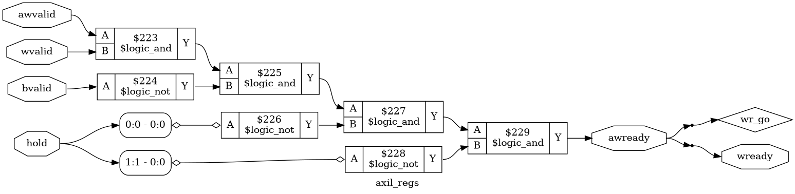
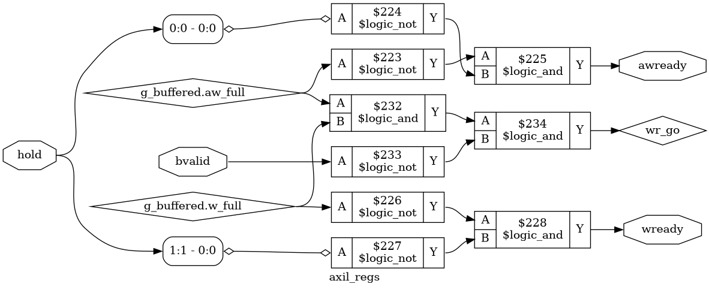

# Tutorial 23: AXI4-Lite

[Tutorial 22](../22-wishbone/README.md) put registers on a Wishbone bus. This
lesson puts the same kind of registers on AXI4-Lite, the bus that most vendor IP
speaks. On a Xilinx part, nearly every IP core with registers, such as AXI GPIO
or AXI UART Lite, has an AXI4-Lite port. On the MiSTer, the bridges between the
Cyclone V's ARM processor and the FPGA fabric are AXI ports too, of the older
AXI3 version, as Intel's Cyclone V Hard Processor System Technical Reference
Manual describes. Nothing here has been run on a MiSTer. Tutorial 26 will connect the RISC-V core to both buses.

AXI is defined in the ARM AMBA AXI specification. AXI4-Lite is its smallest
form: one word per transfer, no bursts and no transaction IDs. The rules in this
lesson were written from that specification for this course. They have not been
checked against ARM's own tools.

Finish [Tutorial 9](../09-skid-buffer/README.md) first, since every AXI channel
is its valid/ready handshake. Run these commands in a VS Code terminal, from this
directory:

```bash
cd tutorials/23-axi4-lite
```

To run everything at once, use `make all`.

## Five channels

Wishbone has one request path and one answer path. AXI4-Lite splits a write into
three channels and a read into two. Each channel is a valid/ready handshake of
its own, with the three rules from Tutorial 9: a transfer happens at a rising
edge where `valid` and `ready` are both high, `valid` does not wait for `ready`,
and an offer stays up, unchanged, until it is taken.

| Channel          | Direction       | Signals here                                  | Carries                        |
| ---------------- | --------------- | --------------------------------------------- | ------------------------------ |
| AW write address | master to slave | `awvalid`, `awready`, `awaddr[31:0]`, `awprot[2:0]` | Where to write          |
| W write data     | master to slave | `wvalid`, `wready`, `wdata[31:0]`, `wstrb[3:0]` | What to write, and which bytes |
| B write response | slave to master | `bvalid`, `bready`, `bresp[1:0]`              | Whether the write worked       |
| AR read address  | master to slave | `arvalid`, `arready`, `araddr[31:0]`, `arprot[2:0]` | Where to read           |
| R read data      | slave to master | `rvalid`, `rready`, `rdata[31:0]`, `rresp[1:0]` | The data, and whether it worked |

A write is one AW, one W and then one B. A read is one AR and then one R. The
specification names the signals in capitals, such as `AWVALID`, and Xilinx IP
adds a prefix, such as `S_AXI_AWVALID`. This lesson uses lowercase names.

`awaddr` and `araddr` are byte addresses, unlike Wishbone's word address in
Tutorial 22. `wstrb` is Wishbone's `sel`: bit k enables byte k of `wdata`. The
`prot` signals mark an access as privileged, secure or an instruction fetch.
This slave ignores them.

### Why the address and the data are separate

In full AXI4, one address can be followed by a burst of up to 256 data beats, so
address and data need channels of their own. AXI4-Lite keeps the same five
channels without the bursts, so a Lite slave looks like a small AXI4 slave.

The cost is that AW and W are two independent handshakes. Nothing says which
comes first. A master may offer the data before the address, the address before
the data, or both together, and a slave must work with all three.

The read side has no such problem. The address goes out on AR and the data comes
back on R, so they are naturally in order.

### Why a valid must never wait for a ready

Rule 2 of Tutorial 9 says that `valid` must not wait for `ready`. AXI extends it
across channels. A master must not wait for `awready` before raising `wvalid`, or
for `wready` before raising `awvalid`. A slave, on the other hand, may wait for
`awvalid`, `wvalid` or both before it raises either ready.

The rule is one-sided on purpose. If both sides were allowed to wait, a master
that holds `wvalid` back until `awready` rises, and a slave that holds `awready`
back until `wvalid` rises, would wait for each other forever. That is a
*deadlock*. With the rule, the master always moves first, and every slave can
count on it. You will build this deadlock in the exercises.

The responses have their own order. `bvalid` may only rise after both the AW and
the W of that write have been taken, and `rvalid` only after its AR.

## The design

[`rtl/axil_regs.v`](rtl/axil_regs.v) is a slave with four registers and an ID:

| Address | Name | Access     | After reset  |
| ------- | ---- | ---------- | ------------ |
| `0x00`  | reg0 | read/write | `0x00000000` |
| `0x04`  | reg1 | read/write | `0x00000000` |
| `0x08`  | reg2 | read/write | `0x00000000` |
| `0x0C`  | reg3 | read/write | `0x00000000` |
| `0x10`  | ID   | read-only  | `0x4158494C`, "AXIL" in ASCII |

The parameter `BASE` moves this block anywhere in the 32-bit address space, in
steps of 32 bytes. Bits `[1:0]` of an address are ignored, so `0x05` is reg1. A
write changes only the bytes whose `wstrb` bit is high, and a write with `wstrb`
at 0 changes nothing. A read returns the whole word.

These registers are reset to 0, unlike the data registers of Tutorial 9. They
hold settings that the rest of a design reads, so they need a known value from
the start.

### Responses

`bresp` and `rresp` carry one of these codes:

| Code   | Value | Sent by this slave for                         |
| ------ | ----- | ---------------------------------------------- |
| OKAY   | `00`  | Any access to reg0 to reg3, and a read of ID   |
| EXOKAY | `01`  | Never. It is for exclusive accesses, which AXI4-Lite does not have |
| SLVERR | `10`  | A write to ID: the register exists and refuses the write |
| DECERR | `11`  | Any other address: there is nothing there. Read data is 0 |

This is a choice. In a larger system an interconnect decodes the address and
answers DECERR itself when no slave is there, and a slave answers SLVERR when it
is reached but cannot do the access. This slave is tested alone, without an
interconnect, so it plays both parts: DECERR for addresses outside its 32 bytes,
SLVERR for the read-only register.

Every request gets exactly one response, even a failed one. A master that waits
for a B or an R must always get one.

### Two ways to take a write

`BUFFERED` picks between two slaves. Both are legal, and the difference is how
they take AW and W.

With `BUFFERED = 0` the slave waits until both are on offer, then takes both in
the same clock and does the write at that edge:

```verilog
assign wr_go   = awvalid && wvalid && !bvalid && !hold[0] && !hold[1];
assign awready = wr_go;
assign wready  = wr_go;
```

It stores nothing, so the write uses `awaddr`, `wdata` and `wstrb` straight from
the bus. But `awready` now depends on `awvalid` and `wvalid`, which is a
combinational path from the master's valids back to the master's readys. This is
allowed, and it is also the kind of path that Tutorial 9 worked to remove.

With `BUFFERED = 1` the slave takes each half as soon as it arrives, into a
register of its own, and does the write once both are there:

```verilog
assign awready = !aw_full && !hold[0];
assign wready  = !w_full && !hold[1];
assign wr_go   = aw_full && w_full && !bvalid;
```

The readys now come from flip-flops, and a W that arrives first is taken at once
instead of waiting for its AW. The price is 68 more flip-flops: 30 for the address,
32 for the data, 4 for the strobes and the two `full` flags.

`hold` is for testing only. Its bits keep `awready`, `wready` and `arready` low
on that clock, so the testbenches can apply backpressure on AW, W and AR. The
waiting slave takes AW and W together, so either of its first two bits holds
both. Tie `hold` to 0 in a real design.

### The responses and the reads

Both slaves share the rest. A write sets `bvalid` and `bresp`, and `bvalid`
stays high until a clock with `bready` high takes it. A new write cannot start
until `bvalid` is low again, so there is never more than one response waiting.

A read is taken while `rvalid` is low, and its data appears on the next clock:

```verilog
assign arready = !rvalid && !hold[2];
```

Reads and writes use separate channels and separate registers, so one of each
can be in progress at the same time.

## Simulate

[`tb/tb_axil_regs.v`](tb/tb_axil_regs.v) contains a scripted master. The script
queues writes and reads with the responses they should get. Each channel then
offers its next item on its own, so AW, W and AR move independently, as they do
on a real bus. The testbench checks each response against the script. It also
fails if a response comes before its request was taken. A read is never queued
in the same run as a write to its register, since the two could happen in either
order.

`make sim` runs it against both slaves:

```bash
make sim
```

Each run should end with `PASS`. Above that, the testbench prints what it
measured. A count of clocks runs from the clock where the first request is
offered to the clock where the last response is taken, both included.

```text
slave: BUFFERED=0
one write: response taken 1 clocks after the request was offered
one read: response taken 1 clocks after the request was offered
writes, nothing stalled:
  32 transactions in 64 clocks: 0.50 per clock
reads, nothing stalled:
  32 transactions in 64 clocks: 0.50 per clock
reads and writes together, nothing stalled:
  64 transactions in 64 clocks: 1.00 per clock
AW offered 2 clocks before W:
  8 transactions in 23 clocks: 0.35 per clock
W offered 2 clocks before AW:
  8 transactions in 25 clocks: 0.32 per clock
random delays, ready held low 30% and bready/rready low 30% of clocks:
  400 transactions in 861 clocks: 0.46 per clock
PASS
```

```text
slave: BUFFERED=1
one write: response taken 2 clocks after the request was offered
one read: response taken 1 clocks after the request was offered
writes, nothing stalled:
  32 transactions in 65 clocks: 0.49 per clock
reads, nothing stalled:
  32 transactions in 64 clocks: 0.50 per clock
reads and writes together, nothing stalled:
  64 transactions in 65 clocks: 0.98 per clock
AW offered 2 clocks before W:
  8 transactions in 24 clocks: 0.33 per clock
W offered 2 clocks before AW:
  8 transactions in 25 clocks: 0.32 per clock
random delays, ready held low 30% and bready/rready low 30% of clocks:
  400 transactions in 720 clocks: 0.56 per clock
PASS
```

What the numbers show:

- **A simple slave does half a transaction per clock in each direction.** The
  response register must empty before the next request can be taken, so each
  write or read takes two clocks.
- **Reads and writes overlap.** With both kinds queued, each direction still runs
  at its own half rate, and together they reach one per clock.
- **The buffered slave answers one clock later.** It takes AW and W at one edge
  and writes at the next.
- **Under random backpressure the buffered slave is faster.** The waiting slave
  can only take a write on a clock where neither AW nor W is held, while the
  buffered one takes each half on any clock where its own ready is free. The cocotb test below shows the
  same difference over longer runs.

The testbench also writes partial words, writes to ID and to unmapped
addresses, reads them back, and checks that reset clears the registers.

## View the waveform

Use a fresh simulation for this step, since `make verilator` writes the same
files and Verilator has no `x` value:

```bash
make sim
```

Then open `build/tb_axil_regs_0.vcd`, the waiting slave, as in
[Tutorial 1](../01-d-flip-flop/README.md). Add `clk`, `awvalid`, `awready`,
`wvalid`, `wready`, `wdata`, `bvalid`, `bready`, `bresp`, `arvalid`, `arready`,
`rvalid` and `rdata` from `tb_axil_regs`. Look at the first write and read:

- At 20 ns `awvalid` and `wvalid` rise together. `awready` and `wready` rise at
  once, in the same clock, because they depend on the valids.
- The rising edge at 25 ns takes both and does the write. `bvalid` rises, and the
  two readys fall because a response is now waiting.
- `bready` is high, so the edge at 35 ns takes the response and `bvalid` falls.
- At 50 ns `arvalid` rises. The edge at 55 ns takes it, and `rdata` shows
  `12345678`, the word just written. The edge at 65 ns takes the response.

Now open `build/tb_axil_regs_1.vcd`, the buffered slave, and also add `aw_full`
and `w_full` from `dut.g_buffered`:

- `awready` and `wready` are already high before 20 ns, and even during reset.
  They come from flip-flops, not from the valids. The rules ask a master to keep
  its valids low during reset, not a slave to keep its readys low.
- The edge at 25 ns takes both halves. `aw_full` and `w_full` rise, and the
  readys fall.
- The edge at 35 ns does the write and raises `bvalid`, one clock later than the
  waiting slave. The readys rise again.

## Lint

```bash
make lint
```

It lints both slaves. Any warning starts with `%Warning`.

## Simulate with Verilator

```bash
make verilator
```

The same testbench runs unchanged, and both runs end with `PASS`. The numbers
match `make sim` except in the random phase, where the two simulators draw
different random numbers. In one run Verilator printed 854 clocks for the
waiting slave and 721 for the buffered one.

## Test in Python

[`tb/test_axil_regs.py`](tb/test_axil_regs.py) plays a random master for 10000
clocks, in five phases. Each request channel waits a random number of clocks
before its next offer, so AW and W arrive in every order. The slave's readys are
held low at random through `hold`, and `bready` and `rready` drop at random.
Addresses include ID and unmapped ones, and `wstrb` is random.

Its checks:

- Each response matches the address: OKAY, SLVERR or DECERR.
- A write response never comes before both its AW and its W were taken, and a
  read response never before its AR.
- A response that is not taken stays, unchanged, until it is.
- The read data matches a model of the registers. The model takes a write when
  its response is taken. A read taken while a write to the same register has
  started but not been answered could see either value, so it is not checked.
- The waiting slave always takes AW and W at the same edge.

```bash
make cocotb
```

Look for `TESTS=1 PASS=1 FAIL=0` twice, once for each slave, and a line of counts
like this one from the buffered slave:

```text
writes=2888 reads=3031 checked_reads=1820 partial_writes=1365 slverr=287 decerr=1026 w_first=779 aw_first=768 same_clock=1341 ready_held=5386 b_stalls=1486 r_stalls=1466
```

The numbers change from run to run, and the test fails if any of them is 0.
`w_first`, `aw_first` and `same_clock` count which half of each write was offered
first.

It also prints the rate of each phase. Over three runs of both slaves, the
buffered slave was faster in every phase that held readys low. The largest
difference was with readys held low 60% of the time: 0.40 to 0.42 transactions
per clock for the waiting slave, and 0.50 for the buffered one.

The test waits for one more clock at the end. Without it, the test ended right
after writing to the inputs, and in this release of cocotb and Icarus the
simulator then often crashed with a segmentation fault, after the test had
already passed.

## Prove it with formal verification

### A checker for the bus

[`formal/axil_checker.v`](formal/axil_checker.v) holds the AXI4-Lite rules. It
watches a port and drives nothing. As in Tutorial 22, the rules split into the
master's and the slave's, and the parameter `DUT_IS_SLAVE` says which side is
being proved. Here the design is the slave, so the master's rules are assumed and
the slave's rules are asserted. With `DUT_IS_SLAVE = 0` it would check a master
instead, but this lesson does not use that mode.

| Rule | Whose  | Says |
| ---- | ------ | ---- |
| M1   | master | No request is offered during reset |
| M2   | master | An AW, W or AR that was not taken stays offered, unchanged, until it is |
| S1   | slave  | No response on the clock after reset |
| S2   | slave  | A B or R that was not taken stays offered, unchanged, until it is |
| S3   | slave  | No response before its request |
| S4   | slave  | At most `MAX_OUTSTANDING` requests in progress on each channel |
| S5   | slave  | Never EXOKAY |

These are all *safety* rules: each says that something bad never happens. None
of them says that a response ever comes. A slave that never answers passes them
all, and so does the deadlock from earlier. The testbenches catch a hang with a
time limit instead.

### Counting requests

S3 needs to know which requests are still waiting. AXI4-Lite has no transaction
IDs, so responses come back in order and counts are enough:

```verilog
aw_out <= aw_out + {3'd0, aw_hs} - {3'd0, b_hs};
w_out  <= w_out  + {3'd0, w_hs}  - {3'd0, b_hs};
ar_out <= ar_out + {3'd0, ar_hs} - {3'd0, r_hs};
```

`aw_out` is the number of AWs taken and not yet answered. One B answers one AW
and one W together. A `bvalid` is then only allowed while both `aw_out` and
`w_out` are above 0:

```verilog
wire s_b_asked = !bvalid || (aw_out != 4'd0 && w_out != 4'd0);
```

A request counts from the edge that takes it, so a response can come on the next
clock at the earliest. This also gives *one response per request*. A response is
held until it is taken, and each one taken lowers the count, so a second response
for the same request would find the count at 0.

### Tying the counts to the slave

The proofs use induction, as in Tutorial 9. Induction may start from any state
that passes the assertions, even one that reset never reaches, so the slave
asserts how the checker's counts follow from its own registers. For the buffered
slave:

```verilog
assert (f_aw_out == {3'd0, g_buffered.aw_full} + {3'd0, bvalid});
assert (f_w_out  == {3'd0, g_buffered.w_full}  + {3'd0, bvalid});
```

An AW is either still in its buffer, or done and waiting for its B.

### The data

The bus rules say nothing about the data. Under `` `ifdef CHECK_DATA `` the slave
picks any one register, as Tutorial 22 does, and keeps a copy of what it should
hold. The copy is built from the ports only: a write counts once both of its
halves have been taken, with the address from its AW and the data and strobes
from its W. A read of that register must return the copy, but only a read taken
while every complete write had been answered. Otherwise the result could
legally be either value.

[`axi4_lite.sby`](axi4_lite.sby) runs three tasks for each slave:

- **`waiting`** and **`buffered`** prove the bus rules.
- **`waiting_data`** and **`buffered_data`** add the data checks.
- **`waiting_cover`** and **`buffered_cover`** check that the interesting cases
  can happen at all.

### The covers

An assumption that is too strong can make every proof pass by ruling out the
traffic that matters. Each cover task asks the solver for 12 traces, including:

- W before AW, AW before W, and both together. For the buffered slave this is the
  order in which the two handshakes happen. The waiting slave always takes both
  at one edge, so for it the order is in which valid rose first.
- A read taken on the clock after the previous read ended, and reads and writes
  answered two clocks apart, which is this slave's full speed.
- A write and a read taken at the same edge.
- A response held while `bready` is low.
- SLVERR, DECERR on a write and DECERR on a read.
- A partial-word write read back.

```bash
make formal
```

Look for `successful proof by k-induction` for the four proof tasks, 12
`Reached cover statement` lines in each cover task, and `DONE (PASS, rc=0)` for
all six.

## See the logic

```bash
make schematic
```

The whole slave is too big to read, so the schematic shows only the logic in
front of `awready`, `wready` and `wr_go`, back to the nearest flip-flops. Click
`build/axil_regs_0.png` in the Explorer for the waiting slave:



`awvalid` and `wvalid` enter on the left and pass through a chain of `$logic_and`
cells to `awready` and `wready` on the right. No flip-flop sits on that path. A
master's valid reaches the slave's ready in the same clock.

Then `build/axil_regs_1.png`, the buffered slave:



`awvalid` and `wvalid` do not appear at all. `awready` comes from
`g_buffered.aw_full` and `wready` from `g_buffered.w_full`, which are flip-flops,
and `hold`. `wr_go` comes from the two full flags and `bvalid`.

## Map it to real FPGAs

```bash
make synth
```

| Slave    | Family    | Flip-flops                           | Total cells |
| -------- | --------- | ------------------------------------ | ----------- |
| waiting  | Xilinx    | 163 `FDRE`, 2 `FDSE`                 | 295         |
| waiting  | Gowin     | 129 `DFFE`, 34 `DFFRE`, 2 `DFFSE`    | 1340        |
| waiting  | Cyclone V | 166 `MISTRAL_FF`                     | 302         |
| buffered | Xilinx    | 231 `FDRE`, 2 `FDSE`                 | 367         |
| buffered | Gowin     | 195 `DFFE`, 36 `DFFRE`, 2 `DFFSE`    | 1586        |
| buffered | Cyclone V | 234 `MISTRAL_FF`                     | 378         |

Most of the flip-flops are the 128 register bits and the 32 bits of `rdata`. The
buffered slave adds 68 on each family, the buffers counted earlier. Gowin's total
is much larger than the others: 436 of its 1340 cells are `LUT1` and 460 are
`MUX2_LUT*` cells. These counts come from Yosys, so vendor tools can give
different results, and they say nothing about timing.

## AXI4-Lite and Wishbone compared

The Wishbone read rate is the one Tutorial 22's `make sim` prints for its
pipelined slave with latency 1. Tutorial 22 does not time writes on their own.
The Wishbone cell count comes from `make compare-wb` here, which puts Tutorial
22's `wb_regfile`, with four registers like this slave, through the same Xilinx
flow. The two testbenches count clocks in slightly different ways, so compare the
rates, not single clocks.

|                        | Wishbone, Tutorial 22          | AXI4-Lite, this lesson         |
| ---------------------- | ------------------------------ | ------------------------------ |
| Wires on the port      | 104                            | 152                            |
| Request paths          | One, shared by reads and writes | Three: AW, W and AR           |
| Writes alone           | Not timed in Tutorial 22       | 32 in 64 clocks: 0.50 per clock |
| Reads alone            | 32 in 32 clocks: 1.00 per clock | 32 in 64 clocks: 0.50 per clock |
| Reads and writes mixed | Share the one path             | 64 in 64 clocks: 1.00 per clock |
| Xilinx cells, registers without reset | 43, with 4 `RAM32M` | 89 waiting, 163 buffered, with 8 `RAM32M` |

The wire counts are the port lists. Wishbone's is `cyc`, `stb`, `we`, a 30-bit
word address, `sel`, `dat_w`, `ack`, `err`, `stall` and `dat_r`. AXI4-Lite's is
the table at the top, 37 + 38 + 4 + 37 + 36. The cell counts need the same
registers on both sides. Tutorial 22's registers have no reset, so Yosys puts
them in LUT RAM. The AXI4-Lite rows are this slave with the reset removed, which
is one of the exercises below.

What each one costs and buys:

- **Wishbone is smaller and simpler.** One request path, one answer per request,
  and its slave answered one request per clock here.
- **AXI4-Lite has more wires and more handshakes.** In return, reads and writes
  never wait for each other, a slave can take the address and data of a write in
  either order, and every channel can be registered on its own. This slave only
  reaches one transaction per clock with reads and writes mixed.
- **The half rate is this slave's choice, not the bus's.** The exercises show a
  one-line change that brings reads to 32 in 33 clocks, as fast as Wishbone's
  slave apart from one clock to start.
- **AXI4-Lite is what vendor IP expects.** Wishbone is common in open-source
  designs, but connecting it to Xilinx IP or to the MiSTer's processor needs a
  bridge to AXI.

## Try it yourself

Change `rtl/axil_regs.v` unless another file is named, then run the checks shown.
Undo each change before trying the next.

**A response before its request.** In the buffered slave, replace
`assign wr_go   = aw_full && w_full && !bvalid;` with
`assign wr_go   = (aw_full || w_full) && !bvalid;`, so the slave writes and
answers as soon as either half has arrived. All three checks fail:

- `make sim` prints `a write response came before its request` and wrong read
  data for the buffered slave. The waiting slave still passes, since its code
  did not change.
- `make cocotb` fails with `a write response came before its AW and W were taken`.
- In `make formal`, `buffered` fails on the checker's `assert (s_b_asked)`, rule
  S3, and on the slave's `assert (f_w_out == ...)`. `buffered_data` fails on
  `assert (regs[f_reg] == f_word)`.

**Ignoring `wstrb`.** Replace `if (wr_strb[k])` with `if (1'b1)`, so every write
writes all four bytes. `make sim` fails with lines like
`read 4: rdata=aaaaaaaa rresp=0 expected 112233aa 0`, and `make cocotb` fails on
the read data. In `make formal`, `waiting` and `buffered` still pass, and
`waiting_data` and `buffered_data` fail on `assert (regs[f_reg] == f_word)`. The
handshakes are perfect and the data is wrong, as in Tutorial 9.

**A response that does not wait.** Replace `end else if (bready) begin` with
`end else begin`, so `bvalid` falls after one clock whether or not it was taken.
`make sim` passes the phases where `bready` is always high, then prints
`FAIL: timed out` in the random phase: a response was missed and never came
again. `make cocotb` fails with `B changed before it was taken`. In
`make formal`, `waiting` and `buffered` fail on the checker's `assert (s_b)`,
rule S2, and on the slave's own count assertions.

**Taking AW without a place to keep it.** In the waiting slave, replace
`assign awready = wr_go;` with `assign awready = awvalid && !bvalid && !hold[0];`,
so it takes an AW without waiting for its W. The address is lost, because this
slave has no buffer. `make sim VARIANTS=0` prints `FAIL: timed out`, and
`make cocotb VARIANTS=0` fails with a wrong response, such as
`write 0x5: bresp=3`. In `make formal`, `waiting` and `waiting_data` fail on
`assert (f_aw_out == {3'd0, bvalid})`, the slave's own count, not a checker
rule. A forgotten AW breaks no bus rule by itself. It only shows up later, as a
response that never comes or that belongs to the wrong request.

**The deadlock.** Now change the master. In `tb/tb_axil_regs.v`, replace
`if (!wvalid && w_i < wq_n) begin` with `if (!wvalid && w_i < aw_i) begin`, so W
is only offered after its AW has been taken. This master waits for `awready`
before raising `wvalid`, which the rules forbid. Run both slaves separately:

```bash
make sim VARIANTS=0
make sim VARIANTS=1
```

The waiting slave prints `FAIL: timed out` before its first write finishes. It is
waiting for `wvalid`, and the master is waiting for `awready`. The buffered slave
prints `PASS`, because its `awready` is high whenever its buffer is empty, but it
is slower: `32 transactions in 97 clocks: 0.33 per clock` for the writes. A
master that breaks this rule can pass all its tests against one slave and hang
against another. The checker's rules would not catch it either, even on a
master: a deadlock is something that never happens, and its rules are all about
things that must not happen.

**An assumption that hides a bug.** Make the change from "A response that does
not wait" again. Then add these lines after the `f_past_valid` block:

```verilog
always @(*)
    assume (bready);
```

Run `make formal`. All four proofs pass, since a master that always takes the
response at once never notices that it would not have waited. Only the cover
tasks fail, both with `Unreached cover statement` for the held response. A
proof is only as good as its assumptions.

**Full-speed reads.** Replace `assign arready = !rvalid && !hold[2];` with
`assign arready = (!rvalid || rready) && !hold[2];`, so a new read is taken at
the same edge that takes the previous answer. This is not a bug: every check
passes. `make sim` now reports `32 transactions in 33 clocks: 0.97 per clock` for
reads, Wishbone's rate apart from the first clock. The price is a combinational path from `rready` to
`arready`, which is the path that Tutorial 9's skid buffer exists to cut.

**What the reset costs.** In the `rst` branch of the write block, delete the
`for` loop that clears `regs`, and run `make synth`. With no reset, Yosys can put
the registers in LUT RAM. On Xilinx the waiting slave drops from 295 cells to 89,
with 8 `RAM32M`, and the buffered one from 367 to 163. On Cyclone V they drop to
112 and 187, and on Gowin to 130 and 195. `make sim` then fails at its last
check, `read 0: rdata=00000404 rresp=0 expected 00000000 0`, since it checks
that reset clears the registers.
