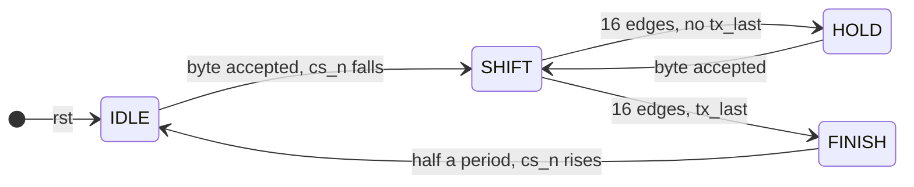
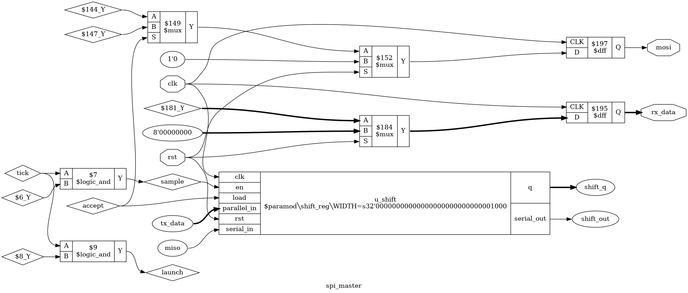

# Tutorial 24: SPI controller

SPI is how an FPGA talks to the chips beside it on the board: flash memory, sensors,
converters and displays. It uses a clock wire, so unlike the UART in
[Tutorial 14](../14-uart/README.md) the two ends never have to agree on a rate. The
price is more wires, and one easy mistake: the two ends must agree on which clock edge
carries the data. This tutorial builds an SPI master and uses it to read a flash chip.
Tutorial 28 puts it on a bus, so that the RISC-V core can boot from SPI flash.

Finish [Tutorial 14](../14-uart/README.md) first. The design also reuses the shift
register from [Tutorial 3](../03-shift-register/README.md) and the handshake from
[Tutorial 9](../09-skid-buffer/README.md). Run these commands in a VS Code terminal,
from this directory:

```bash
cd tutorials/24-spi
```

To run everything at once, use `make all`.

## The four wires

| Wire   | Driven by | Meaning                                                   |
| ------ | --------- | --------------------------------------------------------- |
| `cs_n` | master    | Chip select, active low. The device listens only while it is low |
| `sclk` | master    | The clock. It runs only while a byte is moving            |
| `mosi` | master    | Master out, slave in: data to the device                  |
| `miso` | device    | Master in, slave out: data from the device                |

Every clock moves one bit each way at once. After eight clocks the master has sent a
byte and received one. To read from a device, the master sends a command, then sends
dummy bytes so that the clock keeps running while the answer comes back.

A command often takes several bytes, and `cs_n` must stay low for all of them. If it
rises, the device forgets the command. Raising `cs_n` is how the master says "that
command is finished".

## The four modes

Two settings say which edges carry the data:

- **CPOL** is the level of `sclk` when idle. The *leading* edge is the first edge away
  from that level, and the *trailing* edge is the edge back to it.
- **CPHA** says which of those edges *samples*. With CPHA 0 both ends sample on the
  leading edge and change their outputs, or *launch*, on the trailing edge. With CPHA 1
  they launch on the leading edge and sample on the trailing edge.

| Mode | CPOL | CPHA | Idle `sclk` | Sample on | Launch on |
| ---- | ---- | ---- | ----------- | --------- | --------- |
| 0    | 0    | 0    | low         | rising    | falling   |
| 1    | 0    | 1    | low         | falling   | rising    |
| 2    | 1    | 0    | high        | falling   | rising    |
| 3    | 1    | 1    | high        | rising    | falling   |

The rule behind every row is the same: **launch on one edge, sample on the other**. A
bit is put on the wire, it has half a clock period to settle, and then the other end
takes it. Sampling on the same edge that launches would race against the change.

With CPHA 0 the first bit has no launching edge before it, so it must be on the wire
before the first edge. The master puts it there when `cs_n` falls. Here is mode 0 for
the byte `0xA5`, which is `10100101`, most significant bit first:

```text
cs_n  --+                                                   +--
        |                                                   |
        +---------------------------------------------------+
sclk          +--+  +--+  +--+  +--+  +--+  +--+  +--+  +--+
              |  |  |  |  |  |  |  |  |  |  |  |  |  |  |  |
        ------+  +--+  +--+  +--+  +--+  +--+  +--+  +--+  +---
mosi    ---1---|-0---|-1---|-0---|-0---|-1---|-0---|-1-------
              ^     ^     ^     ^     ^     ^     ^     ^   sample (rising)
```

`mosi` changes just after each falling edge, and each rising edge finds it steady.

## The interface

[`rtl/spi_master.v`](rtl/spi_master.v) has three groups of ports. Tutorial 28 will
connect these to bus registers.

| Port            | Dir | Meaning |
| --------------- | --- | ------- |
| `clk`, `rst`    | in  | System clock, synchronous active-high reset |
| `cpol`          | in  | Idle level of `sclk`. Read only while `cs_n` is high |
| `cpha`          | in  | 0: sample on the leading edge, 1: on the trailing edge. Read when a byte is accepted |
| `clk_div`       | in  | `DIV_WIDTH` bits. Each half period of `sclk` lasts `clk_div + 1` clocks. Read when a byte is accepted |
| `tx_valid`, `tx_data`, `tx_ready` | in, in, out | The handshake from Tutorial 9. A byte moves when `tx_valid` and `tx_ready` are both high |
| `tx_last`       | in  | Travels with the byte. `cs_n` rises after this byte. Without it `cs_n` stays low |
| `rx_valid`, `rx_data` | out | `rx_valid` is high for one clock when `rx_data` holds the byte received |
| `sclk`, `mosi`, `cs_n` | out | To the device, all straight from flip-flops |
| `miso`          | in  | From the device |

`DIV_WIDTH` is a parameter, 8 by default. So `sclk` runs at `clk / (2 * (clk_div + 1))`,
from half the system clock down to 1/512 of it. The divider is an input and not a
parameter because different commands on the same chip have different speed limits, as
the flash model below shows. A program will want to change it without a new bitstream.

**No `rx_ready`.** As in Tutorial 14, `rx_valid` is a pulse with no handshake. Here there
is no need for one: a byte arrives only because a byte was sent, so a slow reader can
simply wait before sending the next one. `rx_data` holds its value until the next byte.

## The design

### Timing

`timer` counts down the clocks of each half period. When it reaches 0, `sclk` changes,
`edges` counts up, and `timer` loads `clk_div` again. Sixteen edges make one byte: eight
that launch and eight that sample. The master needs no separate clock for `sclk`. It is
an ordinary register that the system clock toggles, so the whole design stays in one
clock domain.



- **IDLE:** `cs_n` is high. `sclk` follows `cpol`. When `cpol` changes, `sclk` moves and
  `tx_ready` stays low for another half period, so the device sees the new idle level
  before `cs_n` falls.
- **SHIFT:** a byte is moving. `cs_n` fell half a period before the first edge, which is
  the setup time devices ask for.
- **HOLD:** `cs_n` stays low, `sclk` sits at its idle level, and `tx_ready` is high. The
  master waits here as long as it takes for the next byte. Nothing on the wire changes.
- **FINISH:** half a period after the last edge, `cs_n` rises. Then IDLE keeps it high
  for another half period before the next byte is taken.

### Reusing the shift register

Tutorial 3's shift register shifts towards the most significant bit, takes a new bit in
at `q[0]` and puts out `q[7]`. That is exactly SPI's bit order. So it is copied here
unchanged, as [`rtl/shift_reg.v`](rtl/shift_reg.v), and used as is:

| `shift_reg` port | Connected to | Why |
| ---------------- | ------------ | --- |
| `load`           | `accept`     | The byte to send is loaded when it is accepted |
| `en`             | `sample`     | Each sampling edge shifts once |
| `serial_in`      | `miso`       | The received bit comes in at the bottom |
| `serial_out`     | next `mosi`  | The next bit to send is always at the top |

One register does both jobs. After eight shifts the byte to send has gone out of the top
and the received byte has filled it from the bottom.

### Sampling and launching

```verilog
wire sample = tick && (edges[0] == cpha_r);
wire launch = tick && (edges[0] != cpha_r);
```

An even count of edges means the next edge is a leading one. With CPHA 0 that edge
samples. With CPHA 1 it launches. One comparison covers all four modes. CPOL does not
appear at all, because it only sets where `sclk` starts.

`mosi` is a register of its own, loaded from `shift_out` only on launching edges. It
cannot simply be `q[7]`, because `q` shifts on the sampling edge, and `mosi` would then
change on the very edge where the device samples it.

The master samples `miso` on the clock where it toggles `sclk`. In hardware, that is the
value of `miso` just before the edge leaves the FPGA, half a period after the device
launched it. So the device has half a period, minus the board delays, to get its bit
back. At high `sclk` rates this round trip is the limit, and Try it yourself shows it.

With CPHA 1 the last sample is on the last edge, so `rx_data` takes `miso` straight in
beside `q[6:0]`. With CPHA 0 the last sample was one edge earlier, and `q` is ready.

## Throughput

The testbench sends 8 bytes back to back in one transaction and times them. The system
clock period is 10 ns:

```text
clk_div=0: SCLK 20 ns, 17 clocks per byte
clk_div=1: SCLK 40 ns, 33 clocks per byte
clk_div=3: SCLK 80 ns, 65 clocks per byte
clk_div=7: SCLK 160 ns, 129 clocks per byte
```

A byte needs 16 half periods, so `16 * (clk_div + 1)` clocks. The extra clock is HOLD:
the next byte is accepted on the clock after the last edge. At `clk_div=0` that costs
1 clock in 17, about 6%. Larger dividers hide it. A transaction also spends half a period
before the first edge, half a period after the last, and half a period with `cs_n` high,
so short commands pay proportionally more.

## The flash model

[`tb/spi_flash_model.v`](tb/spi_flash_model.v) is a behavioural SPI NOR flash. **It is our
own model, written from the behaviour that SPI NOR datasheets typically describe. It is
not a vendor model and it does not match any real part.** Its timing limits are in the
range datasheets give, but they are made up, and so is its JEDEC ID, `5a 40 14`.

It knows two commands:

- `0x9F` returns the three-byte JEDEC ID, which says who made the chip and how big it is.
  Reading it is the usual first test of a new board.
- `0x03` takes a 24-bit address and then returns bytes from there for as long as `cs_n`
  stays low. The memory is loaded from [`tb/flash.hex`](tb/flash.hex), which starts with
  the text `Hello, SPI flash`.

Like real NOR flash it supports modes 0 and 3 only, and takes the mode from the level of
`sclk` when `cs_n` falls. It samples `mosi` on the rising edge and changes `miso` 6 ns
after the falling edge. Each broken rule prints `FLASH VIOLATION` and adds one to
`violations`, which the testbench reads. It prints only the first three in a transaction.

**What it checks:**

| Check | Limit in the model |
| ----- | ------------------ |
| `sclk` period, any command | at least 20 ns (50 MHz) |
| `sclk` period, `0x03` | at least 30 ns (33 MHz) |
| `sclk` high and low times | at least 45% of the period limit |
| `cs_n` low to the first `sclk` edge | at least 5 ns |
| The last `sclk` edge to `cs_n` high | at least 5 ns |
| `cs_n` high between commands | at least 10 ns |
| `mosi` steady around each rising edge | 2 ns before to 3 ns after |
| `cs_n` rises only between bytes | whole bytes only |
| `sclk` idle level the same when `cs_n` rises as when it fell | |
| The command is `0x9F` or `0x03` | |

**What it does not check.** Do not read a passing run as more than this:

- It has no write, erase, status register, write enable, busy time or power-down. A real
  part must be written before it can be read, and needs time after power-up.
- It does not check the master's sampling. It drives `miso` 6 ns after the falling edge
  and never asks whether the master took the bit in time. Try it yourself shows the master
  reading wrong data with no violation flagged.
- It has no fast read, dual or quad modes, dummy cycles, `HOLD#` or `WP#` pins.
- Its memory is 256 bytes and wraps there. A real part wraps at the end of its whole array.
- It does not model board delays, edge rates, voltage levels, or a second device on `miso`.
- When `mosi` changes inside the setup and hold window, it takes the new value. A real
  part may latch either value, and may differ from part to part. The violation is the
  only result to trust.
- Its numbers are not from any datasheet. For real hardware, use your part's limits, and
  the vendor's model if there is one.

## Simulate

[`tb/tb_spi.v`](tb/tb_spi.v) runs in four parts:

1. **Loopback.** `miso` is wired to `mosi`, and the flash is held deselected. Four bytes
   in two transactions, in every mode, at dividers 0, 1, 2 and 6. Each byte must come
   back. The testbench also watches the pins on its own: `cs_n` must fall with `sclk` at
   `cpol`, and must rise after exactly 16 edges per byte.
2. **Throughput,** as above. From the first `rx_valid` to the eighth must be exactly 7 times
   `16 * (clk_div + 1) + 1` clocks.
3. **The flash.** JEDEC ID in modes 0 and 3, 16 bytes of data in each mode including a
   wrap at the end of the memory, and two commands back to back, with `cs_n` high for 20 ns
   between them. The flash must flag nothing.
4. **Deliberate mistakes.** Each must make the flash flag at least one violation. This
   checks the checker.

```bash
make sim
```

The run ends with `PASS`. Along the way it prints:

```text
mode 0, clk_div 0: JEDEC ID read as 5a 40 14, flash flagged 0 violations
mode 3, clk_div 0: JEDEC ID read as 5a 40 14, flash flagged 0 violations
mode 0, clk_div 1: read 0x000000 as "Hello, SPI flash"
--- Deliberate mistakes follow. Each should print FLASH VIOLATION. ---
FLASH VIOLATION t=75545000: SCLK high time too short
FLASH VIOLATION t=75575000: SCLK high time too short
FLASH VIOLATION t=75585000: SCLK faster than this command allows
FLASH VIOLATION t=76405000: and 108 more in this transaction
0x03 at clk_div 0: read 48 65, flash flagged 111 violations
```

The `FLASH VIOLATION` lines after the marker are expected. Look at the first mistake:
`0x03` at `clk_div=0`, a 20 ns period against a 30 ns limit. The data still came back
right, `48 65` is `He`. In simulation nothing goes wrong. A real part might work on your
desk and fail when warm. Only the timing check tells you.

## A mode mismatch

The same run then reads the JEDEC ID in the two modes the flash does not support:

```text
mode 1, clk_div 1: JEDEC ID read as 5a 40 14, flash flagged 4 violations
mode 2, clk_div 1: JEDEC ID read as zz zz zz, flash flagged 3 violations
```

**Mode 1** idles low, so the flash takes it for mode 0. The master launches on the rising
edge, the same edge where the flash samples, and the flash flags `mosi` moving inside its
hold window. It flags 4 and not 32, because `mosi` only moves when two bits in a row
differ. The ID is still right, because the model takes the new value. A real part might
not. This is the dangerous kind of mismatch: it reads correctly in simulation.

**Mode 2** idles high, so the flash takes it for mode 3. Now the master launches the
first bit before the first edge and the next bit on each rising edge, while the flash
samples on rising edges. Each rising edge finds the *next* bit already there, so the
command arrives one bit early, shifted left: `0x9F`, `10011111`, arrives as `00111111`.
The flash prints `unsupported command 3f` and never drives `miso`. Under Verilator the ID
reads `00 00 00` instead of `zz zz zz`, since Verilator has only 0 and 1.

**Why a bit, exactly?** Sampling on the launching edge sees either the old bit or the new
one, depending on which wins the race. The new one is the bit after; the old one is the
bit before. Either way the whole byte slides by one place.

The cocotb test below shows all sixteen combinations, against a device that can be set
to any mode. The master sends `3c 5a` and the device answers `a5 0f`:

```text
device mode 0, master mode 0: device got 3c 5a  master got a5 0f  problems flagged 0
device mode 0, master mode 1: device got 3c 5a  master got a5 0f  problems flagged 8
device mode 0, master mode 2: device got 78 b4  master got a5 0f  problems flagged 10
device mode 0, master mode 3: device got 3c 5a  master got 4a 1f  problems flagged 2
device mode 1, master mode 0: device got 78 b4  master got 52 87  problems flagged 8
device mode 1, master mode 1: device got 3c 5a  master got a5 0f  problems flagged 0
device mode 1, master mode 2: device got 3c 5a  master got 52 87  problems flagged 2
device mode 1, master mode 3: device got 3c 5a  master got 52 87  problems flagged 10
device mode 2, master mode 0: device got 78 b4  master got a5 0f  problems flagged 10
device mode 2, master mode 1: device got 3c 5a  master got 4a 1f  problems flagged 2
device mode 2, master mode 2: device got 3c 5a  master got a5 0f  problems flagged 0
device mode 2, master mode 3: device got 3c 5a  master got a5 0f  problems flagged 8
device mode 3, master mode 0: device got 3c 5a  master got 52 87  problems flagged 2
device mode 3, master mode 1: device got 3c 5a  master got 52 87  problems flagged 10
device mode 3, master mode 2: device got 78 b4  master got 52 87  problems flagged 8
device mode 3, master mode 3: device got 3c 5a  master got a5 0f  problems flagged 0
```

`78 b4` is `3c 5a` shifted left by one bit. `52 87` is `a5 0f` shifted right, with a stale
0 in front, and `4a 1f` is `a5 0f` shifted left. Every mismatch is flagged, and two of
them get the right data both ways. The diagonal is the only place with no problem at all.

## View the waveform

`make sim` writes `build/tb_spi.vcd`. Open it as in Tutorial 1, and add `tx_valid`,
`tx_ready`, `cs_n`, `sclk`, `mosi`, `rx_valid` and `rx_data` from `tb_spi`, and `state`
from `dut`. Set `rx_data` to hexadecimal if you can. The first transaction is the loopback
in mode 0 at `clk_div=0`, sending `a5`, `3c`, then `00`:

- `tx_ready` rises at 20 ns, after reset, and `tx_valid` at 30 ns.
- At 35 ns `cs_n` falls, `mosi` goes to 1, the top bit of `a5`, and `state` goes to 1, SHIFT.
- `sclk` rises at 45 ns, half a period later, and from then on changes every 10 ns.
  `mosi` changes only with the falling edges: 0 at 55 ns, 1 at 75 ns, 0 at 95 ns.
- At 195 ns `rx_valid` pulses with `rx_data` at `a5`, `state` goes to 2, HOLD, and
  `tx_ready` rises. The next byte is taken at once, and at 205 ns `state` is back to 1.
- The second `rx_valid`, with `3c`, is at 365 ns, 17 clocks after the first.
- After the third byte `state` goes to 3, FINISH, at 535 ns, and `cs_n` rises 10 ns later.

## Lint and Verilator

```bash
make lint
make verilator
```

Any warning starts with `%Warning`, and there should be none. The lines that start with
`- V e r i l a t i o n` are a normal report. Under Verilator the same testbench
prints the same lines, except the mode 2 ID, and `PASS`.

## Test in Python

[`tb/test_spi.py`](tb/test_spi.py) has its own SPI device, written in Python, that can be
set to any mode. It samples `mosi` on its sampling edge and drives `miso` 1 ns after its
launching edge. It reports `sclk` at the wrong level when `cs_n` moves, `mosi` moving on a
sampling edge, `cs_n` rising in the middle of a byte, and every half period that is not
exactly `clk_div + 1` clocks inside a byte, or shorter than that between bytes.

```bash
make cocotb
```

This takes about 10 seconds. Look for `TESTS=2 PASS=2 FAIL=0`.

- `random_transactions` runs 300 transactions, each with a random mode, a random divider
  from 0 to 39, 1 to 5 random bytes and random gaps between them. A gap leaves the master
  in HOLD with `cs_n` low. The device must report nothing, must receive the bytes sent, and
  the master must receive what the device sent. The seed is fixed, and the last line
  shows what was covered:
  `300 transactions, per mode {0: 82, 1: 71, 2: 72, 3: 75}, dividers 0 to 39, 172 late bytes with CS held`.
- `mode_mismatch` prints the table above. The diagonal must be exact with nothing flagged,
  and every other row must have wrong data or a flagged problem.

## Prove it with formal verification

```bash
make formal
```

[`spi.sby`](spi.sby) has four tasks, and the run takes about 25 seconds. Look for
`DONE (PASS, rc=0)` on each.

| Task     | Mode  | What it shows |
| -------- | ----- | ------------- |
| `prove1` | prove | For all time, with `DIV_WIDTH=1`, so `clk_div` 0 or 1 |
| `prove2` | prove | For all time, with `DIV_WIDTH=2`, `clk_div` 0 to 3 |
| `prove3` | prove | For all time, with `DIV_WIDTH=3`, `clk_div` 0 to 7 |
| `cover`  | cover | A two-byte transaction in each mode, the byte `a5` at the slowest divider, and a CPOL change just before `cs_n` falls |

The solver picks `cpol`, `cpha`, `clk_div`, the bytes, `tx_last`, `miso` and when to offer
a byte, on every clock. The properties are about the pins:

- **Idle level.** While `cs_n` is high, `sclk` moves only to follow `cpol`, and equals
  `cpol` whenever a byte can be taken. `cs_n` falls only when a byte is accepted, with
  `sclk` steady at `cpol`.
- **Chip select held.** `cs_n` rises only after all 16 edges of a byte that had `tx_last`.
  Between the bytes of a transaction `sclk` is back at its idle level.
- **Exactly 16 edges per byte,** 8 sampling and 8 launching, counted by a formal-only
  counter.
- **Timing.** While `cs_n` is low, every level of `sclk` lasts at least `clk_div + 1`
  clocks, and exactly that inside a byte. `cs_n` rises exactly half a period after the last edge.
- **Data.** On every sampling edge `mosi` holds the right bit of the accepted byte and did
  not change on that edge. `rx_data` equals the eight `miso` values at the sampling edges.
- **The handshake.** `tx_ready` is low in the middle of a byte. Each byte gives exactly one
  `rx_valid`, after its 16th edge, and `rx_data` changes only with `rx_valid`.

The second half of the properties are about the inside: `state`, `edges`, `timer` and the
shift register agree with the formal counters. They are there so that induction can
succeed. When a bug breaks the design, one of these often fails first, at an earlier
step than the pin property, and that is the one the summary names.

`tx_ready` must not depend on `tx_valid`, but a property cannot say that, since it sees
only values. The proof asserts the exact expression for `tx_ready` instead, and you can
see in the code that `tx_valid` is not in it.

**What formal does not show.** It checks the master's own pins, one clock domain, and
ideal flip-flops. It says nothing about a device, board delays, or whether `miso` arrives
in time. The proofs cover `DIV_WIDTH` 1 to 3, not the default of 8. The depth is 40
because a shorter search did not reach the end of a transaction with `clk_div` above 0,
and then a broken `cs_n` hold time failed only as an induction failure, `UNKNOWN`,
instead of a real trace.

## Is this a clock domain crossing?

No. `sclk` is a register clocked by `clk`, and the flash launches `miso` from `sclk`, so
`miso` changes at a known time after a `clk` edge. That makes it an I/O timing problem,
solved with timing constraints on the pins, not a synchronizer. The simulations here have
no board delays, so they say nothing about whether those constraints are met.

## See the logic

```bash
make schematic
```

This draws two pictures. `build/spi_master.png` is the whole master, and it is too
tangled to read. `build/datapath.png` keeps only the shift register and the logic just in
front of `mosi`, `rx_data`, `sample` and `launch`:



- `u_shift` is a box, Tutorial 3's module. `accept` drives `load`, `sample` drives `en`,
  and `miso` enters at `serial_in`.
- `sample` and `launch` are each `tick` ANDed with one comparison. `$8` is the `$ne` of
  `edges[0]` and `cpha_r` that `launch` uses.
- `mosi` and `rx_data` come straight from `$dff` cells, and the muxes in front of them are
  the reset and, for `mosi`, the choice made when a byte is accepted.

## Map it to real FPGAs

```bash
make synth
```

| Family     | Flip-flops              | Total cells |
| ---------- | ----------------------- | ----------- |
| Xilinx     | 46 (`FDRE`, `FDSE`)     | 109         |
| Gowin      | 46 (`DFF` and variants) | 362         |
| Cyclone V  | 46 `MISTRAL_FF`         | 111         |

The code declares 44 flop bits, 36 in the master and 8 in the shift register. As in
Tutorial 14, Yosys recodes the 2-bit `state` as four one-hot bits, which makes 46. The
totals include one `$scopeinfo` entry on Xilinx and Gowin, which is bookkeeping and not
a real cell.

The Gowin total is not a mistake in the design. By default Yosys maps to Gowin's wide
LUTs, and here that produced 123 `MUX2_LUT5` to `MUX2_LUT8` cells and 69 `LUT1`. With
`-nowidelut` added, the same design took 126 cells, with 65 LUTs. Which is better on the
chip is a question for the vendor tools.

These are Yosys counts, so vendor tools can give different results, and they say nothing
about timing.

## Try it yourself

Change [`rtl/spi_master.v`](rtl/spi_master.v), then run `make sim`, `make cocotb` and
`make formal`. Undo each change before trying the next. `prove` means all three proof
tasks. The last column names the first property that failed.

| Change | Sim | cocotb | Formal | Failed property |
| ------ | --- | ------ | ------ | --------------- |
| Swap `==` and `!=` in `sample` and `launch` | FAIL | FAIL | `prove` | shift register and `mosi`, inside |
| Delete the two lines that put `tx_data[7]` on `mosi` for CPHA 0 | FAIL | FAIL | `prove` | `mosi` inside |
| `if (edges == 4'd14)` in place of `4'd15` | FAIL | FAIL | `prove` | `rx_valid` after 16 edges |
| `rx_data <= shift_q;` without the CPHA mux | FAIL | FAIL | `prove` | `rx_data == f_rx` |
| Remove `&& sclk == cpol` from `tx_ready` | FAIL | FAIL | `prove` | the `tx_ready` expression |
| `last_r <= 1'b1;` in place of `tx_last` | FAIL | FAIL | `prove`, `cover` | `last_r` inside |
| `.serial_in(1'b0)` in place of `miso` | FAIL | FAIL | `prove`, `cover` | shift register inside |
| `timer <= div_r - 1'b1;` on each edge | FAIL | FAIL | `prove` | `timer` inside |
| In FINISH, `if (1'b0)` in place of `if (timer != 0)` | pass | FAIL | `prove` | `cs_n` half a period after the last edge |

With the swapped edges, sim reports `got d2 expected a5`: the byte shifted by one place,
as in the mismatch table. With `last_r` forced to 1, the throughput check fails, because
every byte now raises `cs_n` and pays the extra half periods: 8 bytes took 1260 ns at
`clk_div=0`, against 1190 ns. The `cover` failures mean a two-byte transaction, or the
byte `a5`, became unreachable.

**A bug the testbench misses.** The last row raises `cs_n` one clock after the last edge
instead of half a period. `make sim` passes, because the flash only needs 5 ns, and one
clock is 10 ns. cocotb fails with `CS rose 10000.0 ps after the last edge`, because its
device expects exactly half a period, and so does formal. The design still works with
this flash. Whether it is a bug depends on the device, and the model only knows its own
limits.

**A change that is not a bug.** Replace `if (launch && edges != 4'd15)` with
`if (launch)`. Now CPHA 0 changes `mosi` once more on the last edge, to a received bit.
Every check passes: sim, cocotb and all four formal tasks. That is right, because no
device samples after the last edge, so `mosi` is a don't-care there. A check that failed
here would be checking the code, not the behaviour.

**Check the checker.** In [`tb/spi_flash_model.v`](tb/spi_flash_model.v), change
`if (t_mosi > t_rise - T_SU)` to `if (1'b0)`, so the setup and hold check never fires.
`make sim` fails with `the flash flagged 0 violations, expected at least 1` at the mode 1
read, which now prints `JEDEC ID read as 5a 40 14, flash flagged 0 violations`. Without
that one check, the wrong mode reads the right answer and nothing complains.

**A slow device.** In the flash model, set `T_V = 12.0`, so `miso` changes 12 ns after
the falling edge. At `clk_div=0` the master samples 10 ns after that edge, before the
new bit arrives:

```text
mode 0, clk_div 0: JEDEC ID read as 2d 20 0a, flash flagged 0 violations
```

`5a 40 14` arrived one bit late, as `2d 20 0a`, and the flash flagged nothing, because it
does not check the master. At `clk_div=1` the read is correct again. This is the round
trip from earlier: on a board, the delays of the pins and traces add to `T_V`, and a
divider that works in simulation can be too fast for the board.
