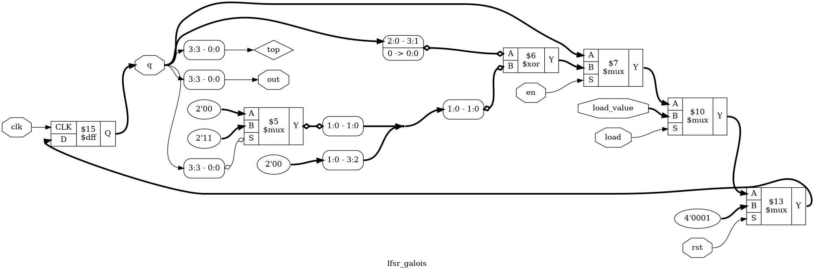
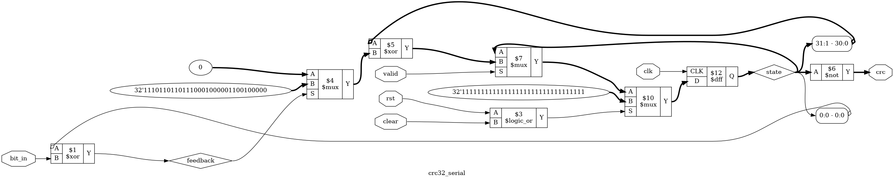

# Tutorial 25: LFSRs and CRCs

A *linear feedback shift register* (LFSR) is a shift register whose input is an
XOR of some of its own bits. It makes long sequences that look random out of a
handful of gates, and it is the core of a *cyclic redundancy check* (CRC), the
checksum on every Ethernet frame, zip file and PNG image. This tutorial builds
LFSRs and measures how long their sequences are. It then builds CRC-32 one bit
per clock, derives the equations for a whole byte per clock, and checks both
against Python's `zlib.crc32`.

Finish [Tutorial 3](../03-shift-register/README.md) and
[Tutorial 12](../12-flags-alu/README.md) first. This one uses shift registers and
XOR, and treats bits as numbers in a new way. Run these commands in a VS Code
terminal, from this directory:

```bash
cd tutorials/25-lfsr-crc
```

To run everything at once, use `make all`.

## Polynomials made of bits

LFSRs and CRCs are described with polynomials whose coefficients are bits. Adding
two of them is XOR, with no carries. So `x^4 + x + 1` is the bits `10011`, and
`(x^4 + x + 1) + (x + 1)` is `10011 ^ 00011 = 10000`, which is `x^4`.

Multiplying by `x` is a shift left. Taking the remainder after dividing by a
polynomial of degree 4 keeps the answer to 4 bits: whenever the shift pushes a 1
into the `x^4` place, XOR the polynomial in to remove it. That one step, shift and
maybe XOR, is all an LFSR does.

Both designs here take the polynomial as a `POLY` parameter, without its top term,
since that is always 1. Bit `k` of `POLY` is the coefficient of `x^k`, so
`x^4 + x + 1` is `POLY = 4'b0011`.

## Two ways to build an LFSR

[`rtl/lfsr_galois.v`](rtl/lfsr_galois.v) is the step above, written directly:

```verilog
q <= {q[WIDTH-2:0], 1'b0} ^ (top ? POLY : {WIDTH{1'b0}});
```

The bit leaving the top is XORed into every tap position. This is the *Galois*
form.

[`rtl/lfsr_fib.v`](rtl/lfsr_fib.v) is the *Fibonacci* form. It XORs the tap bits
into one new bit, and shifts it in at the top while the register shifts right:

```verilog
wire feedback = ^(q & POLY);
...
q <= {feedback, q[WIDTH-1:1]};
```

`^(q & POLY)` is a *reduction XOR*: it XORs every bit of `q & POLY` into one bit.
The Fibonacci form has one wide XOR in the feedback. The Galois form has many
2-input XORs spread along the register, which is often faster.

Both modules have `rst`, which loads `SEED` (1 by default), `load` with
`load_value`, and `en`. `out` is the bit leaving the register.

## Period, and the all-zeros state

An `N`-bit register has 2<sup>N</sup> states. 0 is useless: with no 1 to feed back,
0 shifts to 0 for ever. That is the *lock-up state*. So the longest possible
sequence visits the other 2<sup>N</sup> - 1 states and comes back to the start.
The number of clocks before it comes back is the *period*.

Whether an LFSR reaches that maximum depends only on the polynomial. If it does,
the polynomial is called *primitive*. Others split the nonzero states into
several shorter cycles, and the seed picks which one you are on.

[`tb/tb_lfsr.v`](tb/tb_lfsr.v) measures periods. It builds three 4-bit polynomials
both ways, starts from each of the 15 nonzero seeds, and counts the clocks until
the state comes back. It then does the same for a 16-bit polynomial from seed 1.
The expected numbers are written in the testbench from the theory below, not
taken from the design.

```bash
make sim
```

```text
POLY=0011 fibonacci periods for seeds 1 to 15: 15 15 15 15 15 15 15 15 15 15 15 15 15 15 15
POLY=0011 galois    periods for seeds 1 to 15: 15 15 15 15 15 15 15 15 15 15 15 15 15 15 15
POLY=1111 fibonacci periods for seeds 1 to 15: 5 5 5 5 5 5 5 5 5 5 5 5 5 5 5
POLY=1111 galois    periods for seeds 1 to 15: 5 5 5 5 5 5 5 5 5 5 5 5 5 5 5
POLY=0101 fibonacci periods for seeds 1 to 15: 6 6 6 6 6 3 6 6 6 6 3 6 3 6 6
POLY=0101 galois    periods for seeds 1 to 15: 6 6 6 6 6 6 3 6 3 6 6 6 6 3 6
loaded 0: still 0 after 100 clocks
x^16 + x^14 + x^13 + x^11 + 1: fibonacci period 65535, galois period 65535
PASS
```

- **`x^4 + x + 1` is primitive.** Every seed gives 15, which is 2<sup>4</sup> - 1:
  one cycle through all 15 nonzero states.
- **`x^4 + x^3 + x^2 + x + 1` is not.** Every seed gives 5. Multiply it by
  `x + 1` and you get `x^5 + 1`, so `x^5` leaves a remainder of 1. Five steps
  always bring the state back, and the 15 states form three separate cycles of 5.
- **`x^4 + x^2 + 1` is `(x^2 + x + 1)` squared.** The periods are 3 and 6. The 3
  states that `x^2 + x + 1` can describe on its own cycle every 3 clocks, and the
  other 12 every 6. The two forms disagree seed by seed, because the same number
  means a different state in each form. Both have 3 seeds of period 3 and 12 of
  period 6, and the testbench checks those counts.
- **`x^16 + x^14 + x^13 + x^11 + 1` is primitive.** Both forms take 65535 clocks,
  which is 2<sup>16</sup> - 1, to come back to seed 1. 16 flip-flops and three
  XORs make a sequence that does not repeat for 65535 clocks.
- **Loaded with 0, they stay at 0.** A design that has to recover would check for
  0 and load a seed again.

## From LFSR to CRC

Feed data into the feedback of a Galois LFSR and it computes the remainder of the
data, read as one long polynomial, divided by `POLY`. That remainder is the CRC.
Change any one bit of the message and the remainder changes, and so do many other
patterns of errors.

CRC-32, as used by Ethernet (IEEE 802.3), zip and PNG, adds conventions that each
have to be matched exactly:

| Setting   | CRC-32                                       | Why                                        |
| --------- | -------------------------------------------- | ------------------------------------------ |
| Polynomial | `0x04C11DB7` and an `x^32` term             | Chosen for good error detection            |
| Reflected | Bit 0 of each byte first, register shifts right | Ethernet sends bit 0 of each byte first |
| Init      | `0xFFFFFFFF`                                 | Leading zero bytes change the CRC          |
| Final XOR | `0xFFFFFFFF`                                 | Trailing zero bytes change the CRC         |

Shifting right is the mirror image of shifting left, so the polynomial is
mirrored too: `0x04C11DB7` with its 32 bits reversed is `0xEDB88320`.

Two numbers check an implementation. The CRC-32 of the nine ASCII characters
`123456789` is `CBF43926`, and every CRC catalogue lists it. The *residue* is the
other. Append a message's CRC to it, low byte first, and the CRC of the whole is
always `2144DF1C`, whatever the message was. A receiver uses this to check a frame
without knowing where the CRC starts.

## Bit-serial CRC

[`rtl/crc32_serial.v`](rtl/crc32_serial.v) is the Galois LFSR, mirrored, with the
data bit XORed into the feedback:

```verilog
wire feedback = state[0] ^ bit_in;
...
if (rst || clear)
    state <= 32'hFFFFFFFF;
else if (valid)
    state <= {1'b0, state[31:1]} ^ (feedback ? POLY : 32'd0);
...
assign crc = ~state;
```

`clear` starts a new message and beats `valid`. `crc` is the finished CRC of
every bit taken since the last `clear`, so it can be read after any bit. It costs
one clock per bit, which is too slow for most uses.

## Byte-parallel CRC

A byte per clock means doing eight serial steps in one clock. Each step is only
XORs, so eight of them are still only XORs, and each new state bit is the XOR of
some of the old state bits and some data bits. The question is which.

### Deriving the equations

[`tools/crc_parallel.py`](tools/crc_parallel.py) finds out by running the serial
CRC on symbols instead of bits. A signal is a set of names, such as
`{state[3], data[0]}`, and XOR of two signals is the names that are in one set
but not both, since `a ^ a = 0`. The script keeps each set as the bits of a
Python integer, so XOR of sets is just `^`:

```python
def serial_step(state, bit):
    """One clock of rtl/crc32_serial.v, on sets. state[i] is the set for bit i."""
    feedback = state[0] ^ bit
    nxt = state[1:] + [0]  # shift right: bit i takes bit i + 1, and 0 comes in at the top
    for i in range(WIDTH):
        if (POLY >> i) & 1:
            nxt[i] ^= feedback
    return nxt
```

It starts with `state[i] = {state[i]}` and runs eight steps, with `data[0]` to
`data[7]` as the bits. Then it evaluates the equations on 1002 messages and
compares the answers with `zlib.crc32`, and stops if one is wrong:

```bash
python3 tools/crc_parallel.py
```

```text
checked against zlib.crc32 on 1002 messages
next[ 0] = state[2] ^ state[8] ^ data[2]
next[ 1] = state[0] ^ state[3] ^ state[9] ^ data[0] ^ data[3]
...
next[31] = state[1] ^ state[7] ^ data[1] ^ data[7]
inputs per bit: 3 to 14, 252 in all
```

Look at the pattern: wherever `state[i]` appears for `i` below 8, `data[i]`
appears too. The byte is XORed into the low byte of the state, and only that sum
matters. The high bits of the state just move down 8 places, so `state[8]` turns up
in `next[0]` and `state[31]` in `next[23]`.

`python3 tools/crc_parallel.py verilog` writes the same equations as a module,
[`rtl/crc32_byte_xor.v`](rtl/crc32_byte_xor.v), one `assign` per bit. `make
equations` runs both, and fails if the file in `rtl/` is not what the script
writes now.

### Equations or a loop

The other way is to write the eight steps as a loop and let synthesis unroll it.
That is [`rtl/crc32_byte.v`](rtl/crc32_byte.v):

```verilog
function [31:0] next_state(input [31:0] s, input [7:0] d);
    integer i;
    begin
        next_state = s;
        for (i = 0; i < 8; i = i + 1)
            next_state = {1'b0, next_state[31:1]}
                       ^ ((next_state[0] ^ d[i]) ? POLY : 32'd0);
    end
endfunction
```

The loop is not hardware that runs eight times. It describes the same XORs as
the equations, and Yosys flattens it. Both files have the same ports, and every
test below runs on both.

This tutorial uses the loop, and Tutorial 28 will too:

- It reads as what it is: eight steps of the serial CRC.
- Another polynomial, or 16 bits per clock, is a one-line change. The equations
  would have to be generated again.
- The proof below shows that they are the same logic, and the Yosys counts under
  [Map it to real FPGAs](#map-it-to-real-fpgas) show neither is smaller
  everywhere.

## Simulate the CRC

`make sim` also runs [`tb/tb_crc.v`](tb/tb_crc.v). It sends the same bytes to all
three designs: eight clocks per byte for the serial one, and one clock per byte
for the other two. After every byte it checks that the three agree, and at the
end of each message it checks against the published value:

```text
empty message: serial=00000000 byte=00000000 xor=00000000
"123456789": serial=cbf43926 byte=cbf43926 xor=cbf43926
with its CRC appended: serial=2144df1c byte=2144df1c xor=2144df1c
"The quick brown fox...": serial=414fa339 byte=414fa339 xor=414fa339
with its CRC appended: serial=2144df1c byte=2144df1c xor=2144df1c
after 5 idle clocks: serial=cbf43926 byte=cbf43926 xor=cbf43926
clear with valid high: serial=00000000 byte=00000000 xor=00000000
PASS
```

The CRC of no bytes is 0, because the all-ones start is inverted by the final XOR.
`414FA339` is the CRC-32 of "The quick brown fox jumps over the lazy dog", another
value that is easy to look up. The two different messages leave the same residue.

## View the waveform

Use a fresh simulation for this step, since `make verilator` writes the same file
without any `x`. Run `make sim`, open `build/tb_crc.vcd` as in Tutorial 1, and add
`clk`, `rst`, `clear`, `byte_valid`, `data`, `byte_crc`, `bit_valid`, `bit_in` and
`serial_crc` from `tb_crc`. Show the CRCs in hexadecimal.

- Both CRCs are `x` until the first rising edge, at 5 ns. Reset then sets the
  register to all ones, and the outputs show `00000000`.
- At 10 ns `data` is `31`, the character `1`, and `byte_valid` is high for one clock.
  At 15 ns `byte_crc` is `83dcefb7`, which is `zlib.crc32(b"1")`.
- `serial_crc` takes the same byte one bit per clock. It changes on each of the
  eight rising edges from 15 ns to 85 ns, and reaches `83dcefb7` at 85 ns. The
  values in between are the CRCs of part of a byte, and mean nothing to `zlib`.
- `byte_crc` reaches `cbf43926` at 655 ns, after the ninth byte. `serial_crc`
  gets there at 725 ns.
- The four CRC bytes follow, and both reach the residue `2144df1c`: `byte_crc` at
  975 ns, `serial_crc` at 1045 ns.

[`tb/tb_lfsr.v`](tb/tb_lfsr.v) writes `build/tb_lfsr.vcd` too, for the 4-bit
runs. The 65535-clock run comes after `$dumpoff`, so it is not in the file.

## Lint and Verilator

```bash
make lint
make verilator
```

`make lint` checks each of the five modules with `-Wall`. Any warning starts with
`%Warning`, and there are none. `make verilator` runs both testbenches, and each
should print `PASS`. It writes a waveform for the CRC only: Verilator ignores
`$dumpoff`, so the LFSR waveform would include the long run.

## Test in Python

[`tb/test_crc32_byte.py`](tb/test_crc32_byte.py) sends 300 random messages of 0 to
99 bytes, with random clocks where `valid` is low. After every byte it compares
`crc` with `zlib.crc32` of the message so far. Python's CRC is the golden model,
and it shares no code with the design. `make cocotb` runs it on `crc32_byte` and on
`crc32_byte_xor`, then runs [`tb/test_crc32_serial.py`](tb/test_crc32_serial.py),
which sends 100 random messages one bit at a time.

```bash
make cocotb
```

Look for `TESTS=1 PASS=1 FAIL=0` three times. The log lines count what was sent,
for example `300 messages, 15382 bytes, 3803 idle clocks`. The messages are random,
so the numbers change each run.

Both tests wait one more clock at the end. Without it, the test ended with a write
to `valid` still pending, and this cocotb build crashed with a segmentation fault
after printing `PASS`.

## Prove it with formal verification

```bash
make formal
```

[`crc.sby`](crc.sby) has three tasks. Look for `DONE (PASS, rc=0)` for each.

**`equiv`** proves that the serial CRC and both byte CRCs agree, for every stream
of bytes. [`tb/crc_equiv_formal.v`](tb/crc_equiv_formal.v) lets the solver choose
`f_byte`, `f_start` and `f_clear` afresh on every clock, with `anyseq`. When a byte
starts, the byte CRCs take it at once and the harness feeds its bits to the serial
CRC over eight clocks. The solver may wait between bytes and clear between
messages. Then:

```verilog
assert (xor_crc == byte_crc);
if (!busy)
    assert (serial_crc == byte_crc);
```

Look for `successful proof by k-induction`. It took 38 to 39 seconds in the runs here. A proof
covers every message of every length, which no simulation can.

This proves the three designs are the same as each other. It does not prove that
any of them is CRC-32. That is the job of the check value and of `zlib.crc32`, and
one of the exercises below shows the difference.

**`cover`** asks the solver to find two traces. The first sends two bytes. The
second is a four-byte message whose CRC is `CBF43926`, the same as `123456789`.
The solver found it at step 33. Open
`build/formal_cover/engine_0/trace1.vcd` and read `f_byte` on each clock where
`start` is high: `2a`, `0d`, `cd`, `f2`. Check it with Python:

```bash
python3 -c "import zlib; print(hex(zlib.crc32(bytes.fromhex('2a0dcdf2'))))"
```

```text
0xcbf43926
```

A CRC catches accidents, not attacks. Anyone can make a message with the CRC they
want, and a solver does it in a second.

**`lfsr`** proves, in [`tb/lfsr_formal.v`](tb/lfsr_formal.v), that neither 16-bit
LFSR ever reaches 0 unless it is loaded with 0. This needs bit 0 of `POLY` to be 1.
Then the step can be undone, so two states never lead to the same next state, and
since 0 leads to 0, nothing else can.

## See the logic

```bash
make schematic
```

This draws a 4-bit Galois LFSR with `POLY = 4'b0011`, and the serial CRC. The
byte CRCs are hundreds of XORs, too many to read. Click `build/lfsr_galois.png` in
the Explorer:



Start from the flip-flop's `D` input and read backwards. `$13` loads `4'0001`, the
seed, on `rst`. `$10` picks `load_value` on `load`, and `$7` holds `q` unless `en`
is high. `$6` is the shift and XOR: the box marked `2:0 - 3:1` and `0 -> 0:0` is
`{q[2:0], 1'b0}`. `$5` picks `2'11` or `2'00` with bit 3 of `q`. Yosys has kept
only the two low bits of `POLY`, because the top two are 0, so there are only two
taps to XOR.

Now click `build/crc32_serial.png`:



`$1` is `feedback`, `state[0] ^ bit_in`. `$4` picks the long constant, which is
`EDB88320` in binary, or 0. `$5` XORs it with the shifted state, from the box
marked `31:1 - 30:0`. `$7` holds the state unless `valid` is high, and `$10` loads
all ones on `rst` or `clear`. `$6` at the right is the final XOR, a `$not`.

## Map it to real FPGAs

```bash
make synth
```

The CRCs, with flip-flops, then lookup tables, then other cells:

| Design            | Xilinx                         | Gowin                                      | Cyclone V              |
| ----------------- | ------------------------------ | ------------------------------------------ | ---------------------- |
| `crc32_serial`    | 32 + 15 + 32 `INV` = 79        | 32 + 15 + 32 `LUT1` = 79                   | 32 + 16 = 48           |
| `crc32_byte`      | 32 + 50 + 32 `INV` = 114       | 32 + 146 + 32 `LUT1` + 94 `MUX2` = 304     | 32 + 48 = 80           |
| `crc32_byte_xor`  | 32 + 62 + 32 `INV` = 126       | 32 + 87 + 32 `LUT1` + 20 `MUX2` = 171      | 32 + 60 = 92           |

The 16-bit LFSRs:

| Design        | Xilinx           | Gowin                                    | Cyclone V                  |
| ------------- | ---------------- | ---------------------------------------- | -------------------------- |
| `lfsr_fib`    | 16 + 17 = 33     | 16 + 20 + 3 `MUX2` + 1 `GND` = 40        | 16 + 17 + 1 `NOT` = 34     |
| `lfsr_galois` | 16 + 16 = 32     | 16 + 17 = 33                             | 16 + 17 + 1 `NOT` = 34     |

- An LFSR costs about one lookup table per flip-flop, and most of that is the
  `load` and `en` multiplexers, not the XORs.
- The CRC registers reset to ones, so Xilinx and Gowin use set flip-flops, `FDSE`
  and `DFFSE`. On both, the final XOR shows as 32 inverters. The Cyclone V count
  has none.
- Eight bits per clock costs about three times the lookup tables of one bit per
  clock on Xilinx and Cyclone V, not eight times.
- The loop and the equations are the same logic, as the proof showed, yet Yosys
  gives different counts. The loop is smaller on Xilinx and Cyclone V, and the
  equations are much smaller on Gowin, whose lookup tables have only 4 inputs and
  build wider ones from `MUX2` cells. The way the logic is written steers the
  optimiser. Writing the loop with `({32{bit}} & POLY)` instead of `?:` gave the
  same counts as the `?:`, so not every rewrite matters.

These are Yosys counts, so vendor tools can give different results, and they say
nothing about timing.

## Using it in Tutorial 28

Tutorial 28 checks a program loaded from SPI flash with `crc32_byte`, used as it is:

```verilog
crc32_byte crc (
    .clk(clk), .rst(rst),
    .clear(clear),   // start a new message; beats valid
    .valid(valid),   // take data on this clock
    .data(data),     // bit 0 is first, as on an Ethernet wire
    .crc(crc)        // CRC-32 of every byte since the last clear, final XOR done
);
```

`crc` is valid on the clock after each byte, so a CPU can write bytes and read the
CRC back at any point. It equals `zlib.crc32` of those bytes.

## Try it yourself

Change one thing, then run `make sim`, `make cocotb` and `make formal`. Undo each
change before trying the next. In the LFSR output, a period of 0 means the state
did not come back within 20 clocks.

1. In `rtl/crc32_byte.v`, replace `d[i]` with `d[7 - i]`, so the byte goes in
   bit 7 first. `make sim` prints `FAIL t=90000 after 31 serial=83dcefb7
   byte=360c2086 xor=83dcefb7`, cocotb fails on the first byte, and `equiv` fails.
2. In `rtl/crc32_byte.v`, replace `~state` with `state`, so the final XOR is
   missing. `make sim` fails on the empty message with `byte=ffffffff`, cocotb
   fails on `CRC of no bytes`, and `equiv` fails.
3. In `rtl/crc32_byte.v`, use `32'h04C11DB7`, the polynomial without reflection.
   All three fail. The `cover` task fails too: no four-byte message reaches
   `CBF43926` any more.
4. In `rtl/crc32_serial.v`, feed back `state[31]` instead of `state[0]`. `make sim`
   fails from the first byte. In `make cocotb` both byte CRCs pass and the serial
   test fails, and `equiv` fails.
5. In `rtl/lfsr_fib.v`, shift the other way: `q <= {q[WIDTH-2:0], feedback};`. The
   taps now read the wrong end. `x^4 + x + 1` gives periods of 0 and 3 instead of
   15, and the `lfsr` proof fails because the register reaches 0.
6. In `rtl/lfsr_galois.v`, take `top` from `q[0]`. Seed 1 now has period 1 and the
   other seeds never come back, and the `lfsr` proof fails.

**A proof that passes a broken design.** Remove the final XOR from all three CRC
files: replace `~state` with `state` in `crc32_serial.v`, `crc32_byte.v` and
`crc32_byte_xor.v`. `make formal` passes, because the three still agree with each
other. `make sim` fails with `"123456789": serial=340bc6d9`, and cocotb fails. An
equivalence proof needs a golden reference beside it. `make equations` fails too,
since the generated file no longer matches the script.

**A check that cannot see a wrong start.** Set the start value to `32'h00000000`
in all three CRC files. The check values fail, `"123456789"` gives `d202d277`, but
both residue checks still print `2144df1c`. The residue does not depend on the
start value, so a receiver checking only the residue would accept frames from a
sender with this bug.

**A polynomial without `x^0`.** In `tb/lfsr_formal.v`, set `POLY` to `16'h6800`,
which clears bit 0. `make sim` still passes, since it does not use this
polynomial, but the `lfsr` proof fails at step 2: from state 1, the Fibonacci
feedback is 0 and the register becomes 0. Bit 0 of `POLY` must be 1.
