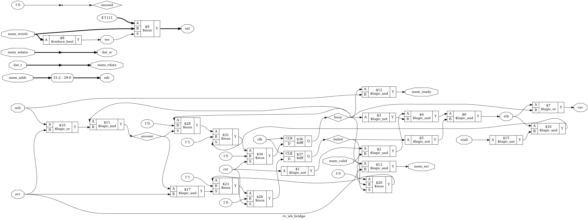

# Tutorial 26: The Core on the Bus

[Tutorial 21](../21-riscv-core/README.md) built a RISC-V core with one memory port, and
tested it against a memory written in the testbench. [Tutorial 22](../22-wishbone/README.md)
built a Wishbone bus, and [Tutorial 23](../23-axi4-lite/README.md) an AXI4-Lite register
block. This lesson joins them into one small system. The core fetches and runs its program
from a RAM on the bus, prints through the UART from [Tutorial 14](../14-uart/README.md),
lights LEDs through a GPIO register, times itself with a counter, and reads and writes the
AXI4-Lite block through a bridge. A bad address no longer goes unnoticed: it stops the
system with an access fault.

Finish Tutorials 21, 22 and 23 first. The memory-mapped UART is the one from
[Tutorial 19](../19-computer/README.md). Run these commands in a VS Code terminal, from this
directory:

```bash
cd tutorials/26-core-on-bus
```

To run everything at once, use `make all`. It took 4 minutes here, starting from `make clean`.

## The system

```text
                                                             +--> wb_ram       RAM, 64 KiB
 +-------+  native  +--------------+  Wishbone  +----------+ +--> wb_uart      Tutorial 14's UART
 | rv32i |--------->| rv_wb_bridge |----------->|    wb_   |-+--> wb_gpio      LEDs
 |       |<---------|              |<-----------| inter-   | +--> wb_counters  cycles, instret
 +-------+          +--------------+            | connect  | +--> wb_axil_bridge --AXI4-Lite--> axil_regs
     |                     | mem_err            +----------+       nobody: err from the default responder
     +--- trap <-----------+
```

[`rtl/soc.v`](rtl/soc.v) connects everything. These files are copied from earlier
tutorials, **unchanged**:

| File | From |
| ---- | ---- |
| `rtl/rv32i.v`, `rtl/rv_decode.v`, `rtl/rv_alu.v`, `rtl/rv_regs.v`, `rtl/enreg.v` | [Tutorial 21](../21-riscv-core/README.md), the core |
| `rtl/wb_interconnect.v`, `formal/wb_checker.v` | [Tutorial 22](../22-wishbone/README.md) |
| `rtl/axil_regs.v`, `formal/axil_checker.v` | [Tutorial 23](../23-axi4-lite/README.md) |
| `rtl/uart.v`, `rtl/uart_tx.v`, `rtl/uart_rx.v` | [Tutorial 14](../14-uart/README.md) |
| `tools/asm.py`, `tools/iss.py` | [Tutorial 21](../21-riscv-core/README.md), the assembler and the reference model |

`make all` here does not check that they still match the originals. `cmp` does:
`cmp rtl/rv32i.v ../21-riscv-core/rtl/rv32i.v` prints nothing when they are the same.

These are new:

| File | What it is |
| ---- | ---------- |
| [`rtl/rv_wb_bridge.v`](rtl/rv_wb_bridge.v) | The core's native interface to a Wishbone master |
| [`rtl/wb_axil_bridge.v`](rtl/wb_axil_bridge.v) | A Wishbone slave to an AXI4-Lite master |
| [`rtl/rv_axil_bridge.v`](rtl/rv_axil_bridge.v) | The native interface straight to AXI4-Lite. Not in the system: it is here to be measured |
| [`rtl/wb_ram.v`](rtl/wb_ram.v) | Tutorial 22's `wb_regfile`, made into a 64 KiB RAM loaded from a hex file |
| [`rtl/wb_uart.v`](rtl/wb_uart.v) | The UART with Tutorial 19's status and data registers |
| [`rtl/wb_gpio.v`](rtl/wb_gpio.v) | One 32-bit output register, for LEDs |
| [`rtl/wb_counters.v`](rtl/wb_counters.v) | Clock and instruction counters, so a program can time itself |
| [`rtl/soc_map.vh`](rtl/soc_map.vh) | The memory map, used by `soc.v` and by the proof |
| [`tools/pad_hex.py`](tools/pad_hex.py) | Pads `asm.py`'s output to 64 KiB, so `$readmemh` fills the whole RAM |

Every slave answers with `ack` on the clock after it takes a request, like `wb_regfile` with
`LATENCY` 1, and has the same `hold` input to make it stall. `soc.v` brings all the `hold`
inputs out as one port, so the testbenches can add wait states. Tie it to 0 in a real design.

## The memory map

| Byte address | Slave | Device | Registers |
| ------------ | ----- | ------ | --------- |
| `0x0000_0000` to `0x0000_FFFF` | 0 | RAM | Instructions and data. The program starts at 0 |
| `0x1000_0000` to `0x1000_0007` | 1 | UART | `+0` status: bit 0 transmitter ready, bit 1 byte waiting, bit 2 framing error, cleared by any write. `+4` data: read takes the waiting byte, write sends byte 0 |
| `0x1000_1000` to `0x1000_1003` | 2 | GPIO | `+0` `gpio_out`, read/write. Bits 7 to 0 are the LEDs |
| `0x1000_2000` to `0x1000_2007` | 3 | Counters | `+0` cycles since reset, `+4` instructions retired since reset. Read-only |
| `0x2000_0000` to `0x2000_001F` | 4 | AXI4-Lite bridge | Tutorial 23's `axil_regs`: `+0` to `+C` reg0 to reg3, `+10` ID, `4158494C`. Nothing from `+14` |
| Anything else | | | `err`, from the interconnect's default responder |

The regions are as small as the devices. `0x1000_0008` is not a second copy of the UART: it
is nobody's, and an access to it faults. A map that repeated devices through a large region
would need less decoding, but a stray pointer would then land on a real register instead of
being caught.

Two choices about read-only registers. The counters and the UART's status ignore writes, as
Tutorial 19's did. `axil_regs` refuses a write to ID with `SLVERR`, as Tutorial 23 built it,
and the bridge passes that on as `err`, so a store to ID faults. Both are legal. The second
tells the program it made a mistake.

## From the core to Wishbone

The core's interface and a Wishbone master port carry the same information:

| Native, from the core | Wishbone | Note |
| --------------------- | -------- | ---- |
| `mem_valid` | `cyc`, `stb` | `stb` is `mem_valid` while no answer is owed |
| `mem_addr[31:2]` | `adr` | Bits 1 and 0 are always 0 |
| `mem_wstrb` | `we`, `sel` | `we` is `mem_wstrb != 0`. A write's `sel` is `mem_wstrb`. A read asks for `1111` |
| `mem_wdata` | `dat_w` | The core already put the bytes in their lanes |
| `mem_ready`, `mem_rdata` | `ack`, `dat_r` | |
| (new) `mem_err` | `err` | |

Tutorial 21 said its memory interface would make this easy, and it does. The core copies a
byte to all four lanes and sets the one `mem_wstrb` bit for the lane it means, which is
exactly what Wishbone's `sel` is. So the bridge has no shifter and no table: `sel` is
`mem_wstrb`, wire for wire.

The request side of [`rtl/rv_wb_bridge.v`](rtl/rv_wb_bridge.v) has no flip-flops:

```verilog
assign stb   = !rst && mem_valid && !busy && !failed;
assign cyc   = stb || busy;
```

This works because of a rule from Tutorial 21: once `mem_valid` is high, the core holds
its request still until `mem_ready`. Wishbone asks the same of a stalled request. So the
core's own flip-flops hold the request, and the bridge only needs `busy`, set when the
request is taken and cleared by its answer, so that one transfer makes one request.
`failed` is for errors, below. The schematic at the end shows the whole bridge: two
flip-flops and a handful of gates.

A bridge that put the request in flip-flops first would be easier to time, but would add a
clock to every access. Here an access to a slave that answers on the next clock takes 2
clocks, one wait state, the same as Tutorial 21's "one wait, like a block RAM" memory.

The answer side is wires too: `mem_ready = busy && ack`, and `mem_rdata = dat_r`. So the
path from a slave's `ack` flip-flop runs through the interconnect, the bridge and the core's
load logic into its register file in one clock. Nothing here measured whether that is fast
enough on a real part.

### Bytes and halfwords on the bus

`programs/lanes.asm` builds one word from bytes and halfwords on three targets: a word of
RAM, the GPIO register, and AXI4-Lite reg0. It checks each step with every kind of load,
then reads the ID register a byte at a time and prints it. `make sim` prints each store as
the bus sees it. These are the AXI4-Lite ones:

```text
  store to 20000000: mem_wstrb 1111, sel 1111, dat_w 00000000
  AXI4-Lite W:  wstrb 1111, wdata 00000000, to awaddr 20000000
  store to 20000000: mem_wstrb 0001, sel 0001, dat_w 11111111
  AXI4-Lite W:  wstrb 0001, wdata 11111111, to awaddr 20000000
  store to 20000000: mem_wstrb 0010, sel 0010, dat_w 22222222
  AXI4-Lite W:  wstrb 0010, wdata 22222222, to awaddr 20000000
  store to 20000000: mem_wstrb 0100, sel 0100, dat_w 33333333
  AXI4-Lite W:  wstrb 0100, wdata 33333333, to awaddr 20000000
  store to 20000000: mem_wstrb 1000, sel 1000, dat_w f4f4f4f4
  AXI4-Lite W:  wstrb 1000, wdata f4f4f4f4, to awaddr 20000000
  store to 20000000: mem_wstrb 0011, sel 0011, dat_w 88998899
  AXI4-Lite W:  wstrb 0011, wdata 88998899, to awaddr 20000000
  store to 20000000: mem_wstrb 1100, sel 1100, dat_w 66776677
  AXI4-Lite W:  wstrb 1100, wdata 66776677, to awaddr 20000000
```

`mem_wstrb`, `sel` and `wstrb` are the same four bits at every step. `sb` puts its byte in all
four lanes of `dat_w`, so the slave can take it from the lane `sel` names without any
shifting. The ID is `4158494C`, and `lbu` at offsets 3, 2, 1 and 0 gives `A`, `X`, `I` and
`L`: the program prints `AXIL`, so reads pick the right lane too.

## From Wishbone to AXI4-Lite

[`rtl/wb_axil_bridge.v`](rtl/wb_axil_bridge.v) is a Wishbone slave on one side and an
AXI4-Lite master on the other. It takes one request at a time:

- A write becomes an AW and a W, offered together. `awaddr` is `{adr, 2'b00}`, `wdata` is
  `dat_w` and `wstrb` is `sel`. The B response is the answer.
- A read becomes an AR. The R response is the answer, with `rdata` as `dat_r`.
- `OKAY` becomes `ack`. `SLVERR` and `DECERR` become `err`.
- The next request stalls until the answer is out.

The valids come from flip-flops, so they hold still until taken whatever the Wishbone side
does, as AXI requires. They are also gated by `rst`. The first proof of this bridge failed
on Tutorial 23's rule M1, no valid during reset: a synchronous reset only clears a flip-flop
at the end of the first reset clock, and for that one clock `arvalid` was still high.

If the master drops `cyc` while the AXI side is busy, the AXI transaction cannot be
cancelled. The bridge lets it finish and throws its answer away. The core never does this,
but the proof's master may.

## Which path to AXI4-Lite?

There were two ways to reach `axil_regs`: through Wishbone and this second bridge, or with a
bridge from the native interface straight to AXI4-Lite,
[`rtl/rv_axil_bridge.v`](rtl/rv_axil_bridge.v). Both were built, proved and timed.
[`tb/tb_paths.v`](tb/tb_paths.v) drives each path the way the core does, 32 writes and then
32 reads back to back, and counts clocks from the first clock of a request to the edge that
ends it:

```text
A  Wishbone to wb_ram:                writes 2.00 clocks each, reads 2.00 clocks each
B  Wishbone to AXI4-Lite axil_regs:   writes 4.00 clocks each, reads 3.00 clocks each
C  AXI4-Lite axil_regs, direct:       writes 3.00 clocks each, reads 2.00 clocks each
```

| Path | Write | Read |
| ---- | ----- | ---- |
| Tutorial 21's memory with no wait, from its README | 1 | 1 |
| A: Wishbone to `wb_ram` | 2 | 2 |
| B: Wishbone, then AXI4-Lite to `axil_regs` | 4 | 3 |
| C: AXI4-Lite straight to `axil_regs` | 3 | 2 |

The first row is Tutorial 21's mode 0, where `mem_ready` came in the first clock of
`mem_valid`. Path B is one clock slower than C on every access: the Wishbone bridge takes the
request at the first edge, and the AXI valids come from its flip-flops a clock later. A
write costs one more than a read on both AXI paths, because `axil_regs` with `BUFFERED`
1 takes AW and W into its buffers at one edge and does the write at the next.

This system uses path B anyway:

- **One bus.** RAM, UART, GPIO and counters are all Wishbone slaves from Tutorial 22's
  family, and Tutorial 22's interconnect and proof already exist. With path C, the core would
  need a decoder in front of two bridges, or every slave would need an AXI4-Lite port.
- **The cost falls only on AXI4-Lite.** Fetches and RAM never pay it. Registers of vendor IP
  are read rarely compared with instructions.
- **The later lessons add masters to one bus.** Tutorial 29's DMA engine shares the bus with
  the core, and one arbiter in front of one interconnect is simpler than two.

## Bus errors become traps

The core is Tutorial 21's, unchanged, and has no input for a failed access. There were two
choices:

- **Ignore `err`.** Treat it as `ack`, and hand the core whatever `dat_r` holds. This is what
  PicoRV32's own Wishbone and AXI adapters do: they do not look at `err` or the response
  codes. A load from a bad pointer returns junk, a store vanishes, and the program carries on.
- **Stop with a trap.** This is what this lesson does. Tutorial 21's traps already say what a
  trap means: the instruction did not finish, nothing it would have changed has changed, and
  `pc` points at it.

The bridge makes the second one possible without touching the core. On `err` it raises
`mem_err` for one clock and does not raise `mem_ready`. The core goes on waiting, with
`mem_valid` high, so the instruction never retires and changes nothing. The bridge then
sends nothing more until `mem_valid` falls, which this core never does:

```verilog
if (answer && err)
    failed <= 1'b1;
else if (!mem_valid)
    failed <= 1'b0;
```

`soc.v` latches the first `mem_err` and turns it into a trap, with the standard `mcause`
code from what the core was doing:

| Code | Cause | When |
| ---- | ----- | ---- |
| 1 | Instruction access fault | `mem_instr` was high |
| 5 | Load access fault | `mem_wstrb` was `0000` |
| 7 | Store access fault | otherwise |

The core's own traps come out on the same `trap` and `trap_cause`, with their own codes. A
misaligned access still traps as misaligned, cause 4 or 6, since the core never puts it on
the bus. For a fetch fault, `retire_pc` is the address that failed, and `retire_instr` is still
the jump that went there.

`programs/fault.asm` prints a line, then loads from `0x30000000`. `programs/readonly.asm`
prints a line, then stores to the ID register. `make sim` prints:

```text
fault.asm, mode 0: printed "load from 0x30000000\n", trap cause 5 at pc 00000010, instr 000e2e83
readonly.asm, mode 0: printed "write to the ID register\n", trap cause 7 at pc 00000018, instr 01c92823
```

`000E2E83` is `lw t4, 0(t3)` at `0x10`, and `01C92823` is `sw t3, 0x10(s2)` at `0x18`, from
`python3 tools/asm.py programs/fault.asm /dev/null --list`. Neither program printed its
`not trapped` line.

Tutorial 27 adds the machine-mode CSRs. Then `mem_err` becomes an input to the core, the
trap becomes a jump to `mtvec` with the cause in `mcause`, and the latch in `soc.v` goes
away. The bridge already allows for that: a core that handles errors must drop `mem_valid`
for at least one clock after `mem_err`, and the bridge takes new requests again.

## Counting clocks

[`rtl/wb_counters.v`](rtl/wb_counters.v) has two counters: `cycles` counts clocks since
reset, and `instret` counts the core's `retire` pulses. RISC-V keeps the same two numbers in
CSRs, `mcycle` and `minstret`. This core has no CSRs yet, so here they are a peripheral.

`programs/cpi.asm` times six loops of 100 iterations. Each loop is three instructions: the one
under test, then `addi` and `bnez`. It reads `cycles` and `instret` before and after, divides
with a shift-and-subtract routine, since RV32I has no divide, and prints:

```text
alu    913 clocks, 303 instructions, CPI 3.01
ram r  1113 clocks, 303 instructions, CPI 3.67
ram w  1113 clocks, 303 instructions, CPI 3.67
gpio r 1113 clocks, 303 instructions, CPI 3.67
axi r  1213 clocks, 303 instructions, CPI 4.00
axi w  1313 clocks, 303 instructions, CPI 4.33
```

Each window has 303 instructions: the 300 of the loop, plus three that start and stop the
count. The testbench counts clocks and retires on its own between the same two reads, works
out the line it expects, and fails if the program printed anything else.

Read the loops as 300 instructions, two thirds of them `addi` and `bnez` at 3 clocks each:

- `alu`: every instruction takes 3 clocks, 2 to fetch and 1 to execute.
- `ram r`, `ram w`, `gpio r`: the load or store takes 5, 3 plus 2 for its own transfer.
  RAM and GPIO cost the same, since both answer on the next clock.
- `axi r`: the load takes 6, one more for the AXI4-Lite read.
- `axi w`: the store takes 7, two more.

## Clocks per instruction, with the bus and without

`make sim` times every instruction of every program, by class. These are the five programs,
with every slave answering on the next clock (mode 0), next to what Tutorial 21's memory with
no wait would have taken for the same instructions:

| Class | Count | Clocks each on this bus | Tutorial 21's memory, no wait |
| ----- | ----- | ----------------------- | ----------------------------- |
| ALU, registers | 2244 | 3.00 | 2 |
| ALU, immediate | 16706 | 3.00 | 2 |
| `lui`, `auipc` | 178 | 3.00 | 2 |
| `jal`, `jalr` | 648 | 3.00 | 2 |
| Branches | 9597 | 3.00 | 2 |
| Loads from RAM | 520 | 5.00 | 3 |
| Stores to RAM | 226 | 5.00 | 3 |
| Loads from a Wishbone peripheral | 4552 | 5.00 | 3 |
| Stores to a Wishbone peripheral | 354 | 5.00 | 3 |
| Loads from AXI4-Lite | 114 | 6.00 | 3 |
| Stores to AXI4-Lite | 107 | 7.00 | 3 |
| All | 35246 | 3.34 | 2.17 |

With every slave stalling at random (mode 1), the same programs took 3.72 clocks per
instruction in all, against 2.16 with no wait for that run's mix. Tutorial 21's own table had
3.34 for its "one wait, like a block RAM" memory: the same cost as this bus, for a
different set of programs.

The fetch is the cost. Every instruction now takes one more clock to fetch, and every load
and store one more for its data. The program mix here is mostly the UART polling loop and
`cpi.asm`'s loops. The testbench also fails if any single transfer takes a different number
of clocks from this table, with no stalls:

| Transfer | Clocks |
| -------- | ------ |
| Fetch, load or store, RAM or a Wishbone peripheral | 2 |
| Load from AXI4-Lite | 3 |
| Store to AXI4-Lite | 4 |

Tutorial 30's instruction cache is the answer to the first column: a hit can come back in
the same clock.

## Simulate

[`tb/tb_soc.v`](tb/tb_soc.v) runs every program on the whole system and judges it by what
comes out: the bytes on `uart_tx`, decoded at bit level as in Tutorial 19, how it stopped,
and a few registers at the end. It runs each program twice. In mode 0 no slave ever stalls.
In mode 1 a pseudo-random sequence drives `hold`, so each slave stalls on about one clock in
four, and every program must print the same thing and stop the same way.

```bash
make sim
```

It ends with `PASS` twice: once for the system, and once for [`tb/tb_paths.v`](tb/tb_paths.v),
the three paths above. In mode 1, `cpi.asm` prints larger numbers, which are checked the same
way:

```text
alu    1009 clocks, 303 instructions, CPI 3.33
ram r  1276 clocks, 303 instructions, CPI 4.21
ram w  1230 clocks, 303 instructions, CPI 4.05
gpio r 1235 clocks, 303 instructions, CPI 4.07
axi r  1335 clocks, 303 instructions, CPI 4.40
axi w  1498 clocks, 303 instructions, CPI 4.94
```

## View the waveform

Use a fresh simulation, since `make verilator` writes the same file. Only the first pass,
without stalls, is recorded, and only the signals used below, which keeps the file to
about 34 MB. Verilator ignores `$dumpoff` and records both passes. For every signal,
change `tb/tb_soc.v` to `$dumpvars(0, tb_soc)`, which gives over 100 MB.
Outside the recorded part every signal, even `clk`, shows as `x`, drawn in red. That is
what `$dumpoff` writes, not the design.

```bash
make sim
```

Open `build/tb_soc.vcd` as in [Tutorial 1](../01-d-flip-flop/README.md). From `tb_soc`, add
`clk`, `trap`, `trap_cause` and `retire_pc`. From `dut`, add `mem_valid`, `mem_instr`,
`mem_addr`, `mem_ready`, `mem_err`, `m_stb` and `m_err`, and from `dut.u_bridge`, `busy` and
`failed`. The clock rises at 5, 15, 25 ns and so on. A value is taken at the rising edge that
sees it, one clock after it first shows on the trace.

**The access fault in `fault.asm`**, from 78460 ns, in mode 0:

- At 78465 ns `mem_valid` and `m_stb` rise with a fetch from `0x10`, the `lw` at `bad`. The
  edge at 78475 ns takes the request, `busy` rises, and so does `mem_ready`, from the RAM's
  `ack`. The edge at 78485 ns ends the fetch. `mem_valid` is low for one clock, `EXECUTE`.
- At 78495 ns `mem_valid` rises again, with `mem_instr` low and `mem_addr` `30000000`, and
  `m_stb` follows it. The edge at 78505 ns takes the request: the interconnect's default
  responder owns it, and `m_err` and `mem_err` rise. `mem_ready` stays low.
- At the edge at 78515 ns `failed` rises, `busy` falls, and `trap` rises with `trap_cause`
  5. `retire_pc` is still `0x10`. `mem_valid` stays high from then on, since the core is still
  waiting, but `m_stb` stays low: nothing more goes on the bus.

The fetch of `0x10` shows the cost of the bus too: `mem_valid` is high for two clocks before
the transfer, where Tutorial 21's fastest memory needed one.

## Lint and Verilator

```bash
make lint
make verilator
```

`make lint` checks the whole system, then each new module on its own. Any warning starts
with `%Warning`. `make verilator` runs both testbenches again under Verilator and prints the
same results line for line.

## Test in Python

[`tb/test_soc.py`](tb/test_soc.py) runs the system in lockstep with the reference model, with
the real bus in the loop. [`tb/lockstep.py`](tb/lockstep.py) is Tutorial 21's checker, changed
for a real bus:

- **The memory is the system's own.** The checker no longer answers the core. It watches the
  core's interface, and on every falling edge it raises each slave's `hold` with a chance of
  0.3, so every slave adds random wait states.
- **The model knows the map.** [`tb/soc_model.py`](tb/soc_model.py) gives Tutorial 21's
  `Iss`, unchanged, a memory with the same map as `soc_map.vh`: RAM, the GPIO register, the
  four AXI4-Lite registers and ID. Before each instruction it checks whether the fetch or an
  aligned load or store would get `err`, and if so it stops with cause 1, 5 or 7.
- **What cannot be predicted is copied.** The UART status and the counters change with time,
  and the model has no clock. So the checker copies every word the bus returns from those two
  devices into the model before the model runs the instruction. Everything else, including
  the GPIO and AXI4-Lite registers, the model works out for itself.
- **The Wishbone port is checked too.** Between the bridge and the interconnect, the checker
  applies Tutorial 22's rules on every clock: `stb` only with `cyc`, a stalled request held
  still, never `ack` and `err` together, and never an answer with nothing owed.

```bash
make cocotb
```

Look for `TESTS=2 PASS=2 FAIL=0`, and these lines:

```text
loads and stores that finished, by device: axil 224, counters 24, gpio 122, ram 748, uart 4233
directed: 28 programs, 16716 stalled requests: 33970 instructions, 54 classes, rarest class ILLEGAL with 1
loads and stores that finished, by device: axil 443, gpio 152, ram 2211
random, 200 programs, 140 ended in a trap, 47 of them access faults, 12555 stalled requests: 26963 instructions, 74 classes, rarest class LBU@1 with 24
```

`directed_programs` runs everything in `programs/`, then 23 small programs that each stop
in a different way: every kind of access fault, a store to ID, a hole in the UART's region
and in the AXI4-Lite block, a jump to nowhere, the core's own traps, and three that end in
`ebreak`: they read ID, write bytes of the GPIO register, and run code fetched from an AXI4-Lite register.

`random_programs` is Tutorial 21's random test, with loads and stores spread over the bus.
Two base registers point into RAM, one at the AXI4-Lite block and one at the GPIO register.
Some offsets fall into holes, so some programs end in an access fault, and `jalr` to a random
address usually ends in a fetch fault. The test fails if any of Tutorial 21's classes of
instruction never ran.

## Prove it with formal verification

[`bus.sby`](bus.sby) has eight tasks, a proof and a cover run for each of four designs:

| Task | Proves |
| ---- | ------ |
| `wb_bridge` | `rv_wb_bridge`: Tutorial 22's `wb_checker` on its Wishbone port, as master. One Wishbone request per transfer, matching it field by field, with `sel` as described above. A transfer ends only with its own answer, never `mem_ready` and `mem_err` together, and nothing is sent after an `err` |
| `wb_axil` | `wb_axil_bridge`: `wb_checker` on the Wishbone side, as slave, and Tutorial 23's `axil_checker` on the AXI side, as master. The AXI request matches the Wishbone one. `OKAY` is `ack` |
| `axil_direct` | `rv_axil_bridge`: `axil_checker` as master, and the same promises to the core as `wb_bridge` |
| `map` | Tutorial 22's interconnect with this map from `soc_map.vh`: all of Tutorial 22's checks, no regions overlap, and every request reaches the slave a second, independent decode says owns it |

```bash
make formal
```

Look for `DONE (PASS, rc=0)` for each, and the last line, `8 tasks passed`. They took
8 seconds or less each here.

The core's side is assumed, not proved here: the bridges assume Tutorial 21's rules, that
`mem_valid` is low after reset and that a request holds still until it ends. Tutorial 21
proved that its core keeps them.

`axil_checker` has only safety rules. To prove that a Wishbone answer always comes, the
`wb_axil` task assumes the AXI slave is quick: it takes a valid within 3 clocks and responds
within 3 clocks of its request. These assumptions are about the slave alone. A bridge that
never offered a request would still fail the Wishbone checker's rule S5.

The covers show each proof is not empty: a read and a write done, back-to-back transfers, a
stalled request, an `err` and the wait after it, `SLVERR` and `DECERR`, AW taken before W and
the other way round, an orphaned response thrown away, and a request to each region of the
map and to the hole after it.

### What is not proved

- **The whole system.** Each bridge and the map are proved on their own. That they work
  together, with the core, is shown by simulation only.
- **The peripherals.** `wb_ram`, `wb_uart`, `wb_gpio` and `wb_counters` are tested by the
  simulations, not proved. They follow `wb_regfile`, which Tutorial 22 proved.
- **Timing.** The combinational path from a slave's `ack` to the core's register file is
  long, and nothing here measured it.

## See the logic

```bash
make schematic
```

The whole system would be unreadable, so this draws the bridge from the core to Wishbone.
Click `build/rv_wb_bridge.png` in the Explorer:



- Along the top, nothing but wiring: `mem_addr` sliced to `adr`, `mem_wdata` to `dat_w`,
  `dat_r` to `mem_rdata`. `$8`, a `$reduce_bool`, makes `we` from `mem_wstrb`, and the `$9`
  multiplexer picks `mem_wstrb` or `4'1111` for `sel`.
- In the middle, the only two flip-flops, `busy` (`$36`) and `failed` (`$37`), each with its
  multiplexers for reset, set and clear.
- `stb` is `$6`: `mem_valid` and not `rst` (`$2`), not `busy` (`$3`, `$4`) and not `failed`
  (`$5`). `cyc` is `$7`, `stb` or `busy`.
- `mem_ready` is `$12`, `ack` and `busy`. `mem_err` is `$13`, `err` and `busy`.

## Map it to real FPGAs

```bash
make synth
```

The bridges alone, on Xilinx:

| Bridge | Flip-flops | Total cells |
| ------ | ---------- | ----------- |
| `rv_wb_bridge` | 2 `FDRE` | 14 |
| `wb_axil_bridge` | 72 `FDRE` | 90 |
| `rv_axil_bridge` | 4 `FDRE` | 18 |

`wb_axil_bridge` holds a copy of the request for the AXI side. 72 is 30 bits of address, 32
of data, 4 of strobes and 6 of state, so Yosys appears to have kept one copy of `awaddr` and
`araddr`, which always match, without the two low bits, which are always 0. `rv_axil_bridge`
keeps no copy, because the core holds its request still. That, and the clock, is what Wishbone in the middle costs.

The whole system, with `hello.asm` in its RAM:

| Family | Flip-flops | RAM blocks | Total cells |
| ------ | ---------- | ---------- | ----------- |
| Xilinx | 1685 `FDRE`, 4 `FDSE` | 16 `RAMB36E1` | 4581 |
| Gowin | 1689 (`DFF`, `DFFE`, `DFFR`, `DFFRE`, `DFFS`, `DFFSE`) | 32 `SP` | 16246 |
| Cyclone V | 1691 `MISTRAL_FF` | 64 `MISTRAL_M10K` | 4698 |

The 64 KiB RAM went into block RAM on all three. Tutorial 21's core alone had 1134
flip-flops, so the bus, the bridges and the peripherals add about 550. Xilinx and Gowin
totals include 46 `$scopeinfo` entries, which are bookkeeping, not cells. For Gowin, Yosys
printed four warnings from its own block RAM library, at `brams_map.v:114`, that a range
select on `PORT_A_WR_DATA` was out of bounds, while it mapped the RAM's byte writes. They were not looked
into, and nothing here was run on a Gowin part. These are Yosys counts, so vendor tools can
give different results, and they say nothing about timing.

## Using these modules later

Tutorials 27 to 31 build on this system. These are the places they plug in:

- **Interrupts and CSRs, Tutorial 27.** The core gets `mem_err` as an input, and a fault
  becomes a jump to `mtvec`. The latch in `soc.v` goes. The bridge needs no change, as long as
  the core drops `mem_valid` for a clock after `mem_err`. The timer is a new Wishbone slave:
  add it to `soc_map.vh`, raise `SOC_SLAVES`, and run `make formal` to prove the new map.
  `0x1000_3000` is free. Its interrupt line goes to the core, not over the bus.
- **The SPI flash, Tutorial 28.** Tutorial 24's controller becomes one more Wishbone slave in
  the same way, at `0x1000_4000` say. A boot ROM is one more region, so the reset address,
  `RESET_ADDR` in `rv32i.v`, can point at it.
- **A second master, Tutorial 29.** The DMA engine needs an arbiter between two Wishbone
  masters, in front of `wb_interconnect`'s master port. `rv_wb_bridge` already behaves as a
  master that keeps `cyc` high only for its own transfers.
- **The instruction cache, Tutorial 30.** It sits between the core and `rv_wb_bridge`, on the
  native interface, and serves hits without a bus request.

What each new module promises:

**`rv_wb_bridge`**: native interface in, Wishbone B4 pipelined master out. One request per
transfer, at most one in flight. 2 clocks per access to a slave that answers on the next
clock. `mem_err` for one clock on `err`, then nothing until `mem_valid` falls.

**`wb_axil_bridge`**: Wishbone slave in, AXI4-Lite master out. One request at a time.
`OKAY` is `ack`, `SLVERR` and `DECERR` are `err`. Adds 1 clock to a read and 2 to a write
with `axil_regs`.

**`rv_axil_bridge`**: native interface in, AXI4-Lite master out, with `mem_err` as above.

## Try it yourself

Make each change, then run `make sim`, `make cocotb` and `make formal`. Undo each change
before trying the next. Every result below was observed. A `formal` column lists the tasks
that failed. All the others passed.

**Bugs every check catches.**

| Change | `sim` | `cocotb` | `formal` fails |
| ------ | ----- | -------- | -------------- |
| In `rv_wb_bridge.v`, build `sel` from the wrong bits: `{mem_wstrb[0], mem_wstrb[3:1]}` in place of `mem_wstrb` | `hello.asm` printed `""`, and so did every program | `LOCKSTEP FAILED in cpi.asm, instruction 1473: x10 is 00000030, and the model has 00000031` | `wb_bridge`, on `assert (sel == (we ? mem_wstrb : 4'b1111))` |
| In `wb_axil_bridge.v`, drop the `ack` of every write: add `&& !writing` to `assign ack` | `lanes.asm: no trap after 500000 clocks`, and the same for `cpi.asm` | `nothing retired for 100 clocks` | `wb_axil`, on the link `f_wb_out == {3'd0, busy}`, and `wb_axil_cover` cannot reach `ack && writing` |
| In `wb_axil_bridge.v`, swap the halves of `wstrb`: `wstrb <= {sel[1:0], sel[3:2]};` | `lanes.asm left AXI4-Lite reg0 at 2211f433`, and it ended in `ecall`, its own check failing | `lanes.asm, instruction 123: x6 is 2211f433, and the model has f4332211` | `wb_axil`, on `assert (wdata == f_dat && wstrb == f_sel)` |
| In `rv_wb_bridge.v`, send a request twice: remove `&& !busy` from `assign stb` | `a transfer to 00000018 took 1 clocks, not 2`, then programs end in illegal instructions, cause 2 | `the system trapped with cause 2, and the model did not` | `wb_bridge`, on `assert (mem_valid && f_sent == 2'd1)` |

In the first, the UART takes only byte 0 of a write. `sb` sets `mem_wstrb` to `0001`, the
wrong `sel` became `1000`, and every byte sent to the UART vanished. A store to RAM went to the
wrong byte. In the last, the second request's `ack` arrived while the core was waiting for
its next fetch, and ended that fetch a clock early with the wrong word.

**An error ignored.** In `rv_wb_bridge.v`, replace `assign mem_ready = busy && ack;` with
`assign mem_ready = busy && (ack || err);`, so an `err` also finishes the transfer, as
PicoRV32's adapters do. `make sim` fails:

```text
FAIL build/fault.hex trapped at pc=00000014 instr=000e2e83, not pc=00000010 instr=000e2e83
FAIL build/readonly.hex trapped at pc=0000001c instr=01c92823, not pc=00000018 instr=01c92823
```

The system still trapped, with the right cause, because `soc.v` still latched `mem_err`. But
the load had already retired and written junk to `t4`, and `pc` had moved on: the trap is no
longer precise. `make cocotb` fails with `fault.asm, instruction 858: the model trapped with
cause 5, and the core retired`. `make formal` fails `wb_bridge` on
`assert (!(mem_ready && mem_err))`. Without the latch, nothing would have noticed at all.

**A bug only the UART line shows.** In `soc.v`, connect the UART's `adr` to `s_adr[1]` in
place of `s_adr[0]`, the wrong address bit. Now both UART registers are the status register.

| Check | Result |
| ----- | ------ |
| `make sim` | `FAIL build/hello.hex printed ""`, and the same for every program that prints |
| `make cocotb` | `TESTS=2 PASS=2 FAIL=0` |
| `make formal` | `8 tasks passed` |

Every program still ran correctly, instruction by instruction: a status read still says the
transmitter is ready, and a write to it is ignored. The lockstep test copies UART reads from
the bus and never looks at `uart_tx`, so it agreed. The proofs cover the bridges and the
interconnect, and the interconnect still sent each request to the UART. Only the testbench
that decodes the serial line saw that nothing came out.

**A bug the programs miss.** This one happened by accident while this lesson was written. The
first copy of `rv32i.v` was taken while Tutorial 21's file held one of its own experiments:
`less : less` in place of `less : less_u` in `compare`, so `bltu` and `bgeu` compare as
signed. To see it again, make that change in `rtl/rv32i.v`:

| Check | Result |
| ----- | ------ |
| `make sim` | `PASS`, for all five programs in both modes |
| `make cocotb` | `random program 4, instruction 59: pc is 00000140, and the model has 000000ec` |
| `make formal` | `8 tasks passed`. These proofs do not include the core |
| `make lint` | `%Warning-UNUSEDSIGNAL: rtl/rv32i.v:142:10: Signal is not used: 'less_u'` |

The only `bltu` in the programs is in `cpi.asm`'s divide, where both numbers are small and
positive, so signed and unsigned agree. The random program compared `ffffffff` with
`77a5a9a0`, where they do not. The lint warning was the first sign. At first it looked like
a quirk of Verilator, until the lockstep test failed. Afterwards, `cmp` showed the copy
differed from Tutorial 21's file, which by then was back to `less_u`.
