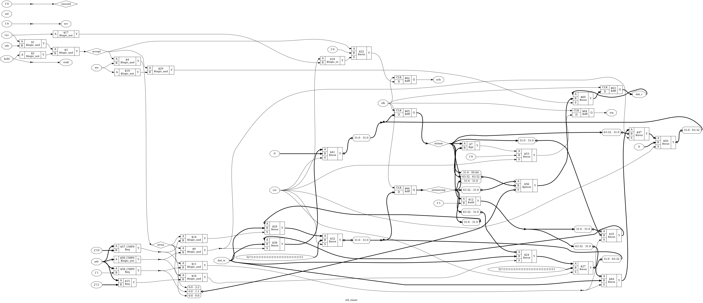

# Tutorial 27: Timer and Interrupts

[Tutorial 26](../26-core-on-bus/README.md) put the RISC-V core on a bus. When anything went
wrong, a bad address or an illegal instruction, the system stopped, and only reset got it
going again. And the only way to wait for the UART was to read its status register again and
again, as [Tutorial 19](../19-computer/README.md) did.

This lesson gives the core machine mode, from the RISC-V privileged specification: the
control and status registers (CSRs) it needs, instructions to read and write them, traps
that jump to a handler and come back with `mret`, and interrupts. A timer peripheral raises
one interrupt, the UART the other. Then it measures what an interrupt costs against polling.

And programs are now written in C. The Docker image has a RISC-V GCC, and this lesson
explains the three small files that stand between C and this system: the startup code, the
linker script, and the step that turns the compiler's output into a RAM image.

Finish Tutorials 21 and 26 first. Run these commands in a VS Code terminal, from this
directory:

```bash
cd tutorials/27-interrupts
```

To run everything at once, use `make all`. It took 12 minutes 29 seconds here, starting from
`make clean`, while other jobs shared the machine. More than half of it is the proofs.

## The system

```text
                                                              +--> wb_ram       RAM, 64 KiB
 +-------+  native  +--------------+  Wishbone  +----------+  +--> wb_uart  ----------+ irq: a byte is waiting
 | rv32i |--------->| rv_wb_bridge |----------->|    wb_   |--+--> wb_gpio            |
 | +CSRs |<---------|              |<-----------| inter-   |  +--> wb_counters        |
 +-------+  mem_err +--------------+            | connect  |  +--> wb_timer   ------+ | irq: mtime >= mtimecmp
   ^   ^                                        +----------+  +--> wb_axil_bridge --> axil_regs
   |   +-- irq_external <--------------------------------------------------------------+
   +------ irq_timer    <------------------------------------------------------------+
```

The interrupt lines go straight to the core, not over the bus. [`rtl/soc.v`](rtl/soc.v)
connects everything. These files are copied from earlier tutorials, **unchanged**:

| File | From |
| ---- | ---- |
| `rtl/rv_alu.v`, `rtl/rv_regs.v`, `rtl/enreg.v` | [Tutorial 21](../21-riscv-core/README.md) |
| `rtl/rv_wb_bridge.v`, `rtl/wb_ram.v`, `rtl/wb_gpio.v`, `rtl/wb_counters.v`, `rtl/wb_axil_bridge.v` | [Tutorial 26](../26-core-on-bus/README.md) |
| `rtl/wb_interconnect.v`, `formal/wb_checker.v` | [Tutorial 22](../22-wishbone/README.md) |
| `rtl/axil_regs.v` | [Tutorial 23](../23-axi4-lite/README.md) |
| `rtl/uart.v`, `rtl/uart_tx.v`, `rtl/uart_rx.v` | [Tutorial 14](../14-uart/README.md) |
| `tools/pad_hex.py` | Tutorial 26 |

`cmp` checks a copy: `cmp rtl/rv_alu.v ../21-riscv-core/rtl/rv_alu.v` prints nothing when
they are the same. `rv_wb_bridge.v`'s comments still describe Tutorial 26, where the core did
not know about `mem_err`. Its logic needed no change, as Tutorial 26 promised.

These are copied and **changed**:

| File | Change |
| ---- | ------ |
| [`rtl/rv32i.v`](rtl/rv32i.v) | Machine mode. The next section lists every change |
| [`rtl/rv_decode.v`](rtl/rv_decode.v) | Two new outputs, `is_csr` and `is_mret`, which are no longer illegal, and a CSR instruction writes `rd` |
| [`rtl/wb_uart.v`](rtl/wb_uart.v) | One new output, `irq`: status bit 1, a byte is waiting |
| [`rtl/soc.v`](rtl/soc.v) | The fault latch is gone, `mem_err` goes to the core, the timer is slave 5, and the two interrupt lines |
| [`rtl/soc_map.vh`](rtl/soc_map.vh), [`formal/map_check.v`](formal/map_check.v) | The timer in the map |
| [`tools/asm.py`](tools/asm.py), [`tools/test_asm.py`](tools/test_asm.py) | The CSR instructions and `mret` |
| [`tools/iss.py`](tools/iss.py) | The CSRs, the new instructions, real traps, and interrupts |
| [`formal/insn_check.v`](formal/insn_check.v), [`insn.sby`](insn.sby) | Tutorial 21's proofs, extended to all of the above |
| [`tb/`](tb) | Rewritten around programs, traps and interrupts |

And these are new:

| File | What it is |
| ---- | ---------- |
| [`rtl/rv_csr.v`](rtl/rv_csr.v) | The CSRs |
| [`rtl/wb_timer.v`](rtl/wb_timer.v) | The machine timer: `mtime`, `mtimecmp` and its interrupt line |
| [`sw/crt0.S`](sw/crt0.S), [`sw/link.ld`](sw/link.ld), [`sw/soc.h`](sw/soc.h), [`sw/lib.c`](sw/lib.c) | What C needs to run here |
| [`tools/bin2hex.py`](tools/bin2hex.py) | The compiler's binary to a `.hex` file for the RAM |
| [`programs/`](programs) | Two assembly tests and four C programs |

## The memory map

The timer is the only new region. It sits at `0x1000_3000`, where Tutorial 26 left room.

| Byte address | Slave | Device | Registers |
| ------------ | ----- | ------ | --------- |
| `0x0000_0000` to `0x0000_FFFF` | 0 | RAM | Instructions and data. The program starts at 0 |
| `0x1000_0000` to `0x1000_0007` | 1 | UART | `+0` status: bit 0 transmitter ready, bit 1 byte waiting, bit 2 framing error. `+4` data |
| `0x1000_1000` to `0x1000_1003` | 2 | GPIO | `+0` `gpio_out` |
| `0x1000_2000` to `0x1000_2007` | 3 | Counters | `+0` cycles, `+4` instructions retired. Read-only |
| `0x1000_3000` to `0x1000_300F` | 5 | Timer | `+0` `mtime` low, `+4` `mtime` high, `+8` `mtimecmp` low, `+C` `mtimecmp` high |
| `0x2000_0000` to `0x2000_001F` | 4 | AXI4-Lite bridge | `axil_regs`: reg0 to reg3, ID at `+10` |
| Anything else | | | `err`: an access fault |

The timer is slave 5, not 3, so that slaves 0 to 4 keep Tutorial 26's numbers.

## Machine mode in one page

RISC-V has privilege levels. Machine mode is the highest, and the only one every core must
have. This core has nothing else, so it runs in machine mode all the time. What machine mode
adds is in the RISC-V privileged specification. This lesson takes only what it needs from it.

**CSRs.** A separate space of 4096 registers, read and written by their own instructions.
[`rtl/rv_csr.v`](rtl/rv_csr.v) has these:

| Number | Name | What it holds here |
| ------ | ---- | ------------------ |
| `0x300` | `mstatus` | `MIE` (bit 3): interrupts on. `MPIE` (bit 7): what `MIE` was before the last trap. `MPP` (bits 12 and 11) reads `11`, machine mode |
| `0x304` | `mie` | Which interrupts are enabled: `MTIE` (bit 7) the timer, `MEIE` (bit 11) external |
| `0x344` | `mip` | Which are pending: `MTIP` (bit 7) and `MEIP` (bit 11). The two lines themselves. Writes are ignored |
| `0x305` | `mtvec` | The address of the trap handler. Bits 1 and 0 read 0 |
| `0x341` | `mepc` | Where the trap happened. Bits 1 and 0 read 0 |
| `0x342` | `mcause` | Why. Bit 31 is 1 for an interrupt. Bits 3 to 0 the code |
| `0x343` | `mtval` | The bad address, or the bad instruction, or 0 |
| `0x340` | `mscratch` | 32 bits for the handler's own use |
| `0x301` | `misa` | Reads `40000100`: 32 bits, the I set. Writes are ignored |
| `0x310`, `0xF11` to `0xF15` | `mstatush`, `mvendorid`, `marchid`, `mimpid`, `mhartid`, `mconfigptr` | Read 0 |

Any other number does not exist here, and an instruction that names one is illegal. That
includes `mcycle` and `minstret`. The privileged spec expects machine mode to have those
counters. This system has them as a peripheral, from Tutorial 26, so the core leaves them
out, and this is one place where it does not follow the spec.

`mtvec` could also select "vectored" mode, where each interrupt has its own entry. This core
has "direct" mode only: bits 1 and 0 of `mtvec` always read 0, and every trap goes to the
same address. The spec allows that.

**The Zicsr instructions.** Six, each reading the old value into `rd` and writing a new one:

| Instruction | The CSR becomes |
| ----------- | --------------- |
| `csrrw rd, csr, rs1` | `rs1` |
| `csrrs rd, csr, rs1` | old OR `rs1`: set the bits that are 1 in `rs1` |
| `csrrc rd, csr, rs1` | old AND NOT `rs1`: clear them |
| `csrrwi`, `csrrsi`, `csrrci` | The same, with a 5-bit number in place of `rs1` |

`csrrs` and `csrrc` with `rs1` = `x0`, or an immediate of 0, do not write at all. That is how
`csrr rd, csr` reads a read-only CSR without trapping. The spec puts the read-only CSRs at
numbers whose top two bits are `11`, so writing `0xF14`, `mhartid`, is illegal, and reading it
is not.

**A trap**, an exception or an interrupt, does this in one step:

1. `mepc` gets the address of the instruction that did not finish.
2. `mcause` gets the reason, `mtval` the bad address or instruction.
3. `MPIE` gets `MIE`, and `MIE` becomes 0, so the handler is not interrupted.
4. `pc` becomes `mtvec`.

**`mret`** undoes 3 and 4: `MIE` gets `MPIE`, `MPIE` becomes 1, and `pc` becomes `mepc`.

## What changed in the core

Tutorial 21 said this would need no new states, and almost nothing else. This is the whole
list of changes to [`rtl/rv32i.v`](rtl/rv32i.v):

1. **New inputs:** `mem_err`, from the bus bridge, and `irq_timer` and `irq_external`.
2. **The CSRs** are a new module, `u_csr`, an instance of `rv_csr.v`. The core gives it the
   CSR number from bits 31 to 20 of the instruction, and a write on the edge where a CSR
   instruction retires.
3. **CSR instructions** compute the new value from the old one in `csr_wdata`, and write the
   old one to `rd` through `rd_value`, like any ALU result. A CSR that does not exist, or a
   write to a read-only one, makes the instruction illegal (`csr_bad`).
4. **`mret`** retires like a jump: `next_pc` is `mepc`, and the CSR module restores `MIE`.
5. **The `TRAP` state is gone.** It was a dead end until reset. Now a trap takes one edge: the
   CSR module writes `mepc`, `mcause`, `mtval` and `mstatus`, `pc` becomes `mtvec`, and the core
   goes to `FETCH` with `mem_valid` low. On the next clock `FETCH` starts the fetch, as it does
   after reset. So there are three states, `FETCH`, `EXECUTE` and `MEMORY`.
6. **`trap` is now a pulse.** It is high in the clock where a trap is taken, and `trap_cause`
   is 32 bits, the whole `mcause`. In Tutorial 21 `trap` stayed high until reset.
7. **Access faults come from `mem_err`.** In `FETCH` it is cause 1, in `MEMORY` cause 5 for a
   load and 7 for a store. The latch that did this in Tutorial 26's `soc.v` is gone.
8. **`mtval`** gets: the instruction word for an illegal instruction, the target for a
   misaligned jump, the address for a misaligned or faulting load or store, `pc` for a fetch
   fault and for `ebreak`, and 0 for `ecall` and interrupts.
9. **Interrupts** are taken in `EXECUTE`, before the instruction, as the next section says.

One rule from Tutorial 21 is now wider: the registers, `pc` **and the CSRs** change only on
the edge at the end of a clock where `retire` or `trap` is high.

The bridge needed `mem_valid` to fall for a clock after `mem_err`, and change 5 gives that for
free: a fault sends the core to `FETCH` with `mem_valid` low. The cocotb test checks it on every
clock, and the `structure` proof proves it.

## When an interrupt is taken

This has to be exact, because the reference model must take each interrupt before the very
same instruction as the core. The rule:

> An interrupt is taken in the `EXECUTE` clock of an instruction if, in that clock,
> `mstatus.MIE` is 1 and some interrupt is both pending in `mip` and enabled in `mie`. The
> instruction does not run. `mepc` gets its address, so `mret` comes back and runs it.
> External comes before timer, the privileged spec's order.

Why `EXECUTE`, and not before the fetch? Because the fetch is already on the bus. The core
starts the next fetch on the edge where an instruction retires, and a Wishbone request cannot
be taken back. So the fetched word is thrown away, and fetched again after `mret`. That costs
two clocks per interrupt, on this bus.

A fetch that faults never reaches `EXECUTE`, so it traps with cause 1 even if an interrupt is
pending. The interrupt waits: the fault clears `MIE`, and the handler's `mret` turns it back on.

### See it in the waveform

`programs/irq.asm` makes the timer due with `mtimecmp` = 0, enables it in `mie`, and then turns
on `MIE` with `csrsi mstatus, 8`. The interrupt must be taken before the next instruction,
`after1: addi s5, s5, 1` at `0x60`. Run `make sim`, open `build/tb_soc.vcd` as in
[Tutorial 1](../01-d-flip-flop/README.md), and add `clk`, `trap`, `trap_cause`, `retire`,
`retire_pc` and `retire_instr` from `tb_soc`, then `state`, `irq_pending`, `mem_valid`,
`mem_addr` and `mem_ready` from `dut.u_core`, and `mstatus_mie`, `mstatus_mpie` and `mepc_word`
from `dut.u_core.u_csr`.

The file holds only `traps.asm` and `irq.asm`, without stalls, and only those scopes and
`dut.u_timer`, one level each. That keeps it to 2.1 MB. Verilator writes no waveform here.
After those two programs every signal, even `clk`, shows as `x`, drawn in red. That is what
`$dumpoff` writes, not the design.
Each row is the value on the falling edge at that time, which is what the rising edge 5 ns later
takes:

| Time (ns) | `state` | `retire_pc` | `retire_instr` | `retire` | `trap` | `irq_pending` | `MIE` | `MPIE` | `mepc_word` |
| --------- | ------- | ----------- | -------------- | -------- | ------ | ------------- | ----- | ------ | ----------- |
| 34710 | 1 `EXECUTE` | `5c` | `30046073` | 1 | 0 | 0 | 0 | 0 | 0 |
| 34720 | 0 `FETCH`   | `60` | `30046073` | 0 | 0 | 1 | 1 | 0 | 0 |
| 34730 | 0 `FETCH`   | `60` | `30046073` | 0 | 0 | 1 | 1 | 0 | 0 |
| 34740 | 1 `EXECUTE` | `60` | `001a8a93` | 0 | 1 | 1 | 1 | 0 | 0 |
| 34750 | 0 `FETCH`   | `138` | `001a8a93` | 0 | 0 | 0 | 0 | 1 | `18` |
| 34780 | 1 `EXECUTE` | `138` | `34202ef3` | 1 | 0 | 0 | 0 | 1 | `18` |

- At 34710 ns `csrsi mstatus, 8` retires. The timer line and `MTIE` are already high, but
  `MIE` is 0, so `irq_pending` is low.
- The edge at 34715 ns sets `MIE`, and starts the fetch of `0x60`. `irq_pending` is high from
  now, but nothing can happen in `FETCH`.
- At 34740 ns, `EXECUTE` of `001A8A93`, `addi s5, s5, 1`: `retire` stays low and `trap` is high,
  with `trap_cause` `80000007`, the timer.
- The edge at 34745 ns: `mepc_word` is `0x18`, so `mepc` is `0x60`, the `addi` that did not
  run. `MIE` is 0 and `MPIE` 1. `pc` is `0x138`, the handler, and `mem_valid` is low for a clock.
- At 34780 ns the handler's first instruction, `csrr t4, mcause` (`34202EF3`), retires: 4
  clocks after the trap clock.

After the handler's `mret`, the `addi` runs once, and `irq.asm` checks that `s5` is 1. With
`mepc` one instruction too far it would be 0: that is the first mutation at the end.

## The timer

[`rtl/wb_timer.v`](rtl/wb_timer.v) is the machine timer the privileged spec describes: a 64-bit
`mtime` that counts up at a constant rate, here once per clock, and a 64-bit `mtimecmp`. Its
interrupt line, `MTIP`, is high while `mtime >= mtimecmp`. It is in the style of the CLINT,
the block that holds the timer in SiFive's cores, but with its own layout of four words.

- **Level, not edge.** The line stays high until the handler writes a later `mtimecmp`. A
  handler that forgets would be interrupted again straight after `mret`, forever.
- **Reset** sets `mtimecmp` to all ones, so nothing fires until a program sets a time.
- **One clock late.** `irq` comes from a flip-flop, so it shows the compare of the clock
  before. The testbench checks exactly that on every clock.
- **Whole words.** A write replaces the whole 32-bit word, whatever `sel` says, so use `sw`.
  The first version merged bytes by `sel`, and its schematic was unreadable, all byte
  multiplexers.
- **Two halves.** A 32-bit core writes `mtimecmp` in two stores, and between them the value is
  half old and half new. Written low half then high, a moment with a small value could fire
  the interrupt by mistake. The privileged spec suggests writing all ones to the low half
  first, then the high half, then the low half. `mtimecmp_write()` in
  [`sw/soc.h`](sw/soc.h) does that. Reading `mtime` has the same problem, and
  `mtime_read()` reads high, low, high, and tries again if the high half moved.

## The UART's interrupt

The external interrupt is the UART's "byte waiting" bit, status bit 1, brought out as
`irq`. It is also level: reading the data register takes the byte and clears it. So the
handler must read the byte, or it is interrupted again at once. A real system has many
devices and an interrupt controller between them and `MEIP`, the PLIC in the privileged
world. With one device, the line goes straight to the core.

## C for the first time

The image has the xPack RISC-V GCC, `riscv-none-elf-gcc` 15.2.0. GCC does not know this
system. Three small files tell it, and `make asm` builds every `programs/*.c` with them:

```text
programs/X.c + sw/crt0.S + sw/lib.c --gcc--> build/X.elf --objcopy--> build/X.bin --bin2hex.py--> build/X.hex
                                                       |--nm-------> build/X.exit  (the address of _exit)
                                                       +--objdump--> build/X.dis   (the disassembly)
```

### The flags

```text
riscv-none-elf-gcc -march=rv32i_zicsr -mabi=ilp32 -O2 -ffreestanding -nostdlib
    -T sw/link.ld ... sw/crt0.S sw/lib.c programs/X.c -lgcc
```

- **`-march=rv32i_zicsr`** says which instructions the core has: the 32-bit base set, `I`,
  and `Zicsr`, the CSR instructions. GCC will not use multiply, compressed instructions or
  anything else. With `-march=rv32i` alone, the assembler refuses `csrr`, with
  `unrecognized opcode 'csrr a0,mcause', extension 'zicsr' required`. The CSR instructions
  are an extension of their own, outside the base set.
- **`-mabi=ilp32`** is the calling convention: `int`, `long` and pointers are 32 bits, and
  arguments go in integer registers only, since there are no floating-point registers.
- **`-ffreestanding`** tells the compiler there is no operating system and no C library, so
  it must not assume `printf` or `memcpy` behave as the standard says.
- **`-nostdlib`** tells the linker the same: link no C library and no startup files. The
  ones that come with the compiler expect an operating system to start them.
- **`-lgcc`** links one library back in: `libgcc`, the compiler's helper functions. RV32I has
  no multiply or divide instruction, so `n / 10` in C becomes a call to `__udivsi3` there.
- **`-T sw/link.ld`** is our linker script, below.

### The startup file

[`sw/crt0.S`](sw/crt0.S) runs from address 0 after reset. C needs four things before `main`:

1. **`gp`**, the global pointer. The linker may reach variables near `__global_pointer$` with
   one instruction relative to `gp`. `.option norelax` keeps it from doing that to the very
   instruction that sets `gp`.
2. **`sp`**, the stack, from the top of RAM, `0x10000`, growing down.
3. **`mtvec`**, pointing at `_trap_default`, so that a trap before `main` sets a handler goes
   somewhere: it puts `mcause` in `a0` and `mepc` in `a1` and stops with `ebreak`.
4. **`.bss` cleared.** C promises that a variable with no starting value starts at 0.

Then `call main`, and at `_exit` an `ebreak` with `main`'s return value in `a0`. The testbench
stops at the first `ebreak`, and checks it is the one at `_exit`, with `a0` = 0.

There is **no copy of `.data`** here. A variable with a starting value lives in `.data`, and
the startup file of a program in flash must copy `.data` into RAM. Here the whole image,
`.data` included, is loaded into RAM by `$readmemh` before reset, at the address where it
runs, so there is nothing to copy. Tutorial 28 boots from flash and will need the copy.

### The linker script

[`sw/link.ld`](sw/link.ld) tells the linker where things go. There is one memory, the RAM,
64 KiB from address 0:

| Section | What | Where |
| ------- | ---- | ----- |
| `.text.start` | `_start` from `crt0.S`, which must come first | `0x0` |
| `.text` | All the code | after it |
| `.rodata` | Constants, such as string literals | after the code |
| `.data`, `.sdata` | Variables with a starting value. `__global_pointer$` is `0x800` past the start of `.sdata` | next |
| `.bss` | Variables that start at 0, between `__bss_start` and `__bss_end` | next. Not in the binary |
| stack | `__stack_top` = `0x10000` | down from the top |

The devices are not in the script. C reaches them through pointers to fixed addresses, in
[`sw/soc.h`](sw/soc.h): `#define UART_DATA (*(volatile uint32_t *)0x10000004)`. `volatile`
makes the compiler do exactly the loads and stores written, in order. Reading `UART_DATA`
takes a byte, so a read that was dropped or done twice would lose one.

### From ELF to RAM

`objcopy -O binary` writes the bytes of the program as they will sit in RAM, from address 0.
[`tools/bin2hex.py`](tools/bin2hex.py) turns them into one 32-bit word per line, little-endian,
padded to 16384 words, as `pad_hex.py` does for the assembler's output.

### The compiler's output against the assembler's

`build/hello.dis` is the disassembly. This is `uart_puts` from [`sw/lib.c`](sw/lib.c), in
`hello.c`'s build:

```text
00000050 <uart_puts>:
  50:   00054683    lbu   a3,0(a0)
  54:   02068663    beqz  a3,80 <uart_puts+0x30>
  58:   10000637    lui   a2,0x10000
  5c:   00460613    addi  a2,a2,4
  60:   10000737    lui   a4,0x10000
  64:   00150513    addi  a0,a0,1
  68:   00072783    lw    a5,0(a4)
  6c:   0017f793    andi  a5,a5,1
  70:   fe078ce3    beqz  a5,68 <uart_puts+0x18>
  74:   00d62023    sw    a3,0(a2)
  78:   00054683    lbu   a3,0(a0)
  7c:   fe0694e3    bnez  a3,64 <uart_puts+0x14>
  80:   00008067    ret
```

Set it beside `puts` in Tutorial 26's `hello.asm`: `lbu`, `beqz`, then the poll of the status
register, `lw`, `andi`, `beqz`, then the store and the next byte. The same instructions, from
the same instruction set, in the same B format: `fe078ce3` is a `beqz` 8 bytes back, its
offset scrambled across the word as Tutorial 21 worked out by hand. What GCC did differently:

- It **inlined** `uart_putc` into the loop, so there is no `call`.
- It kept the two addresses in `a2` and `a4`, out of the loop, and moved `addi a0, a0, 1`
  ahead of the poll.
- It wrote the byte with `sw`, not `sb`, because `UART_DATA` is declared as a 32-bit register.
  The UART takes byte 0 either way.
- It used the ABI's registers: arguments in `a0` and up, scratch in `a2` to `a5`, `ret` to
  return.

One more thing shows in `build/ticks.dis`: `lw a5,984(zero)` for the variable `deadline` at
`0x3D8`. An address below 2 KiB fits in a load's 12-bit offset from `x0`, and the linker
turned `lui` and `lw` into one instruction. Tutorial 21's assembler cannot do that: `la`
always makes two.

### An interrupt handler in C

A handler differs from a function in two ways. It must save every register it uses, since
the code it interrupted did not expect a call. And it returns with `mret`, not `ret`. There
are two ways to write one: in assembly, saving registers by hand and calling C, or in C with
GCC's attribute:

```c
__attribute__((interrupt("machine")))
static void handler(void) { ... }
```

The C programs here use the attribute. It is short, and GCC saves exactly the registers the
handler uses. Here is the start and end of `ticks.c`'s handler, from `build/ticks.dis`:

```text
00000138 <handler>:
 138:   fe010113    addi  sp,sp,-32
 13c:   00d12823    sw    a3,16(sp)
 140:   00f12423    sw    a5,8(sp)
 ...
 1d0:   00412803    lw    a6,4(sp)
 1d4:   02010113    addi  sp,sp,32
 1d8:   30200073    mret
```

It saves seven registers, `a0` to `a6`, and nothing else. The cost of the attribute: a handler
that calls a function must save every register the callee may change, used or not. A one-line
handler that only calls an outside function, compiled with the same flags, saved 16: `ra`,
`t0` to `t6` and `a0` to `a7`. So the handlers here call nothing, and `soc.h`'s helpers
are `static inline`. `irq.asm` and `traps.asm` show the assembly way, with handlers that use
registers the rest of the program leaves alone.

## The programs

| Program | What it does |
| ------- | ------------ |
| [`traps.asm`](programs/traps.asm) | Takes one exception of each kind, 11 in all, logs `mcause`, `mepc`, `mtval` and `mstatus` for each, and checks the log against a table. Ends with `ebreak`, cause 3 |
| [`irq.asm`](programs/irq.asm) | Checks when an interrupt is taken: not with `MIE` off, not with `MTIE` off, and before the very next instruction once both are on. Checks `mepc`, `MIE` and `MPIE`, and that external comes before timer |
| [`hello.c`](programs/hello.c) | The first C program: one line |
| [`ticks.c`](programs/ticks.c) | Counts 10 timer interrupts, 2000 clocks apart, in a C handler |
| [`echo.c`](programs/echo.c) | Echoes a line from the UART. The external interrupt's handler fills a ring buffer, and `main` empties it |
| [`pollirq.c`](programs/pollirq.c) | Polling against interrupts, measured. See below |

A program that wants input prints `>`. Each time a `>` goes out, the testbench sends that
program's input on `uart_rx`.

## Simulate

[`tb/tb_soc.v`](tb/tb_soc.v) runs every program twice, without stalls and then with every slave
stalling at random, as in Tutorial 26. It judges each program by:

- the bytes on `uart_tx`, decoded at bit level. Where a program prints numbers, `#` in the
  expected text stands for any digits;
- the traps it took: for `traps.asm` and `irq.asm` the list of causes must be exact;
- how it stopped: at the first `ebreak`. For C, at `_exit` with `a0` = 0. At that moment the
  testbench raises every slave's `hold`, so the core can fetch nothing more and its registers
  stay put, while the UART finishes sending. Without that, `traps.asm`'s handler would return
  from the final `ebreak` into its `fail` code;
- the timer, on every clock: `irq` must equal `mtime >= mtimecmp` from the clock before.

```bash
make sim
```

It ends with `PASS`. The traps of `traps.asm`, as the core took them:

```text
traps.asm, mode 0: printed "traps ok\n", 12 traps
  trap  0: mcause 00000002  mepc 00000014  mtval 00000000
  trap  1: mcause 0000000b  mepc 00000018  mtval 00000000
  trap  2: mcause 00000004  mepc 00000020  mtval 00000102
  trap  3: mcause 00000006  mepc 00000024  mtval 00000001
  trap  4: mcause 00000000  mepc 00000028  mtval 00000102
  trap  5: mcause 00000005  mepc 00000030  mtval 30000000
  trap  6: mcause 00000007  mepc 00000034  mtval 30000003
  trap  7: mcause 00000007  mepc 00000040  mtval 20000010
  trap  8: mcause 00000001  mepc 30000000  mtval 30000000
  trap  9: mcause 00000002  mepc 0000004c  mtval c00025f3
  trap 10: mcause 00000002  mepc 00000050  mtval f1459073
  trap 11: mcause 00000003  mepc 0000009c  mtval 0000009c
```

In order: the word `00000000`, `ecall`, a misaligned `lw` and `sh`, a `jalr` to `0x102`, a load
and a byte store to nowhere, a store to the AXI4-Lite ID register, which answers `SLVERR`, a
jump to nowhere, whose fetch faults at `0x30000000`, `csrr a1, cycle`, which this core does not
have, `csrw mhartid, a1`, a write to a read-only CSR, and the final `ebreak`. The addresses come
from `python3 tools/asm.py programs/traps.asm /dev/null --list`.

`irq.asm` took four: the timer before `after1` at `0x60`, then the external interrupt and the
timer both before `after2` at `0xB0`, external first, then the `ebreak`.

The C programs printed, in mode 0:

```text
Hello from C
10 ticks, 1669 spins, handler read mtime 32 to 36 clocks after the deadline
>Hello, interrupts!
19 bytes echoed
```

and in mode 1, `10 ticks, 1473 spins, handler read mtime 34 to 43 clocks after the deadline`.
The handler reads `mtime` 32 clocks or more after the deadline: the timer's one clock, the wait
for an instruction boundary, entering the handler, and the six instructions before the `lw` of
`mtime`, four of them stores at 5 clocks each on this bus.

## Interrupt latency

The testbench counts, for every interrupt, the clocks in which an enabled interrupt was
pending with `MIE` set, up to and including the clock it was taken. Then the clocks from there
to the handler's first instruction retiring:

```text
Interrupts in mode 0: 48 taken. Pending to taken: 1 to 5 clocks, mean 2.38. Taken to the handler's first retire: 4 to 4 clocks, mean 4.00
Interrupts in mode 1: 48 taken. Pending to taken: 1 to 7 clocks, mean 2.75. Taken to the handler's first retire: 4 to 7 clocks, mean 4.40
```

Without stalls, an interrupt waits from 1 clock, when it rises just before an `EXECUTE`, to 5,
when it rises just after the `EXECUTE` of a load from a Wishbone peripheral: the load's 2
clocks of `MEMORY`, 2 of fetch, and the `EXECUTE` where it is taken. Then 4 clocks into the
handler: one with `mem_valid` low, 2 to fetch, and 1 to execute. So from the line to the
handler's first instruction, 5 to 9 clocks on this bus without stalls. The `irq` proof below
gives the bound for any memory that answers within 2 waits.

## Polling against interrupts

Tutorial 19 showed what polling costs when bytes come faster than the program can take them.
[`programs/pollirq.c`](programs/pollirq.c) asks a different question: what does each way cost
the CPU? The testbench sends the same 16 bytes twice, back to back at the line's speed, 160
clocks a byte with `CLKS_PER_BIT` = 16.

- **Polled.** The program prints `>`, starts the cycle counter, and reads the status
  register until each byte arrives. All of that time is spent waiting.
- **Interrupts.** A loop that only counts runs for 4000 clocks, first alone, then again while
  the 16 bytes arrive and the handler takes each one. The loop's lost rounds, times its
  clocks per round, is what the bytes cost.

`make sim` printed, without stalls:

```text
polled: 16 bytes in 2752 clocks, all of them waiting, 160 status reads found nothing
interrupts: the loop ran 285 times alone and 156 times while 16 bytes came in: they took 1811 of 4000 clocks, 113 each
pollirq.c, mode 0: 16 external interrupts, 1776 clocks from taking each to its mret retiring, 111.00 each
```

The last line is the testbench's own count, from the trap clock to the clock `mret` retires.
It agrees with the program's estimate to within 2 clocks a byte, which is the fetch thrown
away at each interrupt and done again after `mret`. With stalls the program measured 128 a
byte, and the testbench 125.31.

| | CPU clocks for 16 bytes | Free for other work |
| --- | --- | --- |
| Polled | 2752, all of them | none |
| Interrupts | 1811, 113 a byte | 2189 of the 4000 |

So here an interrupt costs about 113 clocks a byte, and polling costs everything, 172 clocks
a byte, as long as the bytes keep coming. 113 is a lot for taking one byte. In
`build/pollirq.dis` the handler's path for a byte is 27 instructions, 14 of them loads and
stores at 5 clocks each: it saves and restores four registers, reads `mcause` and checks it,
reads the byte, and stores it. `received` is `volatile`, so GCC reads it from memory three
times. Polling wins when the next byte is due sooner than a handler can finish, or when there
is nothing else to do. Interrupts win when the waits are long and there is other work. While
bytes arrive one per 160 clocks, 113 of each 160 go to the handler and 47, about 30 per cent,
are left. The handler's cost is per byte, so the slower the line, the more is left.

## Lint and Verilator

```bash
make lint
make verilator
```

`make lint` checks the whole system, the core alone, and `rv_csr`, `wb_timer` and `wb_uart`
on their own. Any warning starts with `%Warning`. `make verilator` runs the same testbench and
prints the same results line for line.

## Test in Python

[`tb/test_soc.py`](tb/test_soc.py) runs the system in lockstep with the reference model,
[`tools/iss.py`](tools/iss.py), as Tutorial 26 did. [`tb/lockstep.py`](tb/lockstep.py) changed:

- **A step is a retire or a trap.** Each runs one step of the model, and a trap is no longer
  the end. After every step, the registers, `pc` **and the CSRs** are compared.
- **Interrupts.** The model has no clock, so it cannot know when a line rises. This is the
  rule that keeps the two together: in the `EXECUTE` clock of each instruction, the checker
  records the two interrupt lines, and hands them to the model as `mip` when it runs that
  instruction. The model then decides by itself, from its own `mstatus` and `mie`, whether to
  take an interrupt before the instruction, and which.

  So the decision, the priority, `mepc`, `mcause`, and what happens to `mstatus` are all
  checked. Two things are not. The lines themselves are copied, so a timer that rose a clock
  late, or a UART that never raised its line, would go unseen here: `tb_soc.v` checks those.
  And the moment is the core's own: if the core sampled the lines in the wrong clock, the
  checker would copy the wrong clock too. The `irq` proof checks the moment.

  The other way would be to copy the core's decision itself, "it took an interrupt here", into
  the model. That would check nothing about the decision. Copying the lines is the narrowest
  thing that must be copied.
- **Reads from the timer** are copied from the bus into the model, as Tutorial 26 did for the
  UART and the counters.
- **One more interface rule:** after `mem_err`, `mem_valid` is low for a clock.

```bash
make cocotb
```

Look for `TESTS=2 PASS=2 FAIL=0`, and these lines:

```text
directed: 32 programs, 52 bytes sent, 48 interrupts, 14912 stalled requests: 26586 steps, 54 classes, rarest class MISALIGNED_JAL with 1
random, 200 programs, 308 bytes sent, 625 interrupts, 37146 stalled requests: 80000 steps, 83 classes, rarest class LBU@1 with 30
```

`directed_programs` runs all six programs with their input, then 26 small ones that each take
one kind of trap into a handler that is a single `ebreak`: every access fault, every illegal
CSR access, `mret` to an address in `mepc`, and writes of all ones to every CSR, to check the
bits that cannot change.

`random_programs` is Tutorial 26's random test, with interrupts at random times. Each program's
start points `mtvec` at a handler, sets `mtimecmp` 150 to 900 clocks ahead, and enables a random
choice of the two interrupts. The handler moves `mtimecmp` on by a random amount, the same all
through one program, reads the UART's byte, and skips any instruction that took an exception.
Meanwhile the test sends 0 to 4 random bytes on `uart_rx`, at random gaps. The random body now
also has CSR instructions, and `mret`. The random test fails if any class never ran, the two
interrupts included. It printed what each of the 625 interrupts was taken before, which was
44 kinds of instruction, loads, stores, branches, `mret` and CSR instructions among them, and
illegal words:

```text
interrupts were taken before: ADD 2, ADDI 41, AND 9, ANDI 7, AUIPC 3, BEQ 9, ... SW 11, XOR 12, XORI 4
```

## Prove it with formal verification

[`insn.sby`](insn.sby) is Tutorial 21's set of proofs, with three new tasks, and two old ones
changed. [`formal/insn_check.v`](formal/insn_check.v) now leaves free not only every word the
memory returns and when, but also `mem_err` and both interrupt lines, on every clock.

| Task | Proves |
| ---- | ------ |
| `upper` to `fence` | Tutorial 21's ten classes of instruction, unchanged, now with faults and interrupts possible at any time |
| `csr` | Every legal CSR instruction: `rd` gets the old value, and afterwards **every** CSR holds what the spec says, the written one with only its writable bits changed |
| `mret` | `pc` becomes `mepc`, `MIE` gets `MPIE`, `MPIE` becomes 1, and nothing else changes |
| `trap` | Every exception and fault: only when the spec asks, with the right `mcause` and `mtval`, nothing written, and afterwards `pc` = the old `mtvec`, `mepc` = the instruction's address, `MIE` = 0 and `MPIE` = the old `MIE` |
| `irq` | Every interrupt: in `EXECUTE` an enabled pending interrupt is always taken, never one that is not, with the right priority; afterwards `mepc` is the interrupted instruction, which changed nothing, `MIE` is 0 and `MPIE` 1; and it is taken within 7 clocks of becoming pending |
| `structure` | Tutorial 21's interface rules, `mem_valid` low after `mem_err`, every instruction ends, `retire` and `trap` never together, and no instruction other than a CSR instruction or `mret` changes a CSR |
| `cover` | From reset, every class retires, every trap cause happens, both interrupts, the external one while the timer is also pending, and an interrupt that waited the full 7 clocks |

[`bus.sby`](bus.sby) proves the bridge again, and the map with the timer, as Tutorial 26 did, and
the timer itself: Tutorial 22's `wb_checker` on its bus port, `irq` equal to the compare of the
clock before, and `mtime` counting every clock it is not written.

```bash
make formal
```

Look for `DONE (PASS, rc=0)` for each, then the last line, `22 tasks passed`: 16 in `insn.sby`
and 6 in `bus.sby`. The tasks of each file run in parallel. The slowest, `trap`, took 7 minutes
51 seconds here, and `cover` 34 seconds.

**The bound of 7.** An enabled interrupt waits longest when it becomes pending in the first
clock of a load's or store's `MEMORY`: up to 3 clocks of it, with the proof's memory waiting up
to 2, then up to 3 clocks of fetch, then the `EXECUTE` where it is taken. 3 + 3 + 1 = 7. The
`cover` task reached an interrupt taken after exactly 7, so the bound is exact.

Three things went wrong while these were written:

- **A fault on the first clock.** Tutorial 21's checker captured `pc` and the watched register
  at the end of an instruction's first clock, because nothing could end in that clock. Now a
  fetch can fault in it, if the memory answers `err` at once, and the first `trap` proof
  failed in 15 seconds, comparing with values not yet captured. The checker now reads them
  directly in that clock.
- **Induction from nowhere.** The first `irq` proof failed induction from a state no reset
  reaches: the core in `MEMORY` with no request out, waiting forever while an interrupt
  waited. `structure` proves that cannot happen, but each task is proved alone, so `trap` and
  `irq` now assert the same facts themselves.
- **A deeper cover.** The interconnect's own cover, a request to every target in one cycle,
  needed more than 16 steps with seven targets. `map_cover` runs to 24, and reached it in 16.

### What this does not prove

- **The lines.** The proofs leave the interrupt lines free. That the timer and the UART raise
  them at the right time is the timer's proof and the testbench's job. The UART's line is
  checked by simulation only.
- **The whole system.** The core, the bridge, the map and the timer are proved one at a time.
  Together they are simulated, not proved.
- **The spec was read by one person.** `iss.py`, `insn_check.v` and the hand-written tables in
  `traps.asm` and `irq.asm` are three readings of the privileged spec, by the same author. No
  official tests ran. The RISC-V architecture tests need a compiler, which the image now has,
  but they have not been tried.
- **The compiler is trusted.** Nothing checks GCC's output except the programs' own behaviour.
- **RTL only.** Nothing here speaks for a netlist, timing or a board.

## See the logic

```bash
make schematic
```

The core and the system would be unreadable, so this draws the timer. Click
`build/wb_timer.png` in the Explorer:



- In the middle, `mtime` and `mtimecmp`, each one 64-bit `$dff`.
- `$12` is the `$add` that counts `mtime` up by 1. The `$mux` chains in front of each register
  pick the count, a write of one half from `dat_w`, or reset.
- `$7` is the `$ge`: `mtime >= mtimecmp`. Through `$53`, which forces 0 in reset, it goes to the
  flip-flop `$64`, whose output is `irq`. That flip-flop is the one clock of lateness.
- At the right, `$56`, a `$pmux`, picks the word a read returns, into the flip-flop for `dat_r`.

## Map it to real FPGAs

```bash
make synth
```

The core alone, against Tutorial 21's, on Xilinx:

| Core | Flip-flops | Total cells |
| ---- | ---------- | ----------- |
| Tutorial 21, from its README | 1134 `FDRE` | 3375 |
| This one | 1262 `FDRE` | 3872 |
| of which `rv_csr` | 133 `FDRE` | 315 |

The 133 are the CSR bits that can change: `MIE`, `MPIE`, `MTIE`, `MEIE`, 30 of `mtvec`, 32 of
`mscratch`, 30 of `mepc`, 5 of `mcause` and 32 of `mtval`. The rest of the core lost 5
flip-flops, 4 of them Tutorial 21's `trap_cause` register. The fifth was not looked into. So
machine mode costs about 11 per cent more flip-flops and 15 per cent more cells, and nearly
half of the flip-flops are `mscratch` and `mtval`, which a smaller core could leave out.

The whole system, with `hello.c` in its RAM:

| Family | Flip-flops | RAM blocks | Total cells |
| ------ | ---------- | ---------- | ----------- |
| Xilinx | 1908 `FDRE`, 68 `FDSE` | 16 `RAMB36E1` | 5221 |
| Gowin | 1976 (`DFF`, `DFFE`, `DFFR`, `DFFRE`, `DFFS`, `DFFSE`) | 32 `SP` | 18185 |
| Cyclone V | 1977 `MISTRAL_FF` | 64 `MISTRAL_M10K` | 5664 |

Tutorial 26's system had 1689 flip-flops on Xilinx. The CSRs add 133, and the timer's registers
are 64 + 64 bits, plus 32 for `dat_r` and its `ack` and `irq`. Xilinx and Gowin totals include
48 `$scopeinfo` entries, which are bookkeeping, not cells. For Gowin, Yosys printed the same
warnings from its block RAM library as in Tutorial 26, at `brams_map.v:114`. They were not
looked into, and nothing here was run on a Gowin part.

These are Yosys counts, so vendor tools can give different results, and they say nothing about
timing.

## Using these later

Tutorials 28 to 31 build on this. The C files are meant to be reused as they are:

- **`sw/crt0.S`**: stack, `gp`, `mtvec` to a default handler, `.bss` cleared, `main`, then
  `ebreak` at `_exit` with the return value in `a0`. A program in flash will need a `.data` copy
  added.
- **`sw/link.ld`**: everything in the 64 KiB RAM from 0, stack from the top. Tutorial 28's boot
  ROM will be a second memory region.
- **`sw/soc.h`**: the register addresses, `csr_read`, `csr_write`, `csr_set`, `csr_clear`, and
  the two 64-bit timer helpers. Add a device's registers here.
- **The flags**: `-march=rv32i_zicsr -mabi=ilp32 -O2 -ffreestanding -nostdlib`, and `-lgcc`
  at the end of the link.
- **The Makefile rules** for `build/%.elf`, `.bin`, `.hex`, `.exit` and `.dis`, and
  `tools/bin2hex.py`.
- **The interrupt lines**: a new device with an interrupt needs either a spare line or an
  interrupt controller in front of `irq_external`. Tutorial 29's DMA engine is the next device
  that will want one.

## Try it yourself

Make each change, then run `make sim`, `make cocotb` and `make formal`. Undo each change before
trying the next. Every result below was observed. For time, only the proofs that could fail
were run for each change: the `formal` column names the tasks run, and which failed. The line
numbers are in `formal/insn_check.v` and `rtl/wb_timer.v`.

**Bugs every check catches.**

| Change | `sim` | `cocotb` | `formal` |
| ------ | ----- | -------- | -------- |
| `mepc` gets `pc` + 4 for an interrupt. In `rv32i.v`, replace `.trap_pc(pc),` with `.trap_pc(take_irq ? pc_plus_4 : pc),` | `irq.asm printed ">irq FAIL\n"`, `ticks.c` printed `4 ticks` and returned 1, and `echo.c` printed `>HHlloo  nneerupts!` | `LOCKSTEP FAILED in echo.c, step 97: mepc is 000002a0, and the model has 0000029c` | `irq` fails on `assert (f_mepc == e_mepc)`, line 442. `trap` passes |
| `MIE` is not cleared on entry. In `rv_csr.v`'s trap branch, replace `mstatus_mie  <= 1'b0;` with `mstatus_mie  <= mstatus_mie;` | `irq.asm: no EBREAK after 400000 clocks`, after `100060 traps`. `ticks.c` and `echo.c` never end either | `LOCKSTEP FAILED in echo.c, step 97: mstatus is 00001888, and the model has 00001880` | `trap` and `irq` both fail on line 438, `assert (f_mie == e_mie && f_mpie == e_mpie)` |
| `mret` does not restore `MIE`. In `rv_csr.v`, replace `mstatus_mie  <= mstatus_mpie;` with `mstatus_mie  <= mstatus_mie;` | `irq.asm printed "irq FAIL\n"`, with 2 traps, not 4. `ticks.c` and `echo.c` never end | `LOCKSTEP FAILED in echo.c, step 122: mstatus is 00001880, and the model has 00001888` | `mret` fails on line 438. `irq` passes |
| External and timer swapped in priority. In `rv_csr.v`, replace `external_on ? 32'h8000_000B : 32'h8000_0007` with `timer_on ? 32'h8000_0007 : 32'h8000_000B` | `irq.asm` printed `>irq FAIL`, and `trap 1 had cause 80000007, not 8000000b` | `LOCKSTEP FAILED in irq.asm, step 102: trap cause 80000007, and the model has 8000000b` | `irq` fails on line 475, `trap_cause == exp_cause`, and line 516 |

The first is the bug the waveform section warned of. At every interrupt one instruction of
`main` is skipped, whichever it was: in `echo.c` most letters went out twice, and `ticks.c`
ended after 4 ticks, with the wrong count. The second makes every handler interruptible by the very interrupt it is
handling, which has not been cleared yet, so it re-enters forever. The third leaves interrupts
off after the first one. In each, the random test failed too, at `random program 0` for the
first three and `random program 117` for the fourth.

**A bug only the timer's own checks see.** In `rtl/wb_timer.v`, replace `irq <= mtime >=
mtimecmp;` with `irq <= mtime > mtimecmp;`, so the timer fires one clock late.

| Check | Result |
| ----- | ------ |
| `make sim` | Every program passes. `ticks.c` prints `33 to 37 clocks after the deadline`, one more than before. Then the testbench's own check fails 20 times, starting `timer irq is 0, but mtime 0000000000000862 >= mtimecmp 0000000000000861 was 1 a clock ago`, and the run ends `FAIL: 22 errors` |
| `make cocotb` | `TESTS=2 PASS=2 FAIL=0` |
| `make formal` | `timer` fails on line 137, `assert (irq == f_past_due)`. `timer_cover` passes |

No program can see one clock, and the lockstep test copies the interrupt lines from the core,
as it says it does, so it agrees with whatever the timer did. Only the checks written from the
spec's `>=` notice: the monitor in `tb_soc.v` and the timer's proof. That is the limit of the
lockstep rule above, shown.
