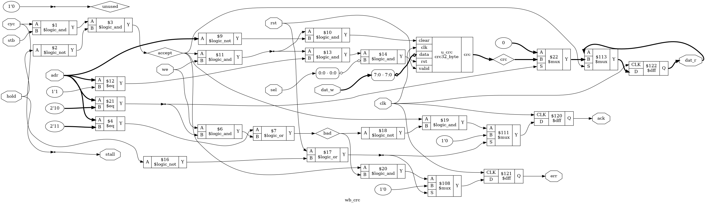

# Tutorial 28: Booting from SPI Flash

In [Tutorial 26](../26-core-on-bus/README.md) the program was already in RAM when the core
came out of reset: the testbench put it there with `$readmemh`. A real board has no
testbench. Its RAM holds nothing at power-up, and its program waits in a flash chip
beside the FPGA. This lesson adds the three things that close that gap: Tutorial 24's
SPI master as a bus slave, Tutorial 25's CRC-32 as a bus slave, and a small boot ROM.
At reset the core runs the boot ROM. It reads an image from the flash, copies it into
RAM, checks its CRC, and jumps to it. If anything is wrong, it says so on the UART and
stops.

Finish Tutorials [24](../24-spi/README.md), [25](../25-lfsr-crc/README.md) and
[26](../26-core-on-bus/README.md) first. Run these commands in a VS Code terminal, from
this directory:

```bash
cd tutorials/28-spi-boot
```

To run everything at once, use `make all`. It took 8 minutes here, starting from `make clean`.

Nothing here ran on hardware. The flash is Tutorial 24's behavioural model, which is our
own, written from datasheet behaviour. It is not a vendor model and matches no real part.

## The system

```text
                                                             +--> wb_ram       RAM, 64 KiB
 +-------+  native  +--------------+  Wishbone  +----------+ +--> wb_uart      Tutorial 14's UART
 | rv32i |--------->| rv_wb_bridge |----------->|    wb_   |-+--> wb_gpio      LEDs
 |       |<---------|              |<-----------| inter-   | +--> wb_counters  cycles, instret
 +-------+          +--------------+            | connect  | +--> wb_axil_bridge --> axil_regs
 reset starts                                   +----------+ +--> wb_rom       boot ROM, 1 KiB      (new)
 at the boot ROM                                             +--> wb_spi       SPI master --> flash (new)
                                                             +--> wb_crc       CRC-32               (new)
```

This is Tutorial 26's system with three more slaves. These files are copied from earlier
tutorials, **unchanged**:

| File | From |
| ---- | ---- |
| `rtl/rv32i.v`, `rtl/rv_decode.v`, `rtl/rv_alu.v`, `rtl/rv_regs.v`, `rtl/enreg.v` | [Tutorial 21](../21-riscv-core/README.md), the core |
| `rtl/rv_wb_bridge.v`, `rtl/wb_ram.v`, `rtl/wb_uart.v`, `rtl/wb_gpio.v`, `rtl/wb_counters.v`, `rtl/wb_axil_bridge.v` | [Tutorial 26](../26-core-on-bus/README.md) |
| `rtl/wb_interconnect.v`, `formal/wb_checker.v` | [Tutorial 22](../22-wishbone/README.md) |
| `rtl/axil_regs.v` | [Tutorial 23](../23-axi4-lite/README.md) |
| `rtl/uart.v`, `rtl/uart_tx.v`, `rtl/uart_rx.v` | [Tutorial 14](../14-uart/README.md) |
| `rtl/spi_master.v`, `rtl/shift_reg.v`, `tb/spi_flash_model.v` | [Tutorial 24](../24-spi/README.md) |
| `rtl/crc32_byte.v` | [Tutorial 25](../25-lfsr-crc/README.md) |
| `tools/asm.py`, `tools/iss.py` | [Tutorial 21](../21-riscv-core/README.md) |
| `tools/pad_hex.py` | [Tutorial 26](../26-core-on-bus/README.md) |

The core is Tutorial 21's, unchanged. `soc.v` sets one parameter, `RESET_ADDR`, to the
boot ROM's base, so the first fetch after reset comes from there. `cmp rtl/rv32i.v
../21-riscv-core/rtl/rv32i.v` prints nothing.

The flash model is unchanged too. Tutorial 24 gave it 256 bytes. The testbenches here set
its `MEM_BYTES` parameter to 65536 and its `MEM_FILE` to an image from `make`. No line of
the file changed.

These are new or changed:

| File | What it is |
| ---- | ---------- |
| [`rtl/wb_spi.v`](rtl/wb_spi.v) | Tutorial 24's SPI master as a Wishbone slave |
| [`rtl/wb_crc.v`](rtl/wb_crc.v) | Tutorial 25's `crc32_byte` as a Wishbone slave |
| [`rtl/wb_rom.v`](rtl/wb_rom.v) | `wb_ram` without the write: 1 KiB, loaded from a hex file, writes get `err` |
| [`rtl/soc.v`](rtl/soc.v) | Tutorial 26's, with the three slaves, the SPI pins, three more `hold` bits and `RESET_ADDR` |
| [`rtl/soc_map.vh`](rtl/soc_map.vh) | Tutorial 26's map with three more regions |
| [`formal/map_check.v`](formal/map_check.v) | Tutorial 26's map proof, for the new map |
| [`rom/boot.asm`](rom/boot.asm) | The boot ROM's program |
| [`rom/getbyte_stream.asm`](rom/getbyte_stream.asm), [`rom/getbyte_poll.asm`](rom/getbyte_poll.asm) | Two ways for it to read one byte |
| [`programs/`](programs) | Three payloads, the programs that boot |
| [`tools/mkflash.py`](tools/mkflash.py) | Builds a flash image: a header, then a payload |

## The memory map

| Byte address | Slave | Device |
| ------------ | ----- | ------ |
| `0x0000_0000` to `0x0000_FFFF` | 0 | RAM, 64 KiB. Empty at reset: the boot ROM fills it |
| `0x0010_0000` to `0x0010_03FF` | 5 | **Boot ROM**, 1 KiB, read-only. Reset starts at `0x0010_0000` |
| `0x1000_0000` to `0x1000_0007` | 1 | UART, as in Tutorial 26 |
| `0x1000_1000` to `0x1000_1003` | 2 | GPIO, as in Tutorial 26 |
| `0x1000_2000` to `0x1000_2007` | 3 | Counters, as in Tutorial 26 |
| `0x1000_3000` | | Free. Left for Tutorial 27's timer |
| `0x1000_4000` to `0x1000_401F` | 6 | **SPI controller**. 5 registers, then a hole |
| `0x1000_5000` to `0x1000_500F` | 7 | **CRC-32**. 3 registers, then a hole |
| `0x2000_0000` to `0x2000_001F` | 4 | AXI4-Lite bridge, as in Tutorial 26 |
| Anything else | | `err`, from the interconnect's default responder |

The slave numbers are the order in `soc_map.vh`. Slaves 0 to 4 kept their numbers, so
Tutorial 26's code and tests still mean the same thing. The boot ROM is not at 0: RAM
keeps address 0, and the ROM sits well above it, where a stray pointer into RAM cannot
reach.

### The SPI controller, `0x1000_4000`

| Offset | Name | Access | Bits |
| ------ | ---- | ------ | ---- |
| `+0x00` | `CTRL` | read/write | 7:0 the divider: each half period of SCLK is divider + 1 clocks. 8 CPOL, 9 CPHA. Reset: divider 1, mode 0 |
| `+0x04` | `TX` | write | 7:0 a byte to send. 8 "last": CS rises after this byte. A write while a byte already waits here stalls. Reads 0 |
| `+0x08` | `RX` | read | 7:0 the last byte received. A read empties it. A write gets `err` |
| `+0x0C` | `STATUS` | read | 0 TX empty. 1 RX full. 2 busy: a byte waits in TX, or CS is low. 3 overrun: a byte arrived while RX was full. Any write clears bit 3 |
| `+0x10` | `STREAM` | read | 7:0 the next byte. The read stalls until a byte is in RX, and as it is answered, the next dummy byte starts. A write gets `err` |
| `+0x14` to `+0x1C` | | | Nothing: `err` |

`TX` is a one-byte buffer in front of Tutorial 24's master: a byte can wait there while
the previous one is on the wire. The master's byte interface had no buffer, and its
`rx_valid` is a pulse, so `RX` holds the byte until the program reads it.

Every byte sent also brings one back. When the boot ROM sends the read command and the
address, four bytes come back that mean nothing. It reads `RX` after each one to empty it.

### The CRC-32 unit, `0x1000_5000`

| Offset | Name | Access | Bits |
| ------ | ---- | ------ | ---- |
| `+0x0` | `CLEAR` | write | Starts a new message. The data is ignored. Reads 0 |
| `+0x4` | `DATA` | write | 7:0 one byte for the message. A write must include byte 0, so `sb` to `+4` or `sw`. Reads 0 |
| `+0x8` | `RESULT` | read | The CRC-32 of every byte since the last `CLEAR` or reset, the same number as `zlib.crc32`. A write gets `err` |
| `+0xC` | | | Nothing: `err` |

`crc32_byte` takes one byte per clock, and a bus request takes at least one clock, so
`DATA` never stalls. A `RESULT` read already includes a `DATA` write just before it.

### The boot ROM, `0x0010_0000`

256 words, loaded from a hex file with `$readmemh`, the same way `wb_ram` is. A read gets
`ack` on the next clock. A write gets `err` on the next clock, so a store to the ROM is a
store access fault, cause 7, as Tutorial 26 turned every `err` into.

## The image in flash

[`tools/mkflash.py`](tools/mkflash.py) builds the image. The header is five little-endian
words, then the payload:

| Offset | Field | Value for `hello.asm` |
| ------ | ----- | --------------------- |
| `+0` | magic | `0x544F4F42`, `BOOT` in ASCII |
| `+4` | length in bytes | 76 |
| `+8` | load address | `0x0000_1000` |
| `+12` | entry point | `0x0000_1000` |
| `+16` | CRC-32 of the payload | `013db652`, from Python's `zlib.crc32` |
| `+20` | the payload | asm.py's words, each one little-endian |

It writes the format of Tutorial 24's `tb/flash.hex`, 16 bytes to a line, and fills the
rest of the 64 KiB with `FF`, as an erased NOR flash reads. `make` prints a line for each
image:

```text
build/flash_hello.hex: 76 bytes of payload for 0x00001000, entry 0x00001000, CRC-32 013db652
build/flash_bitflip.hex: 76 bytes of payload for 0x00001000, entry 0x00001000, CRC-32 013db652, then broken: bit 3 of payload byte 5 flipped
```

The three options `--flip-bit`, `--magic` and `--length` break an image after its CRC is
worked out, to test that the boot ROM refuses it.

The image starts at flash address 0 here. On a real board the FPGA's own bitstream is
usually at the start of the flash, and the program goes after it.

## The boot ROM

[`rom/boot.asm`](rom/boot.asm) does this:

1. Sets the SPI divider and clears the CRC unit.
2. Sends the flash's read command, `0x03`, and the address `0x000000`.
3. Reads the five header words. One read command streams the header and the payload.
4. Checks the header: the magic word, then the length. The length must not be 0, and the
   payload must fit in RAM from the load address.
5. Copies the payload into RAM a byte at a time, and writes each byte to the CRC unit's
   `DATA`.
6. Ends the read: one more byte with "last", so that CS rises.
7. Compares `RESULT` with the header's CRC, and jumps to the entry point.

A bad header or a bad CRC prints one line and stops with `ebreak` at the label `halt`:

```text
boot: bad magic
boot: bad length
boot: bad CRC
```

### Why it is in assembly

Tutorial 27 brings in C, with `riscv-none-elf-gcc`. A C program needs a stack, set up by a
startup file, and data sections copied into RAM before `main` runs. At this point there is
no RAM worth having: it is empty, and filling it is the boot ROM's job. So the boot ROM
keeps every value in a register and never touches RAM except to copy the payload into it.
A subroutine that calls another keeps its return address in `s11`, since there is no stack
to push it on. The whole program is 102 words, 408 bytes, with the streaming `getbyte`.

The code uses only jumps and branches relative to `pc`, and `la`, which is also relative.
So it runs at `0x0010_0000` although `asm.py` assembles every program from 0.

### The payloads

The payloads are in assembly too: [`programs/hello.asm`](programs/hello.asm) is Tutorial
26's `hello.asm` with a new message. Tutorial 27 is being written alongside this one, and
a payload in assembly keeps this lesson free of its startup file and linker script. The
boot ROM does not care: any image `mkflash.py` builds from a hex file boots the same way.

| Payload | What it does |
| ------- | ------------ |
| `hello.asm` | Prints `Hello from flash!` and stops with `ebreak` |
| `again.asm` | Counts its runs in GPIO, prints `Hello again!`, and jumps back to the boot ROM once, without a reset |
| `romwrite.asm` | Prints a line, then stores to the boot ROM, which must fault |

Each one is position-independent, like the boot ROM, so it runs at `0x1000`.

## Polling or streaming

There are two ways to read a byte, in two small files that `make` appends to `boot.asm`.

**Polling**, [`rom/getbyte_poll.asm`](rom/getbyte_poll.asm): write a dummy byte to `TX`,
read `STATUS` until bit 1 says `RX` is full, then read `RX`. While the boot ROM stores the
byte and feeds it to the CRC, the wire is idle.

**Streaming**, [`rom/getbyte_stream.asm`](rom/getbyte_stream.asm): one load from `STREAM`.
The SPI slave stalls the load until the byte is in, then answers it, and starts the next
dummy byte on the same edge. That byte is on the wire while the boot ROM stores this one.

The stall is legal Wishbone: the request waits on the bus, unchanged, until the slave
takes it. Its cost is that the bus is busy for that time. In this system the core is the
only master, and it has nothing else to do. Tutorial 29 adds a second master, and then a
long stall holds it up too.

`make` builds both ROMs for dividers 1, 3, 7 and 15. [`tb/tb_boot.v`](tb/tb_boot.v) boots
each with `hello.asm`, 76 bytes, and with the same payload padded to 1024 bytes. It counts
clocks from the end of reset to the first fetch from the entry point:

```text
RESULT div  1  clk/4    streaming      3786 clocks     36966 clocks   35.00  (102 and 1050 bytes on the wire)
RESULT div  1  clk/4    polling        7535 clocks     79583 clocks   76.00  (101 and 1049 bytes on the wire)
RESULT div  3  clk/8    streaming      7026 clocks     70542 clocks   67.00  (102 and 1050 bytes on the wire)
RESULT div  3  clk/8    polling       10868 clocks    114200 clocks  109.00  (101 and 1049 bytes on the wire)
RESULT div  7  clk/16   streaming     13566 clocks    137754 clocks  131.00  (102 and 1050 bytes on the wire)
RESULT div  7  clk/16   polling       17545 clocks    183445 clocks  175.00  (101 and 1049 bytes on the wire)
RESULT div 15  clk/32   streaming     26646 clocks    272178 clocks  259.00  (102 and 1050 bytes on the wire)
RESULT div 15  clk/32   polling       30877 clocks    321913 clocks  307.00  (101 and 1049 bytes on the wire)
```

| Divider | SCLK | Streaming, 76 bytes | Polling, 76 bytes | Streaming, per byte | Polling, per byte | Polling costs |
| ------- | ---- | ------------------- | ----------------- | ------------------- | ----------------- | ------------- |
| 1 | clk / 4 | 3786 | 7535 | 35 | 76 | 41 |
| 3 | clk / 8 | 7026 | 10868 | 67 | 109 | 42 |
| 7 | clk / 16 | 13566 | 17545 | 131 | 175 | 44 |
| 15 | clk / 32 | 26646 | 30877 | 259 | 307 | 48 |

The per-byte columns are the difference between the two payloads, divided by the 948
bytes between them. At the testbench's 100 MHz clock, the 76-byte boot at divider 1 takes
37.86 µs.

- **Streaming is limited by the wire.** A byte is 16 SCLK edges of divider + 1 clocks: 32
  clocks at divider 1, 256 at divider 15. Each byte costs 3 more: one clock for `RX` to
  fill, one for the read to be taken and the next dummy byte to go into `TX`, one for the
  master to take it. The boot ROM's work on each byte fits inside the 32 clocks the next
  byte takes, so it costs nothing.
- **Polling adds the boot ROM's work to every byte.** 41 to 48 clocks more, whatever the
  divider. The work does not overlap the wire any more, and the polling loop, a load from
  `STATUS`, `andi` and `beqz`, sees the byte up to one turn of the loop late. Where in the
  loop the byte lands depends on the divider, so the cost is not quite constant.
- At a slow divider the wire dominates either way. Per byte, polling takes 19% longer at
  divider 15, and more than twice as long at divider 1.

"Bytes on the wire" counts SCLK edges while CS is low: 4 for the command and address, 20
of header, the payload, and 1 to end the read. Streaming has one more, the dummy byte it
started before the boot ROM knew it was done.

Divider 0 would give SCLK at clk / 2, a 20 ns period. The flash model's limit for `0x03`
is 30 ns, as Tutorial 24 showed, so `make` builds no ROM for it.

## Simulate

[`tb/tb_boot.v`](tb/tb_boot.v) boots the system from the flash model and judges each boot
by what comes out of the UART, decoded at bit level as in Tutorial 26, by how it stopped,
and by the flash model's `violations` count, which must stay 0. Each check runs twice: in
mode 0 no slave stalls, and in mode 1 every slave stalls at random, about one clock in
four. Then it times the boots above.

```bash
make sim
```

It ends with `PASS`. Before the timing table it prints each boot:

```text
=== mode 0: no stalls
hello, streaming           mode 0: printed "Hello from flash!\n", trap cause 3 at pc 0000100c
  booted in 3786 clocks, 102 bytes on the SPI wire
hello, polling             mode 0: printed "Hello from flash!\n", trap cause 3 at pc 0000100c
one bit flipped            mode 0: printed "boot: bad CRC\n", trap cause 3 at pc 001000c0
bad magic                  mode 0: printed "boot: bad magic\n", trap cause 3 at pc 001000c0
bad length                 mode 0: printed "boot: bad length\n", trap cause 3 at pc 001000c0
one bit flipped, polling   mode 0: printed "boot: bad CRC\n", trap cause 3 at pc 001000c0
boot twice                 mode 0: printed "Hello again!\nHello again!\n", trap cause 3 at pc 00001044
store to the boot ROM      mode 0: printed "write to the boot ROM\n", trap cause 7 at pc 00001010
```

`0x001000C0` is `halt` in the boot ROM, from `build/rom_stream_d1.lst`. The broken images:

| Image | Broken how | Why the ROM refuses it |
| ----- | ---------- | ---------------------- |
| `flash_bitflip.hex` | bit 3 of payload byte 5 flipped | The CRC differs. CRC-32 catches every single-bit error |
| `flash_magic.hex` | magic `0x544F4F43`, one bit off | Not `BOOT` |
| `flash_length.hex` | length `0x10000` | 64 KiB from `0x1000` does not fit in RAM |

For the flipped bit the testbench also checks that the core never fetched from the entry
point. `boot twice` checks that `gpio_out` ends at 2, so the second boot ran. `store to
the boot ROM` checks that the fault is `sw zero, 0(t3)`, `000E2023`.

### What the header check does not catch

The CRC covers the payload only. A flipped bit in the load address or the entry point
passes every check, as long as the payload still fits in RAM, and the boot ROM jumps to the
wrong place. The boot ROM does not check that the entry point is a multiple of 4 either:
the cocotb test below found that an entry of `0xFF7F` traps with cause 0, misaligned
fetch, which is what the core does with any such jump. A real format would add a CRC over
the header too.

## View the waveform

`make sim` records the first boot only, `hello.asm` with the streaming ROM at divider 1,
and only the signals used below, one level of `tb_boot`, `tb_boot.dut` and
`tb_boot.dut.u_spi`. The file is 1.7 MB. The testbench writes it only when given
`+waves`, which `make sim` passes and `make verilator` does not: Verilator ignores
`$dumpoff`, and once recorded every boot, 2.5 GB.
Outside the recorded part every signal, even `clk`, shows as `x`, drawn in red. That is
what `$dumpoff` writes, not the design.

```bash
make sim
```

Open `build/tb_boot.vcd` as in [Tutorial 1](../01-d-flip-flop/README.md). From `tb_boot`,
add `clk`, `cs_n`, `sclk`, `mosi` and `flash_miso`. From `dut`, add `mem_addr`,
`mem_ready`, `m_stb` and `m_stall`. From `dut.u_spi`, add `tx_full`, `sending`,
`in_flight`, `m_rx_valid`, `rx_full`, `rx_byte`, `ack` and `dat_r`. The clock rises at 5,
15, 25 ns and so on.

**The first byte of the header**, from 2800 ns:

- At 2805 ns the core puts a load from `0x1000_4010`, `STREAM`, on the bus. `m_stb` rises
  and so does `m_stall`: `RX` is empty. Nothing is on the wire, so the waiting read starts a
  dummy byte. `tx_full` rises at 2815 ns, and at 2825 ns the master takes it: `tx_full`
  falls and `in_flight` rises. `sclk` first rises at 2845 ns.
- At 3145 ns `m_rx_valid` pulses for one clock. At 3155 ns `rx_full` rises with `rx_byte`
  `42`, the `B` of `BOOT`, and `m_stall` falls.
- The edge at 3165 ns takes the load: `ack` and `mem_ready` rise with `dat_r` `42`, `rx_full`
  falls, and `tx_full` rises again with the next dummy byte. At 3175 ns the master takes it.
- From 3175 ns the core returns from `getbyte` and runs `getword` (fetches from
  `0x0010_0194`, `0x0010_00E4` and on), and at 3295 ns it loads from `STREAM` again. It
  stalls until 3505 ns, when `rx_byte` is `4F`, the `O`.

From one `ack` at 3165 ns to the next at 3515 ns is 350 ns, 35 clocks: the streaming
column of the table, with the core's own work hidden inside it.

## Lint and Verilator

```bash
make lint
make verilator
```

`make lint` checks the whole system, then each new slave on its own. No line starts with
`%Warning`. `make verilator` runs the same testbench under Verilator and prints the same
results line for line, with `pc` in `%h` without leading zeros.

## Test in Python

[`tb/test_boot.py`](tb/test_boot.py) runs every boot in lockstep with the reference model,
as Tutorial 26 ran its programs, with every slave stalling at random on 3 clocks in 10. The
top level is [`tb/boot_top.v`](tb/boot_top.v), the system and the flash model. From the
first fetch in the boot ROM to the trap at the end, each instruction is compared with
Tutorial 21's `Iss`: the header, the copy, the CRC check, the jump, and the payload in RAM.
[`tb/soc_model.py`](tb/soc_model.py) and [`tb/lockstep.py`](tb/lockstep.py) are Tutorial
26's, with:

- **The new map in the model.** The boot ROM is there, with the ROM's words, and a write to
  it faults. So do writes to `RX`, `STREAM` and `RESULT`, and the holes in the SPI and CRC
  regions.
- **The CRC worked out in Python.** The model keeps the bytes written to `DATA` since the
  last `CLEAR`, and a read of `RESULT` is `zlib.crc32` of them. Nothing is copied from the
  hardware.
- **SPI reads copied from the bus.** Like the UART's status, what the SPI slave returns
  depends on time, so each word it returns is copied into the model before the model runs
  the load. This means the lockstep test alone cannot tell whether the bytes are the
  flash's. That is checked at the end of each boot instead: the test works out from the
  header alone how the boot must end, and checks that it did.

```bash
make cocotb
```

Look for `TESTS=2 PASS=2 FAIL=0`, and these lines:

```text
loads and stores that finished, by device: crc 1072, gpio 12, ram 1188, rom 100, spi 5017, uart 2888
directed: 12 boots, 20837 stalled requests, 28079 instructions in lockstep
random: 30 images, bad CRC 6, bad length 11, bad magic 3, ok 10, 48369 stalled requests, 46968 instructions in lockstep
```

`directed_boots` boots each image from `make sim` with both ROMs. A failed boot must stop at
`halt` with `a0` just past the right message, since `puts` leaves `a0` at the zero after
it. `random_images` builds 30 images with random padding, load addresses near the end of
RAM and past it, and random faults: a flipped bit anywhere in the payload, a flipped bit in
the magic word, or a length of 0, one byte short or long, 64 bytes long, `0x10000` or
`0xFFFFFFFF`. It fails if any of the four outcomes never happened.

## Prove it with formal verification

[`boot.sby`](boot.sby) has eight tasks:

| Task | Proves |
| ---- | ------ |
| `rom` | `wb_rom` with Tutorial 22's `wb_checker`, as slave. Every request is answered on the next clock. A read gets `ack` with the word it asked for. A write gets `err`, never `ack` |
| `spi` | `wb_spi` with `wb_checker`. Requests taken are answered on the next clock, and only the holes and writes to `RX` and `STREAM` get `err`. A `STREAM` read is only taken with a byte in `RX`. A read of `RX` or `STREAM` returns the byte that was waiting. A byte in `TX` is never replaced before the master takes it. `RX` changes only when the master delivers a byte, and then holds that byte. A waiting `STREAM` read with nothing on its way starts a dummy byte |
| `crc` | `wb_crc` with `wb_checker`. The right requests get `err`. A `RESULT` read returns the CRC at the edge that took it. The CRC changes only on a write to `DATA` or `CLEAR`, and a `CLEAR` leaves 0, the CRC of nothing |
| `map` | Tutorial 22's interconnect with the new map from `soc_map.vh`: Tutorial 26's checks, for eight slaves |

Each has a cover task as well.

```bash
make formal
```

Look for `DONE (PASS, rc=0)` for each, and the last line, `8 tasks passed`. The map's cover run took 121 seconds
here, and each of the others 7 seconds or less.

Some choices:

- **No limit on stalls.** A `TX` write or a `STREAM` read waits for a whole byte on the
  wire, 32 clocks at the reset divider and up to 4096 at divider 255. So `wb_spi`'s
  checker has `MAX_STALL` 0, no limit. That stalls end at all is shown by simulation only.
- **The SPI master without its checks.** `boot.sby` reads `spi_master.v` without
  `FORMAL`, so Tutorial 24's own assertions and covers are left out. Its covers include a
  byte at divider 255, which no cover depth here reaches. Without them, induction may
  start the master in any state, so the `spi` checks are about the slave's side, and hold
  whatever the master does.
- **Depth 24 for `spi`.** Receiving a byte takes about 20 clocks at the fastest divider.
  With Tutorial 26's depth of 8, the bug in "Try it yourself" that reads `RX` a byte late
  fails only the induction step, and `sby` reports `UNKNOWN`, not `FAIL`. At depth 24 the
  base case reaches a real byte, and the result is a counterexample trace.
- **Bitwuzla for the map's cover run.** The interconnect has a cover of every target,
  eight slaves and its default responder, answering in one cycle. That needs 20 steps.
  With the default solver, Yices, it was still searching step 19 after 8 minutes, and
  Bitwuzla reached it in 95 seconds. Only that task uses Bitwuzla.

The covers show each proof is not empty: a ROM read, a ROM write refused, back-to-back
reads, a held request; a `STREAM` read answered (step 23), a `TX` write held back, a byte
landing while the last one is read, an overrun (step 39), an `err`; a CRC read back that is
not 0; and a request to each region of the map, to the hole after it, and to
`0x1000_3000`, which is free.

### What is not proved

- **The boot ROM's program.** It is tested by the simulations, not proved.
- **The whole system.** Each slave and the map are proved on their own.
- **That a stall ends.** As above.
- **The flash.** The model checks its own timing rules. Tutorial 24's README lists what it
  does not check: it has no write, erase or status register, and it does not check when
  the master samples `miso`.

## Is this a clock domain crossing?

No, for the same reason as in [Tutorial 24](../24-spi/README.md): `sclk` is a register
clocked by `clk`, and the flash launches `miso` from `sclk`. It is an I/O timing problem,
for timing constraints on the pins. The simulations have no board delays, so they say
nothing about those.

## See the logic

```bash
make schematic
```

This draws the CRC slave, with `crc32_byte` as one box. Click `build/wb_crc.png` in the
Explorer:



- On the left, `accept` is `$3`: `cyc` and `stb` (`$1`) and not `hold` (`$2`). `stall` is
  `hold`, wire for wire.
- `clear` into `u_crc` is `$10`: `adr` is 0 (`$9`), and an accepted write (`$11`). `valid`
  is `$14`: `adr` is 1 (`$12`), the accepted write (`$13`), and `sel[0]`. `data` is
  `dat_w[7:0]`.
- `bad` is `$7`: `adr` is 3 (`$4`), or a write (`$6`) with `adr` 2 (`$21`).
- The two flip-flops on the right are `ack` (`$120`) and `err` (`$121`), each behind a
  multiplexer that clears it on `rst` or no `cyc` (`$17`). `ack` is `accept` and not `bad`
  (`$19`), `err` is `accept` and `bad` (`$20`).
- `dat_r` (`$122`) loads only on `accept` (`$113`), with `crc` when `adr` is 2 and 0
  otherwise (`$22`).

## Map it to real FPGAs

```bash
make synth
```

The new slaves alone, on Xilinx:

| Slave | Flip-flops | Total cells |
| ----- | ---------- | ----------- |
| `wb_rom` | 2 `FDRE` | 4 |
| `wb_spi` | 87 `FDRE`, 2 `FDSE` | 197 |
| `wb_crc` | 34 `FDRE`, 32 `FDSE` | 153 |

`wb_rom` on its own has no `INIT`, so its memory is empty and Yosys removed it: only
`ack` and `err` are left. `wb_crc`'s 32 `FDSE` are the CRC state, which resets to all ones.

The whole system, with the streaming ROM at divider 1:

| Family | Flip-flops | Memory blocks | Total cells |
| ------ | ---------- | ------------- | ----------- |
| Xilinx | 1842 `FDRE`, 39 `FDSE` | 16 `RAMB36E1` | 5068 |
| Gowin | 1849 (`DFF`, `DFFE`, `DFFR`, `DFFRE`, `DFFS`, `DFFSE`) | 32 `SP`, 1 `SPX9` | 16788 |
| Cyclone V | 1851 `MISTRAL_FF` | 65 `MISTRAL_M10K` | 4987 |

Tutorial 26's system had 1689 flip-flops on Xilinx, 16 `RAMB36E1` and 4581 cells, so these
three slaves add about 190 flip-flops. On Xilinx the block RAM count did not change: the
1 KiB ROM did not go into block RAM, and the 14 `MUXF7` and 4 `MUXF8` suggest it went into
lookup tables. On Gowin it appears as the one `SPX9`, and on Cyclone V as the 65th `M10K`;
Tutorial 26 had 64. The Xilinx and Gowin totals include 52 `$scopeinfo` entries, which are
bookkeeping, not cells. Gowin printed the same four `brams_map.v:114` warnings as in
Tutorial 26. These are Yosys counts, so vendor tools can give different results, and they
say nothing about timing.

## Using these modules later

- **The instruction cache, Tutorial 30.** Code now runs from RAM after a copy. The cache
  sits between the core and `rv_wb_bridge`, as Tutorial 26 said, and serves the boot ROM's
  fetches as well as the payload's.
- **The system-on-chip, Tutorial 31.** It boots this way. The memory map and register maps
  above are the ones to use. A payload in C needs Tutorial 27's startup file and a linker
  script that puts `.text` at the load address; `mkflash.py` takes the hex file either way.
- **DMA, Tutorial 29.** A `STREAM` read holds the bus for a whole SPI byte. With a second
  master, use polling, or let the DMA engine copy from the SPI slave instead.

What each new module promises:

**`wb_spi`**: Wishbone slave, answer on the next clock once taken. `TX` and `STREAM` stall
for as long as a byte takes. Tutorial 24's master and timing, with a one-byte buffer each
way.

**`wb_crc`**: Wishbone slave, answer on the next clock, never stalls. `RESULT` equals
`zlib.crc32` of the bytes written to `DATA` since `CLEAR`.

**`wb_rom`**: Wishbone slave, answer on the next clock. Reads get `ack`, writes get `err`.

## Try it yourself

Make each change, then run `make sim`, `make cocotb` and `make formal`. Undo each change
before trying the next. Every result below was observed, on a copy of this directory. A
`formal` column lists the tasks that failed. All the others passed.

| Change | `sim` | `cocotb` | `formal` fails |
| ------ | ----- | -------- | -------------- |
| **CRC not cleared between boots.** In `wb_crc.v`, tie `.clear` to `1'b0` | `FAIL boot twice printed "Hello again!\nboot: bad CRC\n"`, in both modes. Every other boot passed | `LOCKSTEP FAILED in rom_stream_d1, boot twice, instruction 2808: x5 is 42934c3f, and the model has dbce6711` | `crc`, on `assert (crc == 32'd0)` after a `CLEAR` |
| **`RX` one byte late.** In `wb_spi.v`, load `rx_byte` from a new register that holds the previous byte | Every boot printed `"boot: bad magic\n"` | `rom_stream_d1, hello: stopped at 001000c0, not in RAM` | `spi`, at step 23, on `assert (rx_full && rx_byte == $past(m_rx_data))` |
| **A writable boot ROM.** In `wb_rom.v`, answer every request with `ack`, never `err` | `store to the boot ROM printed "write to the boot ROM\nnot trapped\n"`, and stopped with cause 3, not 7 | `store to the boot ROM, instruction 1931: the model trapped with cause 7, and the core retired` | `rom`, on `assert (err == f_was_write)`, and `rom_cover` cannot reach `err` |
| **No CRC compare.** In `rom/boot.asm`, replace `bne t0, s6, fail` with `nop` | `FAIL one bit flipped printed ""`, `stopped at pc 0000100c, not in the boot ROM`, and `the corrupted image was fetched from the entry point` | `rom_stream_d1, one bit flipped: stopped at 0000100c with a0 00001002, not at the halt` | None. The proofs do not include the boot ROM's program |

Notes on each:

- **Not cleared.** The first boot after reset still works, because reset clears the CRC.
  Only `again.asm`'s jump back to the boot ROM shows the bug: the second CRC starts from
  the first one. The lockstep test caught it at the load from `RESULT`, since the model
  works out the CRC on its own. The first version of the `crc` proof did not check `CLEAR`
  at all, and passed with this bug. The check after a `CLEAR` was added because of it.
- **One byte late.** Every byte of the stream moved one place later, so the magic word was
  wrong and every boot stopped at the first check. Lockstep alone could not see it: SPI
  reads are copied from the bus, and the core and the model agreed on every instruction.
  The check of how the boot ended caught it. The first version of the `spi` proof did not
  tie `RX` to the master's byte, and passed with this bug. The check that `RX` holds the
  byte just received was added because of it.
- **Writable ROM.** The store was acknowledged, and the program went on to print
  `not trapped`. Every boot still booted, so only the tests that write to the ROM noticed.
- **No compare.** With the CRC ignored, the image with the flipped bit ran. Bit 3 of byte
  5 is in the `addi` of `la a0, message`, so `a0` did not point at the message. The program
  printed nothing and stopped at its own `ebreak`, at `0x100C`. On a board, broken code
  would have run with no message at all. In cocotb, `random_images` failed too, on an image
  with a wrong length.
