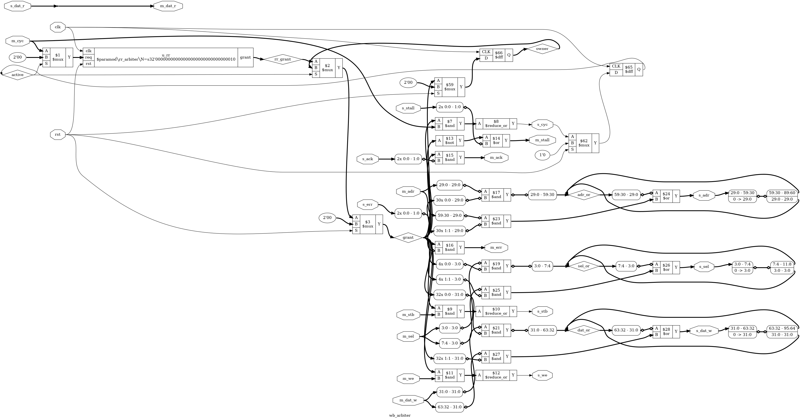

# Tutorial 29: DMA and a Second Bus Master

In [Tutorial 26](../26-core-on-bus/README.md) the core was the only thing on the bus. Every
byte that moved, the core moved, one load and one store at a time. A *DMA engine* (direct
memory access) is a second master: the core writes a source, a destination and a length
into its registers, and it copies the data by itself while the core does something else.

Two masters cannot drive one bus at once, so this lesson also adds an *arbiter*, built
from the round-robin arbiter of [Tutorial 8](../08-arbiter/README.md). Then it measures
what sharing costs: how much slower the core runs while the DMA engine works, how the bus
is split between them, and what goes wrong when a program reads memory the DMA engine has
not finished writing.

Finish Tutorials 8, 22 and 26 first. Run these commands in a VS Code terminal, from this
directory:

```bash
cd tutorials/29-dma
```

To run everything at once, use `make all`. It took 9 minutes here, starting from `make clean`.

## The system

```text
 +-------+  native  +--------------+ cpu_*  +------------+  m_*  +-----------------+ --> wb_ram       RAM, 64 KiB
 | rv32i |--------->| rv_wb_bridge |------->|            |------>|                 | --> wb_uart      UART
 +-------+          +--------------+        | wb_arbiter |       | wb_interconnect | --> wb_gpio      LEDs
                                     dma_*  |            |       |                 | --> wb_counters  cycles, instret
              +-----> wb_dma master ------->|  (rr from  |<------|                 | --> wb_axil_bridge --> axil_regs
              |                             |  Tut. 8)   |       |                 | --> wb_dma       registers
              |                             +------------+       +-----------------+
              +--- wb_dma registers (slave 5), and dreq from the UART's tx_ready
```

The DMA engine has two Wishbone ports. Its master port goes into the arbiter beside the
core's bridge. Its slave port, with the registers, is one more slave on the interconnect,
so the core programs it with ordinary loads and stores.

[`rtl/soc.v`](rtl/soc.v) connects everything. These files are copied **unchanged**:

| File | From |
| ---- | ---- |
| `rtl/rv32i.v`, `rtl/rv_decode.v`, `rtl/rv_alu.v`, `rtl/rv_regs.v`, `rtl/enreg.v` | [Tutorial 21](../21-riscv-core/README.md), the core, by way of Tutorial 26 |
| `rtl/rv_wb_bridge.v`, `rtl/wb_ram.v`, `rtl/wb_gpio.v`, `rtl/wb_counters.v`, `rtl/wb_axil_bridge.v` | [Tutorial 26](../26-core-on-bus/README.md) |
| `rtl/wb_interconnect.v`, `formal/wb_checker.v` | [Tutorial 22](../22-wishbone/README.md), by way of Tutorial 26 |
| `rtl/axil_regs.v` | [Tutorial 23](../23-axi4-lite/README.md) |
| `rtl/uart.v`, `rtl/uart_tx.v`, `rtl/uart_rx.v` | [Tutorial 14](../14-uart/README.md) |
| `rtl/rr_arbiter.v`, `rtl/fixed_arbiter.v` | [Tutorial 8](../08-arbiter/README.md) |
| `tools/asm.py`, `tools/iss.py`, `tools/pad_hex.py`, `programs/hello.asm`, `programs/cpi.asm` | Tutorial 26 |

`cmp rtl/rv32i.v ../21-riscv-core/rtl/rv32i.v` prints nothing when the core is still the
same. These are changed copies:

| File | What changed |
| ---- | ------------ |
| [`rtl/wb_uart.v`](rtl/wb_uart.v) | One new output, `tx_ready`, so the DMA engine can wait for the transmitter |
| [`rtl/soc_map.vh`](rtl/soc_map.vh), [`formal/map_check.v`](formal/map_check.v) | The DMA engine's registers as slave 5 |
| [`tb/lockstep.py`](tb/lockstep.py), [`tb/soc_model.py`](tb/soc_model.py), [`tb/test_soc.py`](tb/test_soc.py) | The lockstep test, with the DMA engine running. See "Test in Python" |

These are new:

| File | What it is |
| ---- | ---------- |
| [`rtl/wb_dma.v`](rtl/wb_dma.v) | The DMA engine |
| [`rtl/wb_arbiter.v`](rtl/wb_arbiter.v) | N masters onto one Wishbone bus, with Tutorial 8's arbiter inside |
| [`rtl/soc.v`](rtl/soc.v) | Tutorial 26's system with the arbiter and the DMA engine added |
| `programs/memcpy.asm`, `dma_uart.asm`, `slowdown.asm`, `coherence.asm`, `dma_error.asm` | The programs this lesson runs |
| [`tb/tb_soc.v`](tb/tb_soc.v) | The Verilog testbench |
| [`dma.sby`](dma.sby) | The proofs |

The programs are in assembly, with Tutorial 21's assembler. Tutorial 27 introduces C, and
it was written at the same time as this lesson, so this one stays in assembly. Nothing here
depends on that: a C program would program the same five registers.

## The memory map

Tutorial 26's map, with one new region:

| Byte address | Slave | Device |
| ------------ | ----- | ------ |
| `0x0000_0000` to `0x0000_FFFF` | 0 | RAM |
| `0x1000_0000` to `0x1000_0007` | 1 | UART |
| `0x1000_1000` to `0x1000_1003` | 2 | GPIO |
| `0x1000_2000` to `0x1000_2007` | 3 | Counters |
| `0x2000_0000` to `0x2000_001F` | 4 | AXI4-Lite bridge |
| `0x1000_5000` to `0x1000_501F` | 5 | **DMA registers**. Words 5 to 7 answer `err` |
| Anything else | | `err`, from the interconnect's default responder |

Tutorial 26 suggested `0x1000_3000` for Tutorial 27's timer and `0x1000_4000` for Tutorial
28's SPI controller. The DMA engine takes `0x1000_5000`, so Tutorial 31 can have all three.

## The DMA engine

[`rtl/wb_dma.v`](rtl/wb_dma.v) has five registers:

| Offset | Name | Meaning |
| ------ | ---- | ------- |
| `+0x00` | `SRC` | Source byte address. Moves on as the copy runs |
| `+0x04` | `DST` | Destination byte address. Moves on as the copy runs |
| `+0x08` | `LEN` | Bytes still to copy. Counts down to 0 |
| `+0x0C` | `CTRL` | bit 0 `START`, bit 1 `SRC_FIXED`, bit 2 `DST_FIXED`, bit 3 `BYTES`, bit 4 `PACE` |
| `+0x10` | `STATUS` | bit 0 `BUSY`, bit 1 `DONE`, bit 2 `ERROR`. Read-only |

A program writes `SRC`, `DST` and `LEN`, then `CTRL` with `START` set. `START` clears
`DONE` and `ERROR`. When the copy ends, `BUSY` clears and `DONE` or `ERROR` is set. While
`BUSY` is set, writes to the registers are acknowledged and ignored, so a copy cannot be
changed or stopped halfway. Only reset stops it.

`SRC`, `DST` and `LEN` are live. A program can read them while the copy runs and see how far
it has got, and after an error they still describe the unit that failed.

### Words, and a byte mode

The bus is 32 bits wide, so the engine copies whole words. A word copy needs `SRC`, `DST`
and `LEN` all to be multiples of 4. If one is not, `START` sets `ERROR` at once, and nothing
goes on the bus. There is no byte tail handled quietly at the end.

For anything else there is `BYTES`. Each unit is then one byte: the engine reads the word
that holds it, takes the byte from its lane, and writes it with `sel` for the destination's
lane only, copied to all four lanes as the core does in Tutorial 26. That handles any
address and any length, at a quarter of the speed. It is also what a byte-wide register
needs, such as the UART's data register.

### One unit per Wishbone cycle

Each unit is one Wishbone cycle: a read of `SRC`, then a write to `DST`, both inside one
`cyc`, then `cyc` drops for at least one clock. So the engine never holds the bus for more
than one unit, and the core gets a turn between every two units. With slaves that answer on
the next clock, a unit takes 5 clocks: 4 with `cyc` high and 1 with it low.

A faster engine would read several words with pipelined requests, as Tutorial 22's master
can, then write them all. It would hold the bus longer each time. This one keeps the cycle
short, which keeps the core's waits short.

### Feeding a peripheral

With `DST_FIXED`, every unit goes to the same address, such as the UART's data register at
`0x1000_0004`. But the UART throws away a byte written while it is still sending the last one.
The engine needs to know when the next byte is welcome.

That is what `PACE` is for. Before each unit the engine waits for its `dreq` input, *data
request*, and `soc.v` connects that to the UART's new `tx_ready` output. The engine waits with
`cyc` low, so a slow peripheral never holds the bus. Real DMA controllers have request lines
like this, one per peripheral. "Try it yourself" shows what happens without it.

### Errors

If the read or the write gets `err`, the copy stops: `ERROR` is set, `BUSY` clears, and
nothing more goes on the bus. The core is not told. In Tutorial 26 an `err` to the core became
a trap, because the core was waiting for that answer. Here the answer goes to the DMA engine,
and the core finds out only if it reads `STATUS`. Tutorial 31 could turn `DONE` and `ERROR` into
an interrupt. The `busy`, `done` and `error` outputs of `wb_dma` are there for that.

## Two masters on one bus

[`rtl/wb_arbiter.v`](rtl/wb_arbiter.v) sits between the masters and the interconnect. The
master it grants is connected through to the interconnect. Every other master sees `stall`
high and no answers.

### Only between cycles

A Wishbone answer carries nothing that says whose it is. The interconnect in Tutorial 22
already relied on this: answers come back in order, and order alone says which request each
one belongs to. If the arbiter handed the bus to another master while answers were still
owed, the next `ack` would go to whoever held the bus when it arrived.

So the arbiter only changes owner between cycles. While the owner's `cyc` is high, it keeps
the bus. `cyc` is exactly the signal for this: a master raises it before its first request
and drops it after its last answer, so a cycle is the unit a master needs to keep.

### Tutorial 8's arbiter, used between cycles

Inside is Tutorial 8's `rr_arbiter`, copied unchanged. Its requests are the masters' `cyc`
lines, but only while no cycle is running:

```verilog
rr_arbiter #(.N(N)) u_rr (
    .clk(clk), .rst(rst),
    .req(active ? {N{1'b0}} : m_cyc),
    .grant(rr_grant)
);

wire [N-1:0] grant = rst ? {N{1'b0}} : active ? owner : rr_grant;
```

`active` is a flip-flop that says the owner had `cyc` high on the last clock, and `owner`
remembers who that was. While a cycle runs, the round-robin arbiter sees no requests, so its
mask holds, and the next pick starts after the last owner. Its grant is combinational, as in
Tutorial 8, so a master that is alone on the bus gets it in the first clock it asks, at no
cost. With the DMA engine idle, `cpi.asm` prints exactly what it printed in Tutorial 26, and
the testbench checks that line for line.

### A clock of `cyc` low between owners

When the owner drops `cyc`, `active` is still high for that clock, so the bus stays with it
for one more clock with `cyc` low. Only on the clock after does another master get it. That
costs one clock at every change of owner. It is there for a master that *abandons* a cycle:
drops `cyc` with answers still owed. Tutorial 22's rule is that a slave must not answer once
`cyc` has fallen, and a slave learns that by seeing `cyc` low. If the next master's `cyc` came
straight after, a slave would see one long cycle, and a late answer could reach the new
master. Neither master here ever abandons a cycle, so no simulation can show the problem, but
the proof can: see "Try it yourself".

The cost is only paid at a change of owner. In the core's case, the clock its `cyc` is low is
the one where it executes, which it spends off the bus anyway.

## Simulate

[`tb/tb_soc.v`](tb/tb_soc.v) runs seven programs on the whole system. As in Tutorial 26, each
runs twice: in mode 0 no slave stalls, and in mode 1 a pseudo-random sequence makes every
slave stall on about one clock in four. Each program is judged by what comes out of the UART,
decoded at bit level, how it stopped, and what is in RAM at the end.

```bash
make sim
```

It ends with `PASS`. Every number a program prints is checked against the testbench's own
count. Clocks are counted between the same two reads of the cycles counter, and the bytes the
DMA engine moved are counted from its write answers between the same two reads of `LEN`.

### Copying: the CPU against the DMA engine

[`programs/memcpy.asm`](programs/memcpy.asm) fills 1 KiB with a pattern, then copies it twice.
The core's copy is a loop of six instructions per word: `lw`, `sw`, three `addi` and `bnez`.
For the DMA engine's copy, the core writes the four registers and reads `STATUS` until `BUSY`
clears. Then it compares both copies with the source, does a byte copy of 13 bytes from an
odd address to another, and checks that too. In mode 0:

```text
cpu copy: 1024 bytes in 5637 clocks
dma copy: 1024 bytes in 2236 clocks
copies match
byte copy: 13 bytes from 00004001 to 00007003, match
```

The core's loop takes 22 clocks per word: two memory instructions at 5 clocks and four others
at 3, from Tutorial 26's table. The DMA engine takes 8.7 clocks per word, 2.5 times faster.
In mode 1 the two took 6311 and 2545 clocks.

The DMA engine alone would take 5 clocks per word, but it is not alone. The core is polling
`STATUS`, and the core's every instruction is a fetch over the bus. The arbiter gives each
master one cycle in turn, so for each cycle of the core's polling loop the engine copies one
word. The poll is three instructions, `lw`, `andi`, `bnez`, which make three cycles of the core:
11 clocks of its own, plus 3 units at 5 clocks each, is 26 clocks for 3 words, 8.67 per
word, close to the 8.73 measured.

The testbench checks the RAM itself too: the source, both copies, all 13 bytes of the byte
copy, and the bytes on each side of it, which must still be 0.

### The DMA engine prints while the CPU counts

[`programs/dma_uart.asm`](programs/dma_uart.asm) has the DMA engine send a 40-byte string to
the UART, with `BYTES`, `DST_FIXED` and `PACE`. Meanwhile the core counts how many times it
reads `STATUS` before `BUSY` clears. Mode 0:

```text
Sent by the DMA, while the CPU counted.
dma printed 40 bytes in 6510 clocks
the cpu looped 450 times
```

At 16 clocks per bit, a UART frame takes 160 clocks, so 40 bytes need at least 6400. The
engine spent almost all of that time waiting for `dreq`, off the bus. The core's loop is four
instructions, 14 clocks alone. 450 loops of 14 clocks is 6300 clocks, and 40 units at 5 clocks
each is 200 of the other 210.

### What the CPU sees while the DMA engine runs

[`programs/slowdown.asm`](programs/slowdown.asm) times three loops of Tutorial 26's `cpi.asm`,
100 iterations each, three ways. The loops are `alu` (no data access at all), `ram` (a load
from RAM each time) and `gpio` (a load from the GPIO register, never touching RAM). The DMA
engine is either idle, doing a 4 KiB word copy from RAM to RAM, or printing a 23-byte line
through the UART with `PACE`. Each run reads the cycles counter and `LEN` before and after the
loop, so it knows the bytes the DMA engine moved in exactly its own window. It also checks that
the engine is still busy at the end. Mode 0:

```text
alu  idle 916 clocks, dma moved 0 bytes
ram  idle 1116 clocks, dma moved 0 bytes
gpio idle 1116 clocks, dma moved 0 bytes
alu  copy 2436 clocks, dma moved 1216 bytes, dma busy
ram  copy 2636 clocks, dma moved 1216 bytes, dma busy
gpio copy 2636 clocks, dma moved 1216 bytes, dma busy
alu  uart 941 clocks, dma moved 5 bytes, dma busy
ram  uart 1151 clocks, dma moved 7 bytes, dma busy
gpio uart 1151 clocks, dma moved 7 bytes, dma busy
```

The idle numbers are `cpi.asm`'s 913 and 1113, plus 3 clocks for the `j record` at the end of
each loop, which is inside this program's window.

| Loop | Idle | During the copy | Slower by | During the UART line | Slower by |
| ---- | ---- | --------------- | --------- | -------------------- | --------- |
| `alu` | 916 | 2436 | 2.66 times | 941 | 25 clocks |
| `ram` | 1116 | 2636 | 2.36 times | 1151 | 35 clocks |
| `gpio` | 1116 | 2636 | 2.36 times | 1151 | 35 clocks |

Three things stand out.

**The loop that keeps hitting RAM is no worse off than the one that does not.** All three
loops lost exactly 1520 clocks to the copy. The contention is for the bus, not for the RAM:
there is one bus, so a load from GPIO waits just as long as a load from RAM. And the `alu`
loop, which makes no data access at all, suffers too, because every instruction is fetched
over the bus. Without a cache, a core is never off the bus. Tutorial 30's instruction cache
changes that.

**The split is one unit per instruction.** The engine moved 1216 bytes, 304 words, in all
three copy runs, and each run has about 300 instructions. Each unit costs the core 5 clocks:
304 times 5 is 1520. The round-robin arbiter gives each master one cycle in turn, and one
cycle of the core is one instruction: a fetch, or a load or store together with the fetch
after it, since the core keeps `cyc` high between them. So the bus was split by cycles, not by
clocks. In the `alu` copy run the engine moved 0.50 bytes per clock, against 0.80 alone (4
bytes per 5 clocks), and the core ran at 2.66 times its idle time. A different split, such as
fewer DMA units per core cycle, is a different arbiter.

**Pacing is nearly free.** During the UART line the engine sent 5 or 7 bytes in each window,
and each cost the core 5 clocks, the same as a unit of the copy. It spends the rest of each
frame waiting for `dreq` off the bus.

In mode 1 the same runs took 1040, 1247 and 1245 clocks idle, and 2773, 2961 and 2942 during
the copy. The engine still moved 1216 bytes in each copy window.

### Coherence: reading before DONE

The DMA engine writes RAM behind the core's back. Nothing in the hardware orders the core's
loads against the engine's writes, so a program that reads the destination too early gets
whatever was there before.
[`programs/coherence.asm`](programs/coherence.asm) starts a 256-byte copy into zeroed RAM. Straight
after `START`, it reads the last word of the destination, and writes `C0FFEE00` to the
second-last word of the *source*. Then it waits for `BUSY` to clear and reads both words of
the destination again:

```text
before done: 00000000
after done:  01db4aff
written during the copy: c0ffee00
```

The first read got the old value. The copy had not got that far. The core's write to the
source landed before the engine read that word, so the copy took the new value. A few
instructions later, or a faster engine, and it would not have. Both results are timing, not
design. The only safe rule is the program's: do not touch a copy's source or destination until
`DONE`. The same two lines printed in mode 1.

A system with a data cache has a harder version of this problem, since the core may read a
stale copy from its cache even after `DONE`. This core has no cache, so `DONE` is enough here.

### Errors

[`programs/dma_error.asm`](programs/dma_error.asm) makes three copies fail, and prints
`STATUS`, `SRC`, `DST` and `LEN` after each. Then the core itself loads from the same bad
address:

```text
write error:  status 00000004 src 00004000 dst 30000000 len 00000010
read error:   status 00000004 src 30000000 dst 00006000 len 00000010
misaligned:   status 00000004 src 00004002 dst 00006000 len 00000010
now the cpu loads from 30000000
```

- **Write error.** The read of `0x4000` worked, and the write to `0x3000_0000` got `err` from
  the interconnect. `STATUS` is 4, `ERROR` alone. `DST` and `LEN` are where the copy stopped:
  nothing was copied.
- **Read error.** The first read got `err`, so nothing was written.
- **Misaligned.** A word copy from `0x4002`. `START` refused it at once, and the program read
  `STATUS` straight after `START`, without waiting: `ERROR` was already set.

None of these stopped the core. Then its own load from `0x3000_0000` did: the system stopped
with trap cause 5, a load access fault, at `pc` `0x6C`, as in Tutorial 26. The same address
gives a status bit to one master and a trap to the other, because the `err` goes to whoever
made the request.

### The arbiter, counted

At the end, the testbench prints what it saw at the arbiter, over all seven programs:

```text
Arbiter in mode 0:
  cpu 113396 cycles, longest 6 clocks, longest wait for the bus 5 clocks
  dma   3516 cycles, longest 4 clocks, longest wait for the bus 5 clocks
Arbiter in mode 1:
  cpu 109155 cycles, longest 13 clocks, longest wait for the bus 11 clocks
  dma   3516 cycles, longest 10 clocks, longest wait for the bus 13 clocks
```

In mode 0 the DMA engine's cycle is 4 clocks, and the core never waited more than 5: one
cycle of the engine, then the clock of `cyc` low. The core's longest cycle is 6 clocks, which
matches a store to AXI4-Lite, 4 clocks in Tutorial 26's table, and the fetch after it. The
testbench fails if either master ever waits
longer than the other's longest cycle plus one clock. It also checks on every clock that at
most one master is granted, and that no request reaches the interconnect without an owner.

## View the waveform

Use a fresh simulation:

```bash
make sim
```

The waveform is kept small: only four scopes are recorded, `tb_soc`, `dut`, `dut.u_arbiter`
and `dut.u_dma`, one level each, and only in two windows of mode 0: `memcpy.asm` until its
DMA copy has been timed, and `dma_error.asm` until its first byte comes out of the UART. The
file was 6 MB here. `tb/tb_soc.v` says how to record everything.
Outside the recorded part every signal, even `clk`, shows as `x`, drawn in red. That is
what `$dumpoff` writes, not the design.

Open `build/tb_soc.vcd` as in [Tutorial 1](../01-d-flip-flop/README.md). From `dut`, add
`clk`, `cpu_cyc`, `cpu_stb`, `cpu_stall`, `dma_cyc`, `dma_stb`, `dma_stall`, `m_cyc`, `m_stb`,
`m_adr`, `m_we`, `m_ack`, `m_err` and `dma_err`. From `dut.u_arbiter`, add `grant` and
`active`. From `dut.u_dma`, add `state`, `len` and `error`. `grant` is `1` for the core and `2`
for the DMA engine. `state` is 1 `WAIT`, 2 `READ`, 3 `READ_ACK`, 4 `WRITE`, 5 `WRITE_ACK`.
The clock rises at 5, 15, 25 ns and so on.

**Taking turns**, from 1194330 ns, the start of the DMA copy in `memcpy.asm`:

- At 1194335 ns the core's store to `CTRL` is on the bus: `m_adr` `4001403`, `m_we` 1. Its
  `m_ack` comes at 1194345 ns, and `state` becomes 1.
- At 1194355 ns the core fetches its next instruction, and the engine raises `dma_cyc` and
  `dma_stb` in `READ`. The core already has the bus, so `dma_stall` is high.
- At 1194375 ns `cpu_cyc` falls: the core is executing. `grant` stays `1` and `active` is
  high, so `m_cyc` is low for this one clock.
- At 1194385 ns `grant` becomes `2`. The engine's read of `0x4000` (`m_adr` `1000`) is on the
  bus, and now the core waits, with `cpu_stall` high, to load `STATUS`.
- The read is answered at 1194395 ns, the write to `0x6000` (`m_adr` `1800`) goes out at
  1194405 ns and is answered at 1194415 ns. At 1194425 ns `dma_cyc` is low, `state` is 1 and
  `len` has gone from `400` to `3fc`. This is the engine's clock of `cyc` low.
- At 1194435 ns `grant` is `1` again, and the core's load of `STATUS` goes out
  (`m_adr` `4001404`). Its answer and the next fetch follow in one cycle, then the engine
  again. From here the two take turns, one cycle each.

**An error**, from 2081350 ns, the first copy in `dma_error.asm`:

- At 2081355 ns the core starts the copy. The engine waits through one fetch by the core,
  and gets the bus at 2081405 ns.
- The read of `0x4000` is answered at 2081415 ns. At 2081425 ns the write goes out to `m_adr`
  `c000000`, byte address `0x3000_0000`.
- At 2081435 ns `m_err` and `dma_err` rise. `cpu_err` does not move: the answer is the
  engine's.
- At 2081445 ns `state` is 0, `error` is 1, and `dst` and `len` are still `30000000` and `10`.
  The core has its next fetch waiting, and gets the bus at 2081455 ns.

## Lint and Verilator

```bash
make lint
make verilator
```

`make lint` checks the whole system, then the arbiter at `N=2` and `N=3`, the DMA engine and
the changed UART slave, each on its own. Any warning starts with `%Warning`.

`make verilator` runs the same testbench under Verilator and prints the same results, line
for line. It is built without `--trace`, so it writes no waveform. Verilator ignores
`$dumpoff`, and a first build with `--trace` wrote a 528 MB file here.

## Test in Python

[`tb/test_soc.py`](tb/test_soc.py) is Tutorial 26's lockstep test, with the DMA engine running.
Every instruction the core retires is compared with Tutorial 21's reference model, `Iss`, with
every slave stalling at random.

- `directed_programs` runs everything in `programs/`, and Tutorial 26's small programs that each
  stop in a different way, plus seven new ones: a load from the hole in the DMA engine's
  region, a store to it, a program that starts a copy and reads the destination and the
  registers while it runs, and four that spin on a load of one word until the DMA engine
  writes it, with copies of 16, 20, 24 and 28 bytes.
- `random_programs` runs 200 random programs, as in Tutorial 26. Each now begins by starting
  the DMA engine, copying random data into the RAM area that the random loads and stores use.
  Most copies are words, some are bytes at any address, some have a fixed source or
  destination, a few are misaligned word copies that `START` refuses, and one in ten programs
  starts no copy.

```bash
make cocotb
```

Look for `TESTS=2 PASS=2 FAIL=0`, and these lines:

```text
directed: 37 programs, 75870 stalled requests: 107735 instructions, 46 classes, rarest class ILLEGAL with 1
directed: the DMA engine wrote 3543 units, each checked, 3542 of them before an instruction the model then ran
random, 200 programs, 147 ended in a trap, 39 of them access faults, 110472 stalled requests: 27058 instructions, 74 classes, rarest class LB@3 with 10
random: the DMA engine wrote 16793 units, each checked, 16698 of them before an instruction the model then ran
```

### Keeping the model in step with the DMA engine

The model knows nothing of the DMA engine, but the core reads what the engine writes. So
[`tb/lockstep.py`](tb/lockstep.py) tells the model about each DMA write, and the question is
*when*. Too late, and the model misses a value the core read. Too early, and the model sees
a value the core did not.

The arbiter answers it. Only one master is on the bus at a time, so every request that reaches
a slave has one place in one order: the clock edge that accepted it. The checker numbers the
edges. It notes the edge of every DMA write, and of every request the core makes. Before the
model runs an instruction, the checker applies the DMA writes that were accepted before that
instruction's last request, and keeps the rest for later. The last request is the load or
store, or the fetch if there is neither.

The RAM takes a write at the edge that accepts it, so for RAM this order is exact. The cut has
to be at the last request, not the fetch. A load comes one cycle after its own fetch, and the
round-robin arbiter gives the DMA engine a turn in between, so a DMA write can land between an
instruction's fetch and its load. The first version of this test passed with the cut at the
fetch too: in its programs no such write happened to hit a word that was then loaded. The four
spin programs were added so that one does. "Try it yourself" shows the result.

Reads of the DMA engine's registers cannot be predicted at all: they change with every unit.
They are copied from the bus into the model, as Tutorial 26 does for the UART and the counters.

The checker also checks the engine itself. For every unit it keeps the word the engine read,
and checks that the write carries the same word with `sel` `1111`, or in byte mode the right
byte in all four lanes with `sel` for the destination's lane.

**The limits.** This is exact for RAM, and nothing else in these tests is a DMA destination.
A slave that does a write later than the edge that accepts it would need its own rule. AXI4-Lite
is such a slave, but `wb_axil_bridge` stalls the next request until the write is answered, so
the order still holds there. A DMA write into the very word the core is executing, between its
fetch and its load, would be applied to the model before the model fetches, and the two would
differ. Nothing here does that. The UART's output is not checked by this test at all, as in
Tutorial 26: `make sim` checks it.

## Prove it with formal verification

[`dma.sby`](dma.sby) has eight tasks, a proof and a cover run for each of four designs:

| Task | Proves |
| ---- | ------ |
| `arbiter` | `wb_arbiter` with 2 masters: Tutorial 22's checker on every port, the grant rules, and fairness |
| `arbiter3` | The same with 3 masters |
| `dma` | `wb_dma`: the checker on both ports, and that the copy is what the registers asked for |
| `map` | Tutorial 22's interconnect with this map, as in Tutorial 26 |

```bash
make formal
```

Look for `DONE (PASS, rc=0)` for each, and the last line, `8 tasks passed`.

### The arbiter

The arbiter gets a `wb_checker` on each master's port, as slave, and one on its port to the
interconnect, as master. So it must keep every rule of Tutorial 22 on every port, for any
masters and any slave that keep theirs. On top of that it asserts that at most one master is
granted, that the grant does not move while a cycle runs, and that nobody waits while the bus
is free. Links tie the checkers' counts together, for induction: the owner's count of answers
owed equals the count at the interconnect, and every other master's is 0.

**Fairness.** As in Tutorial 8, the solver picks one master to watch, with `anyconst`. While
it waits with `cyc` high and no grant, the proof counts the cycles granted to anyone else, and
the clocks. Two bounds are asserted:

- **In cycles:** at most `N-1` other cycles begin while it waits. This is Tutorial 8's bound,
  and it needs no assumption about how long a cycle lasts.
- **In clocks:** at most `(N-1) * (F_MAXCYC + 1)`. This needs a promise from the masters, as
  an assumption: none keeps `cyc` high for more than `F_MAXCYC` clocks in a row while it owns
  the bus. A master that never let go would starve the others under any arbiter. The proof
  uses `F_MAXCYC = 6`, so the bound is 7 clocks with two masters, and 14 with three.

Covers show both bounds are reached exactly: a wait of 7 clocks with two masters, and of 14
with three. The other covers reach a change of owner followed by an answer, every master
owning the bus, an `err` to the last master, and two requests in flight from it.

Tutorial 8's `rr_arbiter.v` is read without `-formal` here, so its own proof is not part of
this one. That proof assumed a request is held until it is granted. Inside `wb_arbiter` the
requests are hidden from it while a cycle runs, which breaks that assumption, and it would
have ruled out exactly the waits this proof is about.

The first runs failed in useful ways. The very first said `grant` was not 0 during reset: a
reset in the middle of a cycle left the owner granted, because only `rr_arbiter`'s grant was
gated by `rst`. The fix is the `rst ?` in the `grant` line above. Later, the three-master proof
needed an induction depth of 32 to finish, where 16 gave `UNKNOWN`.

### The DMA engine

`wb_dma` gets the checker on its master port, assuming slaves that answer within 4 clocks and
stall for fewer than 4, and on its slave port, where it must answer on the next clock. The proof
remembers `SRC`, `DST` and `LEN` at `START`, and counts the bytes written since. It asserts:

- While busy, the bytes written plus `LEN` equal the starting `LEN`, and `SRC` and `DST` are the
  starting values plus the bytes written, or unchanged if fixed. A copy that finishes has
  written exactly the starting `LEN`.
- A word copy never has a misaligned `SRC`, `DST` or `LEN`.
- A write comes only after the read of the same unit.
- A cycle lasts at most 16 clocks, given the slaves' limits, and `cyc` is low while waiting for
  `dreq`.
- `DONE` and `ERROR` are never set together, nor while busy.

The covers reach a two-word copy, a three-byte copy to a fixed address, an `err` on a read and
on a write, a wait for `dreq`, a read of `LEN` while busy, and an `err` from the register hole.

### What is not proved

- **The whole system.** The arbiter, the engine and the map are each proved alone. The proof
  that the core's cycles are short enough for the arbiter's assumption is the simulation's
  longest cycle, not a proof.
- **Data.** The engine's proof checks addresses and counts, not that the word written is the
  word read. The lockstep test checks that for every unit it saw.
- **Metastability.** There is one clock here, so nothing crosses a clock domain. `dreq` comes
  from the UART on the same clock. A peripheral on another clock would need its request line
  synchronised first, as in Tutorial 13.

## See the logic

```bash
make schematic
```

This draws the arbiter. Click `build/wb_arbiter.png` in the Explorer:



- At the top left, `$1` is the `active ? 2'00 : m_cyc` that feeds `u_rr`, Tutorial 8's
  arbiter, drawn as one box.
- `$2` picks `owner` or `rr_grant`, and `$3` forces `2'00` during reset. Its output is `grant`.
- At the top right are the only two flip-flops of the arbiter itself: `$66` is `owner`, loaded
  from `grant`, and `$65` is `active`, loaded from `s_cyc`, which is `grant & m_cyc` reduced by
  `$8`. `$59` and `$62` are their resets.
- Down the middle, `grant` gates each master's request: `$and` cells for `m_cyc`, `m_stb`,
  `m_we`, and each half of `m_adr`, `m_sel` and `m_dat_w`, and `$or` cells merge the halves.
- `$13` and `$14` make `m_stall`: not granted, or the slave stalls. `$15` and `$16` steer
  `s_ack` and `s_err` to the owner. `m_dat_r` is a wire from `s_dat_r`, to both masters.

## Map it to real FPGAs

```bash
make synth
```

The two new modules alone, on Xilinx:

| Module | Flip-flops | Total cells |
| ------ | ---------- | ----------- |
| `wb_arbiter` | 3 `FDRE`, 2 `FDSE` | 89 |
| `wb_dma` | 171 `FDRE` | 507 |

The arbiter's five flip-flops are `active`, `owner` (2), and Tutorial 8's mask (2), which resets
to ones, hence `FDSE`. Its total includes 3 `$scopeinfo` entries. The DMA engine's 171 are
`SRC`, `DST`, `LEN` and the data word, 32 each, the 32-bit read data of its slave port, the
state (3), the four mode bits, `DONE`, `ERROR`, and the slave port's `ack` and `err`. 24
`CARRY4` cells are the adders and the subtractor on `SRC`, `DST` and `LEN`.

The whole system, with `hello.asm` in its RAM:

| Family | Flip-flops | RAM blocks | Total cells |
| ------ | ---------- | ---------- | ----------- |
| Xilinx | 1860 `FDRE`, 6 `FDSE` | 16 `RAMB36E1` | 5258 |
| Gowin | 1866 (`DFF`, `DFFE`, `DFFR`, `DFFRE`, `DFFS`, `DFFSE`) | 32 `SP` | 19799 |
| Cyclone V | 1868 `MISTRAL_FF` | 64 `MISTRAL_M10K` | 5215 |

Tutorial 26's system had 1689 flip-flops on Xilinx, so the arbiter and the DMA engine add about
180. Xilinx and Gowin totals include 51 `$scopeinfo` entries. As in Tutorial 26, Yosys printed
four warnings from its Gowin block RAM library at `brams_map.v:114`, which were not looked
into. These are Yosys counts, so vendor tools can give different results, and they say
nothing about timing. The arbiter adds logic to a path that was already long: from a master's
`cyc` through the grant, the interconnect's decoder and a slave's `stall`, back to the master.

## Using these modules later

Tutorial 31 puts the timer, the boot ROM, the cache and this DMA engine into one system. What
each new module promises:

**`wb_arbiter #(N)`**

- Slave ports, one per master, packed as in `wb_interconnect`: `m_cyc[N-1:0]`, `m_stb`,
  `m_we`, `m_adr[30N-1:0]`, `m_sel[4N-1:0]`, `m_dat_w[32N-1:0]` in; `m_ack[N-1:0]`, `m_err`,
  `m_stall` and one shared `m_dat_r[31:0]` out. Master i is bit i, or bits `[30i+29:30i]` and so
  on.
- Master port, to `wb_interconnect`'s slave port: `s_cyc`, `s_stb`, `s_we`, `s_adr[29:0]`,
  `s_sel[3:0]`, `s_dat_w[31:0]` out; `s_ack`, `s_err`, `s_stall`, `s_dat_r[31:0]` in.
- Round-robin between cycles. A master keeps the bus while its `cyc` is high. A change of owner
  costs one clock of `cyc` low. A master alone on the bus is granted in its first clock.
- A waiting master waits for at most `N-1` other cycles. In clocks, at most `N-1` times the
  longest cycle plus one.
- Combinational paths: from `m_cyc` to the grant, the request and `m_stall`, and from `s_stall`,
  `s_ack`, `s_err` and `s_dat_r` to the masters. A master's `cyc` must not depend on its
  `stall` in the same clock.

**`wb_dma`**

- Slave port: `s_cyc`, `s_stb`, `s_we`, `s_adr[2:0]` (the word within its 32-byte region),
  `s_sel`, `s_dat_w` in; `s_ack`, `s_err`, `s_stall`, `s_dat_r` out. Answers on the next clock.
  `hold` stalls it, for testing. Tie it to 0.
- Master port: `m_cyc`, `m_stb`, `m_we`, `m_adr[29:0]`, `m_sel`, `m_dat_w` out; `m_ack`, `m_err`,
  `m_stall`, `m_dat_r` in. One request in flight, one unit per cycle.
- `dreq` in, used with `PACE`. `busy`, `done` and `error` out, the `STATUS` bits, ready to become
  an interrupt.
- Registers as in the table above. `SRC`, `DST`, `LEN` live; writes ignored while busy; word
  copies must be aligned; `BYTES` for anything else.

## Try it yourself

Make each change, then run `make sim`, `make cocotb` and `make formal`. Undo each change before
trying the next. Every result below was observed. The `formal` column lists the tasks that
failed. All the others passed.

| Change | `sim` | `cocotb` | `formal` fails |
| ------ | ----- | -------- | -------------- |
| Switch mid-cycle: in `wb_arbiter.v`, `.req(m_cyc)` and `grant = rst ? {N{1'b0}} : rr_grant` | FAIL | FAIL | `arbiter`, `arbiter3`, both covers |
| Fixed priority for the DMA engine: in the `grant` line, `m_cyc[N-1] ? {1'b1, {(N-1){1'b0}}} : rr_grant` in place of `rr_grant` | FAIL | FAIL | `arbiter`, `arbiter3` |
| The DMA engine ignores `err`: in `wb_dma.v`, both `if (m_err) begin` become `if (1'b0) begin`, and both `else if (m_ack)` become `else if (m_ack \|\| m_err)` | FAIL | FAIL | `dma` |
| Length off by one: in `wb_dma.v`, `if (len == 32'd0)` in place of `if (len == unit)` | FAIL | PASS | `dma` |
| No clock of `cyc` low between owners: in `wb_arbiter.v`, `(active && \|(owner & m_cyc))` in place of `active`, in `.req` and in `grant` | PASS | PASS | `arbiter`, `arbiter3`, both covers |

What each one printed:

- **Switching mid-cycle.** The arbiter now re-arbitrates every clock, so the bus changes hands
  with answers owed. `make sim` reports `memcpy.asm stopped with trap=1 cause=2`, an illegal
  instruction, and `left 0104a303 at 00006000, not 12345678`: the DMA engine's read answer went
  to the core as a fetch, and the core's fetch answer went into the copy. cocotb reports `a
  Wishbone answer with nothing outstanding` on the core's port. Formal fails `assert (grant ==
  owner && owner != 0)` and, in `arbiter`, rule M3 on the port to the interconnect: a stalled
  request changed under the slave's feet, because a different master's request replaced it.
- **Fixed priority.** The DMA engine wins every choice. It drops `cyc` for one clock between
  units, but that clock is the arbiter's clock of `cyc` low, and on the next one it asks again
  and wins again. The core starves for the whole copy. `make sim` printed `dma copy: 1024 bytes in
  1301 clocks`, nearly the 5 clocks per word of an engine alone, and the arbiter report said the
  core's longest wait was 5120 clocks. `coherence.asm` printed `before done: 01db4aff`: the core
  could not even make its early read until the copy was over. `slowdown.asm` printed `alu copy
  916 clocks, dma moved 0 bytes`, with no `dma busy`: the whole 4 KiB copy ran before the core
  could read the counter. cocotb reports `nothing retired for 100 clocks`. Formal fails the
  bound in cycles, `f_others + ... <= N - 1`. A fixed priority is fine for a master that is
  idle most of the time. A DMA engine is not one.
- **`err` ignored.** `dma_error.asm` printed `write error:  status 00000002 src 00004010 dst
  30000010 len 00000000`: `DONE`, and all 16 bytes counted as copied, though nothing was. The
  misaligned line was unchanged, since `START` checks that. cocotb reports `the DMA engine wrote
  00006000 without reading first`: a read answered with `err` gave it no data, and it wrote
  anyway. Formal fails `assert (f_read_done == ...)`, a write only after the read of its unit.
- **Length off by one.** The engine copies one unit more than `LEN`. The word copies in
  `memcpy.asm` and `coherence.asm` still pass, because the extra word came from unfilled RAM
  and wrote a 0 over a 0. The byte copy in `memcpy.asm` fails (`the byte copy wrote outside its
  13 bytes`, and the program itself printed `COPIES DIFFER`), and `dma_uart.asm` printed
  `ddma printed 40 bytes`, with the first byte after the string sent too. The lockstep test
  passes: its model takes every DMA write as the engine made it, and checks each unit's data,
  not how many units there are. Formal fails `assert (len != 0)` while busy.
- **No clock of `cyc` low between owners.** Both simulations pass, as the section on the gap
  said they would: no master here abandons a cycle. Formal fails, first on `assert (grant ==
  owner && owner != 0)`, which says what the design is meant to do. To see the actual harm,
  also replace that assertion with `assert (1);`. Then the `arbiter` task fails Tutorial 22's
  rules S1 and S3 on master 0's port: master 1 abandons a cycle with a request owed, master 0
  gets the bus on the same clock, and the slave's late answer reaches master 0, who asked for
  nothing. The covers for the longest wait fail too, since waits are now a clock shorter.

**Pacing off.** In `programs/dma_uart.asm`, change `GO` from 29 to 13, which drops `PACE`.
`make sim` fails: the program printed `Si.` and then its own lines, `dma printed 40 bytes in
364 clocks` and `the cpu looped 11 times`. The engine wrote all 40 bytes in 364 clocks, and the
UART took only the 3 that arrived while it was idle. Every write was acknowledged, so the engine
finished with `DONE` and no `ERROR`. A device that drops data without saying so needs a
handshake, and `dreq` is it.

**Breaking the lockstep model.** Two changes to `tb/lockstep.py`, which only `make cocotb` uses:

| Change | Result |
| ------ | ------ |
| In `apply_dma`, `pass` in place of `self.model.mem.dma_write(address, sel, data)`, so the model never sees a DMA write | `LOCKSTEP FAILED in coherence.asm, instruction 407: x21 is 01db4aff, and the model has 00000000` |
| In `watch_wishbone`, `if cyc and stb and not stall and int(dut.mem_instr.value):`, so the cut is at the fetch | `LOCKSTEP FAILED in stop: spin until a copy of 20 bytes lands, instruction 13: x12 is 01400593, and the model has 00000000` |

The first shows the model needs the DMA engine's writes at all. The second shows it needs them
at the right moment: the DMA engine wrote the word between the fetch of the `lw` and the load,
the core read the new value, and a model that stopped at the fetch still had the old one. Before
the four spin programs were added, this change passed every test.
