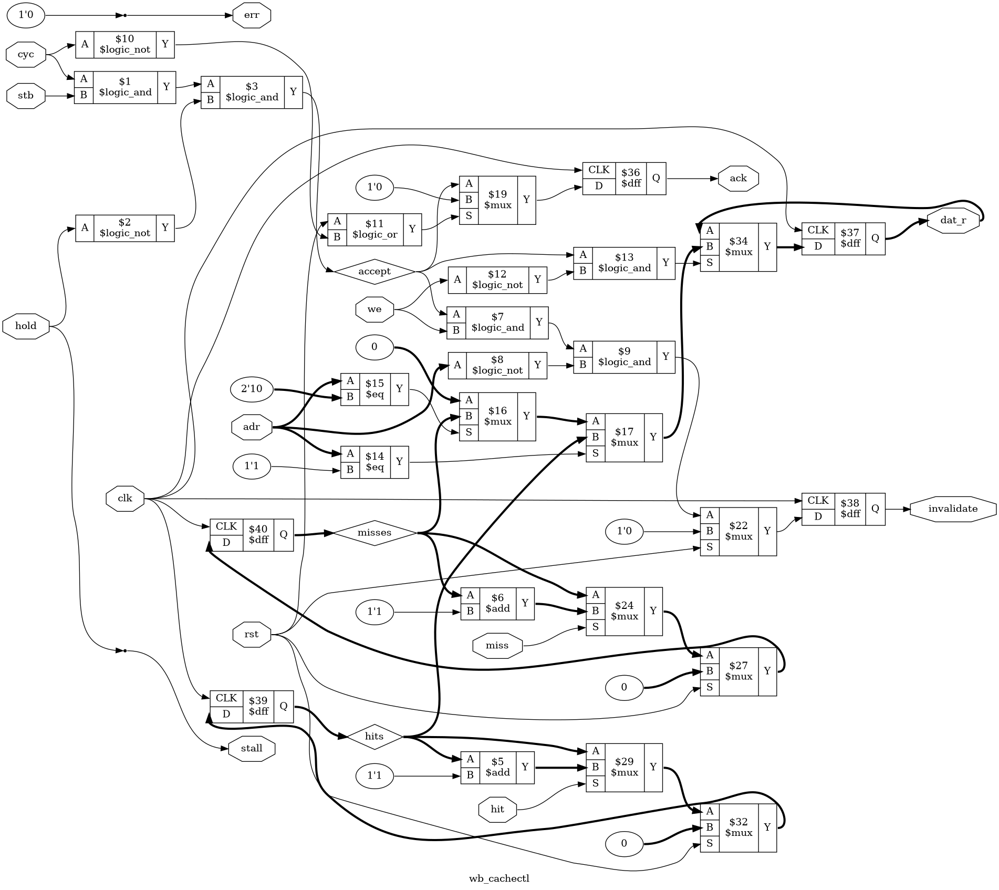

# Tutorial 30: Instruction Cache

In [Tutorial 28](../28-spi-boot/README.md) a program waited in SPI flash, and a boot ROM
copied it into RAM before it could run. A flash can also be read where it is: map it into
the address space, and turn every fetch into an SPI read. This is called *execute in place*,
XIP. It needs no copy and no RAM for code, and it is very slow. This lesson builds it,
measures how slow, then adds an instruction cache between the core and the bus and
measures again.

The cache is direct-mapped, with tags and valid bits, and keeps its data and tags in RAM
that synthesis can put in block RAM. That RAM takes a clock to read, which raises a
problem of its own, solved here with a guess. The core's `fence` does nothing, so the
cache has an "invalidate all" register instead, and a program shows what happens without
it.

Finish Tutorials [26](../26-core-on-bus/README.md) and [28](../28-spi-boot/README.md) first.
The RAMs are written as in [Tutorial 6](../06-sync-ram/README.md). Run these commands in a
VS Code terminal, from this directory:

```bash
cd tutorials/30-icache
```

To run everything at once, use `make all`. It took 8 minutes here, starting from
`make clean`. More than half of that is the lockstep test.

Nothing here ran on hardware. The flash is Tutorial 24's behavioural model, which is our
own, written from datasheet behaviour. It is not a vendor model and matches no real part.

## The system

```text
 +-------+  native  +--------+  native  +--------------+  Wishbone  +----------+ +--> wb_ram       RAM, 64 KiB
 | rv32i |--------->| icache |--------->| rv_wb_bridge |----------->|   wb_    |-+--> wb_gpio      LEDs
 |       |<---------|        |<---------|              |<-----------| inter-   | +--> wb_counters  cycles, instret
 +-------+          +--------+          +--------------+            | connect  | +--> wb_cachectl  invalidate, hits, misses
                      ^   |                                         +----------+ +--> wb_xip       flash, read in place
                      |   +-- hit, miss ----> wb_cachectl                                   |
                      +------ invalidate <--- wb_cachectl                                   +--SPI--> flash
```

[`rtl/soc.v`](rtl/soc.v) is Tutorial 26's system, cut down to what this lesson measures.
The UART, the AXI4-Lite block, the boot ROM and Tutorial 28's SPI and CRC slaves are left
out: the programs here report through registers and `gpio_out`, and the flash belongs to
the XIP slave. These files are copied from earlier tutorials, **unchanged**:

| File | From |
| ---- | ---- |
| `rtl/rv32i.v`, `rtl/rv_decode.v`, `rtl/rv_alu.v`, `rtl/rv_regs.v`, `rtl/enreg.v` | [Tutorial 21](../21-riscv-core/README.md), the core |
| `rtl/rv_wb_bridge.v`, `rtl/wb_ram.v`, `rtl/wb_gpio.v`, `rtl/wb_counters.v` | [Tutorial 26](../26-core-on-bus/README.md) |
| `rtl/wb_interconnect.v`, `formal/wb_checker.v` | [Tutorial 22](../22-wishbone/README.md) |
| `rtl/spi_master.v`, `rtl/shift_reg.v`, `tb/spi_flash_model.v` | [Tutorial 24](../24-spi/README.md) |
| `tools/asm.py`, `tools/iss.py` | [Tutorial 21](../21-riscv-core/README.md) |
| `tools/pad_hex.py` | [Tutorial 26](../26-core-on-bus/README.md) |

The core is Tutorial 21's, unchanged: `cmp rtl/rv32i.v ../21-riscv-core/rtl/rv32i.v` prints
nothing. So is the bridge. The cache fits between them because both of its ports are the
native interface: the core cannot tell the cache from a memory, and the bridge cannot tell
it from the core.

These are new:

| File | What it is |
| ---- | ---------- |
| [`rtl/icache.v`](rtl/icache.v) | The instruction cache |
| [`rtl/wb_xip.v`](rtl/wb_xip.v) | The flash as a read-only Wishbone slave |
| [`rtl/wb_cachectl.v`](rtl/wb_cachectl.v) | The cache's invalidate register, and hit and miss counters |
| [`rtl/soc.v`](rtl/soc.v), [`rtl/soc_map.vh`](rtl/soc_map.vh) | The system and its map |
| [`formal/map_check.v`](formal/map_check.v) | Tutorial 26's map proof, for this map |
| [`formal/spi_master_free.v`](formal/spi_master_free.v) | A stand-in for the SPI master, for `wb_xip`'s proof |
| [`programs/`](programs) | `tight.asm`, `selfmod.asm`, and `jump_to_flash.asm` |
| [`tools/gen_programs.py`](tools/gen_programs.py) | Writes `build/straight.asm` and `build/bigloop.asm` |
| [`tools/flash_hex.py`](tools/flash_hex.py) | A program as a flash image, at flash address 0 |
| [`tools/tables.py`](tools/tables.py) | Prints the measurements as tables |

## The memory map

| Byte address | Slave | Device | Cached |
| ------------ | ----- | ------ | ------ |
| `0x0000_0000` to `0x0000_FFFF` | 0 | RAM, 64 KiB | yes |
| `0x1000_1000` to `0x1000_1003` | 1 | GPIO, as in Tutorial 26 | no |
| `0x1000_2000` to `0x1000_2007` | 2 | Counters, as in Tutorial 26 | no |
| `0x1000_7000` to `0x1000_700F` | 3 | **Cache control** | no |
| `0x4000_0000` to `0x40FF_FFFF` | 4 | **XIP flash**, 16 MiB, read-only | yes |
| Anything else | | `err`, from the interconnect's default responder | |

GPIO and the counters are where Tutorial 26 put them. `0x1000_3000` to `0x1000_6FFF` are
left for Tutorials 27 to 29, and `0x2000_0000` for Tutorial 26's AXI4-Lite bridge.

**Only RAM and the flash are cacheable.** A word there changes only when the program
writes it. A peripheral's register can change on every read: the cycle counter does, so a
cached copy of it would be wrong at once. Peripherals are seldom fetched from, but the
rule is about any fetch: `soc.v` works out `cacheable` from the address, and the cache
passes everything else straight through. Loads and stores are never cached at all. This
is an instruction cache.

### Cache control, `0x1000_7000`

| Offset | Name | Access | Meaning |
| ------ | ---- | ------ | ------- |
| `+0x0` | `INVALIDATE` | write | Clears every line. The data is ignored. Reads 0 |
| `+0x4` | `HITS` | read | Cacheable fetches the cache answered by itself, since reset |
| `+0x8` | `MISSES` | read | Cacheable fetches that had to fill a line, since reset |
| `+0xC` | | read | 0 |

Every request is answered on the next clock. Writes to the counters are ignored.

## Execute in place

[`rtl/wb_xip.v`](rtl/wb_xip.v) maps the flash at `0x4000_0000`. A read of a word becomes
Tutorial 24's read command: CS falls, `0x03` and three address bytes go out, four bytes
come back. The request stalls on the bus until the word is in, then gets `ack` on the next
clock, as Tutorial 28's `STREAM` register did. A write gets `err`, so a store to the flash
is a store access fault, cause 7. The 24-bit address reaches 16 MiB, so the region is that
big. The flash model has 64 KiB, and its address wraps.

The SPI master is Tutorial 24's, unchanged, at divider 1: SCLK is a quarter of the clock,
the fastest the model's `0x03` allows, as Tutorial 28 found.

**Streaming.** A NOR flash goes on sending bytes, from the next address up, for as long as
SCLK runs and CS stays low. So `STREAM` 1, the default, leaves CS low after a word. If the
next read is for the next word, it needs only its four bytes. Any other word ends the open
command first. Tutorial 24's master raises CS only after a byte marked "last", and an open
stream has none: nobody knew which byte would be the last. Sending one more byte only to
raise CS would cost a whole byte, so the slave resets the master instead, which raises CS
on the next clock, then keeps CS high for `DIV` + 1 more clocks before the next command.

### How slow it is

`make sim` times each program from three places. Here the programs run with no cache
(`make measure`, below), and each fetch from the flash costs:

| Flash read | Clocks per word fetched |
| ---------- | ----------------------- |
| One command per word (`STREAM` 0) | 275 |
| Streamed, the next word along | about 139 |

275 clocks is eight bytes of 32 clocks each, plus a few to start and finish. 139 is four.
The core with RAM on the bus took 3 clocks for an ALU instruction. From the flash:

| Program, no cache | RAM, no wait | Flash, one command per word | Flash, streamed |
| ----------------- | ------------ | --------------------------- | --------------- |
| `tight.asm`, a 3-instruction loop | 3.01 | 276.90 | 186.02 |
| `straight.asm`, 512 instructions in a row | 3.01 | 276.52 | 140.52 |
| `bigloop.asm`, a 384-instruction loop | 3.00 | 276.18 | 140.44 |

Clocks per instruction, and nearly all of them are the fetch. A program from the flash
runs about 90 times slower than from RAM, and straight code about 47 times slower with
streaming. Streaming helps straight code most. A loop jumps back every time round, and each jump costs a new command:
`tight.asm` jumps once in three instructions, so it gains least.

## The cache

[`rtl/icache.v`](rtl/icache.v) is direct-mapped: each address can live in one line only.
Its two parameters are `LINES` and `LINE_WORDS`, both powers of 2, so it holds
`4 * LINES * LINE_WORDS` bytes. The default, 64 lines of 4 words, is 1 KiB. A byte address
splits like this, for the default:

```text
 31                       10 | 9            4 | 3    2 | 1 0
 tag, 22 bits                | line, 6 bits   | word   | byte, always 0
```

Each line has:

- **A tag**: the address bits above the line index, of the memory the line holds. Two
  addresses with the same line index compete for one line. The tag says which one is
  there.
- **A valid bit**: whether the line holds anything at all. After reset none does.
- **The data**: `LINE_WORDS` words.

A fetch from a cacheable address is a **hit** if its line is valid and the tag matches.
The cache answers it with no transfer on the bus. Otherwise it is a **miss**, and the cache
fills the whole line from the bus, then answers. Everything else passes straight through,
wires only, with no clock added: loads, stores, and fetches from addresses that are not
cacheable.

### Storage, and why the valid bits are not in the RAM

The data and the tags are two simple dual-port RAMs, written the way Tutorial 6 wrote
`sync_ram`, one write port and one read port, so synthesis can put them in block RAM.
"Map it to real FPGAs" below shows that it did. The valid bits are flip-flops. An
invalidate clears all of them in one clock, and a block RAM reaches one address per clock,
as Tutorial 6 said about a reset.

### A block RAM is a clock late, so the cache guesses

A block RAM gives its data a clock after the address. The core puts a fetch's address on
`mem_addr` at the same edge that raises `mem_valid`. So the cache could read the tag and
the data in the first clock of a fetch, and answer in the second at the earliest: two
clocks per fetch, the same as RAM on the bus. A cache built from block RAM would be no
faster than a block RAM.

So the cache reads ahead. After every fetch it answers, it reads the next word along,
`pc + 4`, while the core executes. If the next fetch asks for that word, as it does unless
the instruction jumped, the tag and the data are already out of the RAMs, and the hit is
answered in the first clock of `mem_valid`. `ra_q` is the word the RAMs show, and `fresh`
says nothing was written since. If the fetch asks for another word, after a jump, the
cache reads that one, and answers a clock later. Loads and stores in between do not
disturb the guess, since they do not use the cache's RAMs.

The result, with RAM on the bus answering on the next clock:

| `tight.asm` from RAM | Clocks per instruction |
| -------------------- | ---------------------- |
| No cache, Tutorial 26's bus | 3.01 |
| With the cache | 2.42 |

The loop's `add` and `addi` are fetched in one clock, and the `bnez` that jumps back makes
the next fetch take two. That is `(2 + 2 + 3) / 3`, 2.33, and the misses at the start make
up the rest. Tutorial 26 said a hit could come back in the same clock. It can, but only
because of the guess.

### Filling a line

A miss writes the new tag and clears the line's valid bit at once, then reads the line's
words from the bus one transfer at a time, from its first word to its last, and writes each
into the data RAM. Each read is a native transfer to `rv_wb_bridge`, exactly like a fetch
from the core. The word the core asked for is caught as it goes past. When the last word
is in, the line becomes valid, and the cache answers the fetch in the next clock.

**No critical word first.** A cache could start the fill at the word the core asked for,
answer it at once, and let the core run while the rest arrives. Two reasons it is not done
here:

- This core cannot run while the line fills. It has one memory port, and the cache's other
  side is busy with the fill, so a load, a store or the next fetch would wait anyway. The
  core would gain only for fetches from the same line that were already in, and the cache
  would need a second path to answer them while it fills.
- From the flash, starting in the middle of a line and wrapping back to its first word
  breaks the stream. The measurements above show that costs a new command: 275 clocks for
  that word in place of 139. This was not built and measured, so how it would come out
  overall is not known.

So the fill goes in order, the core waits for the whole line, and the logic stays simple.
That the miss returns the word it asked for, and the line ends up right, is checked by the
proof below.

### The fill, from the flash

The first miss of `tight.asm` from the flash, in `make sim`'s waveform (`build/tb_icache.vcd`,
see "View the waveform"):

| From | What happens |
| ---- | ------------ |
| 165 ns | The core asks for `0x4000_0000`. The cache's RAMs show the guess from RAM, so it reads this word |
| 175 ns | `miss`: line 0 holds the jump in RAM, with another tag |
| 185 ns | `state` 1, the fill. `d_valid` rises with `0x4000_0000` |
| 205 ns | `cs_n` falls: the read command starts |
| 2925 ns | `d_ready` for the first word, 274 clocks after `d_valid` rose |
| 4315, 5705, 7095 ns | The other three words, 139 clocks apart: the stream did not stop |
| 7105 ns | `state` 2: `mem_ready` with `00000513`, `li a0, 0` |
| 7125 ns | The fetch of `0x4000_0004` is answered in the same clock: `hit` and `mem_ready` both high |

A miss costs the whole line, so the first instruction waited for all four words. The
three after it were hits, in one clock each.

## Measurements

`make measure` builds the testbench for each cache below, runs every program from RAM with
no wait, from RAM with three wait states, and from the flash, and prints tables. RAM with
three wait states takes 5 clocks per word, a stand-in for slower memory such as SDRAM.
The flash is streamed except where it says otherwise. Each cell is clocks per instruction,
from the program's first fetch to its trap. The hit rate is the same from every place,
since the fetches are the same.

The programs:

| Program | What it is | Code |
| ------- | ---------- | ---- |
| `tight.asm` | 3 instructions, round 100 times | 40 bytes |
| `straight.asm` | 512 ALU instructions, each run once, then a check | 2.1 KiB |
| `bigloop.asm` | A loop of 384 ALU instructions, 1.5 KiB, round 4 times | 1.6 KiB |
| `selfmod.asm` | Copies code to RAM and runs it, below | 148 bytes |

Each ends in `ebreak` if its own check passes, and `ecall` if not.
[`tools/gen_programs.py`](tools/gen_programs.py) writes the two long ones and works out their
answers in Python.

**`tight.asm`**, clocks per instruction:

| Cache | RAM, no wait | RAM, 3 waits | Flash | Hit rate |
| ----- | ------------ | ------------ | ----- | -------- |
| no cache, flash one word per command | 3.01 | 6.02 | 276.90 |  |
| no cache, flash streamed | 3.01 | 6.02 | 186.02 |  |
| 256 B: 64 lines of 1 word | 2.42 | 2.51 | 6.91 | 97.1% |
| 256 B: 16 lines of 4 words | 2.42 | 2.54 | 8.26 | 99.0% |
| 1 KiB: 256 lines of 1 word | 2.42 | 2.51 | 6.91 | 97.1% |
| 1 KiB: 64 lines of 4 words | 2.42 | 2.54 | 8.26 | 99.0% |
| 1 KiB: 32 lines of 8 words | 2.44 | 2.60 | 10.08 | 99.3% |
| 4 KiB: 256 lines of 4 words | 2.42 | 2.54 | 8.26 | 99.0% |
| 1 KiB: 64 lines of 4 words, flash one word per command | 2.42 | 2.54 | 13.16 | 99.0% |

**`straight.asm`**, clocks per instruction:

| Cache | RAM, no wait | RAM, 3 waits | Flash | Hit rate |
| ----- | ------------ | ------------ | ----- | -------- |
| no cache, flash one word per command | 3.01 | 6.01 | 276.52 |  |
| no cache, flash streamed | 3.01 | 6.01 | 140.52 |  |
| 256 B: 64 lines of 1 word | 5.01 | 8.02 | 142.53 | 0.0% |
| 256 B: 16 lines of 4 words | 4.26 | 7.26 | 141.78 | 75.0% |
| 1 KiB: 256 lines of 1 word | 5.01 | 8.02 | 142.53 | 0.0% |
| 1 KiB: 64 lines of 4 words | 4.26 | 7.26 | 141.78 | 75.0% |
| 1 KiB: 32 lines of 8 words | 4.13 | 7.14 | 141.65 | 87.5% |
| 4 KiB: 256 lines of 4 words | 4.26 | 7.26 | 141.78 | 75.0% |
| 1 KiB: 64 lines of 4 words, flash one word per command | 4.26 | 7.26 | 277.78 | 75.0% |

**`bigloop.asm`**, clocks per instruction:

| Cache | RAM, no wait | RAM, 3 waits | Flash | Hit rate |
| ----- | ------------ | ------------ | ----- | -------- |
| no cache, flash one word per command | 3.00 | 6.00 | 276.18 |  |
| no cache, flash streamed | 3.00 | 6.00 | 140.44 |  |
| 256 B: 64 lines of 1 word | 5.01 | 8.01 | 142.45 | 0.0% |
| 256 B: 16 lines of 4 words | 4.26 | 7.28 | 142.32 | 74.9% |
| 1 KiB: 256 lines of 1 word | 4.28 | 6.55 | 108.79 | 24.2% |
| 1 KiB: 64 lines of 4 words | 3.73 | 6.03 | 109.38 | 80.8% |
| 1 KiB: 32 lines of 8 words | 3.67 | 6.02 | 111.79 | 90.2% |
| 4 KiB: 256 lines of 4 words | 2.59 | 3.36 | 38.15 | 93.5% |
| 1 KiB: 64 lines of 4 words, flash one word per command | 3.73 | 6.03 | 213.03 | 80.8% |

**`selfmod.asm`**, clocks per instruction:

| Cache | RAM, no wait | RAM, 3 waits | Flash | Hit rate |
| ----- | ------------ | ------------ | ----- | -------- |
| no cache, flash one word per command | 3.55 | 7.19 | 270.05 |  |
| no cache, flash streamed | 3.55 | 7.19 | 180.24 |  |
| 256 B: 64 lines of 1 word | 5.33 | 8.48 | 152.50 | 16.3% |
| 256 B: 16 lines of 4 words | 5.33 | 9.33 | 175.29 | 72.1% |
| 1 KiB: 256 lines of 1 word | 5.33 | 8.48 | 152.50 | 16.3% |
| 1 KiB: 64 lines of 4 words | 5.33 | 9.33 | 175.29 | 72.1% |
| 1 KiB: 32 lines of 8 words | 6.40 | 12.12 | 225.24 | 79.1% |
| 4 KiB: 256 lines of 4 words | 5.33 | 9.33 | 175.29 | 72.1% |
| 1 KiB: 64 lines of 4 words, flash one word per command | 5.33 | 9.33 | 291.36 | 72.1% |

What the tables say:

- **A loop that fits is where a cache earns its keep.** `tight.asm` from the flash goes from
  186 clocks per instruction to 8.26: 22 times faster. Its 3 misses fetch 12 words, and
  every other fetch is a hit. From slow RAM it goes from 6.02 to 2.54.
- **Straight code gains nothing.** Every word is fetched once, so every line is a miss, and
  the cache only adds its own clocks. From the flash, 141.78 against 140.52 with no cache.
  From RAM, 4.26 against 3.01: each miss costs a clock to look up and a clock to answer, on
  top of the fill.
- **A loop bigger than the cache thrashes.** `bigloop.asm` is 1.5 KiB. In a 1 KiB cache its
  first and last half KiB use the same lines, and throw each other out every time round:
  the hit rate is 80.8%, most of it from the other words of each line: with 1-word lines it
  is 24.2%. At 4 KiB the loop
  fits, only its first time round misses, and the flash's 140 clocks per instruction fall
  to 38. The size that matters is the size of the loop.
- **Longer lines help straight code and hurt small loops.** With 1-word lines nothing
  benefits from being next to something else: `straight.asm` hits 0%. With 8-word lines it
  hits 87.5%. But a miss fetches every word of its line, needed or not: `tight.asm` from
  the flash takes 6.91 with 1-word lines, 8.26 with 4 and 10.08 with 8, and
  `selfmod.asm` gets slower too.
- **Streaming and lines go together.** A line fill reads its words in order, so with the
  stream left open, it costs one command and then 139 clocks a word, and the next line
  along costs no command at all. With one command per word, the same 1 KiB cache takes
  `bigloop.asm` from 109.38 to 213.03.

None of these is a property of the cache alone. They are properties of these programs on
this cache, with this core, which waits for every miss.

## Code that writes code

[`programs/selfmod.asm`](programs/selfmod.asm) copies a two-instruction routine into RAM at
`0x80C0` and calls it. Routine A returns 1. Then it copies routine B, which returns 2, to
the same place, and calls it twice: once straight away, and once after a store to
`INVALIDATE`. It puts the three answers in `gpio_out`, a byte each:

| | First call | Second call | Third call, after the invalidate | `gpio_out` |
| --- | --- | --- | --- | --- |
| No cache | 1 | 2 | 2 | `00020201` |
| With the cache | 1 | **1** | 2 | `00020101` |

`make sim` checks both, and prints the second in each `selfmod` line. The store that
copied B went straight past the cache into RAM, as every store does. The cache still held
the line from the first call, with A in it, so the second call ran A. Only the invalidate
made the cache fetch from RAM again.

RISC-V has an instruction for this, `fence.i`: it says "the instructions I wrote are to be
fetched from now on". Tutorial 21's core treats it as illegal, and its `fence` is a NOP, so
the core cannot tell the cache anything. The memory-mapped `INVALIDATE` does that job.
Every program that writes code, then runs it, needs one: a loader that copies a program
into RAM, as Tutorial 28's boot ROM did, or a program that loads a second one over the
first. The first program run after a reset is safe, since reset clears every line.

`0x80C0` was chosen so that the routine's line is not used by the program's own code for
any cache measured here. Otherwise the second call might miss and run B by luck, and the
bug would hide.

The invalidate takes effect at the right time without the core's help. `wb_cachectl` raises
`invalidate` in the clock it answers the store, and the cache clears its lines at the edge
that ends that clock, which is the edge where the core finishes the store. The core's next
fetch already finds the cache empty.

## Simulate

[`tb/tb_icache.v`](tb/tb_icache.v) runs each program from the flash, then from RAM with no
wait and with three wait states, and checks how it stopped and, for `selfmod.asm`,
`gpio_out`. It also counts every fetch itself: a cacheable fetch is a hit if no word was
fetched on the far side of the cache while it waited, and a miss otherwise. A miss must
fetch exactly `LINE_WORDS` words, and the counts must equal the cache's own `HITS` and
`MISSES`. Then it runs the programs again with every slave stalling at random, about one
clock in four.

```bash
make sim
```

The first run of the first version never ended. `ra_q` had no reset, so Icarus started it
at `x`. Then `looked`, `hit` and `miss` were `x` too, the next `ra` was `ra_q` again, and
the cache waited forever on the first fetch. On a real part `ra_q` would hold some value,
and the cache would have gone on: it trusts the RAMs only when `ra_q` matches the fetch,
and after reset every line is invalid anyway.
The proofs passed all along, because a solver has no `x`. `ra_q` now resets to 0.

It prints a `RESULT` line for each run, then the stalled runs, and ends with `PASS`:

```text
=== 64 lines of 4 words, flash reads streamed
RESULT 64 x 4 stream  tight    xip       2519 clocks   305 instrs  CPI    8.26  hits   303 misses    3  hit rate  99.02%  far words    12  clocks/word 150.33
RESULT 64 x 4 stream  straight xip      74717 clocks   527 instrs  CPI  141.78  hits   396 misses  132  hit rate  75.00%  far words   528  clocks/word 139.26
RESULT 64 x 4 stream  bigloop  xip     170639 clocks  1560 instrs  CPI  109.38  hits  1262 misses  299  hit rate  80.85%  far words  1196  clocks/word 139.81
RESULT 64 x 4 stream  selfmod  xip       7362 clocks    42 instrs  CPI  175.29  hits    31 misses   12  hit rate  72.09%  far words    48  clocks/word 133.48  gpio 00020101
RESULT 64 x 4 stream  tight    ram0       738 clocks   305 instrs  CPI    2.42  hits   303 misses    3  hit rate  99.02%  far words    12  clocks/word   2.00
RESULT 64 x 4 stream  straight ram0      2244 clocks   527 instrs  CPI    4.26  hits   396 misses  132  hit rate  75.00%  far words   528  clocks/word   2.00
RESULT 64 x 4 stream  bigloop  ram0      5816 clocks  1560 instrs  CPI    3.73  hits  1262 misses  299  hit rate  80.85%  far words  1196  clocks/word   2.00
RESULT 64 x 4 stream  selfmod  ram0       224 clocks    42 instrs  CPI    5.33  hits    31 misses   12  hit rate  72.09%  far words    48  clocks/word   2.00  gpio 00020101
RESULT 64 x 4 stream  tight    ram3       774 clocks   305 instrs  CPI    2.54  hits   303 misses    3  hit rate  99.02%  far words    12  clocks/word   5.00
RESULT 64 x 4 stream  straight ram3      3828 clocks   527 instrs  CPI    7.26  hits   396 misses  132  hit rate  75.00%  far words   528  clocks/word   5.00
RESULT 64 x 4 stream  bigloop  ram3      9404 clocks  1560 instrs  CPI    6.03  hits  1262 misses  299  hit rate  80.85%  far words  1196  clocks/word   5.00
RESULT 64 x 4 stream  selfmod  ram3       392 clocks    42 instrs  CPI    9.33  hits    31 misses   12  hit rate  72.09%  far words    48  clocks/word   5.00  gpio 00020101
=== mode 1: every slave stalls at random
mode 1  tight    RAM    ended with cause 3 at pc 00000020
mode 1  straight RAM    ended with cause 3 at pc 0000083c
mode 1  bigloop  RAM    ended with cause 3 at pc 00000648
mode 1  selfmod  RAM    ended with cause 3 at pc 00000068  gpio 00020101
mode 1  tight    flash  ended with cause 3 at pc 40000020
mode 1  straight flash  ended with cause 3 at pc 4000083c
mode 1  bigloop  flash  ended with cause 3 at pc 40000648
mode 1  selfmod  flash  ended with cause 3 at pc 40000068  gpio 00020101
PASS
```

## View the waveform

Use a fresh `make sim`. The testbench writes `build/tb_icache.vcd` only when given
`+waves`, which `make sim` passes and `make verilator` does not, since Verilator ignores
`$dumpoff`. It keeps only the first run, `tight.asm` from the flash, and only one level of
`tb_icache`, `tb_icache.dut` and `tb_icache.dut.g_cache.u_icache`, the signals used below.
The file is 0.4 MB. After that run every signal, even `clk`, shows as `x`, drawn in red. That is
what `$dumpoff` writes, not the design.

Open `build/tb_icache.vcd` as in [Tutorial 1](../01-d-flip-flop/README.md). From `tb_icache`,
add `clk` and `cs_n`. From `dut`, add `mem_valid`, `mem_addr`, `mem_ready`, `mem_rdata`,
`d_valid`, `d_addr` and `d_ready`. From `u_icache`, add `state`, `ra_q`, `hit` and `miss`.
The clock rises at 5, 15, 25 ns and so on.

**The first miss, and the hits after it.** This is the table in "The fill, from the flash":

- At 165 ns `mem_valid` is high with `mem_addr` `40000000`. `ra_q` is 2: the cache read
  ahead to the word after the jump in RAM. That is not this word, so it reads word 0.
- At 175 ns `ra_q` is 0 and `miss` is high: line 0 is valid, but holds the jump's line from
  RAM, whose tag differs.
- At 185 ns `state` is 1 and `d_valid` rises with `d_addr` `40000000`. At 205 ns `cs_n`
  falls. `d_ready` is high in the clock from 2925 ns, and at the edge that ends it
  `d_addr` moves to `40000004`. The next three come in the clocks from 4315, 5705 and
  7095 ns.
- At 7105 ns `state` is 2 and `mem_ready` is high with `mem_rdata` `00000513`.
- At 7115 ns the core executes, `mem_valid` is low, and `ra_q` moves to 1: the read ahead.
- At 7125 ns `mem_valid` rises with `40000004`, and `hit` and `mem_ready` are high in the
  same clock. The same at 7145 and 7165 ns for the next two words.
- At 7185 ns the fetch of `40000010` is in the next line. `ra_q` was right, 4, so `miss`
  comes in the first clock, and the next fill starts at 7195 ns.

## Lint and Verilator

```bash
make lint
make verilator
```

`make lint` checks the whole system with and without the cache, then each new module on
its own, the cache also with 1-word lines and the XIP slave also without streaming. No line
starts with `%Warning`. `make verilator` runs the same testbench under Verilator and prints
the same numbers in every line. Only the spacing differs: Verilator right-aligns the
program names, and prints `pc` without leading zeros.

## Test in Python

[`tb/test_icache.py`](tb/test_icache.py) runs programs on the whole system in lockstep with
Tutorial 21's reference model, with the cache in the loop and every slave stalling at
random on 3 clocks in 10. [`tb/lockstep.py`](tb/lockstep.py) and
[`tb/soc_model.py`](tb/soc_model.py) are Tutorial 28's, for this map. The model has **no
cache**. So the test checks that the cache cannot be seen: every instruction the core runs,
from a hit or a miss, from RAM or the flash, must be the one the model runs from memory,
with the same results.

The top level, [`tb/cache_top.v`](tb/cache_top.v), has a small cache, 8 lines of 4 words,
128 bytes, so that every program is bigger than it, and lines are thrown out all the time.

The checker also watches the cache's far side: Tutorial 21's interface rules, as
`rv_wb_bridge` relies on them, and that each miss fetched exactly its own line, in order.

There is one thing the model cannot know: a word stored to after its line was fetched,
with no invalidate since. The cache may still hand out the old word. The checker
remembers such stores, and when the core runs one of those words, it stops the program
there without failing, and says so.

```bash
make cocotb
```

Look for `TESTS=2 PASS=2 FAIL=0`, and these lines:

```text
stopped where code was stale: selfmod from RAM at 000080c0, selfmod from flash at 000080c0
directed: 4945 instructions in lockstep, 3845 hits, 1100 misses (77.8% hits), 303269 stalled requests, fetched from ram, xip
random: 160 programs, 40 started in the flash, 118 ended in a trap, 0 stopped at stale code
random: 20500 instructions in lockstep, 15754 hits, 4760 misses (76.8% hits), 927573 stalled requests, fetched from ram, xip
```

`directed_programs` runs the four programs from RAM and from the flash, and `selfmod.asm`
once more without its second call, the right way to write such a program. `selfmod.asm`
itself must be stopped by the checker at the second call of `0x80C0`, and it is. Then four
small programs for the paths a cache must leave alone: a fetch from a hole, a store to the
flash, a fetch of an `ebreak` from the GPIO register, which is not cacheable, and loads
from the flash, which pass through.

`random_programs` is Tutorial 21's random test, with two changes. A program sits at `0x100`
in RAM and at the same place in the flash, and starts in one or the other. A `jalr` to an
absolute address goes to either copy, so one program runs from both, and their lines meet
in the cache with the same index and different tags. And stores always use a base register
that points into the data area, so a random program never writes its own code: it would
need an invalidate, which a random program does not know to do.

## Prove it with formal verification

[`icache.sby`](icache.sby) has seven tasks:

| Task | Proves |
| ---- | ------ |
| `cache` | The cache, 4 lines of 2 words: the property below, and the native interface on both ports |
| `cache_l1` | The same, 4 lines of 1 word, where a line has no word bits |
| `cache_cover` | The covers below |
| `xip`, `xip_cover` | `wb_xip` with Tutorial 22's `wb_checker`, as slave |
| `map`, `map_cover` | Tutorial 22's interconnect with this map, as in Tutorial 26, and that `cacheable` is exactly RAM and the flash |

```bash
make formal
```

Look for `DONE (PASS, rc=0)` for each, and the last line, `7 tasks passed`. Each took
10 seconds or less here.

### The cache's property

The proof keeps a model of the memory behind the cache, for one word, as Tutorial 6 did
for one word of its RAM. The solver picks the word's address, `f_word`, with `anyconst`.
`f_mem` is what the memory holds there: any value at the start, and changed by every store
that reaches it. A read of that word on the far side returns `f_mem`. That is all the
proof knows of memory.

`f_stale` is high when the word was written since the last invalidate, and since the last
time a fill read it. Then, and only then, may the cache hand out an old copy. The property:

```verilog
if (mem_valid && mem_ready && mem_instr && mem_addr[31:2] == f_word && !f_stale)
    assert (mem_rdata == f_mem);
```

Every word the cache returns for a fetch is the memory's word at that address, unless the
word was written since its line was filled with no invalidate since. It covers hits, the
answer after a fill, and fetches that pass through. Since `f_word` may be any address, it
holds for all of them.

The native interface, on both ports:

- **To the core:** `mem_ready` and `mem_err` only for a request, never together.
- **To the bridge:** Tutorial 21's rules, as the core keeps them, since the bridge relies on
  them: no request on the clock after reset, a request held still until it ends, word
  addresses, and a fetch is a read.
- **Pass-through:** a load, a store, or a fetch that is not cacheable goes to the bridge
  unchanged, and its answer comes straight back. A hit makes no transfer. A fill reads only
  the line of the fetch.

The core's side is assumed, as `rv_wb_bridge`'s proof did: Tutorial 21's rules, which
Tutorial 21 proved its core keeps. The far side is assumed to be what `rv_wb_bridge`
promises: an answer only to a request.

Induction needed the cache's insides tied down: while a line fills, its new tag is written
and it is not valid; the read registers show the RAMs whenever `fresh` is high; a fill that
has passed the watched word left it equal to `f_mem` and not stale. The first version
lacked the last one, and induction failed in seconds: it started in the middle of a fill
with the word already stale, and an invalidate cleared `f_stale` under it.

The covers show none of this is empty: a miss filled, a hit on the watched word, two hits
in a row, a hit in the first clock of a fetch after a fill, the watched word fresh again
after it went stale and an invalidate came, a stale word returned, an invalidate during a
fill, a fill that got `err`, a store passed through, and a fetch not cached. 10 covers, all
reached.

### `wb_xip`

For the proof the SPI master is replaced by [`formal/spi_master_free.v`](formal/spi_master_free.v),
whose outputs the solver chooses on every clock. The proof assumes only the rule of the
master's byte interface that the slave relies on: a byte is taken only when none is on the
wire, and each byte taken brings exactly one `rx_valid`. Tutorial 24 proved the master
keeps it. So the checks hold whatever the flash and the wire do, and the covers do not have
to wait for real bytes. It proves Tutorial 22's bus rules with no limit on stalls, that a
read is taken only when the word for its address is in, that it is answered with that word,
and that a write gets `err`. That the word is the flash's is shown by simulation only.

### What is not proved

- **Speed.** None of the timing above is proved. It is measured.
- **The whole system.** The cache, the XIP slave and the map are proved on their own.
- **The flash.** As in Tutorial 28: the model checks its own timing rules, and nothing more.
- **Large caches.** The proofs use 4 lines. The design is the same at any size, but the
  proof was not run at others.

## See the logic

```bash
make schematic
```

The cache itself, even at two lines of one word, draws as a tangle of hundreds of cells
that nobody could read. This draws the cache control slave. Click `build/wb_cachectl.png`
in the Explorer:



- At the top left, `accept` is `$3`: `cyc` and `stb` (`$1`) and not `hold` (`$2`). `stall` is
  `hold`, and `err` is 0.
- `invalidate` is the flip-flop `$38`. It loads `$9`: `accept`, a write (`$7`), and `adr`
  0 (`$8`), through `$22`, which clears it on `rst`.
- At the bottom, `hits` is `$39`: `$5` adds one, `$29` takes it when `hit` is high, and `$32`
  clears it on `rst`. `misses`, `$40`, is the same with `$6`, `$24`, `$27` and `miss`.
- `dat_r`, `$37`, loads when a read is accepted (`$13`, through `$34`). `$17` picks `hits` when
  `adr` is 1 (`$14`), and `$16` picks `misses` when `adr` is 2 (`$15`), or 0.
- `ack`, `$36`, is `accept` on the next clock, cleared by `rst` or no `cyc` (`$11`, `$19`).

## Map it to real FPGAs

```bash
make synth
```

The cache alone, at three sizes, all with 4-word lines:

| Size | Xilinx | Gowin | Cyclone V |
| ---- | ------ | ----- | --------- |
| 256 B, 16 lines | 122 `FDRE`, 4 `RAM32M`, 11 `RAM64M`. 317 cells | 162 flip-flops, 6 `RAM16SDP4`, 1 `SDPX9B`. 747 cells | 90 `MISTRAL_FF`, 1 `MISTRAL_M10K`, 24 `MISTRAL_MLAB`. 300 cells |
| 1 KiB, 64 lines | 140 `FDRE`, 8 `RAM64M`, 1 `RAMB18E1`. 560 cells | 214 flip-flops, 24 `RAM16SDP4`, 1 `SDPX9B`. 1195 cells | 118 `MISTRAL_FF`, 2 `MISTRAL_M10K`. 516 cells |
| 4 KiB, 256 lines | 314 `FDRE`, 1 `RAMB18E1`, 1 `RAMB36E1`. 1396 cells | 440 flip-flops, 1 `SDPX9B`, 2 `DPX9B`. 2531 cells | 314 `MISTRAL_FF`, 5 `MISTRAL_M10K`. 1409 cells |

Block RAM, per family, for the default 1 KiB cache: one `RAMB18E1` on Xilinx, one `SDPX9B`
on Gowin, two `M10K` on Cyclone V. The rest of the memory went into lookup-table RAM:
`RAM64M` and `RAM32M` on Xilinx, `RAM16SDP4` on Gowin, `MLAB` on Cyclone V. Which array
went where was not traced, but the sizes suggest it: on Xilinx the 1 KiB of data fits one
`RAMB18E1`, and the 64 tags of 22 bits went into the eight `RAM64M`. At 256 bytes the data
is small enough that Xilinx used no block RAM at all, and at 4 KiB the tags got a block of
their own. Gowin's flip-flop count is the sum of `DFF`, `DFFE`, `DFFR` and `DFFRE`.

The flip-flops grow with the number of lines, since every line has a valid bit in a
flip-flop: 174 more on Xilinx from 64 lines to 256. That is the price of an invalidate in
one clock. A cache with thousands of lines would rather clear its valid bits one line per
clock, or keep a generation number in the tag.

The whole system, with the default cache and `tight.asm` in RAM:

| Family | Flip-flops | Memory | Total cells |
| ------ | ---------- | ------ | ----------- |
| Xilinx | 1759 `FDRE`, 1 `FDSE` | 16 `RAMB36E1`, 1 `RAMB18E1`, 8 `RAM64M` | 4822 |
| Gowin | 1834 (`DFF`, `DFFE`, `DFFR`, `DFFRE`, `DFFSE`) | 32 `SP`, 1 `SDPX9B`, 24 `RAM16SDP4` | 17282 |
| Cyclone V | 1740 `MISTRAL_FF` | 66 `MISTRAL_M10K` | 4905 |

The 64 KiB RAM took the same blocks as in Tutorial 26: 16 `RAMB36E1`, 32 `SP`, 64 `M10K`.
The cache took the rest, as it did alone. The Xilinx and Gowin totals include 45
`$scopeinfo` entries, which are bookkeeping, not cells. Gowin printed four warnings from
its own block RAM library, at `brams_map.v:114`, as in Tutorials 26 and 28. They were not
looked into, and nothing here was run on a Gowin part.

These are Yosys counts, so vendor tools can give different results, and they say nothing
about timing. The cache's longest path is likely the hit: the tag compare and the valid
bit, then `mem_ready` into the core, and the read-ahead address into the RAMs, all in one
clock. Nothing here measured it.

## Using these modules later

Tutorial 31 puts everything together. This is what it needs to know.

**`icache`**: native interface in and out. Put it between the core and `rv_wb_bridge`.

| Port | Direction | Meaning |
| ---- | --------- | ------- |
| `mem_valid`, `mem_instr`, `mem_addr`, `mem_wdata`, `mem_wstrb` | in | The core's request, as Tutorial 21 defined it |
| `mem_ready`, `mem_rdata`, `mem_err` | out | To the core. `mem_err` is the far side's, as `rv_wb_bridge` gives it |
| `cacheable` | in | `mem_addr` may be cached. Work it out from the address, as `soc.v` does |
| `invalidate` | in | Clears every line at the next edge. A line being filled is not kept |
| `d_valid`, `d_instr`, `d_addr`, `d_wdata`, `d_wstrb` | out | To `rv_wb_bridge`, under the core's rules |
| `d_ready`, `d_rdata`, `d_err` | in | From `rv_wb_bridge` |
| `hit`, `miss` | out | One clock per cacheable fetch, for counters |

| Parameter | Default | Meaning |
| --------- | ------- | ------- |
| `LINES` | 64 | Lines, a power of 2, at least 2 |
| `LINE_WORDS` | 4 | Words per line, a power of 2, at least 1 |

Timing, with a bridge that answers on the next clock: a hit takes 1 clock if it was the
word after the last fetch, and 2 otherwise. A miss takes 1 or 2 to look up, then
`LINE_WORDS` transfers, then 1. A pass-through adds nothing.

Things to know:

- **Stores do not reach the cache.** Anything that writes code must write `INVALIDATE`
  before running it: the boot ROM after its copy, for a start. That includes a second bus
  master: a DMA engine, Tutorial 29's, that writes code into RAM is invisible to the cache.
- **`mem_err` on a fill** goes to the core, and the line is not kept. In this system it
  cannot happen, since the cacheable regions never answer a read with `err`.
- **The boot ROM** could be made cacheable too, as Tutorial 28 suggested. It is read-only,
  so it is safe. Add it to `cacheable` in `soc.v`.

**`wb_xip`**: read-only Wishbone slave, 22-bit word address. Reads stall until the word is
in, about 275 clocks for a new command and 139 for the next word of an open stream, at
divider 1, then `ack` on the next clock. Writes get `err`. It owns the flash's pins.
Tutorial 28's `wb_spi` needs them too, to boot, so Tutorial 31 must give the flash to one
of them at a time, or boot from XIP and drop the copy.

**`wb_cachectl`**: Wishbone slave, `ack` on the next clock, never `err`. Its `invalidate`
output goes to the cache.

## Try it yourself

Make each change in `rtl/icache.v`, then run `make sim`, `make cocotb` and `make formal`.
Undo each change before trying the next. Every result below was observed, on a copy of this
directory. A `formal` column lists the tasks that failed. All the others passed.

| Change | `sim` | `cocotb` | `formal` fails |
| ------ | ----- | -------- | -------------- |
| **Tag compare missing a bit.** In `found`, compare `tag_q[TB-1:1] == want_tag[TB-1:1]` | `straight.asm` stopped with cause 11, its own check failing, and `bigloop.asm` with cause 2, from RAM and the flash. `tight.asm` and `selfmod.asm` passed | `straight from RAM, instruction 33: a different instruction retired`: at `00000080` the model ran `00c50513`, the core `00000513`, the word at `00000000` | `cache` and `cache_l1`, on the property, `assert (mem_rdata == f_mem)`, at step 6 |
| **Valid not cleared on invalidate.** Delete the two lines `if (invalidate) valid <= {LINES{1'b0}};` | `selfmod left gpio_out at 00010101, not 00020101`, and it stopped with cause 11, its own check of the third call failing. The other programs passed | `selfmod without call 2 from RAM, instruction 29: a different instruction retired`: at `000080c0` the model ran `00200513`, B, and the core `00100513`, A. `random_programs` passed | `cache` and `cache_l1`, on `assert (data_mem[f_slot] == f_mem)`, a valid line holding the watched word, at step 8 and 7 |
| **The word returned before the fill completes.** Add `\|\| (filling && d_ready && fill_word == want_word)` to `mem_ready`, and answer from `d_rdata` while filling | Every miss fetched 1 to 3 words, not 4. `tight.asm` never stopped, `bigloop.asm` ended in a fetch fault, cause 1, and `selfmod.asm` in an illegal instruction | `tight from RAM, instruction 0: a miss at 00000000 fetched ['00000000'], not its line in order` | `cache` and `cache_l1` at step 4, on `assert (... d_addr[31:2+WB] == mem_addr[31:2+WB])`, a fill reads only the line of the fetch, and on the core still waiting during a fill |
| **Index taken from the wrong bits.** `want_word = mem_addr[3 +: AB]`, one bit too high | `bigloop.asm` ended in a fetch fault, cause 1, and `selfmod left gpio_out at 010c0000`. `tight.asm` and `straight.asm` passed | `tight from RAM, instruction 2: a different instruction retired`: at `00000004` the model ran `06400293`, the core `00000513`, the word at 0 | `cache` and `cache_l1` at step 4 and 3, on a fill reading only the line of the fetch |

`cache_cover` passed in every case: the covers are reachable whatever the bug.

Notes on each:

- **A missing tag bit.** Addresses 1 KiB apart now look the same to the 1 KiB cache, so a
  program longer than the cache runs a word from the wrong place. `tight.asm` is 40 bytes
  and never meets its alias. In the lockstep test the cache is 128 bytes, so the alias is
  128 bytes away: `0x80` ran the word at `0x00`.
- **Valid bits kept.** Only code that writes code can see this: every other program ran
  correctly, including all 160 random ones, which never write their own code. The proof
  failed on an inside invariant before it reached the property itself, but on the same
  thing: a line still marked valid after its word changed and an invalidate came.
- **Too early.** The core went on while the cache was still filling, with `mem_addr` now
  the next fetch's, so the rest of the fill read from the wrong line. `straight.asm`
  still ended in `ebreak`, from RAM: it is straight code, and the wrong words it cached
  were never fetched again. Only the testbench's count of words per miss saw it there.
- **Wrong index.** Bit 2 of the address is now in neither the index nor the tag, so two
  neighbouring words are one to the cache. It is luck which programs survive: with the
  64-line cache `tight.asm` did, with the 8-line cache in the lockstep test it failed on
  its second word.

Every one of these makes a property fail in seconds. Simulation needs a program that
happens to meet the bug, which is why `make sim` runs four programs and the lockstep test
runs 160 random ones.
