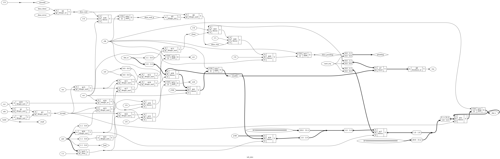

# Tutorial 31: A Small System-on-Chip

Tutorials 26 to 30 each added one thing to the RISC-V core on its bus: machine mode and
interrupts, booting from SPI flash, a DMA engine, an instruction cache. Each lesson built
its own system, with only the parts it needed. This lesson puts all of them into one
system, and runs one program that uses everything at once.

That is not just wiring. The tutorials were written side by side, and three of their
choices clash: two devices at the same address, two controllers that both want the one
flash, and a new interrupt source with no line to raise. This lesson resolves each one,
says why, and shows what breaks without the fix.

Finish Tutorials [26](../26-core-on-bus/README.md) to [30](../30-icache/README.md) first.
Run these commands in a VS Code terminal, from this directory:

```bash
cd tutorials/31-soc
```

To run everything at once, use `make all`. It took 10 minutes here, starting from `make clean`.

Nothing here ran on hardware. The flash is Tutorial 24's behavioural model, which is our
own, written from datasheet behaviour. It is not a vendor model and matches no real part.

## The system

```text
                     +--------+  native  +--------------+ cpu_*  +------------+  m_*  +-----------------+
  rv32i + CSRs ----->| icache |--------->| rv_wb_bridge |------->| wb_arbiter |------>| wb_interconnect |
  (Tutorial 27)<-----| (T30)  |<---------|    (T26)     |<-------|   (T29)    |<------|      (T22)      |
   ^      ^          +--------+          +--------------+        |            |       +-----------------+
   |      |            ^   |                         wb_dma ---->|            |          |
   |      |            |   +-- hit, miss ----------> master      +------------+          +--> 0  wb_ram        RAM, 64 KiB
   |      |            +------ invalidate <-------------------------------------------+  +--> 1  wb_uart ---------------+
   |      |                                                                           |  +--> 2  wb_gpio                 |
   |      +-- irq_timer <------------------------------------------------------------ | -+--> 5  wb_timer                |
   |                                                                                  |  +--> 3  wb_counters             |
   |                                                                                  |  +--> 4  wb_axil_bridge --> axil_regs
   |                                                                                  |  +--> 6  wb_rom        boot ROM
   |                              flash_share <------ wb_gate <-----------------------|--+--> 7  wb_spi --+
   |                               |   |  ^                                           |  +--> 8  wb_crc   |
   |                SPI flash <----+   |  +---------- wb_gate <-----------------------|--+--> 12 wb_xip --+-- pins go
   |                                   +--- go, close                                 |  +--> 9  wb_dma registers   through
   |                                                                                  +--+--> 10 wb_cachectl         flash_share
   +-- irq_external <-------- wb_intc <--- uart irq, dma done/error -------------------+--> 11 wb_intc   (new)
```

[`rtl/soc.v`](rtl/soc.v) connects everything. Reset starts the core in the boot ROM, as in
Tutorial 28. The cache sits between the core and the bridge, as in Tutorial 30, and the
arbiter between the bridge and the interconnect, as in Tutorial 29, with the DMA engine as
the second master.

### Which files are copies

Every file comes from the tutorial that last changed it. These are copied **unchanged**.
`cmp` printed nothing for each of them against the file named:

| File | From |
| ---- | ---- |
| `rtl/rv32i.v`, `rtl/rv_decode.v`, `rtl/rv_csr.v` | [Tutorial 27](../27-interrupts/README.md), the core with machine mode |
| `rtl/rv_alu.v`, `rtl/rv_regs.v`, `rtl/enreg.v` | [Tutorial 21](../21-riscv-core/README.md) |
| `rtl/rv_wb_bridge.v`, `rtl/wb_ram.v`, `rtl/wb_gpio.v`, `rtl/wb_counters.v`, `rtl/wb_axil_bridge.v` | [Tutorial 26](../26-core-on-bus/README.md) |
| `rtl/wb_timer.v` | [Tutorial 27](../27-interrupts/README.md) |
| `rtl/wb_rom.v`, `rtl/wb_crc.v`, `rom/getbyte_stream.asm` | [Tutorial 28](../28-spi-boot/README.md) |
| `rtl/wb_dma.v`, `rtl/wb_arbiter.v` | [Tutorial 29](../29-dma/README.md) |
| `rtl/icache.v`, `rtl/wb_cachectl.v`, `rtl/wb_xip.v` | [Tutorial 30](../30-icache/README.md) |
| `rtl/wb_interconnect.v`, `formal/wb_checker.v` | [Tutorial 22](../22-wishbone/README.md) |
| `rtl/axil_regs.v` | [Tutorial 23](../23-axi4-lite/README.md) |
| `rtl/spi_master.v`, `rtl/shift_reg.v`, `tb/spi_flash_model.v` | [Tutorial 24](../24-spi/README.md) |
| `rtl/crc32_byte.v` | [Tutorial 25](../25-lfsr-crc/README.md) |
| `rtl/uart.v`, `rtl/uart_tx.v`, `rtl/uart_rx.v` | [Tutorial 14](../14-uart/README.md) |
| `rtl/rr_arbiter.v`, `rtl/fixed_arbiter.v` | [Tutorial 8](../08-arbiter/README.md) |
| `sw/crt0.S`, `sw/lib.c`, `tools/asm.py`, `tools/iss.py`, `tools/bin2hex.py` | [Tutorial 27](../27-interrupts/README.md) |
| `tools/pad_hex.py` | [Tutorial 26](../26-core-on-bus/README.md) |

For example, `cmp rtl/rv32i.v ../27-interrupts/rtl/rv32i.v` prints nothing. The core is
Tutorial 27's, exactly. `bin2hex.py` is copied but not used: the boot ROM loads the
programs, so the RAM needs no `.hex` file any more.

These are copied and **changed**:

| File | From | Change |
| ---- | ---- | ------ |
| [`rtl/wb_uart.v`](rtl/wb_uart.v) | 27 | Tutorial 27 added `irq`, Tutorial 29 added `tx_ready`, each to its own copy. This is Tutorial 27's with Tutorial 29's output added |
| [`rtl/wb_spi.v`](rtl/wb_spi.v) | 28 | One new output, `busy`: STATUS bit 2 as a wire, for `flash_share` |
| [`rom/boot.asm`](rom/boot.asm) | 28 | A second entry, `reboot`, with the image's flash address in `a0`, and an invalidate of the cache before the jump |
| [`tools/mkflash.py`](tools/mkflash.py) | 28 | Takes a C program's raw binary, and places more than one thing in the flash |
| [`sw/link.ld`](sw/link.ld), [`sw/soc.h`](sw/soc.h) | 27 | The flash as a second memory, and the new devices |
| [`rtl/soc_map.vh`](rtl/soc_map.vh), [`formal/map_check.v`](formal/map_check.v) | 28, 30 | The final map, below |

And these are new: [`rtl/soc.v`](rtl/soc.v), [`rtl/wb_intc.v`](rtl/wb_intc.v),
[`rtl/flash_share.v`](rtl/flash_share.v), [`rtl/wb_gate.v`](rtl/wb_gate.v),
[`formal/gate_check.v`](formal/gate_check.v), [`soc.sby`](soc.sby), the programs in
[`programs/`](programs), and everything in [`tb/`](tb) except the flash model.

## One memory map

The tutorials' maps did not agree. Tutorial 28 put the CRC unit at `0x1000_5000`, and
Tutorial 29 put the DMA engine there too. Tutorial 30 put cache control at `0x1000_7000`.
Tutorial 27's timer is slave 5, and so was Tutorial 28's boot ROM. The final map:

| Byte address | Slave | Device | Cached |
| ------------ | ----- | ------ | ------ |
| `0x0000_0000` to `0x0000_FFFF` | 0 | RAM, 64 KiB. Empty at reset: the boot ROM fills it | yes |
| `0x0010_0000` to `0x0010_03FF` | 6 | Boot ROM, 1 KiB. Reset starts here | yes |
| `0x1000_0000` to `0x1000_0007` | 1 | UART | no |
| `0x1000_1000` to `0x1000_1003` | 2 | GPIO | no |
| `0x1000_2000` to `0x1000_2007` | 3 | Counters | no |
| `0x1000_3000` to `0x1000_300F` | 5 | Timer | no |
| `0x1000_4000` to `0x1000_401F` | 7 | SPI controller | no |
| `0x1000_5000` to `0x1000_500F` | 8 | CRC-32 | no |
| `0x1000_6000` to `0x1000_601F` | 9 | DMA registers, **moved** from `0x1000_5000` | no |
| `0x1000_7000` to `0x1000_700F` | 10 | Cache control | no |
| `0x1000_8000` to `0x1000_800F` | 11 | Interrupt control, **new** | no |
| `0x1000_9000` | | Free, for Tutorial 33's display controller | |
| `0x0100_0000` to `0x0101_FFFF` | | Free, 128 KiB for Tutorial 33's framebuffer | |
| `0x2000_0000` to `0x2000_001F` | 4 | AXI4-Lite bridge, `axil_regs` | no |
| `0x4000_0000` to `0x40FF_FFFF` | 12 | Flash, read in place by the XIP slave | yes |
| Anything else | | `err`, from the interconnect's default responder | |

- **The CRC unit keeps `0x1000_5000`, and the DMA engine moves.** The boot ROM's program
  uses the CRC unit's address, and it is in ROM: the cheaper side to move is the one in C,
  where the address is one line of [`sw/soc.h`](sw/soc.h).
- **Every peripheral starts on a 4 KiB boundary**, so a 12-bit offset from one `lui` reaches
  all of a device's registers, and no two devices share a page.
- **Slaves 0 to 5 keep Tutorial 27's numbers.** The numbers are only the order in
  `soc_map.vh`. The boot ROM, slave 5 in Tutorial 28, is now 6.
- **Cached**: RAM, the boot ROM and the flash. Their words change only when written. The
  boot ROM was not cached in Tutorial 30; Tutorial 30 said it could be.

`soc_map.vh` is the only place the map is written, and `formal/map_check.v` checks it a
second way, written from the table in its comment. The proof also checks that every base
sits on a 4 KiB boundary, that the cacheable regions are exactly RAM, the boot ROM and
the flash, and that the regions kept for Tutorial 33 belong to nobody. "Try it yourself"
puts the DMA engine back at `0x1000_5000`.

## Sharing the flash

Tutorial 28's SPI controller and Tutorial 30's XIP slave each have an SPI master of their
own, and each expects to own the flash's four pins. There is one flash.

### The choice

There were two ways out. **Boot by XIP alone**: run the program from the flash, and drop
the SPI controller. Or **keep both**, and give the pins to one at a time. This lesson keeps
both, for three reasons:

- The boot ROM's copy checks a CRC over the program before it runs a single instruction of
  it. Code run in place from the flash is not checked at all.
- Code in RAM runs at RAM speed even when it misses the cache. A miss in the flash costs a
  whole line from SPI: Tutorial 30 measured 275 clocks for the first word of a new command.
  The interrupt handler, which must be quick, lives in RAM.
- The SPI controller can do what XIP cannot: any command, such as reading the flash's ID.
  A real system also needs it to write and erase the flash.

So the program is copied to RAM and checked, and only code that is big and seldom changed
needs to stay in the flash. In the demo that is one function, `crc32_soft`, 84 bytes at
flash address `0x8000`.

### The owner

[`rtl/flash_share.v`](rtl/flash_share.v) keeps an owner: `FREE`, `SPI` or `XIP`. The pins
come from the owner. A controller only starts a command when a bus request reaches it, so
each one sits behind a [`wb_gate`](rtl/wb_gate.v), which holds its requests back, stalled,
until it owns the pins:

| From | To | When |
| ---- | -- | ---- |
| `FREE` | `SPI` | A request to the SPI controller waits |
| `FREE` | `XIP` | A request to the XIP slave waits, and none to the SPI controller |
| `SPI` | `FREE` | The SPI controller is not `busy`, no byte in TX and CS high, and no request to it waits |
| `XIP` | `FREE` | The XIP slave's CS is high, and no request to it waits |

The XIP slave leaves CS low after each word, to stream the next one, and would keep it low
until its next read, which may never come. So when a request to the SPI controller waits
while the XIP slave sits like that, `flash_share` raises `xip_close`, which resets the XIP
slave for one clock. Its master's reset raises CS, the same way `wb_xip` ends a stream by
itself. It is only done while no request to the XIP slave is on the bus and none is being
answered, so no bus transfer is cut short. The XIP slave forgets the one word it keeps.

The rule that makes this safe: a controller gets the pins only from `FREE`, and `FREE` needs
both CS high. So the CS of one is never low while the other has the pins. The proof,
below, shows it from what each controller does, and `make sim` checks on every clock that
the two CS lines are never low together.

### What it costs

In the demo, `make sim` counted, for mode 0:

```text
  flash: 3 commands by the SPI controller, 2 by the XIP slave, 29 changes of owner, 1 streams closed
  flash: requests waited for the pins 15 clocks at the SPI controller, 2 at the XIP slave
```

The three SPI commands are the boot ROM's copy, the ID and one word. The XIP slave opened
two: one served all five misses in `crc32_soft`, since its stream stayed open between them,
and the one stream closed was that one. The second was for the word the program read
through the XIP slave after the SPI controller had used the flash.
Most of the 29 changes of owner are register reads: every request to the SPI controller
takes the pins, even a read of `STATUS`, and the owner goes back to `FREE` between two polls.
Each such change costs the request one clock. So the pins cost 17 clocks in a run of 203,000.
Taking the pins only for `TX` and `STREAM`, which start bytes, would save most of them, at the
price of a decode of the register address in `flash_share`.

### One rule it cannot fix

Code that drives the SPI controller must not run from the flash. Between two bytes of a
command, the SPI controller holds CS low and keeps the pins. If the core then needs a
fetch from the flash, that fetch waits for the pins, and the core never fetches the
instruction that would send the next byte. The same would happen, though it was not tried
here, to a DMA copy that reads the flash while the CPU is in the middle of an SPI command:
the DMA engine's read would hold the bus while it waits, and the core could not reach the
SPI controller to finish. Real systems
have the same rule: flash drivers run from RAM. "Try it yourself" moves `flash_id` into
the flash and shows the result.

## Interrupts: two devices, one line

The core has two interrupt lines, MTIP and MEIP. The timer has MTIP. In Tutorial 27 the
UART had MEIP. Now the DMA engine wants an interrupt too, when a copy ends.

The two cannot simply be ORed onto MEIP. The UART's line is a level that reading the byte
clears. The DMA engine's `done` and `error` are levels too, but they stay set until the
next `START`: as an interrupt, that line would stay high after the handler had seen it,
and the handler would be entered again and again. So [`rtl/wb_intc.v`](rtl/wb_intc.v), a
small interrupt controller at `0x1000_8000`, treats them differently:

| Offset | Name | Meaning |
| ------ | ---- | ------- |
| `+0x0` | `PENDING` | Read: bit 0 the UART's line, as it is now. Bit 1 a DMA copy has ended. Write: a 1 in bit 1 clears it |
| `+0x4` | `ENABLE` | Read/write: bit 0 the UART, bit 1 the DMA engine. Reset: both off |
| `+0x8`, `+0xC` | | `err` |

`irq_external` is high while any pending bit is enabled. Bit 1 is set on the **edge** where
`done` or `error` rises, and only the handler clears it. If the edge and the clear come on
the same clock, the edge wins, so no end is lost. The edge is taken from the DMA engine's
own lines, not from the shared one: while the UART holds MEIP high, the shared line has no
edge to see. "Try it yourself" shows that bug.

A handler reads `PENDING` once, and serves each bit that is set. The demo's handler, in
[`programs/demo.c`](programs/demo.c), starts the next DMA message from the DMA bit, so the
three messages chain without the CPU waiting for them.

One limit: a `START` that ends at once, with `LEN` 0 or a misaligned word copy, while
`DONE` or `ERROR` is still set from the last copy, makes no edge. `START` clears the bit and
sets it on one edge. The programs here never do that.

A real system with many sources uses the same idea, in a bigger box: the RISC-V PLIC has a
pending bit per source, priorities and a "claim" register. Two sources need none of that.

## Booting

The boot is Tutorial 28's, with two changes in [`rom/boot.asm`](rom/boot.asm):

1. **The cache is invalidated before the jump.** The copy wrote code into RAM with stores,
   and stores do not reach the cache, as Tutorial 30 warned. After a reset the cache is
   empty anyway, but not after a second boot without reset.
2. **A second entry.** Reset enters at `0x0010_0000`, which loads 0 into `a0` and falls
   through to `reboot` at `0x0010_0004`. A program can jump there with another image's flash
   address in `a0`. [`programs/reboot.c`](programs/reboot.c) does, and the image it boots
   is copied over its own code: the test of change 1. Both images put `main` at `0x200`,
   with `__attribute__((aligned(512)))`. Without that, the test showed nothing: the boot
   ROM is cached too, its 440 bytes use the cache lines of RAM addresses 0 to `0x1BF`, and
   its own fetches during the second boot had already thrown out every line of the first
   image. "Try it yourself" shows the test with `main` at `0x200`.

The boot ROM is now 110 words. Only the streaming `getbyte` is used: a `STREAM` read holds
the bus for a whole byte, which Tutorial 28 warned would hold up a second master, but
during the boot the DMA engine is idle. A program that jumps to `reboot` must turn its
interrupts off and leave the DMA engine idle, as `reboot.c` does.

### C in the flash

[`sw/link.ld`](sw/link.ld) has two memories now: `RAM` at 0, and `FLASH`, 16 KiB at
`0x4000_8000`, which is flash address `0x8000`. Everything goes in RAM, as in Tutorial 27,
except the section `.xip`. A function marked `XIP`, from [`sw/soc.h`](sw/soc.h), goes there:

```c
#define XIP __attribute__((section(".xip.text"), noinline))
```

`noinline` stops GCC from copying the function into a caller in RAM. A call between RAM
and the flash is an `auipc` and `jalr` pair, as any call too far for `jal`. The Makefile
splits the ELF in two with `objcopy`: `build/demo.ram.bin` without `.xip`, for the boot
image, and `build/demo.xip.bin` with `.xip` alone. `mkflash.py` puts the boot image at
flash address 0 and the `.xip` bytes at `0x8000`:

```text
build/flash_demo.hex: 2992 bytes of payload for 0x00000000, entry 0x00000000, CRC-32 0d218b03; build/demo.xip.bin, 84 bytes at 0x8000
```

**No `.data` copy.** Tutorial 27 said a program in flash must copy `.data` into RAM before
`main`. That is true of a program that runs from the flash entirely. Here the boot ROM has
already copied the whole RAM image, `.data` included, to where it runs, so `crt0.S` is
Tutorial 27's, unchanged. Only code goes in `.xip`: a variable there could not be written.
The CRC in the boot image covers the RAM part only. Nothing checks the flash part before
it runs: the demo only compares one word of it, read two ways, below.

## The demo

[`programs/demo.c`](programs/demo.c) puts the whole system to work:

1. The boot ROM copies it from the flash, checks its CRC, and jumps to it.
2. The timer interrupts every 10,000 clocks, and the handler counts ticks.
3. The DMA engine prints three messages through the UART, with `PACE`, one byte each time
   the transmitter is ready. Each message's end interrupts the CPU, and the handler starts
   the next one. Meanwhile the CPU works out a CRC-32 of 512 bytes, bit by bit, in
   `crc32_soft`, which runs from the flash through the cache.
4. The DMA engine copies the same 512 bytes to the CRC unit's `DATA` register, and the two
   CRCs must agree.
5. The SPI controller reads the flash's ID, then the first word of `crc32_soft` with a read
   command, and the program reads the same word through the XIP slave: they must agree.
6. Bytes that arrive on the UART are counted by its interrupt.
7. It prints a report.

`make sim` printed, in mode 0:

```text
SoC demo: booted from flash
DMA: hello from the second bus master.
DMA: the CPU works out a CRC from flash.
DMA: last message, then the report.
report
ticks 7
cycles 202973 instret 61744
cache hits 61637 misses 127, 997 per mille
dma 4 copies, 628 bytes, 0 errors, 4 interrupts
uart 3 bytes in, 3 interrupts
crc software 78b89167 hardware 78b89167
flash id 005a4014, word at 40008000 by spi 04058663 by xip 04058663
```

The three middle lines came from the DMA engine; every other line from the CPU. The
testbench checks every number in the report against something it worked out itself:

| Report | Checked against |
| ------ | --------------- |
| `ticks` | the timer interrupts the core took, counted at the trap |
| `cycles`, `instret` | the testbench's own count of clocks and retires since reset, at the edge where the bus took the program's read of each counter |
| `cache hits`, `misses` | the testbench's own count, at the edge of each read: a cacheable fetch is a hit if no word was fetched behind the cache while it waited, and a miss must fetch exactly one line, 4 words |
| `dma` | rising edges of `done` or `error`, and the bytes the DMA engine wrote, counted from its write answers. Also fixed: 4 copies and 39 + 41 + 36 + 512 = 628 bytes |
| `uart` | the bytes the testbench sent |
| `crc` | a CRC-32 the testbench computes itself, from the same xorshift32 sequence, bit by bit |
| `flash id`, `word` | the flash model's `JEDEC_ID`, and the bytes in its memory at that address |

## Simulate

[`tb/tb_soc.v`](tb/tb_soc.v) boots the system from the flash model for each of five
images, and nothing else: the testbench puts nothing into RAM but zeros. Each runs twice,
in mode 0 with no stalls, and in mode 1 with every slave stalling at random, about one clock
in four. On every clock it checks that the SPI controller and the XIP slave never both have
CS low, that the timer's line is `mtime >= mtimecmp` of the clock before, as in Tutorial 27,
and how every cacheable fetch was served. At the end of each run it checks that the flash
model counted no timing violation and that no exception was taken.

| Image | Program | What it checks |
| ----- | ------- | -------------- |
| `flash_demo.hex` | `demo.c` | The report above |
| `flash_irqmix.hex` | `irqmix.c` | Both interrupt sources pending at once, then `ENABLE` masking one |
| `flash_irqload.hex` | `irqload.c` | Interrupt latency with the DMA engine idle and busy |
| `flash_reboot.hex` | `reboot.c`, then `second.c` | A second boot, over the first image's code |
| `flash_badcrc.hex` | `demo.c`, one bit flipped | The boot ROM refuses it |

```bash
make sim
```

It ends with `PASS`. The other runs printed:

```text
irqmix, mode 0: printed ">pending 3, dma interrupts 1, uart interrupts 1, byte q, masked 1, enabled 2\n", 2 external interrupts
irqload, mode 0: printed "idle: 40 ticks\nbusy: 49 ticks while the DMA engine copied 8192 bytes\n"
reboot, mode 0: printed "image A: booting image B\nimage B: sum 5050\n", stopped at 00000038
badcrc, mode 0: printed "boot: bad CRC\n", stopped at 001000e0
```

`irqmix.c` waits, with interrupts off, until a byte from the testbench is waiting in the
UART, then runs a short DMA copy that ends while the UART's line is high. `PENDING` reads 3,
both bits, and when interrupts go on, one entry into the handler serves both. Then it
checks `ENABLE`: a second copy ends with the DMA bit masked, and interrupts go on. The
handler's count of DMA interrupts stays at 1, `masked 1`, until the program sets the bit
again, and then it is 2, `enabled 2`. In mode 1
`irqload.c` printed `busy: 57 ticks`: the same copy took longer with the stalls.

### System CPI and the cache

For the demo in mode 0 the testbench printed:

```text
  boot: 105953 clocks from reset to the first fetch at 0, 21184 instructions
  retired: 21184 from the boot ROM, 28311 from RAM, 31239 from the flash
  CPI: 3.20 for the whole run, 2.56 after the boot
  cache: 80511 hits, 238 misses, 99.7%; from the flash 31247 hits, 5 misses
```

- **The boot** took 105,953 clocks, 1.06 ms at the testbench's 100 MHz, for 2992 bytes: 35
  clocks a byte, Tutorial 28's streaming figure at divider 1. The boot ROM ran from the
  cache: its fetches were hits, so the copy waits only for the SPI wire.
- **After the boot** the system ran at 2.56 clocks per instruction. Tutorial 26's core
  with RAM on the bus needed 3 for an ALU instruction. The cache's guess of the next word,
  from Tutorial 30, answers most fetches in one clock.
- **The flash** gave 31,239 instructions from 5 misses: `crc32_soft` fits in 6 lines, and
  once they are in, its loop never leaves the cache. Each miss costs a line from SPI, but
  there were only 5.
- **The hit rate**, 99.7% over the whole run, and 99.7% (997 per mille) when the program
  read the counters, is a property of this program: small loops that fit. Tutorial 30's
  tables show how fast it falls for code that does not.

These are clocks per instruction for this program on this system. They say nothing about
the clock rate a real part would reach.

### Interrupt latency, with the DMA engine busy

The testbench measures each interrupt as Tutorial 27's did: clocks from the first clock it
is pending and enabled, with `MIE` set, to the clock it is taken, then from there to the
handler's first retire. It puts each interrupt in one of three classes: the DMA engine idle
all the while, busy at some point, or the cache filling a line from the flash at some point.
For mode 0:

```text
=== interrupt latency in mode 0, demo.c
With the DMA engine idle: 9 taken. Pending to taken: 1 to 4 clocks, mean 1.67. Taken to the handler's first retire: 4 to 4 clocks, mean 4.00
With the DMA engine busy: 2 taken. Pending to taken: 2 to 2 clocks, mean 2.00. Taken to the handler's first retire: 4 to 4 clocks, mean 4.00
With a line fill from the flash: 3 taken. Pending to taken: 149 to 256 clocks, mean 217.67. Taken to the handler's first retire: 4 to 14 clocks, mean 7.33
=== interrupt latency in mode 0, irqload.c
With the DMA engine idle: 40 taken. Pending to taken: 1 to 4 clocks, mean 2.20. Taken to the handler's first retire: 4 to 13 clocks, mean 4.22
With the DMA engine busy: 49 taken. Pending to taken: 1 to 7 clocks, mean 3.12. Taken to the handler's first retire: 4 to 4 clocks, mean 4.00
```

[`programs/irqload.c`](programs/irqload.c) is the measurement: a timer interrupt every 300
clocks, 40 of them with the DMA engine idle, then 49 while it copies 8 KiB, RAM to RAM, as
fast as the arbiter lets it.

- **The DMA engine's load adds at most 3 clocks**: the worst case went from 4 to 7. The
  core takes an interrupt only in `EXECUTE`, and with the DMA engine on the bus, a load or a
  fetch that misses waits for one DMA unit, 4 clocks, as Tutorial 29 measured. The round-robin
  arbiter bounds that wait, so the latency stays bounded.
- **A line fill from the flash costs far more**: up to 256 clocks in the demo. The core
  cannot take an interrupt while it waits for a fetch, and a miss from the flash waits for
  a line over SPI. Three of the demo's 14 interrupts came during the first pass through
  `crc32_soft`, when its lines were filling. That is the price of code in the flash, and
  another reason the handler is in RAM: its own first fetch missed, `4 to 14`, but from
  RAM, not the flash.

## View the waveform

Use a fresh simulation:

```bash
make sim
```

The testbench writes `build/tb_soc.vcd` only when given `+waves`, which `make sim` passes and
`make verilator` does not. It records only five scopes, one level each: `tb_soc`, `tb_soc.dut`,
`dut.u_flash_share`, `dut.u_intc` and `dut.u_dma`. And only two windows of mode 0's demo:
1000 clocks from the end of the DMA engine's first message, and 700 clocks from the first
time a request to the SPI controller finds the XIP slave owning the flash. The file was
0.76 MB here. Outside the two windows every signal, even `clk`, shows as `x`, drawn in red.
That is what `$dumpoff` writes, not the design.

Open `build/tb_soc.vcd` as in [Tutorial 1](../01-d-flip-flop/README.md). The clock rises at
5, 15, 25 ns and so on.

**A DMA interrupt.** From `tb_soc` add `clk`, `trap`, `trap_cause`, `retire` and `retire_pc`.
From `dut` add `dma_done` and `irq_external`. From `dut.u_intc` add `dma_rise`, `dma_pending`
and `clear`. From `dut.u_dma` add `state` and `len`. Go to 1331700 ns:

- At 1331700 ns the first message has just ended: `dma_done` is 1, `len` is 0 and `state`
  is 0, idle. `dma_rise` is 1: `done` rose, and `dma_end_q` has not caught up.
- The edge at 1331705 ns sets `dma_pending`, and `irq_external` rises. In the same clock
  `trap` is high with `trap_cause` `8000000b`: the core was in `EXECUTE` in `crc32_soft`,
  `retire_pc` `40008038`, with `MIE` set, so it took the interrupt at once, 1 clock pending.
- At 1331745 ns `retire` is high with `retire_pc` `1c0`, the handler's first instruction:
  4 clocks after the trap, as in Tutorial 27.
- At 1332325 ns `clear` is high: the handler's store of 2 to `PENDING`. At 1332335 ns
  `dma_pending` and `irq_external` are 0.
- At 1334735 ns `state` goes to 1, `WAIT`: the handler has started the second message, and
  from 1334745 ns the engine reads its first byte. That is 303 clocks after the trap. This
  was the handler's first run, and the instructions before it were cache misses in RAM,
  some 100 ns apart in `retire_pc`.

**The flash changes hands.** From `tb_soc` add `cs_n`. From `dut` add `spi_cs_n_c`,
`xip_cs_n_c` and `xip_close`. From `dut.u_flash_share` add `owner`, `spi_req`, `xip_req` and
`spi_busy`. `owner` is 0 `FREE`, 1 `SPI`, 2 `XIP`. Go to 2016930 ns, where `flash_id` sends
its first byte:

| Time (ns) | `owner` | `spi_req` | `xip_close` | `xip_cs_n_c` | `spi_busy` | `spi_cs_n_c` | `cs_n`, the flash's |
| --------- | ------- | --------- | ----------- | ------------ | ---------- | ------------ | ------------------- |
| 2016930 | 2 `XIP` | 1 | 1 | 0 | 0 | 1 | 0 |
| 2016935 | 2 `XIP` | 1 | 0 | 1 | 0 | 1 | 1 |
| 2016945 | 0 `FREE` | 1 | 0 | 1 | 0 | 1 | 1 |
| 2016955 | 1 `SPI` | 1 | 0 | 1 | 0 | 1 | 1 |
| 2016965 | 1 `SPI` | 0 | 0 | 1 | 1 | 1 | 1 |
| 2016975 | 1 `SPI` | 0 | 0 | 1 | 1 | 0 | 0 |

- At 2016930 ns the core's store to `TX` waits at its gate, `spi_req`. The XIP slave owns the
  flash, with CS low: its stream is still open from the last miss in `crc32_soft`. No request
  to it is on the bus, so `xip_close` is high.
- The edge at 2016935 ns resets the XIP slave, and its CS, and the flash's, go high.
- At 2016945 ns `owner` is `FREE`, and at 2016955 ns `SPI`. The store is let through.
- At 2016965 ns the SPI controller has the byte, `spi_busy`, and at 2016975 ns its master
  lowers CS. The flash's CS was high for 4 clocks, 40 ns; the model asks for at least 10.

From the store reaching the gate to the SPI controller taking it was about 4 clocks: the
price of a change of owner, paid once per SPI command after the XIP slave has used the flash.

## Lint and Verilator

```bash
make lint
make verilator
```

`make lint` checks the whole system, then each new or changed module on its own. No line
starts with `%Warning`. `make verilator` runs the same testbench under Verilator and prints
the same results, line for line. It is built without `--trace`, and the testbench records
a waveform only when given `+waves`, which `make sim` passes and `make verilator` does not:
Verilator ignores `$dumpoff`.

## Test in Python

[`tb/test_soc.py`](tb/test_soc.py) runs the whole system in lockstep with Tutorial 27's
reference model, `Iss`, with every slave stalling at random on 3 clocks in 10. The top
level is [`tb/soc_top.v`](tb/soc_top.v): the system, the flash model and the pull-up.

- `directed_boots` boots each of the five images from reset, through the boot ROM, and
  runs it to the end: the boot ROM's `halt` for the broken image, `_exit` with `a0` = 0 for
  the others. It sends the demo's three bytes when the DMA engine writes its first byte to
  the UART, and `irqmix.c`'s byte when the core prints `>`.
- `random_programs` runs Tutorial 27's random programs, changed for this system. Each now
  starts a DMA word copy into the RAM its loads and stores use, turns on a random choice of
  the UART's and the DMA engine's interrupts at the interrupt controller, as well as the
  timer, and also loads from the flash through the XIP slave. Its handler now clears the
  DMA bit in `PENDING`. Code runs from RAM through the cache. The boot ROM is replaced, through
  the simulator, by one instruction, a jump to 0.

```bash
make cocotb
```

Look for `TESTS=2 PASS=2 FAIL=0`, and these lines:

```text
directed: 5 boots, 153401 steps in lockstep, 115 interrupts, 2684 DMA units checked, 152880 hits and 521 misses, 151989 stalled requests, 4 bytes sent
random: 120 programs, 47764 steps in lockstep, 387 interrupts, 3925 DMA units checked, 2 stopped at stale code, 24452 stalled requests, 203 bytes sent
```

The directed boots fetched from all three cached memories, RAM, the boot ROM and the flash,
and the test fails if one is missing. Two random programs stopped at stale code: Tutorial
27's random programs may store anywhere, and these two then ran a word they had written.
The random test fails if any class of instruction never ran, both interrupts included.
Across the 120 programs, interrupts were taken before 45 kinds of instruction.

### What the model sees

[`tb/lockstep.py`](tb/lockstep.py) takes each rule from the tutorial that needed it, and
changes none of them:

- **Steps and interrupts, from Tutorial 27.** A step is a retire or a trap. After each, the
  registers, `pc` and the CSRs are compared. In each instruction's `EXECUTE` clock the two
  interrupt lines are recorded and handed to the model as `mip`. The model decides by itself
  whether to take an interrupt, and which.
- **DMA writes, from Tutorial 29.** Every request on the bus has a place in one order, the
  edge that accepted it. Before the model runs a step, the DMA writes accepted before the
  core's last request are applied to it. Every DMA unit's write is checked against what it
  read.
- **The cache, from Tutorial 30.** The model has no cache. A store, or a DMA write, to a
  line the core has fetched since the last invalidate is remembered, and if the core then
  runs such a word, the comparison stops there, without failing. The far side of the cache
  must keep the core's interface rules, and a miss must fetch exactly its line, in order.
- **Devices.** Reads from the UART, the counters, the timer, the SPI controller, the DMA
  engine's registers, the cache's counters and the interrupt controller are copied from the
  bus into the model, since they change with time. The CRC unit is **not** copied: the model
  ([`tb/soc_model.py`](tb/soc_model.py)) keeps the bytes written to `DATA`, by the core or by
  the DMA engine, and a read of `RESULT` is `zlib.crc32` of them. The flash is the model's
  own copy of the image, so every fetch and load from the XIP slave is checked.

**The limits.** The interrupt lines are copied, so a line that rose a clock late, or never,
goes unseen here; `tb_soc.v` checks the timer's line, and `irqmix.c` the controller's. The
bytes the SPI controller reads are copied too, so the lockstep test alone cannot tell that
they are the flash's; the end of each boot, and the demo's report, check that. The rule
for DMA writes is exact for RAM, which takes a write at the edge that accepts it, and for
the CRC unit. None of the stale-code stops happened in the directed boots: the test fails
if one does, since the boot ROM invalidates the cache after every copy.

## Prove it with formal verification

[`soc.sby`](soc.sby) has twelve tasks, a proof and a cover run for each of six designs:

| Task | Proves |
| ---- | ------ |
| `map` | Tutorial 22's interconnect with the final map: the interconnect's own checks, including that no two regions overlap, a second decode written from the table, every base on a 4 KiB boundary, the cacheable regions, and the regions kept free |
| `arbiter` | Tutorial 29's `wb_arbiter` with two masters, its proof unchanged: the bus rules on every port, one owner at a time, and fairness |
| `gate` | `wb_gate`, with Tutorial 22's checker on both sides: legal Wishbone as slave and as master, nothing reaches the slave without `go`, and both sides agree on what is owed. It assumes one thing, which `share` proves: `go` never falls while a request waits |
| `share` | `flash_share`: the two CS lines are never low together, the flash sees exactly the controller whose CS is low, whoever owns the pins the other is idle, and `go` never falls while its request waits |
| `intc` | `wb_intc`, with the checker as slave: the line is exactly the enabled pending bits, a DMA end is never lost, even with the UART pending or a clear on the same clock, bit 1 never rises without an end nor falls without a clear, and `PENDING` reads what was there |
| `spi` | Tutorial 28's proof of `wb_spi`, run again on the changed copy |

```bash
make formal
```

Look for `DONE (PASS, rc=0)` for each, and the last line, `12 tasks passed`.

`share` cannot see inside the two controllers, so it states, as assumptions, what it
relies on from them. Each is true of the RTL by construction, and `make sim` checks the
result on every clock:

1. The SPI controller becomes busy only by taking a request, which needs `spi_go`, and CS
   low means busy. In `wb_spi`, only a `TX` write or a `STREAM` read starts a byte, and both
   need `stb`, which the gate holds back.
2. The XIP slave lowers CS only while a request to it is let through. It starts a command
   only for a request, and the request stays on the bus until the word is in, which needs
   CS low first.
3. `xip_close` raises the XIP slave's CS at the next edge: its master's reset does.
4. Reset leaves both CS high, and only one request is on the bus at a time.

The covers show the proofs are not empty: the SPI controller getting the pins after a
stream was closed and the reverse, a request waiting for the pins on each side, both
interrupt bits pending with the line high, the DMA's end arriving while the UART's byte
waits, a clear, a request held back by the gate and then answered.

**One cover left out.** Tutorial 22's interconnect has a cover of every target answering in
one Wishbone cycle. With thirteen slaves that takes too long: the first run had not reached
it at step 25 after 10 minutes. `soc.sby` removes that one cover from the map's cover run
with `chformal`, and keeps the others: each region, and the hole after it, is reached one
at a time.

### What is not proved

- **The whole system.** Each piece is proved alone; together they are simulated.
- **That stalls end.** A request to the flash waits for the pins, and for the wire, with no
  limit in the proofs. That it ends is shown by simulation, and "One rule it cannot fix"
  above is a case where it does not.
- **The programs**, the boot ROM's included.
- **Metastability.** There is one clock, so nothing crosses a clock domain. `uart_rx` is
  synchronised by Tutorial 14's receiver. The SPI pins are an I/O timing problem, as
  Tutorial 24 said, and the simulations have no board delays.

## See the logic

```bash
make schematic
```

The system would be unreadable, so this draws the interrupt controller. Click
`build/wb_intc.png` in the Explorer:



- At the top left, `dma_end` is `$4`, `dma_done` OR `dma_error`. `$56` is the flip-flop
  `dma_end_q`, and `$6` with `$5` is `dma_rise`: `dma_end` and not `dma_end_q`.
- `$57` is `dma_pending`. In front of it, `$46` sets it on `dma_rise`, and `$43` clears it on
  `clear`, otherwise, so the edge wins. `clear` is `$13`: an accepted write to word 0 with
  `sel[0]` and bit 1 of `dat_w`.
- `pending` is `{dma_pending, uart_irq}`. `$7` ANDs it with `enable`, `$58`, and `$8` ORs
  the two bits into `irq`.
- `ack` and `err` are `$53` and `$54`, and `dat_r` is `$55`, behind the multiplexers that
  pick `pending`, `enable` or 0.

## Map it to real FPGAs

```bash
make synth
```

The two new modules alone, on Xilinx: `wb_intc` 8 `FDRE`, 19 cells; `flash_share` 3 `FDRE`,
12 cells. The whole system, with the boot ROM in it and the RAM empty:

| Family | Flip-flops | Memory | Logic | Total cells |
| ------ | ---------- | ------ | ----- | ----------- |
| Xilinx | 2700 `FDRE`, 106 `FDSE` | 16 `RAMB36E1`, 1 `RAMB18E1`, 8 `RAM64M` | 4444 LUTs, 148 `CARRY4` | 7583 |
| Gowin | 2848 (`DFF`, `DFFE`, `DFFR`, `DFFRE`, `DFFS`, `DFFSE`) | 32 `SP`, 1 `SPX9`, 1 `SDPX9B`, 24 `RAM16SDP4` | 9802 LUTs, 606 `ALU` | 18286 |
| Cyclone V | 2753 `MISTRAL_FF` | 67 `MISTRAL_M10K` | 4093 `MISTRAL_ALUT2` to `6`, 632 `MISTRAL_ALUT_ARITH` | 7623 |

The 64 KiB RAM took the same blocks as in Tutorials 26 to 30. The cache took the rest of
the block RAM, as in Tutorial 30, and the boot ROM the one `SPX9` on Gowin, as in Tutorial
28. The Xilinx and Gowin totals include 68 `$scopeinfo` entries, which are bookkeeping, not
cells. Gowin printed the same four `brams_map.v:114` warnings as in Tutorials 26 to 30.
They were not looked into.

**Would it fit the MiSTer?** The MiSTer's board, the DE10-Nano, carries a Cyclone V SE `5CSEBA6U23I7`. Its ALM and M10K totals are not quoted here: the sources found while writing this lesson did not agree, so take them from Intel's *Cyclone V Device Overview* and compare them with the 4,725 ALUT cells and 67 `MISTRAL_M10K` above. Even then it is a comparison of Yosys counts: no vendor tool placed or timed this design, and nothing here says what clock it would reach.

These are Yosys counts, so vendor tools can give different results, and they say nothing
about timing.

## For Tutorial 33

Tutorial 33 draws a picture with this system. What it must add, and where:

- **A framebuffer.** `0x0100_0000` to `0x0101_FFFF` is free for it: 128 KiB, enough for
  320 by 240 at 8 bits a pixel, 75 KiB, or 640 by 480 at 2 bits. It would be another
  `wb_ram`, a new slave, cacheable or not: the CPU draws with stores, which never reach the
  instruction cache, so it does not matter.
- **A display controller**: registers at `0x1000_9000`, and a **third bus master** that reads
  the framebuffer in time with Tutorial 32's timing generator. It attaches as master 2 of
  `wb_arbiter`, set to `N(3)`. Tutorial 29 proved the arbiter with three masters: a master
  waits for at most two other cycles. That bound is what the display reader needs, since it
  must never run out of pixels. Its cycles should be bursts of reads, kept short.
- **Its own interrupt**, vertical blank, as bit 2 of `wb_intc`'s `PENDING`, set on an edge,
  like the DMA engine's.
- **A second clock.** The pixel clock is not this clock. A FIFO of pixels between them is
  Tutorial 10's dual-clock FIFO, and simulation does not model metastability, so a passing
  test there will not prove the crossing safe.

## Try it yourself

Each change below was made on a copy of this directory, under `build/`. Then `make sim`,
`make cocotb` with `directed_boots` only, and the formal tasks named were run. Every result
below was observed.

| Change | `make sim` | `make cocotb` | `make formal` fails |
| ------ | ---------- | ------------- | ------------------- |
| **Two slaves at one address.** Tutorial 29's map back: in `rtl/soc_map.vh` the DMA engine at `32'h1000_5000`, and in `sw/soc.h` its registers at `0x100050xx` | 48 errors. In mode 0 `demo.c` printed its first line, then took a store access fault, cause 7, and stopped in its handler; `irqmix.c` and `irqload.c` faulted the same way. In mode 1 even the boot failed: every image printed `boot: bad CRC` | `LOCKSTEP FAILED in demo, step 21122: x5 is bca21442, and the model has 0e7bd8ca`: the boot ROM's read of the CRC's `RESULT` | `map`, on `wb_interconnect.v` line 168, `assert ((hit & (hit - 1'b1)) == 0)`: two regions overlap |
| **The flash given away with CS low.** In `flash_share.v`, `XIP -> FREE` without waiting for CS: `if (!xip_req)` in place of `if (xip_cs_n && !xip_req)` | 1678 errors, starting `the SPI controller and the XIP slave both have CS low` at 2017160 ns, in the demo's `flash_id`. Every program still printed the right text | Passed: the lockstep test does not watch the pins | `share`, on line 151, `assert (!spi_busy && xip_cs_n)` in `FREE` |
| **The SPI controller loses the pins between bytes.** In `flash_share.v`, `if (!spi_req)` in place of `if (!spi_busy && !spi_req)` | 62 errors. The flash model flagged 69 violations in the first boot, and every boot printed `boot: bad magic` | `demo ended with EBREAK at 001000e0, a0 00100188, not EBREAK at 00000040`: the boot ROM's `halt` | `share`, on lines 151 and 159 |
| **A DMA interrupt lost behind the UART's.** In `wb_intc.v`, the edge against the shared line: `dma_end_q <= dma_end \|\| uart_irq;` | 4 errors: `irqmix.c` printed `>pending 1, dma interrupts 0, uart interrupts 1, byte q, masked 0, enabled 1` and returned 1, in both modes. `demo.c` passed | `irqmix ended with EBREAK at 00000038, a0 00000001` | `intc`, on line 168, `assert (dma_pending)` after a DMA end |
| **ENABLE ignored.** In `wb_intc.v`, `assign irq = \|pending;` in place of `assign irq = \|(pending & enable);` | 4 errors: `irqmix.c` printed `... byte q, masked 2, enabled 2` and returned 1, in both modes | `irqmix ended with EBREAK at 00000038, a0 00000001` | `intc`, on line 153, `assert (irq == ((uart_irq && enable[0]) \|\| (dma_pending && enable[1])))`, in the first step |
| **No invalidate after the copy.** In `rom/boot.asm`, delete `sw zero, 0(t0)` after `li t0, CACHECTL` | 7 errors. `reboot.c` printed `image A: booting image B`, then the bytes `93 05 05` over and over until the timeout, in both modes. Every other program passed | `reboot stopped at stale code at 00000000`: the checker saw the core run words written since their line was fetched | None: the boot ROM's program is not proved |
| **The SPI driver in the flash.** In `programs/demo.c`, `XIP uint32_t flash_id(void)` in place of `static uint32_t flash_id(void)` | 22 errors. `demo.c` printed its three DMA lines, then nothing: `no EBREAK after 2000000 clocks`, in both modes | `LOCKSTEP FAILED in demo, step 60122: nothing happened for 3000 clocks, with the model at 40008060` | None: the proofs leave stalls unbounded |

Notes on each:

- **Two slaves at one address.** The CRC unit and the DMA engine both took every request
  to `0x1000_5000` and up, and both answered it. What the core got back was the two
  answers together: here a store access fault in mode 0, and a wrong CRC during the boot in
  mode 1. In mode 0 the boot itself happened to pass, which is why such a bug can hide.
  The proof needs no program at all: the interconnect asserts the regions are disjoint.
- **CS low on both.** The flash itself saw nothing wrong, and no program noticed: the pins
  follow the owner, and the SPI controller was the owner. But the XIP slave had a stream
  open, with CS low inside it, while it was not connected; had the program read the next
  word through it, the XIP slave would have read bytes without sending a command. Only the
  testbench's watch on both CS lines, and the proof, saw it.
- **Pins lost between bytes.** The boot ROM reads the whole image as one command, and the
  first clock with no request to the SPI controller, between two of the boot ROM's loads,
  gave the pins to `FREE`, which shows the XIP slave's CS, high. The flash saw its read command end, and the next bytes came back as `FF`.
- **The lost interrupt.** Only `irqmix.c` makes the DMA engine end while the UART's byte
  waits. In the demo, the bytes and the copies never met. The first version of the `intc`
  proof checked the edge against the module's own `dma_end_q`, and so passed with this bug:
  the property was true of whatever `dma_end_q` held. It now works out the edge from
  `dma_done` and `dma_error` itself.
- **ENABLE ignored.** The DMA engine's second copy in `irqmix.c` ends with its bit
  masked, and the handler ran anyway: `masked 2`. The first version of this lesson had no
  such phase, and then only the proof caught this change: no program left a source
  pending with its bit masked.
- **No invalidate.** The second image's `main` is at `0x200`, as the first's was. The cache
  still held the first image's `main`, which called `uart_puts` with its string at `0x3FC`.
  In the second image `0x3FC` holds code, `00050593`, `mv a1, a0`: hence `93 05 05`, then
  the zero byte that ends the string. Then it jumped to
  the boot ROM again, and again. The first version of this test, with `main` wherever the
  linker put it, passed with this bug, as "Booting" explains.
- **The driver in the flash.** `flash_id` sent `0x9F`, then needed its next line from the
  flash, while the SPI controller held CS low and the pins. The fetch waited for the pins,
  and the pins waited for the next byte, which the fetch would have sent. Nothing in the
  design can break this: it is a rule for the software, "One rule it cannot fix" above.
