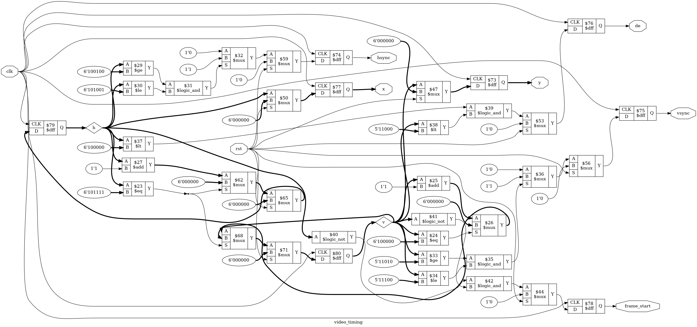

# Tutorial 32: Video Timing and a Test Pattern

A video output sends a picture one pixel at a time, at a fixed rate, with gaps
between the lines and between the frames. A monitor finds its place in that stream
from two sync pulses. Getting those gaps and pulses exactly right is most of the
work. This tutorial builds a timing generator for VGA 640x480 at 60 Hz, puts a
test pattern on it, and writes whole frames from the simulation to PNG files that
you can open.

Nothing here has been shown on a monitor. The outputs are the sync, display enable
and colour signals that a video encoder needs. [Tutorial 33](../33-dvi-live/README.md) adds
the TMDS encoding that DVI and HDMI use.

Finish [Tutorial 2](../02-counter/README.md) for counters with parameters,
[Tutorial 5](../05-sequence-detector/README.md) for `cover`, and
[Tutorial 15](../15-pipelining/README.md) for alignment registers. Run these
commands in a VS Code terminal, from this directory:

```bash
cd tutorials/32-video-timing
```

To run everything at once, use `make all`. It takes a few minutes, because two
whole VGA frames are captured in Python.

## How a picture is sent

The picture is sent as a raster: the top line from left to right, then the next
line down, and so on. A new pixel goes out on every rising edge of the *pixel
clock*. Each line is made of four parts, always in this order:

```text
 |<------------------------- one line: 800 clocks ------------------------->|
 |<------------ active: 640 ------------>|<-16->|<---- 96 ---->|<--- 48 --->|
 |  visible pixels, de = 1               | front|  sync pulse  |   back     |
 |                                       | porch|  hsync on    |   porch    |
```

- **Active** is the visible pixels. *Display enable*, `de`, is high only here.
- **Front porch** is a gap before the sync pulse.
- **Sync** is the pulse that tells the monitor a line has ended.
- **Back porch** is a gap after it, before the next line's pixels.

The porches and the pulse together are the *horizontal blanking*. Nothing visible
is sent in them, and the colour must be black. They come from cathode-ray tubes,
where the beam needed time to fly back to the left edge, and digital monitors
still expect them.

A frame has the same four parts, counted in lines instead of clocks. VGA 640x480
at 60 Hz uses these numbers:

| Part        | Horizontal, clocks | Vertical, lines |
| ----------- | ------------------ | --------------- |
| Active      | 640                | 480             |
| Front porch | 16                 | 10              |
| Sync        | 96                 | 2               |
| Back porch  | 48                 | 33              |
| Total       | 800                | 525             |
| Sync level  | low during the pulse | low during the pulse |

So a frame is 800 x 525 = 420,000 clocks, of which 640 x 480 = 307,200 are visible.
About 27% of the time, nothing is drawn.

The *polarity* says which level is the pulse. In 640x480 both pulses are low, and
the lines idle high. Other modes use high pulses, so the design has a parameter for
each.

## The pixel clock and the refresh rate

The standard pixel clock for this mode is 25.175 MHz:

```text
line rate  = 25,175,000 / 800     = 31,468.75 lines per second
frame rate = 25,175,000 / 420,000 = 59.94 frames per second
```

25.175 MHz is awkward to make from the crystals on FPGA boards, so 25.0 MHz is
commonly used instead, with the same 800 x 525 timing:

```text
line rate  = 25,000,000 / 800     = 31,250 lines per second
frame rate = 25,000,000 / 420,000 = 59.52 frames per second
```

Everything is 0.7% slower, since 25.0 / 25.175 = 0.993. Monitors are often said to
accept this, but nothing in this course has been tried on one. The testbench
runs a 40 ns clock, which is 25.0 MHz, and measures a frame period of 16,800,000 ns.
That is 1 / 0.0168 s = 59.52 frames per second, as worked out above.

## The design

[`rtl/video_timing.v`](rtl/video_timing.v) takes every number in the table as a
parameter, with VGA as the default:

```verilog
module video_timing #(
    parameter integer H_ACTIVE = 640,
    parameter integer H_FRONT  = 16,
    parameter integer H_SYNC   = 96,
    parameter integer H_BACK   = 48,
    ...
    parameter [0:0]   H_POL    = 1'b0,   // level of hsync during the pulse
```

It has two stages of registers. **Stage 1** is two counters, like the one in
Tutorial 2. `h` counts the clocks along a line, and `v` counts the lines, stepping
on the clock where `h` wraps:

```verilog
end else if (h == H_LAST[XW-1:0]) begin
    h <= 0;
    v <= (v == V_LAST[YW-1:0]) ? {YW{1'b0}} : v + 1'b1;
end else begin
    h <= h + 1'b1;
end
```

**Stage 2** decodes them. Each output is a comparison against the parameters,
stored in a flip-flop:

```verilog
hsync       <= (h >= HS_FIRST[XW-1:0] && h <= HS_LAST[XW-1:0]) ? H_POL : !H_POL;
vsync       <= (v >= VS_FIRST[YW-1:0] && v <= VS_LAST[YW-1:0]) ? V_POL : !V_POL;
de          <= (h < H_ACTIVE[XW-1:0]) && (v < V_ACTIVE[YW-1:0]);
x           <= h;
y           <= v;
frame_start <= (h == 0) && (v == 0);
```

The outputs come straight from flip-flops, so they cannot glitch, and they all
describe the same position. `x` and `y` are copies of `h` and `v`, one clock
late, for exactly that reason: if `x` were taken from `h` directly, it would be one
pixel ahead of `de`. This is the alignment problem from Tutorial 15, and it costs
20 flip-flops here to avoid it.

The outputs are:

| Output        | Meaning |
| ------------- | ------- |
| `hsync`, `vsync` | The sync pulses, at the level set by `H_POL` and `V_POL` |
| `de`          | High for visible pixels only |
| `x`, `y`      | The position. They count through the blanking too, so they are pixel coordinates only while `de` is high |
| `frame_start` | High for one clock per frame, together with `de` for pixel (0, 0) |

`vsync` changes at the start of a line, on the same clock as `x` returns to 0.
Reset is synchronous and makes every output idle. The first clock after reset is
pixel (0, 0), with `frame_start` high.

## The test pattern

[`rtl/test_pattern.v`](rtl/test_pattern.v) draws the picture from `x`, `y` and
`de`:

- eight colour bars in the standard order over the top three quarters,
- a grey strip below them, with a white box that moves `STEP` pixels to the right
  on each frame and starts again at the left edge when it would not fit,
- a white border one pixel wide around the edge,
- black whenever `de` is low.

The box moves after the last visible pixel of a frame, so no frame shows it in two
places. The bar colours have a trick in them. In the order white, yellow, cyan,
green, magenta, red, blue, black, the colours read as `{green, red, blue}` bits
are 7, 6, 5 down to 0. So each bar's colour is its number inverted:

```verilog
colour = {{8{!bar[1]}}, {8{!bar[2]}}, {8{!bar[0]}}};
```

The colour is registered, so it leaves one clock after the `x` and `y` it came
from. The timing signals must wait one clock as well, or each colour would leave
with the `de` of the next pixel:

```verilog
always @(posedge clk) begin
    {r, g, b}     <= colour;
    hsync_r       <= hsync;
    vsync_r       <= vsync;
    de_r          <= de;
    frame_start_r <= frame_start;
end
```

These are the alignment registers of Tutorial 15. Any stage that takes time to
make a colour, such as a memory read in Tutorial 33, needs the same delay on the
timing signals. The picture below shows what happens without it.

[`rtl/video_top.v`](rtl/video_top.v) joins the two modules. Its outputs are what an
encoder takes: `hsync`, `vsync`, `de`, `frame_start`, and 8 bits each of `r`, `g`
and `b`, all two clocks after the counters.

## Simulate

[`tb/tb_video_timing.v`](tb/tb_video_timing.v) measures the timing as a monitor
would. It knows nothing of `h` and `v`. It watches the outputs change and counts
the clocks between the changes: from one hsync pulse to the next, the pulse width,
from `de` falling to the pulse, from the pulse to `de` rising, and the same for
`vsync` and lines. It checks each measurement against the parameters, on every
line and every frame. It also checks the level of both syncs while `de` is high,
`x` and `y` on every visible pixel, one `frame_start` per frame on its first pixel,
and that the pattern's outputs are its inputs one clock later, with black in the
blanking. Part-way through, it resets the design in the middle of a line, and
checks that everything starts again from pixel (0, 0).

```bash
make sim
```

This runs two modes. The first is a small made-up one, 32 x 24 visible inside
48 x 33 clocks, with active-high pulses, so that the parameters and both
polarities are tested. Its frames are short, so it runs 6 frames each side of the
reset. The second is VGA, 2 frames each side. The last lines should include:

```text
mode 32x24, 48x33 clocks
line:  48 clocks = 32 active + 4 front + 6 sync + 6 back (416 lines measured)
frame: 33 lines = 24 active + 2 front + 3 sync + 4 back (10 frames measured)
hsync pulses high, vsync pulses high
frame period 1584 clocks = 63360 ns at a 40 ns clock
PASS
...
mode 640x480, 800x525 clocks
line:  800 clocks = 640 active + 16 front + 96 sync + 48 back (2448 lines measured)
frame: 525 lines = 480 active + 10 front + 2 sync + 33 back (2 frames measured)
hsync pulses low, vsync pulses low
frame period 420000 clocks = 16800000 ns at a 40 ns clock
PASS
```

Every number in these lines was measured from the outputs. Compare them with the
table above. The polarity is read from the idle level, the one seen while `de` is
high, so a pulse at the wrong level shows up as a very long pulse.

## View the waveform

Only the small mode writes a waveform, because the VGA run would make a file of
hundreds of megabytes. Run `make sim` again if you have run `make verilator`, which
writes the same file and has no `x` value. Open `build/tb_video_timing.vcd` as in
Tutorial 1 and add `clk`, `rst`, `de`, `hsync`, `vsync`, `frame_start`, `x` and `y`
from `tb_video_timing`. Show `x` and `y` in decimal.

- `rst` falls at 120 ns. At 140 ns, the next rising edge, `frame_start` and `de`
  rise together, with `x` and `y` at 0. `frame_start` falls at 180 ns.
- `x` counts up by one per clock. `de` falls at 1420 ns, after 32 clocks.
- `hsync` rises at 1580 ns, 4 clocks later, and falls at 1820 ns, 6 clocks later.
  It pulses high, because this mode sets `H_POL` to 1.
- `de` rises again at 2060 ns, 6 clocks later, for the next line.
- Zoom out. `vsync` rises at 50060 ns and falls at 55820 ns, which is 3 lines of
  48 clocks. The next `frame_start` is at 63500 ns, 1584 clocks after the first.

## Lint

```bash
make lint
```

Any warning starts with `%Warning`. The lines that start with `- V e r i l a t i o n`
are a normal report. Lint runs on `video_top` twice, in VGA and in the small mode,
because the parameters change the widths.

## Simulate with Verilator

```bash
make verilator
```

The same testbench runs unchanged in both modes, and prints the same lines.

## Frames as PNG files

[`tb/test_video.py`](tb/test_video.py) is a cocotb test of `video_top`. It reads
`de`, `frame_start` and the colour on every clock, builds whole frames from them,
and writes each one to a PNG file in `build/`. It then compares every pixel with a
Python model of the picture, and checks each bar by name.

The container has no image library, so [`tb/png.py`](tb/png.py) writes PNG with
the standard library alone. A PNG file is a signature and three chunks: `IHDR`
gives the size, `IDAT` holds the rows of pixels compressed with `zlib`, and `IEND`
ends the file. Each chunk carries a CRC-32, from `zlib.crc32`. The whole file is 38
lines of Python.

```bash
make cocotb
```

This runs the small mode, 12 frames, and then VGA, 2 frames. Look for
`TESTS=1 PASS=1 FAIL=0` twice. The VGA run took 127 and 229 seconds in two runs
here, because Python looks at each of 803,842 clocks. The log includes:

```text
vga: 2 frames of 640x480 in 803842 clocks
frame 0: all 307200 pixels match, box at x=0
frame 1: all 307200 pixels match, box at x=8
bars: white (255, 255, 255), yellow (255, 255, 0), cyan (0, 255, 255), green (0, 255, 0), magenta (255, 0, 255), red (255, 0, 0), blue (0, 0, 255), black (0, 0, 0)
```

Click `build/frame_vga_1.png` in the Explorer. This is that file:


The border is white, so it does not show against a white page, except on the right
next to the black bar. In the small mode the box moves 3 pixels per frame, and the
log shows it reach x=27 in frame 9 and start again at x=0 in frame 10. The small
frames are written 8 times larger, so that they can be seen.

### One clock out

The test also captures each frame a second way, with `de` and `frame_start` taken
straight from the timing generator, before their alignment register. This is the
design you would get by forgetting that register. Each `de` now arrives one clock
before its colour:

```text
misaligned by one clock: 3590 of 307200 pixels wrong, right border white in 2 of 480 rows
```

Every pixel shows the colour of the one to its left. Column 0 shows black, from
the blanking before the line, and the last pixel of each line is lost. The test
checks exactly that, for every row. The whole picture is one pixel to the right,
so most pixels are still right: only the edges of the bars, the box and the border
are wrong. The right-hand border survives only in the top and bottom rows, which
are white all the way along.

`build/frame_vga_misaligned.png` is that frame. One pixel is hard to see at full
size, so `build/edge_vga.png` magnifies the top right corner, 12 by 8 pixels, 16
times. The good frame is on top, with its white border down the right side. The
misaligned frame is below, and its border has gone.

A one-clock error looks small, but on a real link it can be worse than a shifted
picture. In DVI, the blanking carries control codes instead of colour, so a colour
sent while `de` says blanking is a protocol error, not a wrong pixel.

## Prove it with formal verification

The `` `ifdef FORMAL `` block of `rtl/video_timing.v` asserts:

- `h`, `v`, `x` and `y` stay in range,
- `de` is high only in the active area, and `frame_start` only at (0, 0),
- the `hsync` pulse lasts exactly `H_SYNC` clocks, and `vsync` exactly
  `V_SYNC * H_TOTAL`, unless a reset cuts them short,
- `frame_start` comes exactly `H_TOTAL * V_TOTAL` clocks after the last one.

The pulse widths and the frame length are checked with counters that only the proof
uses. `hs_run` counts how many clocks in a row `hsync` has been on, and an assertion
checks it when the pulse ends. The other assertions in the block are *helpers*, as
in Tutorial 5: they tie these counters, and the two stages, to the position, so
that the induction step cannot start from a state no reset can reach. The helpers
for the syncs are written from the parameters, `H_ACTIVE + H_FRONT` and so on, not
from the `HS_FIRST` that the design uses, so a mistake there is not copied into the
proof.

```bash
make formal
```

[`video_timing.sby`](video_timing.sby) has three tasks. `prove_vga` and
`prove_small` prove the assertions for the two modes. Look for
`successful proof by k-induction` and `DONE (PASS, rc=0)` from each.

`cover_tiny` checks four covers in a tiny mode of 8 x 6 clocks, so that the solver
can reach a second frame in a few steps. They were reached in steps 9, 21, 39 and
50:

| Step | Cover |
| ---- | ----- |
| 9    | The end of an `hsync` pulse |
| 21   | `de` on the last visible pixel |
| 39   | `hsync` and `vsync` on at once |
| 50   | A second `frame_start` |

A frame of this mode is 48 clocks, and the first `frame_start` came at step 2, so
step 50 is the second one. Each cover shows the proof is about a design that
actually draws frames.

## See the logic

```bash
make schematic
```

Click `build/video_timing.png` in the Explorer. It is drawn in the small mode,
because VGA's 10-bit counters make it unreadable:



Find `h` and `v`, the two diamonds. The register on the left, `$79`, is `h`.
`$23 $eq` compares it with `6'101111`, which is 47, the last clock of a line, and
the multiplexers below it choose between `h + 1` and 0, and let `v` step. Each
stage 2 output is a comparison feeding a flip-flop on the right:

- `$29 $ge` with 36 and `$30 $le` with 41 are the `hsync` window, clocks 36 to 41.
  `$32 $mux` then chooses `1'1` inside it, because `H_POL` is 1 here.
- `$37 $lt` with 32 and `$38 $lt` with 24 make `de`.
- `$33 $ge` with 26 and `$34 $le` with 28 are the `vsync` window, lines 26 to 28.
- `$40` and `$41` are `$logic_not` cells, the tests for `h == 0` and `v == 0` that
  make `frame_start`.

Each output then passes a multiplexer for `rst` before its flip-flop, as in
Tutorial 1.

## Map it to real FPGAs

```bash
make synth
```

This maps `video_top`, timing and pattern together, in the VGA mode:

| Family     | Flip-flops | Cells | Other cells |
| ---------- | ---------- | ----- | ----------- |
| Xilinx     | 62 `FDRE`/`FDSE` | 159 | 77 LUTs, 6 `INV`, 14 `CARRY4` |
| Gowin      | 62 `DFF*`  | 296 | 64 LUTs, 4 `MUX2_LUT5`, 162 `ALU` |
| Cyclone V  | 82 `MISTRAL_FF` | 376 | 53 LUTs, 7 `MISTRAL_NOT`, 234 `MISTRAL_ALUT_ARITH` |

The Xilinx report splits the count by module: the timing generator has 44
flip-flops, which is 10 each for `h`, `v`, `x` and `y` and one each for the four
other outputs. The pattern has 18, far fewer than its 24 colour bits and 10-bit
box position. Most of each colour's 8 bits always hold the same value, and the box
moves in steps of 8, so its 3 low bits are always 0. That is the likely reason, but
the report does not say. Most of the other cells are comparisons, which Yosys
builds from carry chains: the `ALU` cells on Gowin and the arithmetic cells on
Cyclone V.

These are Yosys counts, so vendor tools can give different results. They say
nothing about timing. 25 MHz is a slow clock for any of these families, but no
place and route has been run for this design.

## What this does not show

- **No monitor has seen this.** The timing is checked against the standard's
  numbers in simulation, and that is all.
- **No pins.** VGA needs a resistor DAC on the board for each colour, and DVI or
  HDMI need an encoder and a serialiser. [Tutorial 33](../33-dvi-live/README.md) adds TMDS
  encoding, the 8b/10b code that DVI uses, and checks it with a decoder in the
  testbench.
- **No pixel clock.** A real design makes 25 MHz with a PLL, which is a vendor
  primitive and is left out here. The simulation clock is just a number.

## Try it yourself

Change one line, then run `make sim`, `make cocotb` and `make formal`. Undo each
change before trying the next. For a quick run, `make -C tb MODE=small` runs only
the small cocotb test.

1. **An off-by-one porch.** In `rtl/video_timing.v`, replace
   `HS_FIRST = H_ACTIVE + H_FRONT;` with `HS_FIRST = H_ACTIVE + H_FRONT + 1;`.
   `make sim` prints `front porch: got 5, expected 4` and
   `back porch: got 5, expected 6`, and its summary line says
   `32 active + 5 front + 6 sync + 5 back`. The line is still 48 clocks and the
   pulse is still 6 wide: only its place has moved. `make cocotb` passes, because
   the picture does not change. A picture test cannot see sync timing.
   In `make formal`, `prove_small` ends `DONE (FAIL, rc=2)` with a failed assertion
   on the `hsync` window, but `prove_vga` ends `DONE (UNKNOWN, rc=4)`. Read that as
   "not proven", not as a pass. The base case checks only 20 steps from reset, and
   the first VGA pulse is 656 clocks away, so the solver found no trace from reset,
   and the induction step failed. That is why `prove_small` checks 60 steps.
2. **The wrong polarity.** Replace `? H_POL : !H_POL;` with `? !H_POL : H_POL;`.
   `make sim` fails with `hsync level during de: got 1, expected 0`, and its summary
   says `10 front + 42 sync + 12 back`: the monitor now sees a 42-clock pulse at
   the wrong level. `make cocotb` passes again. Both formal proofs fail.
3. **A misaligned pattern.** In `rtl/test_pattern.v`, replace
   `assign out_de          = de_r;` with `assign out_de          = de;`, so `de` skips
   the alignment register. `make sim` fails with `pattern de delay` and
   `colour in blanking`. `make cocotb` fails with
   `frame_start is not on the first pixel of a line`, because `de` now rises a
   clock before `frame_start`. The formal block covers only the timing generator,
   so `make formal` passes.
4. **A pulse one clock too long.** Replace `HS_FIRST + H_SYNC - 1;` with
   `HS_FIRST + H_SYNC;`. `make sim` fails with `hsync width: got 7, expected 6`.
   `make cocotb` passes. `prove_small` fails, and its first failed assertion is
   `hs_run < H_SYNC`, the one that says a pulse is never too long.
5. **A frame start on every line.** Replace `frame_start <= (h == 0) && (v == 0);`
   with `frame_start <= (h == 0);`. `make sim` fails with
   `frame_start on the first pixel: got 1, expected 0`, `make cocotb` fails with
   `frame_start before the last frame was complete`. `prove_small` fails, and
   `prove_vga` ends `DONE (UNKNOWN, rc=4)` for the reason given in exercise 1.
6. **Grey in the blanking.** In `rtl/test_pattern.v`, replace
   `colour = 24'h000000;` with `colour = 24'h404040;`. `make sim` fails with
   `colour in blanking: got 4210752, expected 0`, which is `0x404040`. In
   `make cocotb` every captured frame still matches, since a frame holds only
   visible pixels. The test fails only on its misaligned frame, with
   `column 0 of row 0 is (64, 64, 64)`, where the blanking leaks into view.

**A bug that a proof finds late.** Replace `VS_FIRST = V_ACTIVE + V_FRONT;` with
`VS_FIRST = V_ACTIVE + V_FRONT - 1;`, so the vertical front porch is one line short.
`make sim` fails with `vertical front porch, clocks: got 64, expected 112`, which
is one line of 48 clocks short. Its summary says `24 active + 1 front + 3 sync + 5 back`.
`make cocotb` passes. This time both proofs end `DONE (UNKNOWN, rc=4)`. Even in the
small mode the first `vsync` is 1,200 clocks from reset, far beyond 60 steps, so
only the induction step fails. The simulation gives a clear answer much sooner.

**A proof of nothing.** Replace `if (!past_valid)` with `if (1)`, so that
`assume (rst);` holds on every clock. `make formal` reports
`successful proof by k-induction` and `DONE (PASS, rc=0)` for both proofs, since
a design held in reset breaks no rule. Only `cover_tiny` fails, with
`unreached cover statements` and `DONE (FAIL, rc=2)`.
