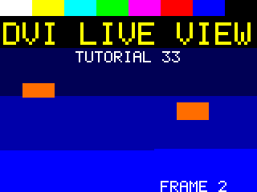
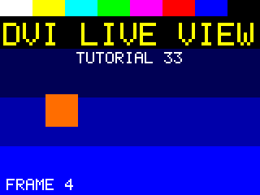
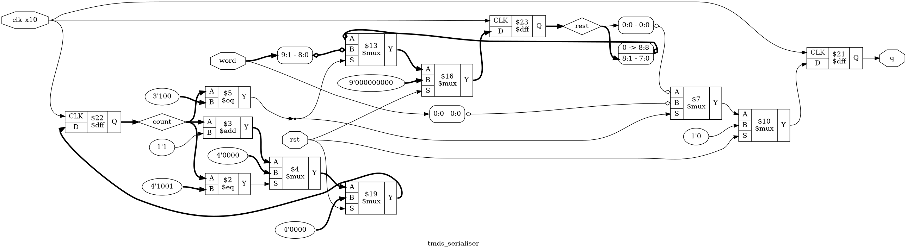

# Tutorial 33: DVI/HDMI Output and a Live View

Tutorial 32 made the timing of a picture: sync pulses, porches, and which pixels are
visible. Tutorial 31 built a RISC-V system-on-chip. This last lesson joins them. The
system draws into a framebuffer, a display controller reads it out in time with the
timing generator, and the pixels are encoded the way DVI and HDMI send them: TMDS,
ten bits on a wire for every eight-bit colour. The testbench then does what a monitor
would do. It takes only the serial wires, finds where each character starts, decodes
them, and builds the frames, which it writes to PNG files. A long run in Verilator
writes one file again every frame, for VS Code to show as it changes: a live view of the
simulated screen.

Finish [Tutorial 10](../10-async-fifo/README.md) for the dual-clock FIFO,
[Tutorial 13](../13-cdc-reset/README.md) for synchronisers,
[Tutorial 15](../15-pipelining/README.md) for alignment registers,
[Tutorial 31](../31-soc/README.md) for the system and
[Tutorial 32](../32-video-timing/README.md) for the timing first. Run these commands
in a VS Code terminal, from this directory:

```bash
cd tutorials/33-dvi-live
```

To run everything at once, use `make all`. It took 6 minutes 15 seconds here, starting
from `make clean`, on a machine with many cores: `make sim` and `make verilator` each run
four simulations at once, and `make formal` its ten tasks.

## What this does not show

Read this first, because it limits everything below.

- **Nothing here was run on a monitor**, or on an FPGA.
- **No real serialiser and no pins.** DVI and HDMI send each bit at ten times the pixel
  clock, on differential pairs. An FPGA does that with the vendor's serialiser
  primitive, such as `OSERDESE2` on Xilinx 7 series, `OSER10` on Gowin, or the DDIO and
  LVDS blocks of Cyclone V, and with the vendor's differential output buffers and pin
  constraints. This course leaves vendor primitives out, so
  [`rtl/tmds_serialiser.v`](rtl/tmds_serialiser.v) is a behavioural model: a shift
  register on a clock ten times as fast, which simulation can run and nothing else is
  claimed for. The outputs here are single wires.
- **No PLL.** The pixel clock and the clock ten times as fast are made by the
  testbench. On a board a PLL makes them, also a vendor primitive.
- **Not a standard mode.** The picture is 160 by 120 in a made-up mode, chosen so
  simulation is quick. "Choosing the size" below says what a monitor would need.
- **No HDMI extras.** A plain DVI signal is what this sends. HDMI adds data islands,
  guard bands and preambles, for sound and for InfoFrames, none of which is here.
- **Simulation does not model metastability.** The display controller has two clock
  domains. See the warning in "Two clocks".

## The system

```text
  Tutorial 31's system                                       new in Tutorial 33
  ---------------------------------------------------------  ------------------------------------------------
  rv32i -> icache -> rv_wb_bridge --> +------------+  m_*  +-----------------+
                                      | wb_arbiter |------>| wb_interconnect |--> slaves 0 to 12, as in 31
                    wb_dma ---------> |   N = 3    |       |                 |--> 13 wb_ram, framebuffer, 128 KiB
          display reader ---------->  +------------+       |                 |--> 14 display registers
               ^                                           +-----------------+
               |                                                 |
   rtl/display.v:                                         wb_intc bit 2 <-- vblank
     wb_display (clk) --> async_fifo --> display_pixel (pclk) --> dvi_tx --> tmds_data[2:0], tmds_clk
                                                      |               3 x tmds_encoder (pclk)
                                                video_timing          4 x tmds_serialiser (clk_x10)
```

[`rtl/soc.v`](rtl/soc.v) is Tutorial 31's, with the parts its "For Tutorial 33" section
asked for, in the places it left free:

- a **framebuffer**, slave 13: another `wb_ram`, 128 KiB at `0x0100_0000`;
- a **display controller**, [`rtl/display.v`](rtl/display.v), with its registers as
  slave 14 at `0x1000_9000`, and a **reader** that is master 2 of `wb_arbiter`, now
  `N(3)`;
- its **vertical blank interrupt**, bit 2 of `wb_intc`'s `PENDING`, set on an edge;
- a **second clock**, `pclk`, for the pixels, with Tutorial 10's dual-clock FIFO
  between the system clock and it, and `clk_x10` for the serialisers;
- a **DVI transmitter**, [`rtl/dvi_tx.v`](rtl/dvi_tx.v): three TMDS encoders and four
  serialisers.

### Which files are copies

These are copied **unchanged**. `cmp` printed nothing for each of them against the
file named:

| File | From |
| ---- | ---- |
| Every file in `rtl/` not named elsewhere in these tables: the core, the cache, the bus and Tutorial 31's peripherals | [Tutorial 31](../31-soc/README.md) |
| `rom/boot.asm`, `rom/getbyte_stream.asm`, `sw/crt0.S`, `sw/lib.c`, `sw/link.ld` | [Tutorial 31](../31-soc/README.md) |
| `tools/asm.py`, `tools/mkflash.py`, `tools/pad_hex.py`, `tb/spi_flash_model.v`, `formal/wb_checker.v` | [Tutorial 31](../31-soc/README.md) |
| `rtl/video_timing.v` | [Tutorial 32](../32-video-timing/README.md) |
| `rtl/gray_ptr.v` | [Tutorial 10](../10-async-fifo/README.md) |
| `rtl/sync_2ff.v`, `rtl/reset_sync.v` | [Tutorial 13](../13-cdc-reset/README.md) |

The unchanged files from Tutorial 31 are `axil_regs.v`, `crc32_byte.v`, `enreg.v`,
`fixed_arbiter.v`, `flash_share.v`, `icache.v`, `rr_arbiter.v`, `rv32i.v`, `rv_alu.v`,
`rv_csr.v`, `rv_decode.v`, `rv_regs.v`, `rv_wb_bridge.v`, `shift_reg.v`,
`spi_master.v`, `uart.v`, `uart_rx.v`, `uart_tx.v`, `wb_arbiter.v`, `wb_axil_bridge.v`,
`wb_cachectl.v`, `wb_counters.v`, `wb_crc.v`, `wb_dma.v`, `wb_gate.v`, `wb_gpio.v`,
`wb_interconnect.v`, `wb_ram.v`, `wb_rom.v`, `wb_spi.v`, `wb_timer.v`, `wb_uart.v` and
`wb_xip.v`. For example, `cmp rtl/wb_arbiter.v ../31-soc/rtl/wb_arbiter.v` prints
nothing: the arbiter takes a third master by its parameter alone, as Tutorial 29 wrote
it.

These are copied and **changed**:

| File | From | Change |
| ---- | ---- | ------ |
| [`rtl/soc.v`](rtl/soc.v) | 31 | The new slaves, master and clocks above. `hold` is 17 bits: 15 the framebuffer, 16 the display registers |
| [`rtl/soc_map.vh`](rtl/soc_map.vh), [`formal/map_check.v`](formal/map_check.v) | 31 | Slaves 13 and 14 |
| [`rtl/wb_intc.v`](rtl/wb_intc.v) | 31 | Bit 2, `VBLANK`, and one more property in its proof, which "Try it yourself" explains |
| [`rtl/async_fifo.v`](rtl/async_fifo.v) | 10 | Two outputs, `wr_used` and `rd_used`, and their proof. See "The FIFO's level" |
| [`sw/soc.h`](sw/soc.h) | 31 | The display's registers, the framebuffer, `INTC_VBLANK` |

Everything else is new: in `rtl/`, `display.v`, `wb_display.v`, `display_pixel.v`,
`dvi_tx.v`, `tmds_encoder.v` and `tmds_serialiser.v`; the program
[`programs/draw.c`](programs/draw.c); [`tools/font.py`](tools/font.py) and
[`tools/scene.py`](tools/scene.py); [`dvi.sby`](dvi.sby); and in `tb/`, everything but
the flash model. `tools/iss.py` and `tools/bin2hex.py` were not copied: the lockstep
test that used them is Tutorial 31's.

## The memory map

Tutorial 31's map, with its two free regions now taken:

| Byte address | Slave | Device | Cached |
| ------------ | ----- | ------ | ------ |
| `0x0100_0000` to `0x0101_FFFF` | 13 | Framebuffer RAM, 128 KiB, **new** | no |
| `0x1000_9000` to `0x1000_901F` | 14 | Display registers, **new** | no |

Every other line of Tutorial 31's table is unchanged. The framebuffer is not cached:
the core never runs code from it, and the instruction cache would only hold stale
pixels. `formal/map_check.v` checks the new decode a second way, that both regions
belong to their slave and to no other, that `0x1000_9020` to `0x1000_9FFF` still
answers `err`, and that the framebuffer is not in the cacheable regions.

The display's registers:

| Offset | Name | Meaning |
| ------ | ---- | ------- |
| `+0x00` | `CTRL` | Read/write. Bit 0 `ENABLE`. Reset 0: the screen is black |
| `+0x04` | `BASE` | Read/write. The framebuffer for the next frame, a byte address, a multiple of 4. Reset `0x0100_0000` |
| `+0x08` | `CURRENT` | Read. `BASE` as it was taken for the frame on the screen now |
| `+0x0C` | `STATUS` | Read. Bit 0 `VBLANK`, bit 1 `UNDERRUN` (since reset), bit 2 `BUS_ERROR` (since reset), bit 3 `READING` |
| `+0x10` | `FRAMES` | Read. Vertical blanks since reset |
| `+0x14` | `SIZE` | Read. Height in bits 31:16, width in 15:0 |
| `+0x18`, `+0x1C` | | `err` |

And `wb_intc`'s `PENDING` and `ENABLE` have a third bit, `VBLANK`, bit 2.

## TMDS: eight bits in ten

DVI sends each colour on its own wire, a *channel*: blue on channel 0, green on 1, red
on 2. A fourth pair carries the pixel clock. Every pixel clock each channel sends one
10-bit *character*. The code, TMDS, is the DVI 1.0 spec's, and
[`rtl/tmds_encoder.v`](rtl/tmds_encoder.v) follows the spec's flow chart step by step.

### Step 1: fewer changes of level

A wire that changes level often is harder to send fast. The encoder first makes a 9-bit
word, `q_m`, with few changes. Its first bit is `d[0]`, and each next bit is the last one
XORed with the next bit of `d`, or XNORed:

```verilog
wire       use_xnor = (d_ones > 4'd4) || (d_ones == 4'd4 && !d[0]);
...
q_m[0] = d[0];
for (i = 1; i < 8; i = i + 1)
    q_m[i] = use_xnor ? !(q_m[i-1] ^ d[i]) : (q_m[i-1] ^ d[i]);
q_m[8] = !use_xnor;
```

With XOR, a 1 in `d` means "change level here"; with XNOR, a 0 does. Choosing XNOR when
`d` has more than four 1s means at most four changes are asked for. `q_m[8]` tells the
receiver which was used, so it can undo it: `d[i] = q_m[i] ^ q_m[i-1]`, or its inverse.

### Step 2: DC balance

The second step keeps the numbers of 1s and 0s sent about equal. `cnt` is the *running
disparity*: 1s minus 0s since the last blanking. If sending `q_m[7:0]` as it is would
push `cnt` further from zero, the encoder sends it inverted, and sets `q[9]` to say so:

```verilog
end else if (cnt == 5'sd0 || m_ones == 4'd4) begin
    q   <= {!q_m[8], q_m[8], q_m[8] ? q_m[7:0] : ~q_m[7:0]};
    cnt <= q_m[8] ? cnt + m_disp : cnt - m_disp;
end else if ((cnt > 5'sd0 && m_ones > 4'd4) || (cnt < 5'sd0 && m_ones < 4'd4)) begin
    q   <= {1'b1, q_m[8], ~q_m[7:0]};
    cnt <= cnt + two_q8 - m_disp;
end else begin
    q   <= {1'b0, q_m[8], q_m[7:0]};
    cnt <= cnt - two_nq8 + m_disp;
end
```

`m_disp` is 1s minus 0s in `q_m[7:0]`. The corrections `two_q8` and `two_nq8` count bits
8 and 9, so `cnt` is exactly the disparity of the characters on the wire, not just of
their low eight bits. The proof below shows that.

**The bound.** `cnt` only ever holds the even values from -8 to 8. A search of every
byte from every reachable value, in [`tb/tmds_model.py`](tb/tmds_model.py), finds
exactly those nine; the proof shows no other is reachable; and the cover run reaches 8
and -8, so no smaller bound holds. So `cnt` needs 5 bits.

**Seen in the simulation.** On the white bar, red is `0xFF` on every pixel. The
waveform shows red's characters and `cnt` along the first line of a frame:

| Time (ps) | `u_enc2.q` | `u_enc2.cnt` |
| --------- | ---------- | ------------ |
| 2028292500 | `0x200` = `1000000000` | `0x18` = -8 |
| 2028331500 | `0x0FF` = `0011111111` | `0x1E` = -2 |
| 2028370500 | `0x0FF` | `0x04` = 4 |
| 2028409500 | `0x200` | `0x1C` = -4 |
| 2028448500 | `0x0FF` | `0x02` = 2 |
| 2028487500 | `0x200` | `0x1A` = -6 |
| 2028526500 | `0x0FF` | `0x00` = 0 |
| 2028565500 | `0x200` | `0x18` = -8, and round again |

`0xFF` has eight 1s. After step 1 it is `q_m` = `011111111`, XNOR. The first character
sends it inverted, as XNOR with `cnt` at 0 always is: `1000000000`, one 1 and nine 0s,
so `cnt` drops by 8. Then it is sent as it is, `0011111111`, eight 1s and two 0s, +6,
until `cnt` is above 0 again. `cnt` goes round seven values, back to 0 every seven
pixels, and never past 8 either way. Across every
run here, every channel's disparity at the end of each data character stayed between
-8 and 8, which the testbench checks:

```text
disparity since the last token, at the end of each character: ch0 -8 to 8, ch1 -8 to 8, ch2 -8 to 8
```

### Blanking: control tokens

While `de` is low, nothing visible is sent. Each channel sends one of four *control
tokens*, chosen by two control bits. Channel 0 carries `hsync` and `vsync` in them; the
other two send 00. `cnt` goes back to 0.

| `{C1, C0}` | Token, `q[9:0]` | 1s |
| ---------- | --------------- | -- |
| 00 | `1101010100` | 5 |
| 01 | `0010101011` | 5 |
| 10 | `0101010100` | 4 |
| 11 | `1010101011` | 6 |

The tokens change level at least seven times in ten bits. A data character, after
step 1, changes far less. The testbench counted, over every character of a run:

```text
changes of level inside a character: data at most 5, control tokens at least 7
```

So a run of tokens is easy to recognise from the wire, and that is how a receiver
finds where each character starts. The proof shows that no data character is ever
equal to a token.

**DC balance is a property of the data period only.** `cnt` is cleared in blanking
without being brought back to zero first, and two of the tokens are not balanced. So
over a whole frame the wire is not balanced. The testbench sums 1s minus 0s over every
character of each frame, tokens included:

```text
disparity on the wire over the last frame, tokens included: ch0 -1214, ch1 -246, ch2 -46
```

Frame 1 was black, and there the sums were -1248, -240 and -240. Channels 1 and 2 send
only token 00, which is balanced, so their -240 came from the data periods: each line
of black ended with `cnt` at -2, and blanking cleared it without paying it back, 120
times. Channel 0 has the same -240, and -1008 more from the vsync pulse: for three lines
it sends token 10, two 0s too many, on the 184 characters outside hsync, and token 11,
two 1s too many, on the 16 inside it. 3 x (184 x -2 + 16 x 2) = -1008. This is what the algorithm does,
measured; what it means for a real cable's receiver is not something this simulation
can show.

## Serialising

[`rtl/tmds_serialiser.v`](rtl/tmds_serialiser.v) takes each character and shifts it
out, bit 0 first, on `clk_x10`. A counter from 0 to 9 says when to take the next word:

```verilog
count <= (count == 4'd9) ? 4'd0 : count + 4'd1;
if (count == LOAD[3:0]) begin
    q    <= word[0];
    rest <= word[9:1];
end else begin
    q    <= rest[0];
    rest <= {1'b0, rest[8:1]};
end
```

`word` belongs to the pixel clock and is read on `clk_x10`. That is safe only because
the two clocks come from one source, at exactly ten to one, and the word is taken in the
middle of a pixel, at `LOAD`: the testbench gives `pclk` its rising edge half a bit
before a `clk_x10` edge, so with `LOAD` 4 the word is taken 4.5 bits after it changed.
A vendor serialiser does this alignment inside the primitive. This model is only good
for simulation, as "What this does not show" says.

The clock channel is a fourth serialiser, sending `0000011111` every pixel: five bits
high, five low, a copy of the pixel clock. The testbench checks that it does.

## The receiver in the testbench

[`tb/tb_dvi.v`](tb/tb_dvi.v) knows nothing of the pixels inside the design. It samples
the four wires in the middle of each bit, on the falling edge of `clk_x10`, and keeps the
last ten bits of each.

1. **Word alignment.** It does not know where a character starts. It waits until the
   last ten bits of a channel are a control token eight times in a row, ten bits apart.
   From then on, every tenth bit ends a character. The three channels must agree on the
   bit, and the clock wire must read `0000011111` there.
2. **Decoding.** Three tokens are blanking: `C0` of channel 0 is `hsync`, `C1` is `vsync`.
   Three data characters are a pixel, decoded with the spec's decoder: undo the
   inversion that `q[9]` marks, then the XOR or XNOR that `q[8]` marks. A token on one
   channel and data on another is an error.
3. **Frames.** Each rise of `vsync` ends a frame. Each data period is a row: it must be
   160 pixels, and a frame 120 rows and 130 `hsync` pulses.

Then every decoded pixel is compared with the framebuffer, at the address the display
took for that frame, `CURRENT`, expanded from RGB332 as the display does. A frame not
shown must be black. So the picture is recovered from the TMDS wires, not tapped
before the encoder: a mistake anywhere from the framebuffer to the wire shows as a
wrong pixel.

The testbench also writes each frame to a PNG file, from Verilog. A PNG file is a
signature and three chunks, each ending with a CRC-32: Tutorial 25's CRC, here with a
256-entry table. The pixels go in a zlib stream, and zlib allows *stored* blocks, which
are not compressed at all, so the only other thing needed is zlib's Adler-32 checksum.
Each pixel is written as 2 by 2, so the files are 320 by 240.
[`tb/check_frames.py`](tb/check_frames.py) reads them back with Python's `zlib`.

## Choosing the size

A monitor expects a standard mode, and the smallest common one is Tutorial 32's VGA
640x480 at 60 Hz: 420,000 pixel clocks a frame. Each pixel clock here costs ten
`clk_x10` edges in four serialisers and in the testbench's receiver. In an early run,
Icarus took about 23 seconds of computer time for each frame of the small mode below; a
VGA frame has some sixteen times as many pixel clocks.

So the screen is **160 by 120**, in a made-up mode in the style of Tutorial 32's small
one, with active-high syncs:

| Part | Horizontal, clocks | Vertical, lines |
| ---- | ------------------ | --------------- |
| Active | 160 | 120 |
| Front porch | 8 | 2 |
| Sync | 16 | 3 |
| Back porch | 16 | 5 |
| Total | 200 | 130 |

That is 26,000 pixel clocks a frame. The testbench runs the pixel clock at 39 ns and
measured a frame period of 1,014,000,000 ps, 1.014 ms, which is 26,000 pixel clocks.
No monitor would take this mode.

The framebuffer is exactly the screen: one byte a pixel, **RGB332**, 3 bits of red, 3 of
green and 2 of blue, so 19,200 bytes. That leaves room in the 128 KiB for two
framebuffers, which the program uses. For a monitor, the framebuffer could stay at
160 by 120 and each pixel be sent 4 by 4, in VGA timing: the reader would read each row
four times and the pixel side would take a new byte every fourth pixel. That is not done
here.

## Two clocks

> **Warning: simulation does not model metastability.** The display controller crosses
> between the system clock and the pixel clock. In simulation a flip-flop that samples a
> signal from another clock always settles cleanly to 0 or 1. On real hardware it can go
> metastable. So every test here passing does **not** prove the crossings safe. They are
> safe by construction only if every crossing goes through a synchroniser, as Tutorials
> 10 and 13 explain, and "Try it yourself" shows a crossing without one that every
> simulation still passes.

[`rtl/display.v`](rtl/display.v) has two halves. [`rtl/wb_display.v`](rtl/wb_display.v)
runs on the system clock, `clk`, at 100 MHz in the testbench: the registers and the
reader. [`rtl/display_pixel.v`](rtl/display_pixel.v) runs on `pclk`: Tutorial 32's timing
generator, and the pixels. The 39 ns pixel clock is not a multiple of `clk`'s 10 ns, so
the two edges drift past each other at every phase. Only these cross:

| What | From | To | How |
| ---- | ---- | -- | --- |
| The FIFO's write and read pointers | each side | the other | Gray code, two flops, inside Tutorial 10's `async_fifo` |
| `vblank`: vertical blanking has begun | pixel | system | `sync_2ff` |
| `show`: the next frame will be shown | pixel | system | `sync_2ff` |
| `underrun` | pixel | system | `sync_2ff` |
| `ENABLE` | system | pixel | `sync_2ff` |
| The reset | system | pixel | Tutorial 13's `reset_sync` |

Each single bit is a level from a flop, as `sync_2ff` requires. The reset rises with
`rst` and falls two pixel clocks after it, so both sides of the FIFO are in reset
together, as Tutorial 10 requires.

### One frame, from both sides

The two sides never share a counter. They agree by sending exactly the same number of
words, `WORDS` = 160 x 120 / 4 = 4800, for every frame that is shown:

1. When vertical blanking starts, the pixel side sets `show_next` to `ENABLE`, and
   raises `vblank`. Both change on one pixel clock edge, and then hold still for the
   whole blanking, ten lines.
2. The system side sees `vblank` rise, two or three clocks later. One clock after that,
   `CURRENT` takes `BASE`, `FRAMES` counts, and if `show` is 1 the reader starts: 4800
   words from `CURRENT`, in order, into the FIFO. `show` is read a clock after `vblank`
   was seen, so even if its synchroniser took one clock more, it has settled.
3. At the first pixel of the frame, the pixel side takes `show_next` as `show`, and owes
   4800 words. Every fourth visible pixel of a shown frame takes one.

**An underrun** is a word due while the FIFO is empty. The pixel side then sets
`UNDERRUN`, shows the old word again, and still owes the word. In the vertical blanking
it takes and throws away whatever it still owes, so the next frame starts in step. If
the reader is still busy with a frame when the next one starts, it queues the new one.
Mode `underrun` below shows one frame spoiled, and the next ones right.

### The reader on the bus

The reader reads in **bursts**: one Wishbone cycle of four pipelined reads, started only
when the FIFO has room for all four. The cycle ends with the last answer, so Tutorial
29's round-robin arbiter can hand the bus on; Tutorial 29 proved that with three
masters, a master waits for at most two other cycles. The bus has plenty of room: the
screen needs one word every four pixels, 156 ns, about 15.6 clocks, and in the waveform
below a burst of four held `cyc` for five clocks.

### The pixel side

[`rtl/display_pixel.v`](rtl/display_pixel.v) is a pipeline of three stages, in the way of
Tutorials 15 and 32:

1. On the clock where the timing generator gives `x` and `de`, a word is *due* if `de`
   is high, the frame is shown and `x` is a multiple of 4. Then `fifo_rd` is high.
2. The FIFO's word arrives on the next clock. The byte for the pixel is picked by the
   low two bits of `x`, delayed one clock: the leftmost pixel is in bits 7:0, as the core
   stores bytes.
3. On the clock after that the colour leaves, registered, expanded from RGB332 by
   repeating its bits: red `{r, r, r[2:1]}`, so 7 becomes `0xFF` and 0 stays 0. `de`,
   `hsync` and `vsync` are each delayed two clocks to stay with it.

Then each encoder adds one more clock.

### The FIFO's level

Tutorial 10's FIFO says only `full` and `empty`. A burst needs to know there is room for
four words, so this copy adds a count on each side:

```verilog
assign wr_used = to_bin(wr_gray) - to_bin(rd_gray_sync);
assign rd_used = to_bin(wr_gray_sync) - to_bin(rd_gray);
```

Each uses that side's own pointer and its synchronised copy of the other's: the same
copies `full` and `empty` already use, so nothing new crosses. The copy is old, so each
count is wrong only in the safe direction: `wr_used` may count words already read, so a
writer that trusts it never overflows; `rd_used` may miss words just written. The proof
of Tutorial 10, run again on this copy, now also asserts exactly that:
`wr_used >= used` and `rd_used <= used`.

## The vertical blank interrupt

The program needs to know when a frame has started, to swap framebuffers. `vblank`,
synchronised to `clk`, goes to `wb_intc` as a third source. It is high for the whole
blanking, 2000 pixel clocks, so as a level it would interrupt again and again, as the
DMA engine's `DONE` would in Tutorial 31. So it is handled like the DMA engine's: its
rising edge sets bit 2 of `PENDING`, and only the handler clears it, by writing 1 there.
An edge on the same clock as the clear wins.

## The program

[`programs/draw.c`](programs/draw.c) draws an animated picture: colour bars, a title in
a 5 by 7 font, and a square that bounces, with "FRAME n" at the bottom. It uses **two
framebuffers**, at `0x0100_0000` and `0x0100_5000`, so the screen never shows a picture
half drawn:

```c
for (uint32_t n = 0;; n++) {
    draw(back, n);
    __asm__ volatile ("" : : : "memory");
    DISP_BASE = (uint32_t)back;
    DISP_CTRL = DISP_ENABLE;
    uint32_t seen = vblanks;
    while (DISP_CURRENT != (uint32_t)back)
        if (vblanks - seen > 1)
            return 2;
    ...swap back and front...
}
```

- It draws scene `n` into the buffer not on the screen, then writes that buffer's
  address to `BASE`. The display takes it at the next vertical blank, and from then on
  the old buffer is free.
- **The barrier.** The pixels are plain C stores, and only the register stores are
  `volatile`. A compiler may move a plain store after a volatile one, so without the
  empty `asm` with a `"memory"` clobber, some pixels could be stored after `BASE` changed.
- **The interrupt** counts vertical blanks in `vblanks`, and writes the count to
  `gpio_out` for the testbench. The loop waits for `CURRENT` to show the swap. One more
  blank may arrive from before `BASE` was written; two with no swap means something is
  wrong, and the program stops. WFI would be the way to wait, but Tutorial 27's core
  treats it as illegal, so the program polls.

The program never ends. It is 1993 bytes, booted from the flash by Tutorial 31's boot
ROM as before. The font is in [`tools/font.py`](tools/font.py), which writes
`build/font.h` for the C program. [`tools/scene.py`](tools/scene.py) draws the same
scenes in Python, from the same font, for the testbench to compare with.

## Simulate

```bash
make sim
```

This builds the program and runs the testbench four times, in parallel, each with its
own log: `build/sim_nominal.log` and so on. Each must end with `PASS`.

| Run | What it does |
| --- | ------------ |
| `nominal` | No stalls, a 39 ns pixel clock. Writes `build/live.png` and a waveform |
| `stalls` | Every slave stalls at random, about one clock in four, as Tutorial 31's mode 1 |
| `fast` | Stalls, and a 14 ns pixel clock: the FIFO empties 2.8 times as fast |
| `underrun` | The framebuffer stalls for 3000 clocks in the middle of a frame, on purpose |

It took 3 minutes 12 seconds here. The `nominal` run printed, for each frame, then a
summary:

```text
frame 1: black, 19200 pixels checked, disparity on the wire this frame -1248 -240 -240
frame 2: shown, 19200 pixels checked, disparity on the wire this frame -1214 -282 -2
...
frame 6: shown, 19200 pixels checked, disparity on the wire this frame -1214 -246 -46
--- mode 0
frames: 6 decoded, 5 shown, the first shown was frame 2; 0 with wrong pixels
frame period: 1014000000 ps = 26000 pixel clocks of 39000 ps; 130 hsync pulses a frame
fifo: 24000 words due; lowest level when one was due, the reader not done, 13, as the pixel side saw it 12, of 16; 0 found it empty
reader: 6004 bursts of 4 reads; clocks from cyc to the first read taken: at most 9, mean 0.28
disparity since the last token, at the end of each character: ch0 -8 to 8, ch1 -8 to 8, ch2 -8 to 8
disparity on the wire over the last frame, tokens included: ch0 -1214, ch1 -246, ch2 -46
changes of level inside a character: data at most 5, control tokens at least 7
vblank: 7 edges, 7 handler runs; STATUS 9; UNDERRUN 0
PASS
```

and then [`tb/check_frames.py`](tb/check_frames.py) compared its frames with the Python
model of the program:

```text
frame_01.png: black
frame_02.png: scene 0, all 19200 pixels match
frame_03.png: scene 1, all 19200 pixels match
frame_04.png: scene 2, all 19200 pixels match
frame_05.png: scene 3, all 19200 pixels match
frame_06.png: scene 4, all 19200 pixels match
build/live.png: the same picture as frame_06.png
frames match the model: scenes 0 1 2 3 4
```

The `stalls` run's frames were checked the same way, with the same result.

- **The frame period** is 26,000 pixel clocks, measured between two `vsync` pulses as
  decoded from the wires.
- **`STATUS 9`** is `READING` and `VBLANK`: the run stopped in a vertical blank, with the
  reader already fetching the next frame.
- **`vblank: 7 edges, 7 handler runs`**: the testbench checks that each handler run, seen
  as a new count on `gpio_out`, follows exactly one vertical blank.
- **Frame 1 is black**: the program was still booting. The boot ROM copied it from the
  flash and it set `ENABLE` in time for frame 2.
- **One scene a frame.** Frame 2 shows scene 0, frame 6 scene 4: drawing a scene takes
  less than a frame, so the program never misses a swap. The test allows a scene to stay
  for more than one frame, but not to skip one.
- **Every pixel of every frame** matched the framebuffer, and the model.

### The FIFO never ran dry

The testbench records the FIFO's level each time a word is due, from both of its
pointers, and as the pixel side saw it, `rd_used`. The FIFO always empties at the end of
a frame, when the reader has nothing left to fetch, so the lowest level is taken only
while more words are owed than the FIFO holds. Of 16 words:

| Run | Lowest level, true | Lowest, as `rd_used` saw it | Words due | Found empty | Longest wait for the bus |
| --- | ------------------ | --------------------------- | --------- | ----------- | ------------------------ |
| `nominal` | 13 | 12 | 24000 | 0 | 9 clocks |
| `stalls` | 13 | 12 | 24000 | 0 | 12 clocks |
| `fast` | 11 | 10 | 24000 | 0 | 13 clocks |
| `underrun` | 0 | 0 | 24000 | 144 | 2954 clocks, the stall |

So in the three runs meant to pass, the reader stayed at least 11 words ahead, and no
word ever found the FIFO empty. "Longest wait for the bus" is clocks from the reader
raising `cyc` to its first read being taken. These numbers hold for these runs only: a
program that kept the bus for longer, or a faster pixel clock, could do worse. Nothing
here proves a bound for every program.

The `underrun` run is the one that should fail, and does, as designed: the stall
emptied the FIFO, 144 words found it empty, `UNDERRUN` was set, and only frame 4 was
wrong:

```text
frame 4: 1216 pixels differ from the framebuffer
...
frames: 6 decoded, 5 shown, the first shown was frame 2; 1 with wrong pixels
fifo: 24000 words due; lowest level when one was due, the reader not done, 0, as the pixel side saw it 0, of 16; 144 found it empty
vblank: 7 edges, 7 handler runs; STATUS b; UNDERRUN 1
stall: 3000 clocks of the framebuffer in frame 4
PASS
```

`PASS` here means the testbench saw what it expected of this run: an underrun, `UNDERRUN`
set in `STATUS` (`b` is `READING`, `UNDERRUN` and `VBLANK`), exactly one frame wrong, and
the frames after it right.



The stall came at row 60. Below it, every pixel is late: the square appears twice, and
"FRAME 2" has moved right. The next frame was right again, and the tests check that.

## The live view

```bash
make live
```

This builds the testbench with Verilator and runs 600 frames. Run it in VS Code's
terminal, not with `docker compose run`. Each frame is written to `/tmp/live.png`, the
same file each time, and the first ten also to `build/live/frame_NN.png`. While it runs,
open `/tmp/live.png` with **File > Open File...**: type the path and press OK. The image
preview reloads the file each time it changes, so the square moves and the frame number
counts up. Make the run longer with `make live LIVE_FRAMES=3000`.

Why `/tmp`, when everything else goes in `build/`: VS Code's preview did not reload
`build/live.png` as it changed. That was seen on Windows with Docker Desktop, where
`/work` is a folder shared from the host, and VS Code is not told when a file there
changes, even when the change is made inside the same container. A file in the
container's own `/tmp` reloaded at once. `/tmp` belongs to one container, so the run
must be in the IDE's terminal for VS Code to see it.

When the repository is on a Linux file system, `build/` works too:
`make live LIVE_PNG=build/live.png`. That was seen with a copy of the repository inside
WSL 2's Ubuntu, on its own ext4 disk, served by a second IDE: `build/live.png` reloaded by
itself, showing "FRAME 78", "FRAME 97", "FRAME 116" and "FRAME 135" about two seconds
apart. A Linux machine without WSL was not tried.

The run itself was checked: it took 3 minutes 54 seconds here, about 2.6 frames a
second, and every check still applies. It ended with
`600 decoded, 599 shown ... 0 with wrong pixels`, `601 edges, 601 handler runs` and
`PASS`, and the last frame showed "FRAME 598".

Watching it in the browser IDE was checked with `make live LIVE_FRAMES=120`, run in VS
Code's terminal: `/tmp/live.png`, open in the image preview, changed by itself. Four
looks about two seconds apart showed "FRAME 53", "FRAME 60", "FRAME 67" and "FRAME 74",
with the square in a new place each time. None of them was caught half written, though
the file is written in place a byte at a time, so that may still happen.

This is the frame that `make sim` leaves in `build/live.png`:



Colour bars along the top, the title in yellow, "TUTORIAL 33" in white, the orange
square, and "FRAME 4", over four bands of blue, darkest at the top. Every pixel in it
came off the three TMDS wires.

## View the waveform

Use a fresh `make sim`: the waveform is written only by its `nominal` run, which passes
`+waves`. The file, `build/tb_dvi.vcd`, was 0.61 MB here. It holds only six scopes, one
level each: `tb_dvi`, `dut.u_display.u_bus`, `dut.u_display.u_pixel`,
`dut.u_display.u_fifo`, `dut.u_dvi.u_enc2` (red's encoder) and `dut.u_intc`, and only
two windows. Outside them every signal, even `clk`, shows as `x`, drawn in red. That is
what `$dumpoff` writes, not the design. The times are in picoseconds.

Open it as in [Tutorial 1](../01-d-flip-flop/README.md). `clk` rises at 5, 15, 25 ns
and so on; `pclk` every 39 ns, at times ending in 500 ps.

**A vertical blank starts a frame.** The first window starts at 1950065000 ps, at the
end of the last visible line after the program set `ENABLE`. From `u_pixel` add `y`,
`vblank` and `show_next`. From `u_bus` add `vblank`, `show_s`, `tick_q`, `frames`,
`current`, `left`, `m_cyc`, `m_stall`, `fifo_wr` and `fifo_used`. From `u_intc` add
`vblank_pending` and `irq`, and from `tb_dvi` add `trap` and `trap_cause`.

| Time (ps) | What happens |
| --------- | ------------ |
| 1950175500 | `y` becomes `0x78`, 120: the first line of vertical blanking |
| 1950214500 | On the next pixel clock, `u_pixel.vblank` and `show_next` rise together |
| 1950225000 | `u_bus.vblank` and `show_s` rise: two system clocks later, through `sync_2ff` |
| 1950235000 | `tick_q` is 1. `vblank_pending` and `irq` rise, and in the same clock `trap` is 1 with `trap_cause` `8000000b`: the core took the interrupt at once |
| 1950245000 | `frames` goes from 1 to 2, and `left` to `0x12c0`, 4800 words to fetch. `current` takes `BASE`, `0x400000`, the word address of `0x0100_0000`: the program's first buffer is at the reset value, so it does not change |
| 1950255000 | `m_cyc` rises and `m_stall` falls: the arbiter granted the reader at once |
| 1950265000 to 1950305000 | `fifo_wr` is high for four clocks, `fifo_used` counts 1 to 4, `left` counts down, and `m_cyc` falls with the fourth answer |
| 1950315000 | The next burst raises `m_cyc`, but `m_stall` stays high until 1950405000: another master had the bus, nine clocks |

**The first pixels.** The second window starts at 2027795000 ps, ten pixels before the
first frame shown. From `u_pixel` add `x`, `y`, `de`, `frame_start`, `fifo_rd`,
`fifo_data`, `show`, `owed`, `de_o` and `r_o`. From `u_enc2`, red's encoder, add `de`, `q`
and `cnt`. Show `x`, `y` and `owed` in decimal.

| Time (ps) | What happens |
| --------- | ------------ |
| 2028175500 | `frame_start` and `de` rise, `x` and `y` are 0, and `fifo_rd` is 1: the first word is due |
| 2028214500 | `fifo_data` is `ffffffff`: four white pixels. `show` is 1, and `owed` 4799 |
| 2028253500 | `de_o` and `r_o` = `ff`, two clocks after `x` was 0: the pipeline of "The pixel side". `u_enc2.de` is its copy |
| 2028292500 | `q` is `0x200` and `cnt` -8: the first character of red, as in "Step 2" |
| 2028331500 | `fifo_rd` is 1 again at `x` = 4, and `owed` drops to 4798 the clock after |

`fifo_data` is `x` until the first read: the FIFO's output register has no reset, as in
Tutorial 10.

## Lint and Verilator

```bash
make lint
make verilator
```

`make lint` checks the whole system, then each new or changed part on its own. No line
starts with `%Warning`. Two `lint_off` comments are on purpose: `rst` goes to
`reset_sync` as an asynchronous reset for the pixel clock's domain, which is what
`reset_sync` is for, and Verilator warns about any signal used both ways.

`make verilator` runs the same testbench, unchanged, for the same four runs. Every line
of every log was the same as Icarus's, apart from Icarus's line about opening the VCD,
and the PNG files were byte for byte the same. It took 56 seconds, build included,
against 3 minutes 12 seconds for Icarus. That speed is what makes the live view possible.

## Test in Python

Two cocotb runs, each of one module alone.
[`tb/test_tmds.py`](tb/test_tmds.py) tests the encoder, against
[`tb/tmds_model.py`](tb/tmds_model.py), an encoder and decoder written from the spec's
flow charts in Python. [`tb/test_display.py`](tb/test_display.py) tests the display
controller's bus side, `wb_display.v`.

```bash
make cocotb
```

The encoder's run ends with `TESTS=2 PASS=2 FAIL=0`, after these lines:

```text
cnt can reach [-8, -6, -4, -2, 0, 2, 4, 6, 8]
every byte from every state: 6656 characters, 9 states, all match the model
random lines: 9753 characters; cnt stayed from -8 to 8
```

- `every_byte_from_every_state` drives the encoder to each of the nine values `cnt` can
  hold, by a shortest path of bytes the model finds, then sends each of the 256 bytes.
  Every character must equal the model's, bit for bit, and decode back. It sends a
  blanking after each byte, so the state a byte leaves behind is not checked here:
  "Try it yourself" shows a bug that only `random_lines` finds.
- `random_lines` sends random lines between blanking, half of the bytes repeated, as in
  a picture.

The display controller's run ends with `TESTS=1 PASS=1 FAIL=0`, after this line:

```text
frame 1 read from 0x1000000, frame 2 from 0x1004000, 16 requests
```

- `queued_frame_reads_its_own_buffer` makes the case the whole system never does. With a
  frame of 16 by 2 pixels, 8 words, and the framebuffer stalled, frame 1 starts from
  buffer A and cannot move. The program, here the test, sets `BASE` to B, and the next
  vertical blank queues frame 2: `CURRENT` reads B. Then it sets `BASE` to C, and only then
  ends the stall. Frame 1 must read A, and frame 2 must read B, the buffer it was given,
  not C.

## Prove it with formal verification

[`dvi.sby`](dvi.sby) has ten tasks, a proof and a cover run for each of five designs:

| Task | Proves |
| ---- | ------ |
| `tmds` | The encoder, from any input and any reachable state: a data character decodes back to its byte and is never a control token; a control character is the right token and decodes back to its bits; `cnt` is even and from -8 to 8; and `cnt` equals the 1s minus 0s actually sent since the last token, counted from `q` |
| `fifo` | Tutorial 10's proof of the 16-word FIFO, with every clock ratio, run again on the changed copy, with the new counts: `wr_used` never less than the true count, `rd_used` never more |
| `intc` | Tutorial 31's proof of the interrupt controller, with bit 2: no vertical blank is lost, the bit rises only on an edge, falls only on a clear, and a clear works |
| `map` | Tutorial 31's map proof with fifteen slaves |
| `arbiter3` | Tutorial 29's arbiter proof with three masters, `N = 3`, as `soc.v` now uses it |

```bash
make formal
```

Look for `DONE (PASS, rc=0)` for each, and the last line, `10 tasks passed`.

The decoder in the proof is written from the spec, inside the `` `ifdef FORMAL `` block,
not from the encoder's code. The inputs are free, so "every byte" is every byte from
every state the solver can reach. The cover run reaches `cnt` = 8 and -8 at step 2: the
bound is tight.

### What is not proved

- **That the encoder follows the spec's XNOR rule.** The proof checks that every
  character decodes, not that it is the one the spec would send. "Try it yourself" breaks
  the rule; only the cocotb test, bit for bit against the model, notices.
- **The display controller**, either half, and the crossings between them. They are
  simulated. The FIFO's crossing is proved, alone; the others are synchronisers whose
  safety comes from Tutorial 13, not from a proof here, and no proof models
  metastability.
- **That the reader keeps up.** The FIFO levels above are measured, for four runs.
- **The serialiser**, and the program.
- **That the algorithm is the spec's.** The encoder, the proof's decoder, the testbench's
  decoder and `tb/tmds_model.py` were all written for this lesson, from the DVI 1.0
  algorithm, by the same author. They agree with each other; no outside implementation
  or real receiver has checked them. A mistake made the same way in all four would pass
  every check here. One more check was made while reviewing this lesson: a second Python encoder, written
  separately from the DVI 1.0 algorithm, matched `rtl/tmds_encoder.v` on 200,000 characters
  of random pixels and blanking, 149,466 of them pixels, and its disparity never left -8
  to 8. That narrows the risk, but it is not part of `make all`, and no real receiver has
  seen this output.

## See the logic

```bash
make schematic
```

The encoder's bit counting would be unreadable, so this draws the serialiser. Click
`build/tmds_serialiser.png` in the Explorer:



- At the bottom left, `$22` is the flop `count`. `$3` adds 1, `$2` compares it with
  `4'1001`, 9, and `$4` picks 0 then: the count from 0 to 9. `$19` puts `rst` first.
- `$5` compares `count` with `3'100`, 4: that is `LOAD`, the edge that takes the word.
- On that edge `$13` picks `word[9:1]` for `rest`, `$23`, and `$7` picks `word[0]` for
  `q`, `$21`. On every other edge they take `rest` shifted right, with a 0 in at the top,
  and `rest[0]`. `$16` and `$10` are the reset.

## Map it to real FPGAs

```bash
make synth
```

The encoder alone, on Xilinx: 15 flip-flops (10 `FDRE` and 5 `FDSE`: `q` and `cnt`), 60
LUTs, 1 `INV`, 7 `CARRY4` and 3 `MUXF7`/`MUXF8`, 86 cells. The whole display controller, both
halves and the FIFO: 340 flip-flops (336 `FDRE`, 2 `FDSE`, 2 `FDPE`, the last two from
`reset_sync`), 271 LUTs, 30 `INV`, 38 `CARRY4` and 6 `RAM32M`: 696 cells, 11 of them `$scopeinfo`. The whole system:

| Family | Flip-flops | Memory | Logic | Total cells |
| ------ | ---------- | ------ | ----- | ----------- |
| Xilinx | 3124 `FDRE`, 124 `FDSE`, 2 `FDPE` | 48 `RAMB36E1`, 1 `RAMB18E1`, 8 `RAM64M`, 6 `RAM32M` | 5020 LUTs, 121 `INV`, 29 `MUXF7`/`MUXF8`, 212 `CARRY4` | 8784 |
| Gowin | 3293 (`DFF`, `DFFE`, `DFFP`, `DFFR`, `DFFRE`, `DFFS`, `DFFSE`) | 96 `SP`, 1 `SPX9`, 1 `SDPX9B`, 32 `RAM16SDP4` | 7136 LUTs, 1566 `MUX2_LUT5` to `8`, 841 `ALU` | 13057 |
| Cyclone V | 3218 `MISTRAL_FF` | 195 `MISTRAL_M10K`, 32 `MISTRAL_MLAB` | 4749 `MISTRAL_ALUT2` to `6`, 850 `MISTRAL_ALUT_ARITH`, 91 `MISTRAL_NOT` | 9135 |

Against Tutorial 31's table, the framebuffer is the large change: 128 KiB of block RAM,
32 more `RAMB36E1` on Xilinx (48 against 16) and 128 more `MISTRAL_M10K` on Cyclone V
(195 against 67). The FIFO is
the six `RAM32M` on Xilinx. The serialisers synthesise as ordinary flip-flops on
`clk_x10`, which is not what a board would use: see "What this does not show".
The Xilinx and Gowin totals include 89 `$scopeinfo` entries, which are bookkeeping, not
cells. Gowin printed the same four `brams_map.v:114` warnings as in Tutorial 31.

These are Yosys counts, so vendor tools can give different results, and they say nothing
about timing. Nothing here says whether a part could run the serialisers' clock, ten
times the pixel clock.

## Try it yourself

Each change below was made on a copy of this directory, under `build/`, never in `rtl/`.
Then `make verilator` ran the four runs, which use the same testbench as `make sim`, and
the cocotb test and the formal task named were run. Every result below was observed.

| Change | `make verilator` | `make cocotb` | `make formal` |
| ------ | ---------------- | ------------- | ------------- |
| **The XNOR rule backwards.** In `rtl/tmds_encoder.v`, `(d_ones == 4'd4 && d[0])` in place of `(d_ones == 4'd4 && !d[0])` | All four runs passed, and every frame matched the model | `TESTS=2 PASS=0 FAIL=2`, each within its first 50 characters: `de=1 value=0xf: q=0010101111, the model has 1111111010` | `tmds` passed |
| **The disparity counted wrong.** `cnt <= cnt + two_q8 + m_disp;` in place of `- m_disp`, where the encoder inverts | Every run failed with `channel 0's disparity left -8 to 8`, and the same for 1 and 2. Every pixel still decoded right | `TESTS=2 PASS=1 FAIL=1`: `random_lines` failed, `de=1 value=0x0: q=1111111111, the model has 0100000000`. `every_byte_from_every_state` passed | `tmds` failed, on line 180: `cnt` is not the disparity on the wire |
| **A level crossing the FIFO unsynchronised.** In `rtl/async_fifo.v`, `wr_used` from `rd_gray`, the read side's own pointer, in place of `rd_gray_sync` | All four runs passed, with the same FIFO levels | | `fifo` failed, on line 210, `assert (wr_used == wp - r2)` |
| **`show` read without its synchroniser.** In `rtl/wb_display.v`, `tick_q && show_p` in place of `tick_q && show_s` | All four runs passed | | Not proved: no task covers it |
| **The FIFO overfilled.** In `rtl/wb_display.v`, a burst when `fifo_used <= DEPTH`, in place of `<= ROOM` | Every run failed. In `nominal`, 23270 words found the FIFO empty and every frame was wrong from pixel (64, 0) on | | Not proved |
| **The reader waits too long.** A burst only when `fifo_used == 0` | Every run failed. In `nominal` the lowest level was 1, 17 words found the FIFO empty, `UNDERRUN` was set, and all 5 frames shown were wrong; in `fast`, 4827 found it empty | | Not proved |
| **The vertical blank as a level.** In `rtl/wb_intc.v`, `if (vblank)` in place of `if (vblank_rise)` | Every run failed with `the vblank handler ran after 0 vertical blanks, not 1`: 31 handler runs during the first blank, then the test stopped at 30 errors | | `intc` failed, on line 217: a clear did not clear the bit |
| **A queued frame from the wrong buffer.** In `rtl/wb_display.v`, `m_adr <= base;` in place of `m_adr <= new_frame ? base : current;` | `make sim` this time: all four runs passed, and every frame matched the model; `underrun` still had 1 frame wrong, as without the change | The display run failed: `request 8 read word address 0x402000, not 0x401000: frame 2 read the wrong buffer`. The encoder's run passed | All 10 tasks passed |
| **A pixel out of step.** In `rtl/display_pixel.v`, `de_o <= de;` in place of `de_o <= de_1;` | Every run failed: `frame 2 pixel (0, 0) is 000000, the framebuffer says ffffff`, and each bar's first pixel showed the bar to its left | | Not proved |

Notes on each:

- **The XNOR rule.** Decoding still works: `q[8]` tells the receiver which was used,
  whatever the encoder chose. So the picture, the testbench's decoder and the proof's are
  all happy, and the disparity stays bounded. Only the cocotb test, which compares every
  character with the spec's encoder bit for bit, notices. Even the count of level changes
  stayed at 5 at most for this picture. A wrong encoder that a real monitor decodes
  correctly is still wrong: it no longer sends what the spec says.
- **The disparity.** Again every pixel decoded right, because `q[9]` still says what was
  done. What broke is the DC balance, and only checks of the balance see it: the
  testbench's bound, and the proof's link between `cnt` and the wire. The cocotb test
  that sends every byte from every state **passed** this bug. The mutated line only
  makes `cnt` wrong, and a wrong `cnt` shows only in the next character, but that test
  sends a blanking, which clears `cnt`, after each byte it checks. `random_lines`, with
  long lines, failed within its first ten characters. "Every byte from every state" was not
  every case after all: the state after the byte is checked only by the next one.
- **The two crossings without synchronisers.** These are the warning in "Two clocks",
  shown. In simulation every flop samples cleanly, so a signal taken straight from the
  other clock behaves the same as one through a synchroniser. Every simulation passed
  both. The FIFO's proof caught one, because it asserts which copy of the pointer each
  count uses; nothing here catches the other. Only reading the design, and the rule that
  every crossing goes through a synchroniser, does.
- **The overfilled FIFO.** With room for one word, the reader still asked for four. The
  FIFO ignores writes while full, so words were lost, and every word after them came too
  late: the pixel side kept finding the FIFO empty.
- **Waiting too long.** The reader only refilled an empty FIFO, so the pixel side waited
  for a whole burst at the start of each refill. That was enough for 17 underruns in a
  run of 24000 words: a FIFO is only as good as how early it is refilled.
- **The level.** The handler cleared the bit, and the level set it again on the next
  clock, so the handler ran again and again through the blank. The first version of the
  proof, with Tutorial 31's checks extended to bit 2, passed this mutation: the bit rose
  only with the line and fell only on a clear, as those checks ask. It now also asserts
  that a clear works unless an edge came on the same clock, for both bits.
- **The pixel out of step.** This is Tutorial 32's "one clock out", found here from the
  TMDS wires.
- **The queued frame.** The whole system never shows this bug. From the code, a frame
  is queued only when the reader is still busy as the next one starts, and of these runs
  only `underrun` stalls the reader for that long. Even then the change matters only if
  the program writes `BASE` between that frame's vertical blank and its late start, and
  in these runs `draw.c` never did. The first version of this lesson had nothing else, and nothing caught
  it. `test_display.py` now makes that case on purpose, with the module alone.
